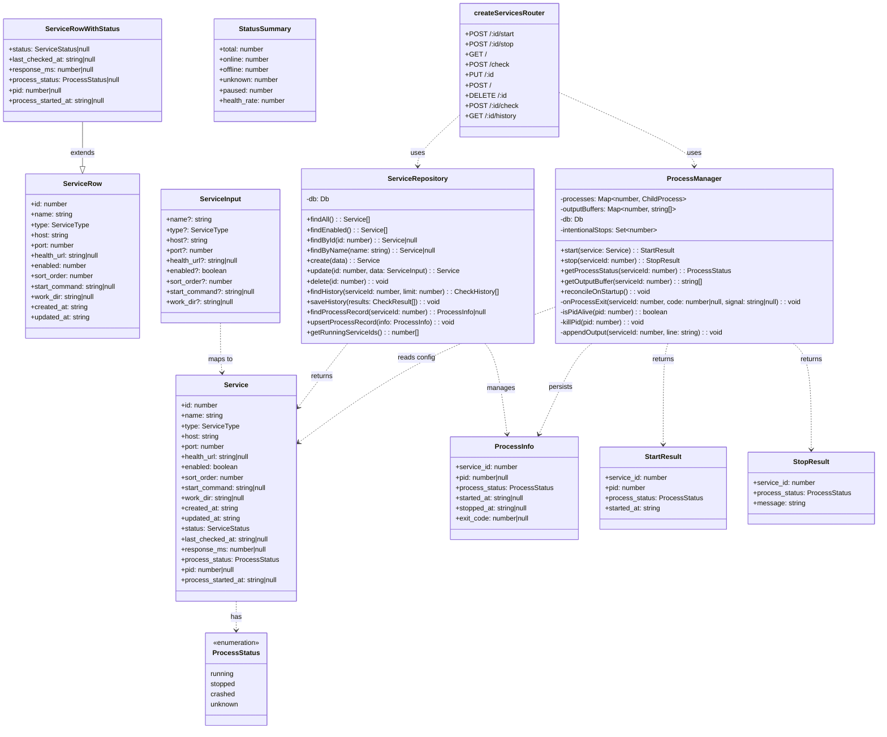
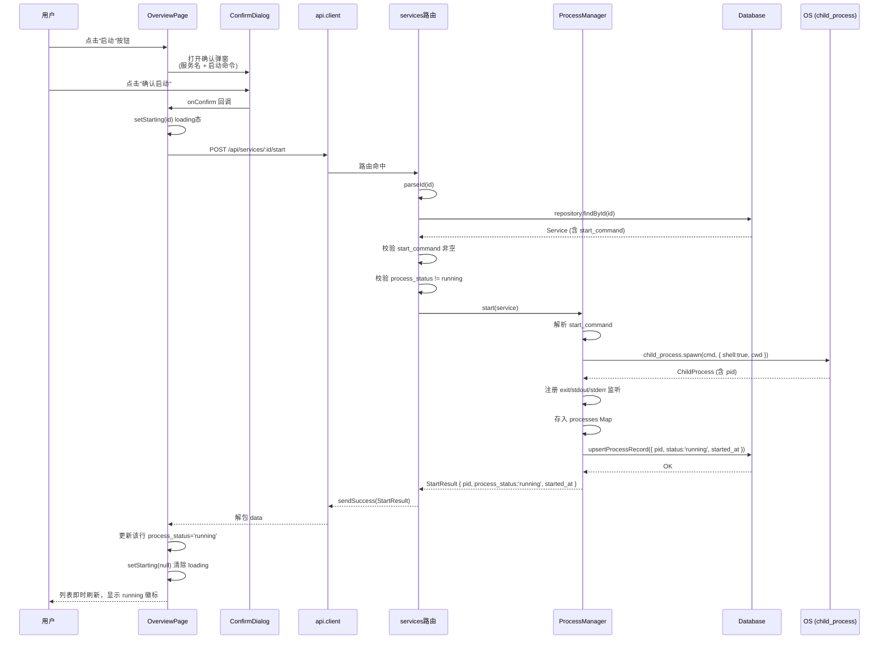
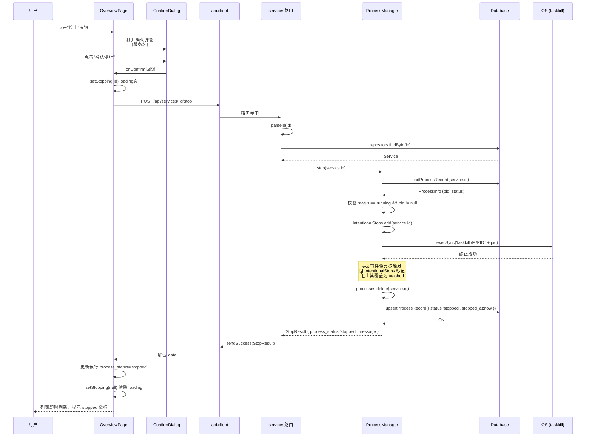
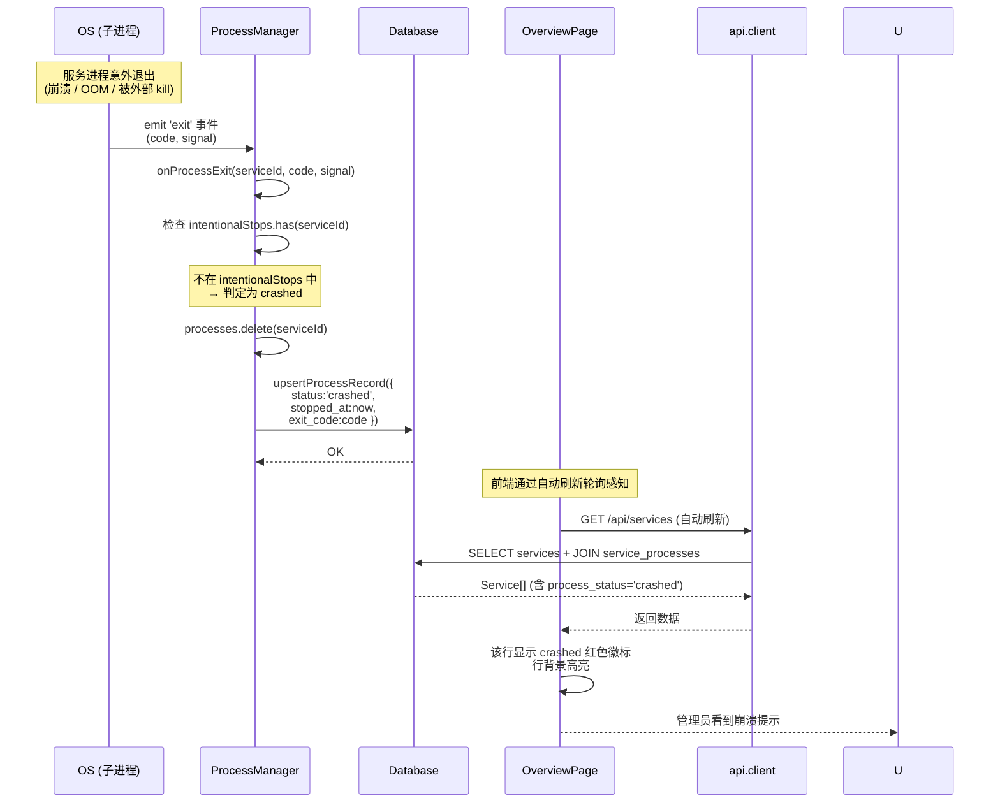
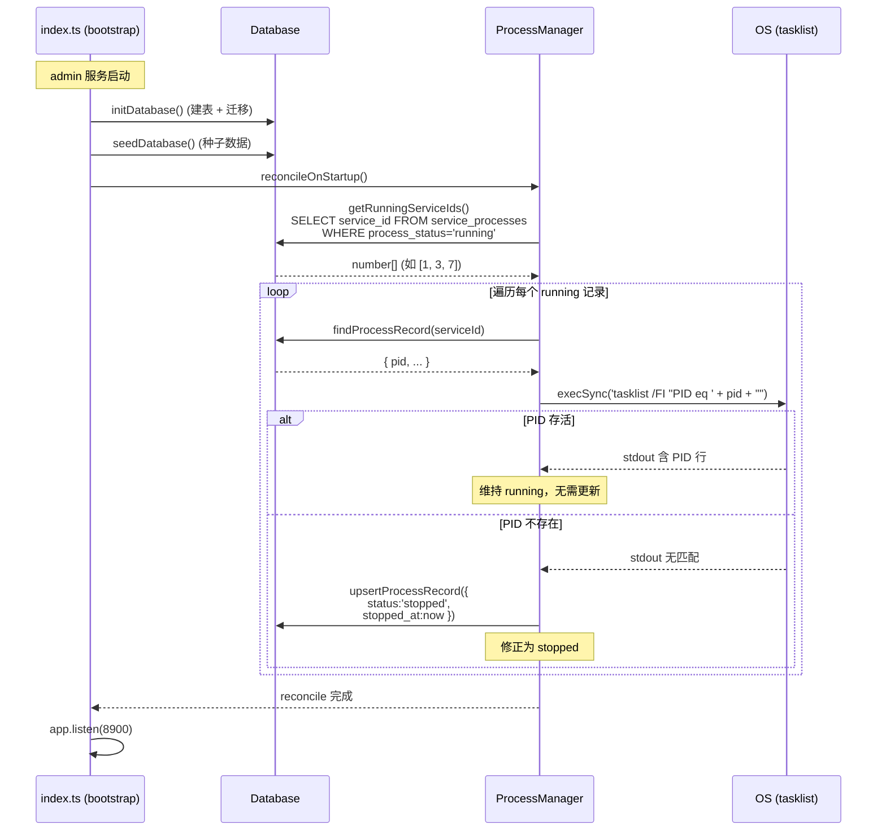
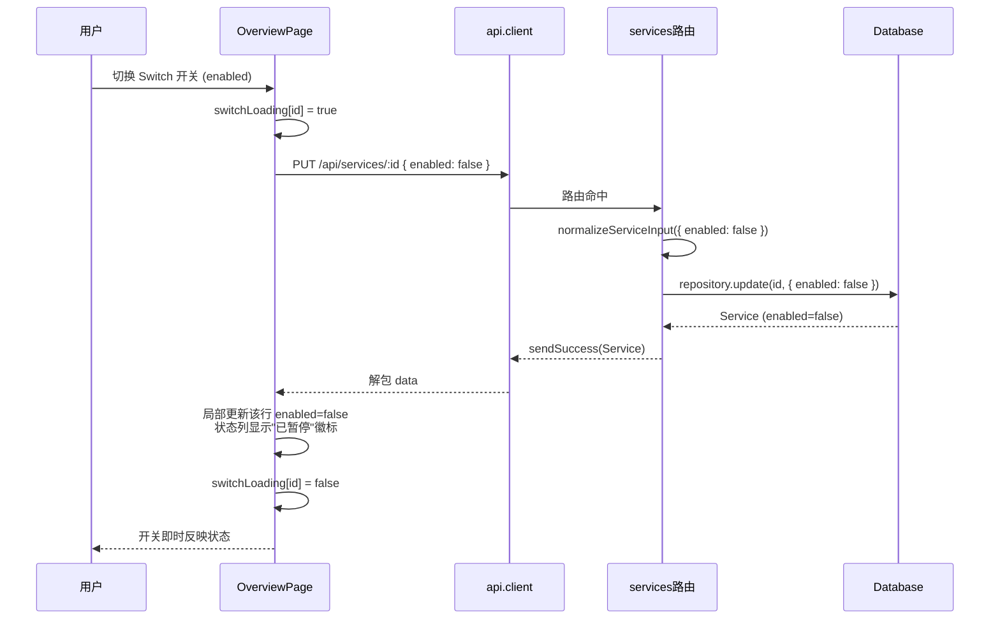

# LIS 运维后台 — 服务控制功能 架构设计 + 任务分解

> **文档版本**：v1.0 ｜ **日期**：2026-08-01 ｜ **作者**：架构师 高见远
> **关联文档**：`docs/prd-service-control.md`（PRD）、`docs/architecture.md`（系统总架构）
> **上游输入**：PRD v1.0（产品经理 许清楚）

---

## 一、实现方案 + 框架选型

### 1.1 核心技术挑战

| # | 挑战 | 方案 |
|---|------|------|
| C1 | **进程生命周期管理**：spawn 子进程后需持续追踪 PID、监听 exit 事件、区分主动停止与意外崩溃 | 内存 `ProcessManager` 单例持有 `Map<serviceId, ChildProcess>` + 数据库 `service_processes` 表持久化 PID/状态；exit 事件中通过 `intentionalStop` 标志位区分 stopped vs crashed |
| C2 | **admin 重启后状态一致性**：admin 进程重启后内存中 ChildProcess 引用全部丢失，数据库中记录的 PID 可能已被 OS 回收 | 启动时执行 `reconcileOnStartup()`：遍历 DB 中 `process_status='running'` 的记录，用 `tasklist /FI "PID eq xxx"` 检测 PID 存活，不存活则修正为 `stopped` |
| C3 | **数据库幂等迁移**：SQLite 不支持 `ADD COLUMN IF NOT EXISTS`，需在每次启动时安全执行 | 封装 `addColumnIfNotExists()` 工具函数，通过 `PRAGMA table_info` 检测列是否存在后再 ALTER |
| C4 | **监控状态与进程状态解耦**：暂停监控（enabled=false）的服务仍需展示进程状态，两套状态独立运作 | `Service` 对象同时携带 `status`（监控态）和 `process_status`（进程态），前端分列展示、独立更新 |
| C5 | **进程输出环形缓冲**：子进程 stdout/stderr 需缓存最近 N 行用于排查，但不落库 | `ProcessManager` 内部 `Map<serviceId, string[]>`，push 时超长截断，admin 重启后丢失（可接受） |

### 1.2 框架与库选型

| 层面 | 选型 | 理由 |
|------|------|------|
| 进程管理 | `node:child_process`（内置） | Node.js 内置模块，无需额外依赖；`spawn` + `shell:true` 可直接执行自由文本命令 |
| PID 存活检测 | `child_process.execSync('tasklist /FI "PID eq xxx"')` | Windows 原生命令，无需第三方库；解析 stdout 判断进程是否存在 |
| 进程终止 | `child_process.execSync('taskkill /F /PID xxx')` | Windows 强制终止，可靠且简单（Q7 决策） |
| 数据库迁移 | 手写 `addColumnIfNotExists` + `CREATE TABLE IF NOT EXISTS` | 项目已用 node:sqlite，无需引入 knex/typeorm 等迁移框架；迁移逻辑内聚在 `db/init.ts` |
| 前端状态 | 现有 Zustand（无变更） | 进程操作状态（loading）用组件局部 useState 即可，无需全局化 |
| 前端 UI | 现有 MUI 5（Switch / Dialog / Chip / IconButton） | 全部所需组件 MUI 已内置，无需新增依赖 |

**结论：无需新增任何 npm 依赖。**

### 1.3 架构模式

延续现有项目的分层架构：

```
┌─ 前端 (web/src/) ─────────────────────────────────────────────┐
│  pages/OverviewPage.tsx  ← 页面编排（表格 + 工具栏 + 弹窗）     │
│  components/             ← UI 组件（徽标 / 开关 / 确认框 / 配置）│
│  api/client.ts           ← API 客户端（axios + unwrap）         │
│  store/appStore.ts       ← 全局状态（Zustand）                  │
│  types/index.ts          ← 类型镜像（与后端对齐）                │
├─ 后端 (server/src/) ──────────────────────────────────────────┤
│  routes/services.ts      ← HTTP 路由 + ServiceRepository        │
│  services/processManager.ts ← 进程管理核心（NEW）               │
│  services/healthChecker.ts ← 健康检测（不变）                   │
│  db/init.ts              ← DDL + 迁移                           │
│  db/seed.ts              ← 种子数据                             │
│  config/defaults.ts      ← 常量 + 种子定义                      │
│  types/index.ts          ← 类型契约                             │
└───────────────────────────────────────────────────────────────┘
```

---

## 二、文件列表及相对路径

### 2.1 需修改的现有文件

| 文件路径 | 职责变更 |
|----------|----------|
| `server/src/db/init.ts` | 新增幂等迁移逻辑：`addColumnIfNotExists` 为 services 表添加 `start_command`/`work_dir` 列；新增 `service_processes` 建表语句；新增 backfill 逻辑为已有服务插入进程记录 |
| `server/src/types/index.ts` | 新增 `ProcessStatus` 类型；`ServiceRow` 添加 `start_command`/`work_dir`；`ServiceRowWithStatus` 添加进程 JOIN 字段；`Service` 添加 `start_command`/`work_dir`/`process_status`/`pid`/`process_started_at`；`ServiceInput` 添加 `start_command`/`work_dir`；`StatusSummary` 添加 `paused` 字段；新增 `ProcessInfo`/`StartResult`/`StopResult` 接口 |
| `server/src/config/defaults.ts` | 新增进程管理常量：`PROCESS_OUTPUT_BUFFER_LINES`（500）、`PROCESS_SPAWN_SHELL`（true）；`DefaultServiceSeed` 添加 `start_command`/`work_dir` 可选字段 |
| `server/src/routes/services.ts` | `SELECT_SERVICES_WITH_STATUS` SQL 新增 LEFT JOIN `service_processes`；`toService()` 映射进程字段；`normalizeServiceInput()` 支持 `start_command`/`work_dir`；`ServiceRepository` 新增 `findProcessRecord`/`upsertProcessRecord`/`getRunningServices` 方法；`summarize()` 改为接收 `Service[]` 并统计 `paused`；新增 `POST /:id/start`、`POST /:id/stop` 路由 |
| `server/src/routes/dashboard.ts` | `DashboardService.countServiceStatus()` 调用改造后的 `summarize()` 传入 `Service[]`；`DashboardSummary` 无需改动（`StatusSummary` 已扩展 `paused` 字段） |
| `server/src/index.ts` | `bootstrap()` 中 `seedDatabase()` 之后调用 `processManager.reconcileOnStartup()` 修复 admin 重启后的 PID 状态 |
| `server/src/db/seed.ts` | `DEFAULT_SERVICES` 种子数据可为每条服务预填 `start_command`（示例值，用户可后续修改） |
| `web/src/types/index.ts` | `Service` 接口添加 `start_command`/`work_dir`/`process_status`/`pid`/`process_started_at`；`ServiceSummary` 添加 `paused` 字段；新增 `ProcessStatus` 类型 |
| `web/src/api/client.ts` | 新增 `startService(id)` / `stopService(id)` API 方法 |
| `web/src/components/StatusBadge.tsx` | 支持 `enabled=false` 时显示"已暂停"徽标（灰色 outlined） |
| `web/src/components/OverviewCards.tsx` | 概览卡片新增"已暂停 N"卡片 |
| `web/src/components/ServiceConfigDialog.tsx` | 表单新增 `start_command`（multiline TextField）和 `work_dir`（TextField）输入项 |
| `web/src/pages/OverviewPage.tsx` | 表格新增"监控"列（Switch 开关）和"进程"列（ProcessStatusBadge）；操作列新增启动/停止按钮；集成 ConfirmDialog 确认弹窗；Switch 和按钮的 loading 态管理 |
| `web/src/utils/mergeCheckResults.ts` | 合并检测结果时保留 `process_status` 等进程字段（当前实现已用 spread 保留，确认不丢失即可，可能仅需类型对齐） |

### 2.2 需新建的文件

| 文件路径 | 职责 |
|----------|------|
| `server/src/services/processManager.ts` | **进程管理核心**。`ProcessManager` 单例类：`spawn`/`kill`/`reconcileOnStartup`/`getOutputBuffer`；内存持有 `Map<serviceId, ChildProcess>` + `Map<serviceId, string[]>` 输出缓冲；exit 事件处理（区分 crashed/stopped）；Windows `tasklist`/`taskkill` 封装 |
| `web/src/components/ProcessStatusBadge.tsx` | 进程状态徽标组件。根据 `process_status` + `start_command` 是否配置，展示 running（绿）/stopped（灰）/crashed（红）/unknown（灰虚线） |
| `web/src/components/ConfirmDialog.tsx` | 通用操作确认弹窗。Props：`open`/`title`/`content`/`confirmLabel`/`onConfirm`/`onCancel`/`loading`；用于启动/停止进程前的二次确认（P1-1） |

---

## 三、数据结构和接口

### 3.1 类图



### 3.2 新增数据库表结构

#### service_processes 表（NEW）

```sql
CREATE TABLE IF NOT EXISTS service_processes (
  service_id     INTEGER PRIMARY KEY,          -- 关联 services.id，1:1，作为主键
  pid            INTEGER,                       -- 操作系统进程 PID，null 表示未运行
  process_status TEXT NOT NULL DEFAULT 'unknown', -- running/stopped/crashed/unknown
  started_at     TEXT,                          -- 进程启动时间（ISO 8601）
  stopped_at     TEXT,                          -- 进程停止时间（ISO 8601）
  exit_code      INTEGER,                       -- 退出码，null 表示未退出或正常停止
  updated_at     TEXT NOT NULL DEFAULT (datetime('now')),
  FOREIGN KEY (service_id) REFERENCES services(id) ON DELETE CASCADE
);
CREATE INDEX IF NOT EXISTS idx_process_status ON service_processes(process_status);
```

#### services 表新增列（ALTER TABLE）

```sql
ALTER TABLE services ADD COLUMN start_command TEXT;        -- 启动命令，null 表示不支持进程管控
ALTER TABLE services ADD COLUMN work_dir TEXT;             -- 工作目录，null 表示使用默认目录
```

### 3.3 新增 API 端点签名

| 方法 | 路径 | 请求体 | 响应 data | 说明 |
|------|------|--------|-----------|------|
| POST | `/api/services/:id/start` | 无 | `StartResult` | 启动服务进程。校验：服务存在 + start_command 非空 + 当前非 running。返回 pid + started_at |
| POST | `/api/services/:id/stop` | 无 | `StopResult` | 停止服务进程。校验：服务存在 + 当前 running。taskkill 后更新状态为 stopped |

**StartResult**：
```typescript
{
  service_id: number;
  pid: number;
  process_status: 'running';
  started_at: string;  // ISO 8601
}
```

**StopResult**：
```typescript
{
  service_id: number;
  process_status: 'stopped';
  message: string;  // "进程已停止" 或 "进程未在运行"
}
```

**错误响应**（沿用现有 `{ code, message, data: null }` 格式）：

| 场景 | HTTP 状态码 | message |
|------|-------------|---------|
| 服务不存在 | 404 | `服务不存在: id=${id}` |
| 未配置启动命令 | 400 | `服务 ${name} 未配置启动命令` |
| 进程已在运行 | 409 | `服务 ${name} 进程已在运行 (PID=${pid})` |
| 进程未在运行 | 400 | `服务 ${name} 进程未在运行` |
| spawn 失败 | 500 | `启动进程失败: ${error.message}` |

### 3.4 类型定义变更摘要

**后端 `server/src/types/index.ts`**：

```typescript
/** 进程运行状态。unknown = 未配置启动命令或从未启动。 */
export type ProcessStatus = 'running' | 'stopped' | 'crashed' | 'unknown';

// ServiceRow 新增字段
export interface ServiceRow {
  // ... 现有字段 ...
  start_command: string | null;   // NEW
  work_dir: string | null;         // NEW
}

// ServiceRowWithStatus 新增 JOIN 字段
export interface ServiceRowWithStatus extends ServiceRow {
  // ... 现有字段 ...
  process_status: ProcessStatus | null;     // NEW (from service_processes JOIN)
  pid: number | null;                        // NEW
  process_started_at: string | null;         // NEW
}

// Service 对外接口新增字段
export interface Service {
  // ... 现有字段 ...
  start_command: string | null;              // NEW
  work_dir: string | null;                   // NEW
  process_status: ProcessStatus;             // NEW (兜底 'unknown')
  pid: number | null;                        // NEW
  process_started_at: string | null;         // NEW
}

// ServiceInput 新增可选字段
export interface ServiceInput {
  // ... 现有字段 ...
  start_command?: string | null;             // NEW
  work_dir?: string | null;                  // NEW
}

// StatusSummary 新增 paused 计数
export interface StatusSummary {
  total: number;
  online: number;
  offline: number;
  unknown: number;
  paused: number;                            // NEW
  health_rate: number;
}

// 新增接口
export interface ProcessInfo {
  service_id: number;
  pid: number | null;
  process_status: ProcessStatus;
  started_at: string | null;
  stopped_at: string | null;
  exit_code: number | null;
}

export interface StartResult {
  service_id: number;
  pid: number;
  process_status: 'running';
  started_at: string;
}

export interface StopResult {
  service_id: number;
  process_status: 'stopped';
  message: string;
}
```

**前端 `web/src/types/index.ts`** 镜像上述变更。

---

## 四、程序调用流程

### 4.1 启动进程流程



### 4.2 停止进程流程



### 4.3 进程意外退出流程



### 4.4 admin 重启后状态一致性流程



### 4.5 监控开关切换流程



---

## 五、任务列表

### 任务总览

| ID | 标题 | 优先级 | 依赖 |
|----|------|--------|------|
| T01 | 数据层基础：DB 迁移 + 前后端类型定义 + 配置常量 | P0 | 无 |
| T02 | 后端进程管理核心：ProcessManager + API 端点 + 启动钩子 | P0 | T01 |
| T03 | 前端数据层 + API 客户端 + 核心徽标组件 | P0 | T01 |
| T04 | 前端交互组件：配置弹窗 + 确认弹窗 + 概览卡片 | P0 | T01 |
| T05 | 页面集成 + 种子数据 + 仪表盘汇总 + 集成验证 | P0 | T02, T03, T04 |

---

### T01：数据层基础 — DB 迁移 + 前后端类型定义 + 配置常量

**涉及文件**：
- `server/src/db/init.ts`
- `server/src/types/index.ts`
- `server/src/config/defaults.ts`
- `web/src/types/index.ts`

**依赖**：无

**实现要点**：

1. **`server/src/db/init.ts`**：
   - 新增 `addColumnIfNotExists(db, table, column, definition)` 工具函数：通过 `PRAGMA table_info(table)` 检查列是否存在，不存在则 `ALTER TABLE ADD COLUMN`
   - 在 `initDatabase()` 中（`SCHEMA_SQL` 执行后）调用：
     - `addColumnIfNotExists(db, 'services', 'start_command', 'TEXT')`
     - `addColumnIfNotExists(db, 'services', 'work_dir', 'TEXT')`
   - 在 `SCHEMA_SQL` 字符串中追加 `service_processes` 建表语句（`CREATE TABLE IF NOT EXISTS`）+ 索引
   - 新增 backfill 逻辑：`INSERT OR IGNORE INTO service_processes (service_id, process_status) SELECT id, 'unknown' FROM services` — 为已有服务补充进程记录

2. **`server/src/types/index.ts`**：
   - 新增 `ProcessStatus` 类型：`'running' | 'stopped' | 'crashed' | 'unknown'`
   - `ServiceRow` 添加 `start_command: string | null`、`work_dir: string | null`
   - `ServiceRowWithStatus` 添加 `process_status: ProcessStatus | null`、`pid: number | null`、`process_started_at: string | null`
   - `Service` 添加 `start_command`、`work_dir`、`process_status`（兜底 `'unknown'`）、`pid`、`process_started_at`
   - `ServiceInput` 添加 `start_command?: string | null`、`work_dir?: string | null`
   - `StatusSummary` 添加 `paused: number`
   - 新增 `ProcessInfo`、`StartResult`、`StopResult` 接口

3. **`server/src/config/defaults.ts`**：
   - 新增 `PROCESS_OUTPUT_BUFFER_LINES = 500`（进程输出环形缓冲行数）
   - `DefaultServiceSeed` 接口添加 `start_command?: string | null`、`work_dir?: string | null`

4. **`web/src/types/index.ts`**：
   - 镜像后端变更：`Service` 添加 `start_command`、`work_dir`、`process_status`、`pid`、`process_started_at`
   - `ServiceSummary` 添加 `paused: number`
   - 新增 `ProcessStatus` 类型导出

---

### T02：后端进程管理核心 — ProcessManager + API 端点 + 启动钩子

**涉及文件**：
- `server/src/services/processManager.ts`（新建）
- `server/src/routes/services.ts`
- `server/src/index.ts`

**依赖**：T01

**实现要点**：

1. **`server/src/services/processManager.ts`（新建）**：
   - `ProcessManager` 类，单例模式（导出 `processManager` 实例）
   - 私有字段：`processes: Map<number, ChildProcess>`、`outputBuffers: Map<number, string[]>`、`intentionalStops: Set<number>`
   - **`start(service: Service): StartResult`**：
     - 校验 `service.start_command` 非空（否则抛 HttpError 400）
     - 校验 `processes.has(service.id)` 为 false（否则抛 HttpError 409）
     - `child_process.spawn(service.start_command, [], { shell: true, cwd: service.work_dir ?? undefined, stdio: ['ignore', 'pipe', 'pipe'] })`
     - 注册 `child.on('exit', (code, signal) => this.onProcessExit(service.id, code, signal))`
     - 注册 `child.stdout.on('data')` / `child.stderr.on('data')` → `appendOutput(service.id, line)`
     - `processes.set(service.id, child)`
     - `upsertProcessRecord({ service_id, pid: child.pid, process_status: 'running', started_at: nowIso() })`
     - 返回 `{ service_id, pid, process_status: 'running', started_at }`
   - **`stop(serviceId: number): StopResult`**：
     - 从 DB 获取 `ProcessInfo`，校验 `process_status === 'running'` 且 `pid != null`
     - `intentionalStops.add(serviceId)` — 标记主动停止
     - `execSync('taskkill /F /PID ' + pid)` — Windows 强制终止
     - `processes.delete(serviceId)`
     - `upsertProcessRecord({ service_id, process_status: 'stopped', stopped_at: nowIso() })`
     - 返回 `{ service_id, process_status: 'stopped', message: '进程已停止' }`
     - 注意：exit 事件会异步触发，`onProcessExit` 中检查 `intentionalStops` 跳过 crashed 标记
   - **`onProcessExit(serviceId, code, signal)`**（私有）：
     - `processes.delete(serviceId)`
     - 若 `intentionalStops.has(serviceId)` → `intentionalStops.delete(serviceId)` → return（stop 方法已更新状态）
     - 否则 → `upsertProcessRecord({ service_id, process_status: 'crashed', stopped_at: nowIso(), exit_code: code })`
   - **`reconcileOnStartup()`**：
     - 调用 `repository.getRunningServiceIds()` 获取所有 `process_status='running'` 的 service_id
     - 对每个 id：获取 pid → `isPidAlive(pid)` → 不存活则 `upsertProcessRecord({ process_status: 'stopped' })`
   - **`isPidAlive(pid): boolean`**（私有）：
     - `execSync('tasklist /FI "PID eq ' + pid + '" /NH /FO CSV')` → 解析 stdout 是否包含该 PID
   - **`appendOutput(serviceId, line)`**（私有）：
     - `buffer = outputBuffers.get(serviceId) ?? []`
     - `buffer.push(line)` → 若 `buffer.length > 500` → `buffer.shift()`
     - `outputBuffers.set(serviceId, buffer)`
   - **`getOutputBuffer(serviceId): string[]`**：返回缓冲副本（P2 功能预留，本期不暴露 API）

2. **`server/src/routes/services.ts`**：
   - **修改 `SELECT_SERVICES_WITH_STATUS`**：追加 `LEFT JOIN service_processes sp ON sp.service_id = s.id`，SELECT 中增加 `sp.process_status`、`sp.pid`、`sp.started_at AS process_started_at`
   - **修改 `toService()`**：映射 `process_status: row.process_status ?? 'unknown'`、`pid: row.pid ?? null`、`process_started_at: row.process_started_at ?? null`、`start_command: row.start_command ?? null`、`work_dir: row.work_dir ?? null`
   - **修改 `normalizeServiceInput()`**：增加 `start_command`（string 或 null）和 `work_dir`（string 或 null）的校验与归一化
   - **修改 `ServiceRepository.update()`**：UPDATE SQL 增加 `start_command`、`work_dir` 字段
   - **修改 `ServiceRepository.create()`**：INSERT SQL 增加 `start_command`、`work_dir` 字段
   - **新增 `ServiceRepository` 方法**：
     - `findProcessRecord(serviceId): ProcessInfo | null`
     - `upsertProcessRecord(info: ProcessInfo): void`（INSERT OR REPLACE）
     - `getRunningServiceIds(): number[]`（SELECT service_id WHERE process_status='running'）
   - **修改 `summarize()`**：改为接收 `Service[]`（而非 `string[]`），遍历时先判断 `enabled`：false → `paused++`，true → 按 status 计入 online/offline/unknown。`health_rate = online / total * 100`
   - **修改 GET `/`**：`summarize(services)` 传 `Service[]`
   - **修改 POST `/check`**：`summarize(results.map(r => ({ status: r.status, enabled: true })))` — 检测结果均为 enabled，paused=0
   - **新增路由 POST `/:id/start`**：
     ```typescript
     router.post('/:id/start', (req, res) => {
       const id = parseId(req.params.id);
       const service = repository.findById(id);
       if (!service) throw new HttpError(404, `服务不存在: id=${id}`);
       const result = processManager.start(service);
       sendSuccess(res, result);
     });
     ```
   - **新增路由 POST `/:id/stop`**：
     ```typescript
     router.post('/:id/stop', (req, res) => {
       const id = parseId(req.params.id);
       const service = repository.findById(id);
       if (!service) throw new HttpError(404, `服务不存在: id=${id}`);
       const result = processManager.stop(id);
       sendSuccess(res, result);
     });
     ```
   - **`createServicesRouter` 签名不变**：`ProcessManager` 作为模块级单例引入，不需注入

3. **`server/src/index.ts`**：
   - 在 `seedDatabase()` 之后、`createApp()` 之前调用 `processManager.reconcileOnStartup()`
   - 新增 `import { processManager } from './services/processManager'`

---

### T03：前端数据层 + API 客户端 + 核心徽标组件

**涉及文件**：
- `web/src/api/client.ts`
- `web/src/components/StatusBadge.tsx`
- `web/src/components/ProcessStatusBadge.tsx`（新建）
- `web/src/components/OverviewCards.tsx`

**依赖**：T01（需要前端类型定义）

**实现要点**：

1. **`web/src/api/client.ts`**：
   - 新增 `startService: (id: number) => unwrap<StartResult>(http.post(`/services/${id}/start`))`
   - 新增 `stopService: (id: number) => unwrap<StopResult>(http.post(`/services/${id}/stop`))`
   - 在 import 中添加 `StartResult`、`StopResult` 类型

2. **`web/src/components/StatusBadge.tsx`**：
   - Props 新增 `enabled?: boolean`（默认 true）
   - 当 `enabled === false` 时，直接返回"已暂停"徽标（灰色 outlined Chip），不显示 online/offline/unknown
   - 当 `enabled === true` 时，保持现有逻辑

3. **`web/src/components/ProcessStatusBadge.tsx`（新建）**：
   - Props：`processStatus: ProcessStatus`、`hasStartCommand: boolean`
   - 配置映射：
     - `running` → 绿色 filled，label="运行中"
     - `stopped` → 灰色 filled，label="已停止"
     - `crashed` → 红色 filled，label="已崩溃"
     - `unknown` + `hasStartCommand=false` → 灰色 outlined dashed，label="未配置"
     - `unknown` + `hasStartCommand=true` → 灰色 outlined，label="未启动"
   - 使用 MUI `Chip` 组件，风格与 `StatusBadge` 保持一致

4. **`web/src/components/OverviewCards.tsx`**：
   - 新增"已暂停"卡片：`<StatCard label="已暂停" value={summary.paused} color="#757575" />`
   - Grid 布局从 4 列调整为 5 列：在线 / 离线 / 已暂停 / 总数 / 健康率
   - `Grid item` 的 `xs/md` 断点调整以适配 5 列（如 `xs={6} md={2.4}` → 实际用 `xs={12} sm={6} md={true}` 自适应）

---

### T04：前端交互组件 — 配置弹窗 + 确认弹窗 + 纯函数对齐

**涉及文件**：
- `web/src/components/ServiceConfigDialog.tsx`
- `web/src/components/ConfirmDialog.tsx`（新建）
- `web/src/store/appStore.ts`
- `web/src/utils/mergeCheckResults.ts`

**依赖**：T01（需要前端类型定义）

**实现要点**：

1. **`web/src/components/ServiceConfigDialog.tsx`**：
   - `form` state 新增 `start_command: string`、`work_dir: string`
   - `useEffect` 初始化时：编辑模式从 `service.start_command ?? ''`、`service.work_dir ?? ''` 读取
   - 新增两个 TextField：
     - **启动命令**：`multiline`、`fullWidth`、`rows={2}`，placeholder=`java -jar D:\path\to\lis-gateway.jar`，helperText=`用于进程启动/停止功能；留空则该服务仅支持监控`
     - **工作目录**（可选）：placeholder=`D:\path\to\service`，helperText=`进程启动的工作目录，留空使用默认目录`
   - `save()` 方法 payload 新增 `start_command: form.start_command || null`、`work_dir: form.work_dir || null`

2. **`web/src/components/ConfirmDialog.tsx`（新建）**：
   - 通用确认弹窗，基于 MUI `Dialog`
   - Props 接口：
     ```typescript
     interface ConfirmDialogProps {
       open: boolean;
       title: string;
       children: React.ReactNode;       // 弹窗内容（服务名、命令等）
       confirmLabel: string;             // 确认按钮文字，如"确认启动"
       confirmColor?: 'primary' | 'error' | 'success';  // 确认按钮颜色
       loading?: boolean;
       onConfirm: () => void;
       onCancel: () => void;
     }
     ```
   - 布局：DialogTitle + DialogContent(children) + DialogActions(取消 + 确认)
   - 确认按钮支持 loading 态（CircularProgress）

3. **`web/src/store/appStore.ts`**：
   - 无结构性变更。`Service` 类型已在 T01 扩展，store 中的 `services: Service[]` 自动包含新字段
   - 如需追踪进程操作 loading 态，建议用组件局部 useState 而非全局 store（保持简单）

4. **`web/src/utils/mergeCheckResults.ts`**：
   - 当前实现使用 `{ ...service, status, response_ms, last_checked_at }` spread，会自动保留 `process_status` 等新字段
   - 确认类型对齐即可，可能无需代码修改（但需验证 TypeScript 编译通过）

---

### T05：页面集成 + 种子数据 + 仪表盘汇总 + 集成验证

**涉及文件**：
- `web/src/pages/OverviewPage.tsx`
- `server/src/db/seed.ts`
- `server/src/routes/dashboard.ts`

**依赖**：T02、T03、T04

**实现要点**：

1. **`web/src/pages/OverviewPage.tsx`**：
   - **表格列调整**：表头从 7 列变为 9 列：服务名 | 类型 | 地址 | **监控** | **进程** | 状态 | 最后检测 | 耗时 | 操作
   - **"监控"列**：MUI `Switch` 组件，`checked={s.enabled}`，`onChange` 时调用 `api.updateService(s.id, { enabled: !s.enabled })`，切换时显示 `CircularProgress` loading 态（局部 state `switchLoading: Record<number, boolean>`）
   - **"进程"列**：`<ProcessStatusBadge processStatus={s.process_status} hasStartCommand={!!s.start_command} />`
   - **"状态"列**：`<StatusBadge status={s.status} enabled={s.enabled} />` — 传入 enabled 支持"已暂停"显示
   - **行高亮**：crashed 行背景 `#fdecea`（与现有 offline 高亮逻辑合并：`s.status === 'offline' || s.process_status === 'crashed'`）
   - **操作列新增按钮**：
     - 启动按钮（PlayArrow 图标，绿色）：`disabled={s.process_status === 'running' || !s.start_command}`，点击打开 ConfirmDialog
     - 停止按钮（Stop 图标，红色）：`disabled={s.process_status !== 'running'}`，点击打开 ConfirmDialog
   - **ConfirmDialog 集成**：
     - 局部 state：`confirmAction: { type: 'start' | 'stop'; service: Service } | null`
     - 确认回调：调用 `api.startService(id)` 或 `api.stopService(id)`，成功后局部更新该行 `process_status`
     - loading 态：`actionLoading: Record<number, boolean>`
   - **操作后即时更新**：成功响应后，用 `setServices` 更新 services 数组中对应行的 `process_status` / `pid`，无需重新拉取全量列表
   - **colSpan 调整**：空状态行从 `colSpan={7}` 改为 `colSpan={9}`

2. **`server/src/db/seed.ts`**：
   - `DEFAULT_SERVICES` 中为每条服务预填 `start_command` 示例（用户可后续修改）
   - 示例：`lis-gateway` → `start_command: 'java -jar D:\\lis\\services\\lis-gateway\\lis-gateway.jar'`，`work_dir: 'D:\\lis\\services\\lis-gateway'`
   - 也可留空（`null`），由用户在 UI 自行配置 — **建议预填示例值便于测试，但标注为示例**
   - INSERT SQL 需同步添加 `start_command`、`work_dir` 列

3. **`server/src/routes/dashboard.ts`**：
   - `DashboardService.countServiceStatus()` 改为：`summarize(this.serviceRepository.findAll())` — 传入 `Service[]` 而非 `string[]`
   - `buildHealthPie()` 可选增加"已暂停"分片：`{ name: '已暂停', value: status.paused }`
   - `DashboardSummary` 接口无需改动（`StatusSummary` 已扩展 `paused` 字段，前端自动获取）

4. **集成验证清单**（工程师自行验证）：
   - [ ] `npm run build`（server）通过，无 TypeScript 错误
   - [ ] `npm run build`（web）通过，无 TypeScript 错误
   - [ ] 启动 admin 后端，数据库迁移成功（services 表新增列 + service_processes 表创建）
   - [ ] 前端服务总览页显示 9 列表格，监控 Switch 正确反映 enabled 状态
   - [ ] 切换 Switch → PUT 请求成功 → 状态列显示"已暂停" → 概览卡片"已暂停"+1
   - [ ] 服务配置弹窗显示启动命令 + 工作目录输入框
   - [ ] 配置启动命令后，点击启动 → 确认弹窗 → 进程拉起 → 进程列显示"运行中"
   - [ ] 点击停止 → 确认弹窗 → taskkill → 进程列显示"已停止"
   - [ ] 手动 kill 子进程 → 自动刷新后显示"已崩溃" + 红底高亮
   - [ ] 重启 admin 后端 → 之前 running 的进程若仍存活则维持 running，若已退出则修正为 stopped

---

## 六、依赖包列表

**无需新增任何 npm 依赖。**

所有功能均基于现有技术栈实现：
- 后端：`node:child_process`（内置）、`node:sqlite`（内置）、Express（已有）
- 前端：MUI 5 Switch/Dialog/Chip/IconButton（已有）、axios（已有）、Zustand（已有）

---

## 七、共享知识（跨文件约定）

### 7.1 前后端类型契约

- **类型镜像**：`server/src/types/index.ts` 为权威定义，`web/src/types/index.ts` 必须保持镜像对齐。新增字段时两个文件同步修改
- **字段命名**：数据库列名和 API 传输字段统一使用 `snake_case`（如 `process_status`、`start_command`、`work_dir`、`process_started_at`）
- **布尔转换**：数据库中 `enabled` 存储为 `0/1` 整数，`toService()` 转为 `boolean`，API 请求/响应用 `boolean`
- **进程状态枚举**：`ProcessStatus = 'running' | 'stopped' | 'crashed' | 'unknown'`，前后端共用

### 7.2 数据库字段约定

- **services 表**：纯配置数据（name, type, host, port, health_url, enabled, sort_order, start_command, work_dir）
- **service_processes 表**：运行时状态数据（pid, process_status, started_at, stopped_at, exit_code），以 `service_id` 为主键（1:1）
- **时间格式**：所有时间字段使用 `datetime('now')`（SQLite 本地时间）或 `nowIso()`（ISO 8601 UTC），与现有约定一致
- **迁移幂等性**：`addColumnIfNotExists` + `CREATE TABLE IF NOT EXISTS` + `INSERT OR IGNORE` 确保每次启动安全执行

### 7.3 API 响应格式约定

- **统一封装**：所有 API 返回 `{ code: number, message: string, data: T }`，`code=0` 表示成功
- **HTTP 状态码**：200（成功）/ 400（参数错误）/ 404（不存在）/ 409（冲突，如重复启动）/ 500（服务器错误）
- **进程操作响应**：`start` 返回 `StartResult`（含 pid），`stop` 返回 `StopResult`（含 message）
- **前端解包**：`api.client` 的 `unwrap()` 函数自动检查 `code=0` 并提取 `data`

### 7.4 进程管理约定

- **单例模式**：`ProcessManager` 为模块级单例，整个 admin 生命周期共享一个实例
- **intentionalStops 标志**：`stop()` 调用前设置，`onProcessExit()` 检查后清除，防止主动停止被误判为 crashed
- **输出缓冲**：内存环形缓冲最近 500 行，admin 重启后丢失（Q8 决策），不落库
- **shell 执行**：`spawn(command, [], { shell: true })` 让操作系统 shell 解析命令字符串，支持路径含空格、管道等复杂命令
- **Windows 专有命令**：`tasklist /FI "PID eq xxx" /NH /FO CSV`（检测存活）、`taskkill /F /PID xxx`（强制终止）

### 7.5 前端状态管理约定

- **服务列表**：全局存储于 Zustand `appStore.services`，进程操作后局部更新对应行（不重新拉取全量列表）
- **操作 loading 态**：使用组件局部 `useState`（如 `switchLoading`、`actionLoading`），不污染全局 store
- **自动刷新**：现有自动刷新机制（`setInterval` → `checkAll`）会重新拉取服务列表，自动感知进程状态变化（crashed 等）

---

## 八、待明确事项

| # | 问题 | 影响 | 当前假设 | 建议后续处理 |
|---|------|------|----------|-------------|
| A1 | **种子数据 start_command 值** | T05 种子数据 | 预填示例值（如 `java -jar D:\lis\services\lis-gateway\lis-gateway.jar`），实际路径可能不正确 | 建议主理人提供 15 个服务各自的真实启动命令与工作目录，或种子数据留空由用户在 UI 自行配置 |
| A2 | **summarize 函数签名变更影响** | T02 | 将 `summarize(string[])` 改为 `summarize(Service[])`，`dashboard.ts` 和 `services.ts` 的调用方需同步修改 | 工程师实现时需全局搜索 `summarize(` 调用点确保全部适配 |
| A3 | **POST /check 的 summary 计算** | T02 | 检测结果（CheckResult[]）不含 `enabled` 字段，summarize 改造后需传入 `{ status, enabled: true }[]` 形式 | 工程师可选择为 CheckResult 添加 `enabled` 字段，或在调用处 map 为 `Service[]` 子集 |
| A4 | **graceful shutdown（优雅停止）** | P2 | 本期使用 `taskkill /F`（强制终止），不等待请求处理完成 | P2 阶段可扩展：先调用 Spring Boot actuator shutdown 端点，超时后再 taskkill |
| A5 | **PID 复用风险** | P1-3 | 本期仅做 PID 存活检测（tasklist），不校验进程名。OS 可能将已退出进程的 PID 分配给新进程 | P2 阶段增强为 PID + 进程名双校验（`tasklist /FI "PID eq xxx" /FI "IMAGENAME eq java.exe"`） |
| A6 | **多实例/集群场景** | 架构限制 | 本期设计假设 admin 与所有微服务运行在同一 Windows Server 上，spawn 本地进程 | 如需远程主机进程管控，需引入 SSH 或 Agent 机制，属于架构级变更 |
