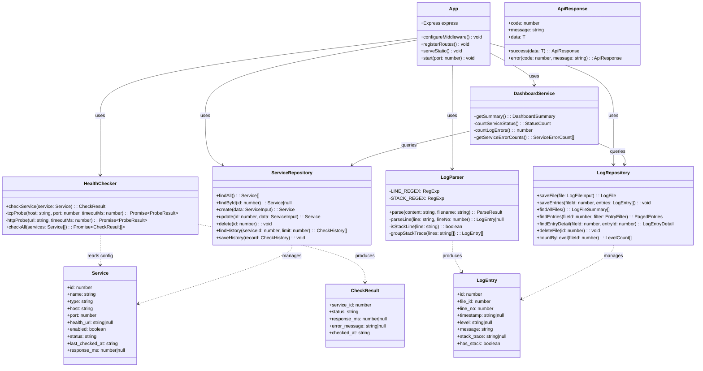
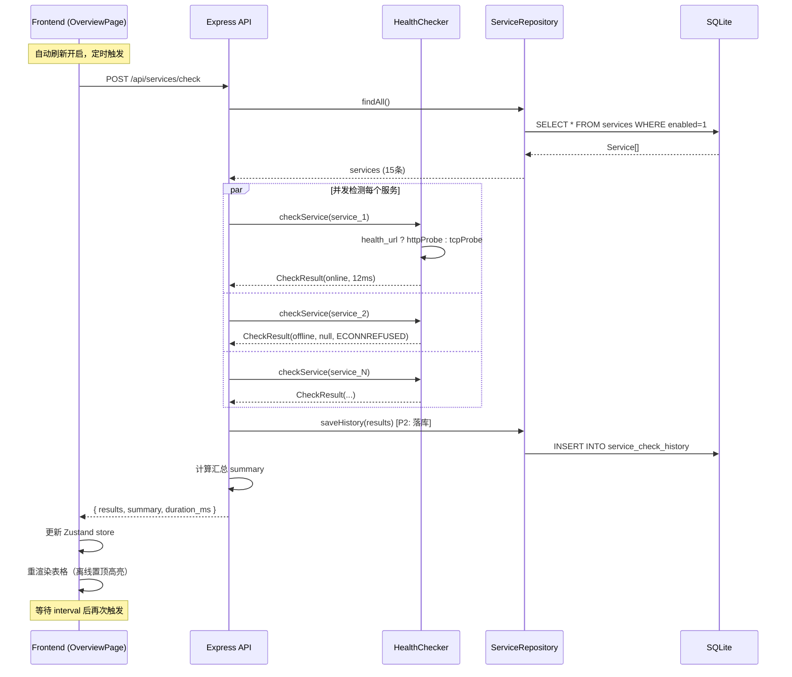
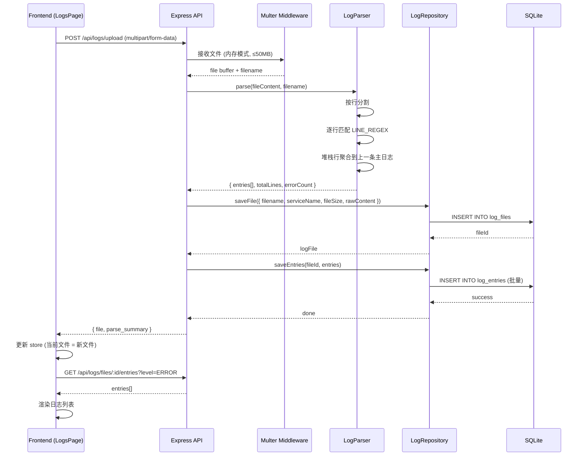
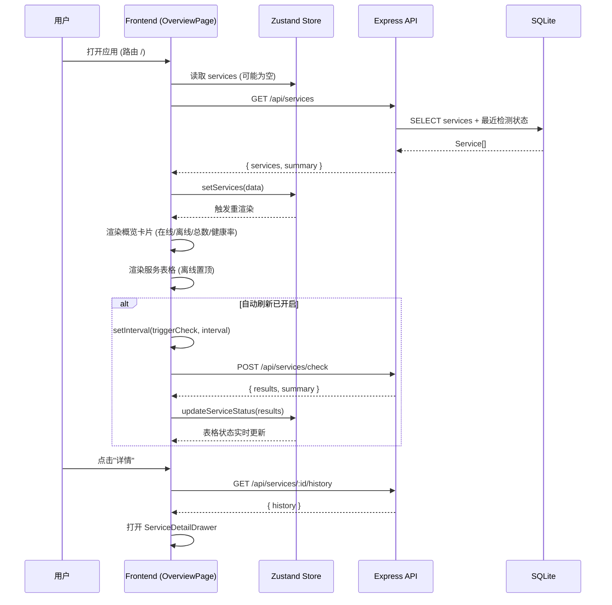

# LIS 运维后台管理系统 — 系统架构设计文档

> **文档版本**：v1.0 ｜ **日期**：2026-07-31 ｜ **作者**：架构师 高见远
> **上游输入**：`docs/prd.md`（产品经理 许清楚）
> **技术栈决策**：主理人已拍板（前端 React+MUI+Tailwind / 后端 Node+Express+TS+SQLite）

---

## 1. 实现方案与框架选型

### 1.1 核心技术挑战

| 挑战 | 解决方案 |
|------|---------|
| LIS 无注册中心、无 Actuator，无法被动获取服务状态 | 自建可配置服务注册表 + 主动健康检查引擎（TCP 端口探测为主，可选 HTTP 探测） |
| 全量 15 个服务检测需 ≤10s | `Promise.all` 并发探测，单服务超时 ≤3s，TCP 连接用 `net.Socket` 短超时 |
| 日志按 Spring Boot 标准行格式结构化解析 | 正则匹配标准行 + 堆栈行聚合算法（连续缩进/`at `/`Caused by` 归属上一条主日志） |
| 前后端独立部署且前端可由后端托管 | 开发期 Vite dev server (8901) 经 proxy 转发 `/api` → 后端 (8900)；生产期后端 Express 托管 `web/dist` 静态文件 |
| 历史趋势 P2 落库预留 | 预建 `service_check_history` 表结构，定时检测写入，前端 P2 阶段接入 |

### 1.2 技术栈确认与理由

#### 前端
| 技术 | 版本 | 用途 |
|------|------|------|
| Vite | ^5.x | 构建工具，开发热更新快 |
| React | ^18.x | UI 框架 |
| TypeScript | ^5.x | 类型安全 |
| MUI (Material UI) | ^5.x | 组件库（表格/抽屉/对话框/卡片等开箱即用） |
| Tailwind CSS | ^3.x | 原子化 CSS，快速布局与状态色彩 |
| Axios | ^1.x | HTTP 请求 |
| ECharts | ^5.x | 仪表盘图表（饼图/柱状图） |
| Zustand | ^4.x | 轻量状态管理（服务列表/日志文件/自动刷新状态） |
| React Router | ^6.x | 页面路由 |

#### 后端
| 技术 | 版本 | 用途 |
|------|------|------|
| Node.js | ≥18 LTS | 运行时 |
| Express | ^4.x | HTTP 服务框架 |
| TypeScript | ^5.x | 类型安全 |
| better-sqlite3 | ^11.x | SQLite 驱动（同步 API，无需 ORM，零配置部署） |
| multer | ^1.x | 日志文件上传（multipart/form-data） |
| tsx | ^4.x | 开发期直接运行 TS（生产 `tsc` 编译后 `node` 运行） |
| cors | ^2.x | CORS 中间件 |

### 1.3 前后端通信与部署

```
开发模式:
  浏览器 → http://localhost:8901 (Vite dev)
               │ /api/* 请求经 vite proxy 转发
               ▼
  Express API → http://localhost:8900/api/*
  Express → SQLite (server/data/lis_admin.db)

生产模式:
  浏览器 → http://localhost:8900
               │
               ├── /api/* → Express 路由处理
               └── /*     → Express 静态托管 web/dist
  Express → SQLite (server/data/lis_admin.db)
```

---

## 2. 目录与文件列表

```
D:\traeitem\labWork\ALLcontrll\
├── README.md                              # 项目说明、启动方式、部署指南
├── package.json                           # 根 workspace（统一 scripts）
├── .gitignore
├── docs/
│   ├── prd.md                             # 产品需求文档（已有）
│   └── architecture.md                    # 本文档
│
├── server/                                # ===== 后端 =====
│   ├── package.json                       # 后端依赖
│   ├── tsconfig.json                      # TS 编译配置
│   ├── .env.example                       # 环境变量示例
│   ├── data/                              # SQLite 数据目录（gitignored）
│   │   └── .gitkeep
│   └── src/
│       ├── index.ts                       # 入口：启动 Express 服务 (端口 8900)
│       ├── app.ts                         # Express 应用配置（CORS/JSON/路由/静态托管/错误处理）
│       ├── config/
│       │   └── defaults.ts                # 默认 15 条服务注册表 + 配置常量
│       ├── db/
│       │   ├── connection.ts              # better-sqlite3 连接单例
│       │   ├── init.ts                    # 建表 DDL + 索引
│       │   └── seed.ts                    # 首次启动写入默认 15 条服务
│       ├── types/
│       │   └── index.ts                   # 后端 TS 接口定义
│       ├── services/
│       │   ├── healthChecker.ts           # TCP/HTTP 健康探测 + 并发执行
│       │   └── logParser.ts              # Spring Boot 日志行解析 + 堆栈聚合
│       ├── routes/
│       │   ├── services.ts                # 服务 CRUD + 手动检测 + 检测历史
│       │   ├── logs.ts                    # 日志上传 + 文件管理 + 条目查询
│       │   └── dashboard.ts              # 仪表盘汇总数据
│       └── utils/
│           └── response.ts               # 统一响应封装 {code,message,data}
│
└── web/                                   # ===== 前端 =====
    ├── package.json                       # 前端依赖
    ├── tsconfig.json
    ├── vite.config.ts                     # Vite 配置 + /api 代理 → 8900
    ├── tailwind.config.ts
    ├── postcss.config.js
    ├── index.html
    └── src/
        ├── main.tsx                       # React 入口（挂载 MUI ThemeProvider + Router）
        ├── App.tsx                        # 路由定义 + Layout 组装
        ├── types/
        │   └── index.ts                   # 前端 TS 接口（与后端镜像）
        ├── api/
        │   └── client.ts                  # Axios 实例 + 全部 API 方法封装
        ├── store/
        │   └── appStore.ts               # Zustand 全局状态（服务列表/日志文件/自动刷新配置/仪表盘数据）
        ├── theme/
        │   └── index.ts                   # MUI 主题 + Tailwind 协调
        ├── components/
        │   ├── Layout.tsx                 # 主布局（左侧导航 + 顶部栏 + 内容区）
        │   ├── StatusBadge.tsx            # 状态徽标（在线绿/离线红/未知灰）
        │   ├── OverviewCards.tsx          # 概览卡片（在线/离线/总数/健康率）
        │   ├── ServiceConfigDialog.tsx    # 服务注册表配置弹窗（表格化增删改）
        │   ├── ServiceDetailDrawer.tsx    # 服务详情抽屉（检测历史时间线 + 关联日志）
        │   ├── LogUploadZone.tsx          # 日志上传区（拖拽 + 点击选择）
        │   ├── LogDetailDrawer.tsx        # 日志详情抽屉（完整消息 + 堆栈 + 复制）
        │   └── charts/
        │       ├── HealthPieChart.tsx     # 服务健康率饼图
        │       └── ErrorBarChart.tsx      # 各服务异常计数柱状图
        ├── pages/
        │   ├── OverviewPage.tsx           # 服务状态总览页（默认首页）
        │   ├── LogsPage.tsx              # 异常日志查看页
        │   └── DashboardPage.tsx         # 仪表盘页
        └── styles/
            └── globals.css                # Tailwind 指令 + 全局样式
```

---

## 3. 数据结构

### 3.1 SQLite 表结构

#### 表 `services` — 服务注册表
```sql
CREATE TABLE services (
  id            INTEGER PRIMARY KEY AUTOINCREMENT,
  name          TEXT NOT NULL UNIQUE,        -- 服务名，如 lis-gateway
  type          TEXT NOT NULL DEFAULT 'backend',  -- 'backend' | 'frontend'
  host          TEXT NOT NULL DEFAULT '127.0.0.1',
  port          INTEGER NOT NULL,             -- 端口号
  health_url    TEXT,                         -- 可选 HTTP 健康探测 URL（NULL=用TCP）
  enabled       INTEGER NOT NULL DEFAULT 1,   -- 1=启用检测, 0=停用
  sort_order    INTEGER NOT NULL DEFAULT 0,   -- 排序
  created_at    TEXT NOT NULL DEFAULT (datetime('now')),
  updated_at    TEXT NOT NULL DEFAULT (datetime('now'))
);
CREATE INDEX idx_services_type ON services(type);
CREATE INDEX idx_services_enabled ON services(enabled);
```

#### 表 `service_check_history` — 检测历史（P2 落库，P0 阶段预建表）
```sql
CREATE TABLE service_check_history (
  id              INTEGER PRIMARY KEY AUTOINCREMENT,
  service_id      INTEGER NOT NULL,
  status          TEXT NOT NULL,              -- 'online' | 'offline' | 'unknown'
  response_ms     INTEGER,                    -- 响应耗时（毫秒），超时为 NULL
  error_message   TEXT,                       -- 离线时的错误信息
  checked_at      TEXT NOT NULL DEFAULT (datetime('now')),
  FOREIGN KEY (service_id) REFERENCES services(id) ON DELETE CASCADE
);
CREATE INDEX idx_history_service_time ON service_check_history(service_id, checked_at);
```

#### 表 `log_files` — 上传的日志文件
```sql
CREATE TABLE log_files (
  id            INTEGER PRIMARY KEY AUTOINCREMENT,
  filename      TEXT NOT NULL,               -- 原始文件名
  service_name  TEXT,                         -- 关联服务名（可空，用户选择或从日志推断）
  file_size     INTEGER NOT NULL,             -- 文件大小（字节）
  entry_count   INTEGER NOT NULL DEFAULT 0,   -- 解析出的日志条目数
  raw_content   TEXT,                          -- 原始文件内容（P0存文本，<50MB）
  uploaded_at   TEXT NOT NULL DEFAULT (datetime('now'))
);
CREATE INDEX idx_log_files_service ON log_files(service_name);
```

#### 表 `log_entries` — 解析后的日志条目
```sql
CREATE TABLE log_entries (
  id            INTEGER PRIMARY KEY AUTOINCREMENT,
  file_id       INTEGER NOT NULL,
  line_no       INTEGER NOT NULL,             -- 原文件行号
  timestamp     TEXT,                          -- 日志时间戳（解析后）
  level         TEXT,                          -- INFO/DEBUG/WARN/ERROR/TRACE
  pid           TEXT,                          -- 进程 PID
  thread        TEXT,                          -- 线程名
  logger        TEXT,                          -- logger 类名
  message       TEXT NOT NULL,                -- 日志消息
  stack_trace   TEXT,                          -- 完整堆栈文本（含 Caused by / at 行）
  has_stack     INTEGER NOT NULL DEFAULT 0,   -- 1=含异常堆栈
  raw_line      TEXT,                          -- 原始行文本
  FOREIGN KEY (file_id) REFERENCES log_files(id) ON DELETE CASCADE
);
CREATE INDEX idx_entries_file_level ON log_entries(file_id, level);
CREATE INDEX idx_entries_file_time ON log_entries(file_id, timestamp);
CREATE INDEX idx_entries_level ON log_entries(level);
```

### 3.2 后端核心模块类图



---

## 4. REST API 接口设计

> **统一响应格式**：所有接口返回 `{ "code": 0, "message": "ok", "data": <T> }`，code=0 表示成功，非 0 表示错误。HTTP 状态码同时反映语义（200/400/404/500）。

### 4.1 服务管理

#### `GET /api/services` — 获取全部服务（含最新状态）
**响应 data**:
```json
{
  "services": [
    {
      "id": 1,
      "name": "lis-gateway",
      "type": "backend",
      "host": "127.0.0.1",
      "port": 8080,
      "health_url": null,
      "enabled": true,
      "sort_order": 1,
      "status": "online",
      "last_checked_at": "2026-07-31T18:00:01.000Z",
      "response_ms": 12
    }
  ],
  "summary": { "total": 15, "online": 13, "offline": 2, "unknown": 0, "health_rate": 86.7 }
}
```

#### `POST /api/services` — 新增服务
**请求体**:
```json
{ "name": "lis-new-service", "type": "backend", "host": "127.0.0.1", "port": 8100, "health_url": null }
```
**响应 data**: 新建的 Service 对象

#### `PUT /api/services/:id` — 更新服务配置
**请求体**: 同新增（部分字段可选）
**响应 data**: 更新后的 Service 对象

#### `DELETE /api/services/:id` — 删除服务
**响应 data**: `{ "deleted": true }`

#### `POST /api/services/check` — 手动检测全部服务
**响应 data**:
```json
{
  "results": [
    { "service_id": 1, "name": "lis-gateway", "status": "online", "response_ms": 12, "error_message": null, "checked_at": "..." },
    { "service_id": 2, "name": "lis-frontend", "status": "offline", "response_ms": null, "error_message": "ECONNREFUSED", "checked_at": "..." }
  ],
  "summary": { "total": 15, "online": 13, "offline": 2, "health_rate": 86.7 },
  "duration_ms": 3210
}
```

#### `POST /api/services/:id/check` — 检测单个服务
**响应 data**: 单个 CheckResult 对象

#### `GET /api/services/:id/history` — 获取服务检测历史
**查询参数**: `limit` (默认 50)
**响应 data**:
```json
{ "history": [ { "id": 1, "status": "online", "response_ms": 12, "checked_at": "...", "error_message": null } ] }
```

### 4.2 日志管理

#### `POST /api/logs/upload` — 上传日志文件
**请求**: `multipart/form-data`，字段 `file` (日志文件) + 可选 `serviceName` (关联服务名)
**限制**: 单文件 ≤50MB，仅 `.log`/`.txt` 后缀
**响应 data**:
```json
{
  "file": {
    "id": 1,
    "filename": "lis-service-report.out.log",
    "service_name": "lis-service-report",
    "file_size": 102400,
    "entry_count": 1523,
    "uploaded_at": "2026-07-31T18:05:00.000Z"
  },
  "parse_summary": { "total_lines": 2000, "parsed_entries": 1523, "error_count": 27, "warn_count": 15 }
}
```

#### `GET /api/logs/files` — 获取已上传日志文件列表
**响应 data**:
```json
{
  "files": [
    { "id": 1, "filename": "lis-service-report.out.log", "service_name": "lis-service-report", "entry_count": 1523, "file_size": 102400, "uploaded_at": "..." }
  ]
}
```

#### `GET /api/logs/files/:fileId/entries` — 查询日志条目（带筛选/分页）
**查询参数**:
| 参数 | 类型 | 说明 |
|------|------|------|
| `level` | string | 级别筛选，逗号分隔如 `ERROR,WARN` |
| `keyword` | string | 关键字搜索（匹配 message/logger） |
| `start_time` | string | 起始时间 ISO 8601 |
| `end_time` | string | 结束时间 ISO 8601 |
| `has_stack` | boolean | 仅看含堆栈的条目 |
| `page` | number | 页码，默认 1 |
| `page_size` | number | 每页条数，默认 50 |

**响应 data**:
```json
{
  "entries": [
    {
      "id": 101,
      "line_no": 42,
      "timestamp": "2026-07-31T17:30:02.114+08:00",
      "level": "ERROR",
      "thread": "http-nio-8082-exec-1",
      "logger": "com.lis.report.controller.ReportController",
      "message": "NullPointerException at ReportService.java:120",
      "has_stack": true
    }
  ],
  "total": 27,
  "page": 1,
  "page_size": 50,
  "level_counts": { "ERROR": 27, "WARN": 15, "INFO": 1481 }
}
```

#### `GET /api/logs/files/:fileId/entries/:entryId` — 获取日志条目详情（含完整堆栈）
**响应 data**:
```json
{
  "entry": {
    "id": 101,
    "line_no": 42,
    "timestamp": "2026-07-31T17:30:02.114+08:00",
    "level": "ERROR",
    "pid": "16212",
    "thread": "http-nio-8082-exec-1",
    "logger": "com.lis.report.controller.ReportController",
    "message": "NullPointerException at ReportService.java:120",
    "stack_trace": "java.lang.NullPointerException\n\tat com.lis.report.service.ReportService.generate(ReportService.java:120)\n\tat ...\nCaused by: ...\n",
    "has_stack": true,
    "raw_line": "2026-07-31T17:30:02.114+08:00 ERROR 16212 --- [lis-service-report] [http-nio-8082-exec-1] c.l.r.c.ReportController : NullPointerException..."
  }
}
```

#### `DELETE /api/logs/files/:fileId` — 删除日志文件（级联删除条目）
**响应 data**: `{ "deleted": true }`

### 4.3 仪表盘

#### `GET /api/dashboard/summary` — 仪表盘汇总数据
**响应 data**:
```json
{
  "service_status": { "total": 15, "online": 13, "offline": 2, "unknown": 0, "health_rate": 86.7 },
  "log_summary": { "total_files": 3, "total_entries": 4569, "error_count": 27, "warn_count": 15 },
  "service_health_pie": [
    { "name": "在线", "value": 13 },
    { "name": "离线", "value": 2 }
  ],
  "service_error_counts": [
    { "service_name": "lis-service-sample", "error_count": 15 },
    { "service_name": "lis-service-report", "error_count": 12 }
  ]
}
```

---

## 5. 关键流程时序图

### 5.1 定时健康检查流程



### 5.2 日志上传解析流程



### 5.3 前端总览页加载流程



---

## 6. 任务列表

### T01: 项目基础设施搭建
- **优先级**: P0
- **依赖**: 无
- **源文件**:
  - `package.json`（根 workspace）
  - `.gitignore`
  - `server/package.json`
  - `server/tsconfig.json`
  - `server/.env.example`
  - `server/data/.gitkeep`
  - `server/src/index.ts`（入口骨架）
  - `web/package.json`
  - `web/tsconfig.json`
  - `web/vite.config.ts`（含 /api 代理 → 8900）
  - `web/tailwind.config.ts`
  - `web/postcss.config.js`
  - `web/index.html`
  - `web/src/main.tsx`（React 入口骨架）
- **说明**: 搭建 monorepo workspace 结构，前后端各自的 package.json 声明全部依赖（见第 7 节），TypeScript 配置，Vite 配置含开发代理，Tailwind/PostCSS 配置，入口文件骨架。工程师完成后即可 `npm install` 并启动空壳。

### T02: 后端数据层与核心服务
- **优先级**: P0
- **依赖**: T01
- **源文件**:
  - `server/src/config/defaults.ts`（默认 15 条服务 + 常量：端口/超时/文件大小限制）
  - `server/src/types/index.ts`（Service/LogFile/LogEntry/CheckResult 等接口）
  - `server/src/db/connection.ts`（better-sqlite3 单例）
  - `server/src/db/init.ts`（建表 DDL + 索引，4 张表）
  - `server/src/db/seed.ts`（首次启动写入默认 15 条服务）
  - `server/src/services/healthChecker.ts`（TCP/HTTP 探测 + 并发 checkAll）
  - `server/src/services/logParser.ts`（Spring Boot 行解析 + 堆栈聚合）
  - `server/src/utils/response.ts`（统一响应封装）
- **说明**: 实现数据库初始化与种子数据、全部 TypeScript 类型、健康检查引擎（TCP 用 `net.Socket`、HTTP 用 `fetch`/`http`、并发用 `Promise.all`）、日志解析器（正则见第 8 节）、统一响应工具函数。此任务完成后核心业务逻辑可用，但尚无 HTTP 端点暴露。

### T03: 后端 REST API 路由
- **优先级**: P0
- **依赖**: T02
- **源文件**:
  - `server/src/app.ts`（Express 应用：CORS + JSON + 路由注册 + 静态文件托管 + 错误处理）
  - `server/src/routes/services.ts`（服务 CRUD + 检测 + 历史，含 Repository 逻辑内联或拆出）
  - `server/src/routes/logs.ts`（上传 + 文件管理 + 条目查询/详情，multer 配置）
  - `server/src/routes/dashboard.ts`（仪表盘汇总）
  - 更新 `server/src/index.ts`（引入 app 并启动监听 8900）
- **说明**: 实现 Express 应用完整配置，所有 REST 端点（见第 4 节），含 CORS、静态托管 `web/dist`（生产模式）、multer 文件上传中间件、错误处理中间件。此任务完成后后端可独立运行并通过 API 测试。

### T04: 前端基础层（类型/API/状态/布局/主题）
- **优先级**: P0
- **依赖**: T01
- **源文件**:
  - `web/src/types/index.ts`（前端 TS 接口，与后端镜像）
  - `web/src/api/client.ts`（Axios 实例 + 全部 API 方法：getServices/checkServices/uploadLog/getEntries 等）
  - `web/src/store/appStore.ts`（Zustand store：services/logs/currentFile/autoRefresh/dashboard）
  - `web/src/theme/index.ts`（MUI 主题配置）
  - `web/src/styles/globals.css`（Tailwind 指令 + 全局样式）
  - `web/src/components/Layout.tsx`（左侧导航 + 顶部栏 + 自动刷新开关 + 内容区）
  - `web/src/components/StatusBadge.tsx`（状态徽标组件）
  - `web/src/App.tsx`（路由配置：/ → OverviewPage, /logs → LogsPage, /dashboard → DashboardPage）
- **说明**: 搭建前端基础设施——类型定义、API 客户端封装、全局状态管理、MUI 主题、主布局组件、路由配置。此任务完成后前端框架可运行，页面为占位状态。

### T05: 前端功能页面与集成
- **优先级**: P0 + P1
- **依赖**: T03（后端 API）, T04（前端基础层）
- **源文件**:
  - `web/src/pages/OverviewPage.tsx`（服务总览：表格 + 概览卡片 + 手动/自动刷新 + 离线置顶高亮）
  - `web/src/pages/LogsPage.tsx`（日志查看：上传区 + 筛选 + 列表 + 关键字高亮 + 分页）
  - `web/src/pages/DashboardPage.tsx`（仪表盘：汇总卡片 + ECharts 图表）
  - `web/src/components/OverviewCards.tsx`（在线/离线/总数/健康率卡片）
  - `web/src/components/ServiceConfigDialog.tsx`（服务注册表配置弹窗：表格化增删改）
  - `web/src/components/ServiceDetailDrawer.tsx`（服务详情抽屉：检测历史 + 关联日志跳转）
  - `web/src/components/LogUploadZone.tsx`（拖拽上传区）
  - `web/src/components/LogDetailDrawer.tsx`（日志详情：完整堆栈 + 复制）
  - `web/src/components/charts/HealthPieChart.tsx`（健康率饼图）
  - `web/src/components/charts/ErrorBarChart.tsx`（异常计数柱状图）
  - `README.md`（项目说明 + 启动方式 + 部署指南）
- **说明**: 实现全部三个功能页面和所有业务组件，集成 ECharts 图表，完成 P0 全部功能 + P1 仪表盘/概览卡片/多文件管理/关键字高亮/服务详情抽屉。编写 README 文档。此任务完成后系统功能完整可用。

---

## 7. 依赖包列表

### 7.1 后端 (`server/package.json`)

```json
{
  "dependencies": {
    "express": "^4.19.2",
    "better-sqlite3": "^11.0.0",
    "multer": "^1.4.5-lts.1",
    "cors": "^2.8.5",
    "dotenv": "^16.4.5"
  },
  "devDependencies": {
    "typescript": "^5.5.0",
    "@types/express": "^4.17.21",
    "@types/better-sqlite3": "^7.6.10",
    "@types/multer": "^1.4.11",
    "@types/cors": "^2.8.17",
    "@types/node": "^20.14.0",
    "tsx": "^4.16.0",
    "nodemon": "^3.1.0"
  },
  "scripts": {
    "dev": "tsx watch src/index.ts",
    "build": "tsc",
    "start": "node dist/index.js"
  }
}
```

### 7.2 前端 (`web/package.json`)

```json
{
  "dependencies": {
    "react": "^18.3.1",
    "react-dom": "^18.3.1",
    "react-router-dom": "^6.26.0",
    "@mui/material": "^5.16.0",
    "@mui/icons-material": "^5.16.0",
    "@emotion/react": "^11.13.0",
    "@emotion/styled": "^11.13.0",
    "axios": "^1.7.0",
    "echarts": "^5.5.0",
    "echarts-for-react": "^3.0.2",
    "zustand": "^4.5.0"
  },
  "devDependencies": {
    "typescript": "^5.5.0",
    "@types/react": "^18.3.0",
    "@types/react-dom": "^18.3.0",
    "@vitejs/plugin-react": "^4.3.0",
    "vite": "^5.3.0",
    "tailwindcss": "^3.4.0",
    "postcss": "^8.4.0",
    "autoprefixer": "^10.4.0"
  },
  "scripts": {
    "dev": "vite --port 8901",
    "build": "tsc && vite build",
    "preview": "vite preview"
  }
}
```

### 7.3 根 (`package.json`)

```json
{
  "name": "lis-admin",
  "private": true,
  "scripts": {
    "dev:server": "cd server && npm run dev",
    "dev:web": "cd web && npm run dev",
    "dev": "concurrently \"npm run dev:server\" \"npm run dev:web\"",
    "build:server": "cd server && npm run build",
    "build:web": "cd web && npm run build",
    "build": "npm run build:server && npm run build:web",
    "install:all": "cd server && npm install && cd ../web && npm install"
  },
  "devDependencies": {
    "concurrently": "^8.2.0"
  }
}
```

---

## 8. 共享知识（跨文件约定）

### 8.1 统一响应结构
```typescript
// 所有 API 返回统一格式
interface ApiResponse<T> {
  code: number;       // 0 = 成功, 非 0 = 错误
  message: string;    // "ok" 或错误描述
  data: T;            // 业务数据
}
```
HTTP 状态码同时使用：200(成功)、400(参数错误)、404(未找到)、413(文件过大)、500(服务器错误)。

### 8.2 日志解析正则
```typescript
// Spring Boot 标准行正则
const LINE_REGEX = /^(\d{4}-\d{2}-\d{2}T\d{2}:\d{2}:\d{2}\.\d{3}(?:[+-]\d{2}:\d{2})?)\s+(INFO|DEBUG|WARN|ERROR|TRACE)\s+(\d+)\s+---\s+\[([^\]]+)\]\s+\[([^\]]+)\]\s+(\S+)\s*:\s*(.*)$/;
// 捕获组: [1]timestamp [2]level [3]pid [4]thread [5]mainThread [6]logger [7]message

// 堆栈行判定
const STACK_LINE_REGEX = /^(Exception|Caused by:|at\s+|\.\.\.\s+\d+\s+more|\s+at\s)/;
// 续行（缩进行）也归属上一条主日志

// JVM 崩溃日志 (hs_err_pid*) 不走正则，整体作为单条 raw_text 展示
const HS_ERR_FILENAME = /^hs_err_pid\d+\.log$/;
```

### 8.3 状态判定逻辑
```
TCP 探测:
  - 建立 socket 连接，timeout=3000ms
  - 连接成功 → online, 记录 response_ms
  - 超时/拒绝 → offline, 记录 error_message

HTTP 探测 (当 health_url 非空时优先使用):
  - GET health_url, timeout=3000ms
  - 响应 2xx → online
  - 其他 → offline

前端服务:
  - TCP 端口可达 → online（HTTP 200 校验作为 P1 增强）

状态枚举: 'online' | 'offline' | 'unknown'(未检测过)
```

### 8.4 CORS 与开发代理
- **后端**: `app.use(cors())` — 开发模式允许所有来源
- **前端**: `vite.config.ts` 配置 `server.proxy['/api']` → `http://localhost:8900`
- **生产模式**: 后端 Express 静态托管 `web/dist`，前后端同源，无 CORS 问题
- **API 前缀**: 所有后端路由统一 `/api` 前缀

### 8.5 时间格式
- 数据库存储: SQLite `datetime('now')` → `YYYY-MM-DD HH:MM:SS` UTC
- API 传输: ISO 8601 格式（如 `2026-07-31T17:28:11.321+08:00`）
- 前端展示: 使用 `toLocaleString('zh-CN')` 本地化显示
- 日志时间戳: 保留原始格式，解析时同时存储原始字符串

### 8.6 文件上传约定
- 单文件上限: 50MB
- 允许后缀: `.log`, `.txt`, `.out`, `.err`, 无后缀（崩溃日志）
- multer 使用 `memoryStorage`（小文件内存处理），超限返回 413
- 上传后文件原文存入 `log_files.raw_content`（TEXT 类型，SQLite 单行可存 GB 级）

### 8.7 前端状态管理约定
- 使用 Zustand 单一 store (`appStore.ts`)
- 状态分片: `services` / `currentLogFile` / `logFiles` / `logEntries` / `autoRefresh` / `dashboardData`
- API 调用在页面组件中触发，结果写入 store，组件从 store 读取渲染
- 自动刷新: store 中保存 `autoRefreshInterval`(秒) 和 `autoRefreshEnabled`(布尔)，OverviewPage 组件内 `setInterval` 控制

### 8.8 默认服务注册表（首次启动种子数据）
15 条记录，host 均为 `127.0.0.1`，type/名称/端口见 PRD 2.1 节表格，`sort_order` 按 1-15 递增，`health_url` 默认 NULL（TCP 探测），`enabled` 默认 1。

---

## 9. 待明确事项

| # | 事项 | 当前处理 | 需确认 |
|---|------|---------|--------|
| 1 | P2 历史趋势落库时机 | 预建 `service_check_history` 表 + `saveHistory()` 方法在每次检测后调用写入，P0 阶段即写入但不展示趋势图 | 是否 P0 阶段就写入历史表？（建议是，避免后续补数据） |
| 2 | 自动刷新是前端定时器还是后端 WebSocket | 采用**前端定时器**（`setInterval` 调用 POST /api/services/check），实现简单，满足需求 | 确认可接受轮询方式（非实时推送） |
| 3 | 日志文件 `raw_content` 是否存入数据库 | 存入 `log_files.raw_content`（TEXT），便于详情展示和重新解析；50MB 以内可行 | 确认此方案（替代方案为存磁盘文件，但增加部署复杂度） |
| 4 | 前端 HTTP 200 校验（P1）的具体实现 | 前端服务的 `health_url` 可配置为其 dev server URL（`http://127.0.0.1:3000`），GET 200=在线 | 确认前端服务默认配置 HTTP 探测 URL |
| 5 | JVM 崩溃日志展示方式 | 文件名匹配 `hs_err_pid*` 时，跳过行解析，整文件作为单条 raw_text 条目展示 | 确认可接受 |
| 6 | 根 workspace 是否使用 npm workspaces | 采用简单 scripts 转发（`cd server && npm run dev`），不使用 npm workspaces，避免依赖提升问题 | 确认此组织方式 |

---

## 附录：任务依赖图


**并行机会**: T02（后端数据层）与 T04（前端基础层）可并行开发，仅共同依赖 T01。T03 依赖 T02 完成后才能联调，T05 依赖 T03 + T04 完成后才能集成。
