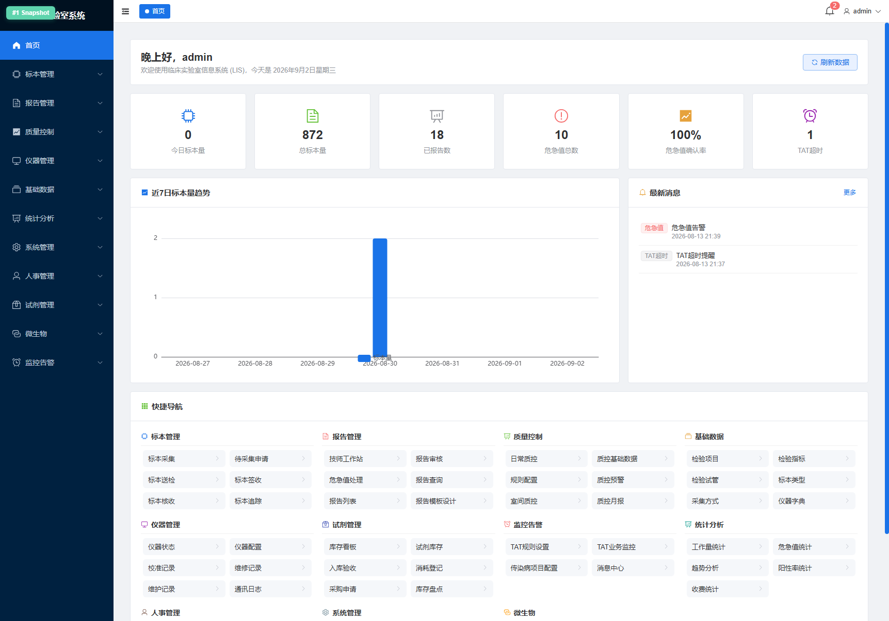

# LIS 临床实验室信息系统 操作文档

> 版本：v1.2（带 84 张本地截图 / Word 版同源） ｜ 更新日期：2026-09-02 ｜ 适用对象：检验技师、科主任、质控员、试剂管理员、系统管理员


> 📷 本操作文档含 **84 张**本地页面截图，与 MD 同目录下的 `screenshots/` 文件夹一一对应。
>
> 打开方式：
> - **Word 版**：双击「操作文档.docx」查看嵌入版，可直接打印/分发；
> - **Markdown 版**：用 Typora / VSCode / Obsidian 打开本 MD，图片相对路径自动渲染。

***

## 0. 访问与登录

### 0.1 访问地址

- 单机/局域网部署：`http://<服务器IP>:8080`

- 本地演示：`http://localhost:8080`

### 0.2 登录页 `/login`


!\[]\(说明：登录页显示「LIS 临床实验室信息系统」大标题)

| 项目   | 说明                             |
| ---- | ------------------------------ |
| 用户名  | 登录账号，由系统管理员在「用户管理」中创建          |
| 密码   | 初始密码 `123456`，首次登录后建议修改        |
| 默认账号 | `admin / 123456`（超级管理员，拥有全部权限） |

**操作步骤：**

1. 打开浏览器访问系统地址。
2. 输入「用户名」与「密码」。
3. 点击 **登 录**，系统校验通过后跳转到【首页】。

> 典型业务角色账号（示例，管理员可按需创建）：
>
> - 技师：`tech / 123456`
>
> - 科主任 / 审核：`director / 123456`

**常见错误：**

- `用户不存在或密码错误` → 检查大小写；或请管理员重置密码。

- 页面空白 / 404 → 确认部署已启动；参阅「部署文档」排查。

***

## 1. 首页 `/home`




登录成功后默认进入首页，页面主要分区如下：

### 1.1 顶部工具栏

- 左：**面包屑** 显示当前所在页面（首页 / 模块 / 子页面）。

- 右：**用户名按钮** 点击可下拉，通常包含「个人中心 / 修改密码 / 退出登录」。

### 1.2 左侧主导航（12 大模块）

按角色权限显示可访问模块，模块可点击展开子菜单：
01\. 首页
02\. 标本管理
03\. 报告管理
04\. 质量控制
05\. 仪器管理
06\. 基础数据
07\. 统计分析
08\. 系统管理
09\. 人事管理
10\. 试剂管理
11\. 微生物
12\. 监控告警

### 1.3 核心指标卡片（可点【刷新数据】）

- **今日标本量**：当日新采集/签收标本数量。

- **总标本量**：系统累计标本总数。

- **已报告数**：已生成并通过审核的报告数量。

- **危急值总数**：当前尚未处理的危急值数量。

- **危急值确认率**：已确认危急值 / 应确认危急值，目标 100%。

- **TAT 超时**：超出规定周转时间（Turnaround Time）的任务数量。

### 1.4 近 7 日标本量趋势

以折线/柱状图展示最近 7 天标本量走势，用于评估工作量与排班。

### 1.5 最新消息

点击「更多」进入【消息中心】查看全部告警（危急值、TAT 超时、传染病等）。

### 1.6 快捷导航

覆盖常用业务入口，点击即可跳转到对应页面（无需逐层展开菜单）。

### 1.7 消息通知面板

按类别过滤：`全部 / 危急值 / 传染病 / TAT超时`，支持「全部已读」与「查看全部消息」。

***

## 2. 标本管理模块

### 2.1 新建检验申请 `/sample/apply`


> 面向护士/开单医生，录入患者信息并选择检验项目。

**操作步骤：**

1. 左侧菜单「标本管理 → 新建检验申请」。
2. 填写患者基本信息：姓名、性别、年龄、病历号 / 就诊号、就诊科室、**就诊类型**（1 门诊 / 2 住院 / 3 急诊）。
3. 选择检验项目（搜索或按分类勾选）。

   - ⚠️ 规则：**一个申请只能包含一个检验项目**；若开多项，务必拆分为多个申请。
4. 选择收费类型、标本类型、临床诊断、备注等。
5. 点击「提交」→ 系统生成 **申请单号** 并进入【待采集申请】队列。

### 2.2 待采集申请 `/sample/pending`


> 查看所有已开单但尚未采集标本的申请。

**操作步骤：**

1. 使用顶部筛选：按科室、患者姓名/病历号、申请日期、开单人等过滤。
2. 勾选需要采集的申请行（可多选批量处理）。
3. 点击「去采集」跳转到【标本采集】页；或「打印条码」先打印不干胶条码。
4. 列表列：申请单号、患者、科室、检验项目、申请时间、状态（待采集 / 部分采集 / 已取消）。

### 2.3 标本采集 `/sample/barcode`


> 采集工作站：按检验项目为标本生成条码并记录采集信息。

**操作步骤：**

1. 扫描或输入申请单号（回车定位）。
2. 核对患者信息与检验项目列表。
3. 系统按 **合管规则** 自动分组显示应采集的试管：

   - 相同试管 + 相同标本类型 → 合并为一管；

   - 未绑定试管的检验项目 → 各自独立一管；

   - **微生物项目**（`is_micro=1` 或名称含 培养/药敏/涂片 等）→ 单独一项目一管，不合管。
4. 若合管后需手工拆分，在单管行点击「拆分」按钮，调整项目归属后保存。
5. 点击「生成条码」：系统依据【条码规则】配置为每管生成一个唯一条码（条码绑定的是检验项目而非指标）。
6. 填写采集人、采集时间、采集部位、标本性状等。
7. 点击「完成采集」→ 标本流转至【标本送检】。

### 2.4 标本送检 `/sample/deliver`


> 实验室外的标本（如门诊、病房）通过物流送至检验科的交接记录。

**操作步骤：**

1. 扫描标本条码（批量）或输入送检批次号。
2. 核对列表中每一份标本信息（数量、项目、标本类型）。
3. 填写送检人、接收人、送检时间、运送方式。
4. 点击「确认送检」→ 状态变更为「已送检」，进入检验科【标本签收】环节。

### 2.5 标本签收 `/sample/sign-off`


> 检验科窗口人员对送达的标本进行清点签收。

**操作步骤：**

1. 扫描条码或选择送检批次。
2. 系统列出应收标本列表，逐条核对。
3. 若标本存在问题：选择「拒收」并填写原因（如：溶血、凝块、标识错误、量不足等）。
4. 对合格标本点击「批量签收」→ 标本进入下一步【标本核收】。

   - ⚠️ 业务规则：**必须已签收的标本才能核收**。

### 2.6 标本核收 `/sample/receive`


> 检验组组长对签收后的标本进行二次核查，同时确认仪器是否可承载对应项目。

**操作步骤：**

1. 进入页面，列出所有「已签收 / 待核收」的标本。
2. 勾选标本 → 点击「核收」。
3. 系统自动校验：所选检验项目是否在已绑定仪器的「检验指标 + 标本类型 + 通道码」配置范围内。

   - 若提示「仪器未配置该项目/标本类型」，需先前往【仪器配置】或【基础数据】补全后再核收。
4. 核收通过后标本进入【技师工作站】等待上机检验。

### 2.7 标本追踪 `/sample/tracking`


> 全生命周期视图：从开单 → 采集 → 送检 → 签收 → 核收 → 上机 → 审核 全流程节点与时间戳。

**操作步骤：**

1. 顶部输入：标本条码 / 申请单号 / 患者姓名 → 点击查询。
2. 结果显示：

   - 时间轴：各节点时间、操作人、地点；

   - 合管信息：此标本包含哪些检验项目；

   - 异常标注：拒收、退回、TAT 超时时会高亮红色。
3. 点击「导出」可导出该患者/批次的完整流程记录。

### 2.8 批量导入 `/sample/batch-import`


> 适合从 HIS / Excel 批量导入申请。

**操作步骤：**

1. 点击「下载模板」获取 `import_template.xlsx`。
2. 按模板填写：每行 = 一条申请（一个检验项目）。
3. 点击「选择文件」→「上传预览」。
4. 系统校验：必填项、患者 ID 格式、就诊类型枚举（1/2/3）、检验项目编码是否存在。
5. 校验通过 → 点击「提交导入」；失败则下载错误报告修改后重新上传。

***

## 3. 报告管理模块

### 3.1 技师工作站 `/report/technician` ⭐ 核心页面


> 检验技师对已核收标本执行「结果录入 / 审核通过 / 仪器结果回传」的日常工作台。

#### 3.1.1 页面布局

- **左 / 上侧：标本列表**（两种视图：卡片视图 + 表格视图，可切换）。

- **右 / 下侧：标本详情**（病人信息、项目分组、每个指标的结果录入区）。

#### 3.1.2 标本列表（修复说明：多项目完整显示）

> ✅ **已修复**：单个标本若有多个检验项目，左侧卡片「项目」行与表格「检验项目」列均会 **完整显示所有项目名称**（以多 Tag 形式展示，并带数量角标如「9项」）。
>
> 历史问题：旧版本仅显示 1 个申请项目名，与详情页 9 个分组不一致；现已统一数据口径（后端 A∪B 聚合：已回传结果 panel ∪ 预期指标 panel）。

**左侧卡片字段：**

| 字段      | 说明                                 |
| ------- | ---------------------------------- |
| 标本条码    | 大号醒目，扫码枪直接扫描即选中                    |
| 患者      | 姓名、性别、年龄                           |
| 科室 / 床号 | 就诊科室与床位（住院）                        |
| 项目      | 多 Tag 展示所有检验项目名，超过 1 项时右上角显示「N项」角标 |
| 状态标签    | 待检测 / 结果录入中 / 已审核 / 已终审            |
| 优先级     | 急诊、特急标本红色高亮                        |

**顶部筛选栏：**

- 按时间范围、科室、检验项目、状态、优先级、条码/姓名关键字过滤。

- 刷新：点击「刷新」按钮可重新拉取列表。

#### 3.1.3 操作流程

1. 在左侧列表中点击一个标本卡片 → 右侧加载详情。
2. 右侧详情：

   - **顶部**：患者信息、申请项目汇总、合管信息。

   - **中部 panel 列表分组**：按检验项目（panel）分 Tab 或折叠分组。

   - **每个指标行**：指标名、结果输入框、单位、参考范围（性别/年龄差异化）、异常标志自动计算（↑ ↓ H L 等）。
3. 结果录入方式：

   - **手工录入**：直接在结果框输入数字，回车到下一个指标。

   - **仪器回传**：若仪器已上传，则结果框自动填充，只读，带绿色 √ 标识。

   - **手工修改仪器结果**：允许，但会留痕「修改人 / 修改时间 / 修改原因」。
4. 录入完 panel 所有指标后，点击分组上的「保存本组结果」。
5. 全部项目录入完成后：

   - 点击「提交审核」→ 标本流转到【报告审核】。

   - 或点击「保存草稿」→ 留待后续继续录入。

### 3.2 报告审核 `/report/audit`


> 科主任 / 授权审核人对结果进行审核，通过后报告直接变为**终审**状态（本系统无需额外「发布」步骤）。

**操作步骤：**

1. 顶部按条件筛选：日期、项目、科室、审核状态。
2. 列表中点击一条报告 → 右侧加载结果。
3. 审核要点：

   - 结果是否合理（与诊断/历史趋势比较）。

   - 危急值是否已确认处理。

   - 备注 / 镜检 / 涂片描述是否完整。
4. 操作：

   - **通过**：报告状态变为「终审」，自动扣减对应试剂库存（库存不足只告警，不阻断审核），可打印。

   - **退回**：选择原因并留言给录入技师，回到【技师工作站】修改。

   - **复审**：部分项目需双人双签时触发第二审核人。

### 3.3 报告列表 `/report/list`


> 所有报告的统一列表视图，支持按患者 / 申请 / 时间组合查询。

**操作步骤：**

1. 顶部条件：日期范围、患者、科室、项目、状态（草稿/待审/已审/终审/已退回）。
2. 点击行：进入【报告审核】详情（按权限）。
3. 批量：

   - 批量导出 PDF / Excel。

   - 批量打印。

   - 批量通过（需具备审核权限 + 非危急值）。

### 3.4 危急值处理 `/report/critical`


> 处理结果命中危急值规则的报告，必须在规定时间内完成确认并通知临床。

**操作步骤：**

1. 列表显示所有「未确认 / 确认中 / 已确认」的危急值。
2. 未确认条目红色闪烁 + 声音告警（需浏览器允许音频播放）。
3. 点击条目 → 弹出处理对话框：

   - 填写 **处理方式**（复查/已通知临床/已记录等）。

   - 填写 **通知人**（医生 / 护士姓名）、**通知时间**。

   - 填写备注。
4. 点击「确认处理」→ 【首页】危急值计数相应减少。

### 3.5 报告查询 `/report/query`


> 全院/科室视角查询历史报告，支持多种条件组合。

**查询条件：** 报告日期、患者 ID、姓名、性别、科室、检验项目、状态、审核人、是否异常等。

**操作：**

- 点击结果行 → 查看报告详情（只读）。

- 「打印」输出正式报告。

- 「导出」按筛选条件导出 Excel。

### 3.6 微生物报告 `/report/micro`


> 微生物专业报告：细菌鉴定 + 药敏结果。

**操作步骤：**

1. 按标本条码 / 患者查询。
2. 录入培养结果：直接涂片、菌落形态、革兰染色等。
3. 添加鉴定细菌：从【细菌字典】中选择并录入数量/占比。
4. 添加药敏：按【抗生素模板】推荐抗生素，录入 MIC / 抑菌圈 / SIR。
5. 结果说明、备注、签名。
6. 「保存 → 提交审核」流程同常规报告。

### 3.7 报告模板设计 `/report/designer`


> 自定义报告格式（页眉、Logo、表格列、签名区、底部备注、水印）。

**操作：**

- 左侧组件库拖拽到画布。

- 绑定字段：患者信息、指标结果、签名等。

- 「预览」查看打印效果。

- 保存模板后，可在【报告审核】→「打印」时选择该模板。

***

## 4. 质量控制模块

### 4.1 室内质控 `/qc/daily`


> 日常质控：录入质控品测定值，绘制 Levey-Jennings 图，按规则判控。

**操作步骤：**

1. 选择日期 / 仪器 / 项目 / 质控品批号。
2. 录入质控测定值（或直接「从仪器结果一键导入」）。
3. 系统自动：

   - 计算均值 / SD / CV；

   - 判定是否违反【规则配置】（1₂s / 1₃s / 2₂s / R₄s / 4₁s / 10x̄ 等）。
4. 图表：

   - 切换「L-J 图 / 多水平叠加 / 批次对比」。

   - 失控点红点标注，hover 显示违反规则。
5. 点击失控点 → 可直接跳转新建【失控报告】。

### 4.2 失控报告管理 `/qc/occ`


> 记录每一次失控的原因调查、纠正措施、效果验证。

**数据来源：** ⚠️ **本页面必须使用数据库中存储的真实数据，不允许使用假数据填充。**

**操作步骤：**

1. 列表可按日期、仪器、项目、状态（未处理/处理中/已结案）筛选。
2. 新建失控报告：

   - 填写「失控描述」（规则、偏移方向、程度）。

   - 原因分析：人 / 机 / 料 / 法 / 环 5M1E。

   - 纠正措施：立即纠正 + 长期改进。

   - 效果验证：重新测同一批次质控品结果。
3. 审批流程：组长签字 → 科主任审核 → 结案。
4. 列表支持「导出 PDF」。

### 4.3 质控基础数据 `/qc/lot`


> 维护质控品、批号、靶值、SD、有效期、项目对应关系。

**字段：** 质控品名称、批号、水平（高/中/低）、项目、靶值、SD、有效期、供应商、开启日期、开瓶稳定期。
**操作：** 新增 / 编辑 / 停用（过期自动禁用）。

### 4.4 规则配置 `/qc/rule-config`


> 配置每个项目适用的 Westgard 多规则组合与告警阈值。

**操作：** 选择项目 → 启用规则（1₂s / 1₃s / 2₂s / R₄s / 4₁s / 10x̄ 等）→ 设置触发等级（警告 / 失控）→ 保存。

### 4.5 质控预警 `/qc/alert`


> 汇总当前所有未结案的失控、趋势漂移、接近失控的告警。

**操作：** 点击条目 → 跳转对应的【室内质控】或【失控报告】页进行处理；处理完成后告警自动消失。

### 4.6 室间质评 `/qc/eqa`


> 管理卫健委 / 外部质评机构发放的 EQA 样本检测与上报。

**操作：** 录入质评编号、批号、样本、回报结果、统计结果（PT/SDI/CVI）、评价结论、证书上传。

### 4.7 质控月报 `/qc/report`


> 按月生成质控汇总报表。

**操作：** 选择年、月、实验室部门 → 点击「生成」→ 系统汇总当月所有项目 CV、合格率、失控次数、纠正措施执行率 → 可打印 / 导出。

***

## 5. 仪器管理模块

### 5.1 仪器状态 `/instrument/status`


> 实时看板：所有接入仪器的在线状态、当前标本数、错误码。

**面板信息：**

- 在线（绿）/ 离线（灰）/ 故障（红）。

- TCP 连接状态、最近心跳时间、当日处理标本数、待处理队列长度。

- 异常时可点击「重启连接」。

### 5.2 仪器配置 `/instrument/config` ⚠️ 关键配置


> 将「检验指标 + 标本类型 + 通道码」绑定到具体仪器；标本核收时会校验此配置。

**操作步骤：**

1. 新建 / 编辑一台仪器：名称、型号、厂商、IP、端口、通讯协议（ASTM/HL7/自定义 TCP）。
2. 进入「项目通道」Tab：

   - 每行：**检验指标 | 标本类型 | 通道码**（仪器识别的通道号/测试号）。
3. 保存后，【标本核收】才可对该标本放行。

### 5.3 校准记录 `/instrument/calibration`


> 记录仪器校准 / 定标。

**字段：** 仪器、项目、校准品批号、校准日期、K 值 / 斜率 / 截距、校准结论、执行人、复核人。

### 5.4 维修记录 `/instrument/repair`


> 记录故障报修、维修过程、配件更换、费用。

**字段：** 仪器、报修时间、故障描述、维修厂商/工程师、到场时间、解决措施、换件清单、费用、完成时间、验收人。

### 5.5 维护记录 `/instrument/maintenance`


> 日/周/月/季/年度保养记录。

**操作：** 选择仪器 → 选择保养项（来自【保养计划】）→ 打勾每项完成情况 → 上传照片 → 保存。

### 5.6 保养计划 `/instrument/plan`


> 为每台仪器配置周期性保养模板。

**字段：** 仪器、保养类型、周期（日/周/月/季/年）、保养项目清单（多行）、负责人、提前提醒天数。

### 5.7 通讯日志 `/instrument/log`


> 查看仪器与 LIS 的双向通讯报文（调试、回溯必备）。

**操作：** 按仪器、时间范围过滤；支持「按方向（LIS→仪器/仪器→LIS）」过滤；可下载原始报文 TXT。

***

## 6. 基础数据模块（系统管理员 / 组长常用）

### 6.1 检验项目 `/base/panel`


> 可被申请开单的项目（组合/套餐），一个项目可绑定多个**检验指标**，可绑定**检验试管**。

**字段：** 项目编码、名称、助记码（拼音首字母）、分类、收费、标本类型、默认试管、周转时间（TAT）、报告模板、是否微生物项目（`is_micro`）。
**操作：**

- 指标 Tab：勾选本项目包含的检验指标（来自 6.2）。

- 试管 Tab：绑定默认试管；若未绑定则该项目独立一管，不与其他项目合管。

### 6.2 检验指标 `/base/test-item`


> 单条具体可测量的指标（子项）。如：WBC、RBC、HGB、GLU 等。

**字段：** 编码、名称、英文缩写、单位、结果类型（数值 / 定性 / 文本）、精度、默认仪器通道码占位。

### 6.3 检验试管 `/base/test-tube`


> 采血管字典。合管判断关键字段：「试管」+「标本类型」。

**字段：** 编码、名称、颜色、容量、规格、抗凝剂 / 促凝剂说明、默认条码前缀。

### 6.4 标本类型 `/base/specimen-type`


> 血清 / 血浆 / 全血 / 尿液 / 粪便 / 脑脊液 / 痰液 等。

### 6.5 采集方式 `/base/collection-method`


> 静脉采血 / 动脉采血 / 末梢血 / 留尿 / 痰培养 等。

### 6.6 仪器字典 `/base/instrument`


> 仪器主数据（与「仪器管理 → 仪器配置」的仪器记录一一对应）。含：名称、型号、厂商、所属实验室部门。

### 6.7 参考范围 `/base/ref-range`


> 为每个指标按「性别 + 年龄区间 + 人群」配置差异化参考范围。

**字段：** 指标、性别（男/女/通用）、年龄起、年龄止（年/天）、孕周、下限、上限、单位、危急值下限/上限。
**判定逻辑：** 录入结果时自动按患者匹配一条规则计算 ↑↓H L 与危急值。

### 6.8 条码规则 `/base/barcode-rule`


> 配置采集工作站生成条码的前缀、长度、流水号规则、日期位、校验位。

**应用：** 生成标本条码；入库验收时试剂条码规则为 `RG + 试剂ID + 批号 + 明细ID`（由系统内部生成，回写到 `lis_reagent_inbound_item.barcode`）。

***

## 7. 统计分析模块

> 通用交互：所有统计页顶部均有「时间范围、科室、项目、分组维度（日/周/月）、导出 Excel」按钮。

| 页面    | 路由                     | 功能说明                                  |
| ----- | ---------------------- | ------------------------------------- |
| 工作量统计 | `/stats/workload`      | 按人 / 按仪器 / 按科室 / 按项目统计检验数量、耗时、TAT 达标率 |
| 危急值统计 | `/stats/critical`      | 危急值项目分布、科室分布、响应时长、确认及时率               |
| 趋势分析  | `/stats/trend`         | 选定指标，按时间绘制平均值、异常率趋势（月/季/年）            |
| 阳性率统计 | `/stats/positive-rate` | 定性项目 / 细菌鉴定 / 肿瘤标志物 阳性率、科室对比          |
| 收费统计  | `/stats/charge`        | 项目收费金额、科室收入、开单医生排行、应收 vs 实收           |

---

### 工作量统计 `//stats/workload`

> 按人 / 按仪器 / 按科室 / 按项目统计检验数量、耗时、TAT 达标率


### 危急值统计 `//stats/critical`

> 危急值项目分布、科室分布、响应时长、确认及时率


### 趋势分析 `//stats/trend`

> 选定指标，按时间绘制平均值、异常率趋势（月/季/年）


### 阳性率统计 `//stats/positive-rate`

> 定性项目 / 细菌鉴定 / 肿瘤标志物 阳性率、科室对比


### 收费统计 `//stats/charge`

> 项目收费金额、科室收入、开单医生排行、应收 vs 实收


***

## 8. 系统管理模块

### 8.1 用户管理 `/system/user`


**操作：** 新增 / 编辑 / 停用 / 重置密码（重置后默认 `123456`）/ 分配角色。

### 8.2 角色管理 `/system/role`


**操作：** 创建角色 → 分配权限（菜单级 + 按钮级）→ 保存。
典型角色示例：`技师 / 审核人 / 科主任 / 质控员 / 试剂管理员 / 系统管理员`。

### 8.3 权限管理 `/system/permission`


> 权限点字典：菜单权限、按钮权限。系统自动同步；一般无需手动新建。

### 8.4 操作日志 `/system/log`


> 记录所有重要操作：登录、修改、删除、审核通过、退回、导出。
> 可按「用户 / 模块 / 时间 / 关键字」检索回溯。

### 8.5 科室管理 `/system/department`


> 临床科室字典（申请开单科室）与检验科内部部门（生化/免疫/微生物/临检等）。
> 字段：编码、名称、上级科室、负责人、联系电话、类型（临床科室 / 检验科室）。

### 8.6 系统参数 `/system/config`


> 全局开关与默认值：
>
> - 默认 TAT（分钟）
>
> - 危急值默认超时提醒
>
> - 报告审核通过即终审（默认 ON，不可关闭）
>
> - 密码复杂度、登录失败锁定策略
>
> - 条码默认规则

### 8.7 数据备份 `/system/backup`


> 一键备份 PostgreSQL 数据库为 `lis_db_YYYYMMDD_HHMMSS.sql`，保存到服务器指定目录。
> 可下载备份文件、查看历史备份、手动恢复（由管理员执行，需谨慎）。

***

## 9. 人事管理模块

| 页面   | 路由                  | 功能说明                                       |
| ---- | ------------------- | ------------------------------------------ |
| 员工档案 | `/hr/staff`         | 员工基本信息：姓名、工号、性别、入职日期、所属科室/小组、职称、联系电话、紧急联系人 |
| 小组管理 | `/hr/group`         | 科内分组，如生化组、免疫组、微生物组                         |
| 职称管理 | `/hr/title`         | 职称字典与序列（技士/技师/主管技师/副主任技师/主任技师）             |
| 排班管理 | `/hr/schedule`      | 日历视图排班：白班/中班/夜班/休息，支持批量复制周排班               |
| 培训记录 | `/hr/training`      | 培训主题、时间、讲师、参加人员、考核结果、附件                    |
| 资质证书 | `/hr/certificate`   | 证书类型、编号、取得日期、有效期、到期提醒                      |
| 授权管理 | `/hr/authorization` | 员工对项目/仪器的授权资格、有效期、复审记录                     |
| 文档资料 | `/hr/document`      | SOP、制度、规范、红头文件；分级上传、在线预览                   |

---

### 员工档案 `//hr/staff`

> 员工基本信息：姓名、工号、性别、入职日期、所属科室/小组、职称、联系电话、紧急联系人


### 小组管理 `//hr/group`

> 科内分组，如生化组、免疫组、微生物组


### 职称管理 `//hr/title`

> 职称字典与序列（技士/技师/主管技师/副主任技师/主任技师）


### 排班管理 `//hr/schedule`

> 日历视图排班：白班/中班/夜班/休息，支持批量复制周排班


### 培训记录 `//hr/training`

> 培训主题、时间、讲师、参加人员、考核结果、附件


### 资质证书 `//hr/certificate`

> 证书类型、编号、取得日期、有效期、到期提醒


### 授权管理 `//hr/authorization`

> 员工对项目/仪器的授权资格、有效期、复审记录


### 文档资料 `//hr/document`

> SOP、制度、规范、红头文件；分级上传、在线预览


***

## 10. 试剂管理模块

### 10.1 库存看板 `/reagent/dashboard`


首页式概览：总库存金额、低库存预警数量、近效期预警数量、本月入库金额、本月消耗金额。

### 10.2 试剂字典 `/reagent/list`


维护试剂基础信息：编码、名称、规格、单位、分类、品牌、供应商、最小库存、有效期预警天数、对应检验项目。

### 10.3 供应商管理 `/reagent/supplier`


供应商档案：资质、联系人、合同、结算方式、评价记录（联动「供应商评价」）。

### 10.4 分类管理 `/reagent/category`


试剂分类树：生化试剂 / 免疫试剂 / 微生物试剂 / 校准品 / 质控品 / 耗材。

### 10.5 仓库管理 `/reagent/warehouse`


仓库 + 库位：如「一号仓-A区-第1排-第3格」。

### 10.6 采购申请 `/reagent/purchase-apply`


使用科室填写采购申请 → 审批 → 生成采购订单。

### 10.7 采购订单 `/reagent/purchase-order`


订单下发供应商；含订单号、明细、金额、交货期、状态。

### 10.8 入库验收 `/reagent/inbound` ⚠️ 条码自动生成


> **重要规则**：入库验收通过时，系统自动为每个明细生成试剂条码，规则为：
> `RG + 试剂ID + 批号 + 明细ID`，并**同步回写**到 `lis_reagent_inbound_item.barcode`。

**操作步骤：**

1. 新建入库单：关联采购订单（可选）→ 选择供应商、仓库。
2. 新增明细：试剂、批号、生产日期、失效日期、数量、单价、金额。
3. 点击「验收通过」：

   - 为每个明细生成条码；

   - 回写字段 `lis_reagent_inbound_item.barcode`；

   - 自动入【试剂库存】。
4. 可打印条码不干胶，粘贴到试剂盒上用于移动扫码作业。

### 10.9 试剂库存 `/reagent/stock`


按「仓库 + 试剂 + 批号」显示当前在库量、可用量、锁定量、效期。
支持：批次锁定 / 解锁、批次转移、报废。

### 10.10 消耗登记 `/reagent/consumption`


手工登记消耗；或在【报告审核通过】分支由系统**自动扣减试剂库存**（自动扣减失败/库存不足不阻断主流程）。

### 10.11 请领业务单 `/reagent/requisition`


使用科室向仓库请领试剂 → 审核 → 出库。

### 10.12 出入库记录 `/reagent/record`


全量流水：入库、出库、退库、调拨、报废；按维度搜索导出。

### 10.13 库存盘点 `/reagent/check`


按仓库生成盘点单 → 支持移动扫码盘点（见 10.18）→ 录入实盘数 → 系统生成盘盈盘亏单 → 审批后调整库存。

### 10.14 成本核算 `/reagent/cost`


按项目 / 仪器 / 时间段统计试剂成本、收入、利润率。

### 10.15 预算管理 `/reagent/budget`


按年度/季度/部门做预算计划，对比实际支出，生成预算执行率报表。

### 10.16 供应商评价 `/reagent/supplier-evaluate`


对供应商从「质量、价格、交货、服务」维度评分，生成等级。

### 10.17 环保处置台账 `/reagent/scrap-disposal`


废弃试剂、耗材的收集、交接、处置记录，符合环保合规要求。

### 10.18 移动扫码作业 `/reagent/mobile`


面向 PDA / 手机浏览器的轻量化作业集合，提供 3 个子页面：

| 子页面    | 路由                            | 功能                        |
| ------ | ----------------------------- | ------------------------- |
| 移动扫码盘点 | `/reagent/mobile/scan-check`  | 扫描盘点单上的试剂条码 + 录入数量，自动汇总差异 |
| 移动扫码领用 | `/reagent/mobile/scan-pick`   | 扫描请领单条码，逐扫码出库并实时扣减库存      |
| 移动库存查询 | `/reagent/mobile/stock-query` | 扫码或输入试剂名，即时查询在库数量、效期、库位   |

### 10.19 试剂报表 `/reagent/report`


一键生成：出入库月报、库存周转率、近效期、低库存、供应商供货统计。

***

## 11. 微生物模块（专项）

### 11.1 微生物报告 `/report/micro`


见 3.6 节。

### 11.2 细菌字典 `/micro/bacteria`


维护细菌：编码、名称、革兰分类、菌种说明、默认鉴定编码。

### 11.3 抗生素字典 `/micro/antibiotic`


抗生素：编码、名称、分类、纸片含量 / MIC 范围、折点参考。

### 11.4 抗生素模板 `/micro/antibiotic-template`


按「标本类型 + 细菌大类」配置推荐抗生素列表。例如：尿液标本 G- 杆菌推荐 12 种抗生素。

### 11.5 耐药规则 `/micro/resistance`


配置「细菌-抗生素」的天然耐药表（表型推断规则）。命中后自动修正药敏结果并提示专家解释。

### 11.6 耐药规则说明 `/micro/expert-rule`


耐药知识库说明页：列出所有 CLSI / EUCAST 推荐的专家规则及解释文案（只读为主）。

### 11.7 耐药预警 `/micro/alert`


监控 MRSA、VRE、CRE、CR-AB 等重点耐药菌，一有检出立即触发首页消息 + 消息中心。

### 11.8 仪器导入 `/micro/instrument-import`


对接质谱仪 / 微生物鉴定仪 / 药敏仪：导入鉴定与药敏原始数据，自动对应到报告。

### 11.9 流行病学统计 `/micro/epidemiology`


病区 / 科室 / 季度维度：

- 细菌分离率排行；

- 主要细菌耐药率趋势；

- 重点耐药菌检出率分布。

### 11.10 微生物室内质控 `/micro/qc`


ATCC 菌株质控：日期、菌株、培养基、培养条件、结果、结论。

### 11.11 培养基类型 `/micro/medium-type`


培养基字典：血平板 / 巧克力平板 / 麦康凯 / 沙保弱 等。

### 11.12 培养方案配置 `/micro/culture-plan`


按「标本类型」配置默认培养基组合、培养环境（需氧/厌氧/CO₂）、培养时长。

### 11.13 培养基条码生成 `/micro/patient-data-by-barcode`


为每个平板生成唯一培养基条码，关联患者与标本；接种时扫码登记。

***

## 12. 监控告警模块

### 12.1 TAT 规则设置 `/monitor/tat-rule`


> 配置不同环节的 TAT 阈值（分钟）。

字段：环节（采集→签收 / 签收→核收 / 核收→结果 / 结果→审核）、项目、优先级、阈值、提前预警阈值、超时处理动作（消息提醒 / 升级提醒）。

### 12.2 TAT 业务监控 `/monitor/tat-monitor`


> 实时看板：当前所有在途标本的各环节耗时。
> 红色高亮已超时、黄色高亮即将超时。支持按环节、项目、科室过滤。

### 12.3 传染病项目配置 `/monitor/infectious`


> 将 HBsAg、抗-HCV、抗-HIV、TP 等法定传染病项目配置为「传染病项目」。
> 命中异常结果时，自动触发【消息中心】传染病告警并登记上报。

### 12.4 消息中心 `/monitor/message`


> 系统所有告警的统一入口。

**分类：** 危急值 / TAT 超时 / 传染病 / 质控失控 / 试剂低库存 / 近效期 / 仪器异常。
**操作：** 标记已读 / 批量已读 / 跳转到对应业务页处理。

***

## 附录 A. 默认账号与端口

| 项目    | 值                      |
| ----- | ---------------------- |
| 系统地址  | `http://<server>:8080` |
| 默认管理员 | `admin / 123456`       |
| 示例技师  | `tech / 123456`        |
| 示例主任  | `director / 123456`    |

## 附录 B. 典型业务流转总览（一条申请的一生）

```
新建申请 → 待采集申请 → 标本采集（生成条码+合管）→ 标本送检 → 标本签收
→ 标本核收（校验仪器配置）→ 技师工作站（录入/接收结果）
→ 报告审核（通过→终审+自动扣减试剂）→ 报告查询/打印
                         ↘ 危急值 → 危急值处理
                         ↘ 质控联动 → 室内质控 → 失控报告
```

## 附录 C. 术语表

| 缩写 / 术语               | 全称                                      |
| --------------------- | --------------------------------------- |
| LIS                   | Laboratory Information System 实验室信息系统   |
| HIS                   | Hospital Information System 医院信息系统      |
| TAT                   | Turnaround Time 检验周转时间                  |
| Panel                 | 检验项目（组合 / 套餐）                           |
| Test Item / Indicator | 检验指标（单个可测子项）                            |
| S / I / R             | 药敏：敏感 / 中介 / 耐药                         |
| QC                    | Quality Control 质量控制                    |
| EQA                   | External Quality Assessment 室间质评        |
| L-J 图                 | Levey-Jennings 质控图                      |
| CV                    | 变异系数；SD = 标准差                           |
| MIC                   | Minimum Inhibitory Concentration 最小抑菌浓度 |
| WBC / RBC / HGB / GLU | 白细胞 / 红细胞 / 血红蛋白 / 葡萄糖（指标示例）            |

