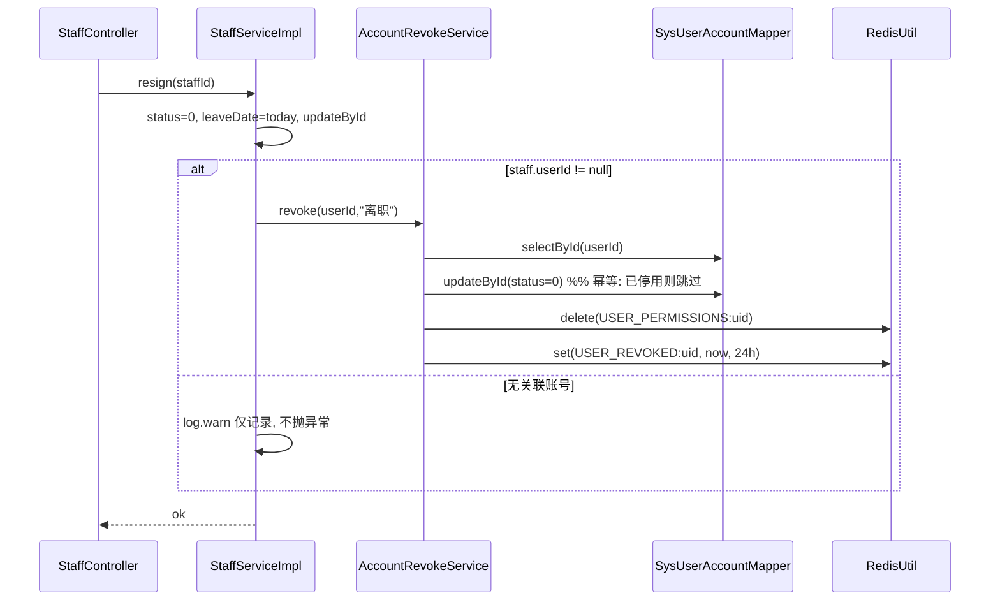
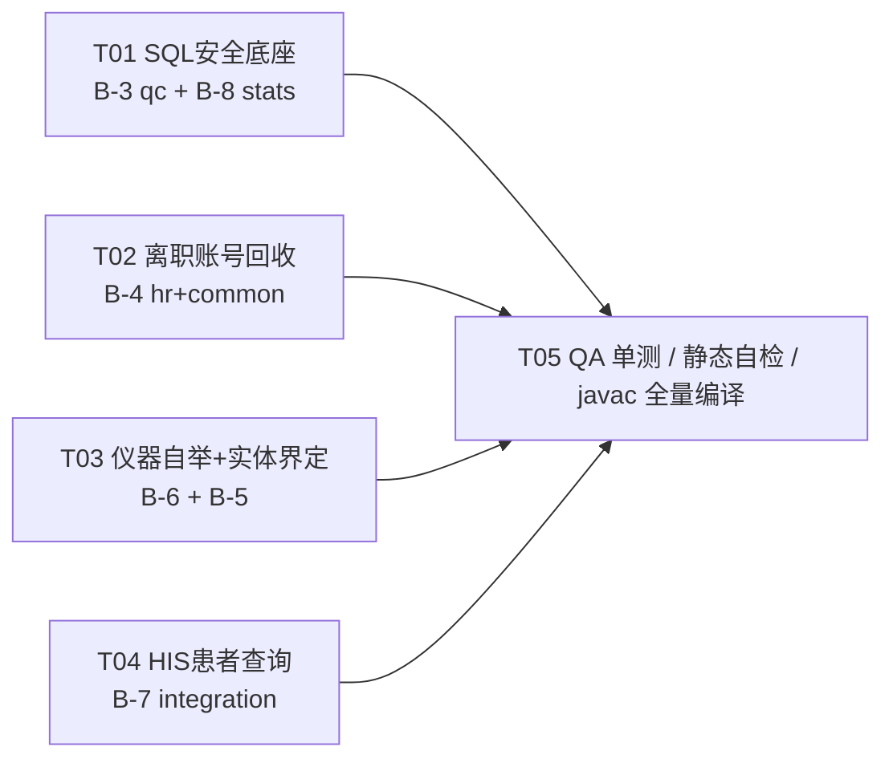

# B-3 ~ B-8 增量修复设计（架构师：高见远）

> 依据：`docs/system-overall-check.md` B-3~B-8 + 逐文件实读复核（2026-08）
> 范围：`lis-system/lis-service/`，仅设计不实现。Java17 / Spring Boot 3.2 / MyBatis-Plus 无 XML。
> 环境：`mvn test` 因 `~/.m2` 缺 surefire-junit-platform provider 无法执行 → 工程师 `javac` 全量编译验证，QA 静态自检。

---

## 0. 实读复核结论（与报告的差异，务必先看）

| # | 报告描述 | 实读复核 | 影响 |
|---|---|---|---|
| B-3 | qc 有 `LIMIT` 拼接 | ✅ 属实，且**不止 2 处**：另有 `QCRecordServiceImpl:223` 与 `:199-207` 的 `IN (%s)` `String.format` | 修复面扩大 |
| B-4 | 无账号联动 | ✅ 属实；**但 `Staff.userId` 字段已存在（Staff.java:26）**，staff↔user 关联无需新建映射 | 风险大幅下降 |
| B-5 | 实体重复 | ✅ 属实且**字段完全一致**（18 字段）；但两模块**互不依赖**（instrument 只依赖 lis-common/lis-api），且 **base 才是台账写权威**（CRUD+校准+维修+人员映射），instrument 侧只读 | **推荐结论与任务书相反**，见 §3 |
| B-6 | init 只打日志 | ✅ 属实（`InstrumentConnectionManager.java:60-63`） | — |
| B-7 | queryPatient 未实现 | ✅ 仅 HL7v2 未实现（`:254-259`）；Fhir/UniversalRest **已实现**。且 `HL7MessageBuilder` 已有 `buildQBP_Q22`、`HL7MessageParser` 已有 `parseADT_A01`（可复用 PID/PV1） | 可低成本补齐 |
| B-8 | 裸 SQL 零校验 | ⚠️ **SQL 已全部用 `?` 参数化，无注入**（4 个 ServiceImpl 已核）。真实缺陷是：①入参零校验（`startDate="x"` → `CAST('x' AS TIMESTAMP)` 抛 PSQLException 500）②无区间/limit 上限（全表扫）③`new JdbcTemplate(dataSource)` 手工 new → **无法 Mock 单测** | 定性从"注入"改为"校验+可测性" |

---

## 1. B-3　qc LIMIT / IN 注入面

**现状证据**
- `lis-service-qc/.../QCChartServiceImpl.java:40`、`:123` → `.last("LIMIT " + limit)`
- `lis-service-qc/.../QCRecordServiceImpl.java:223` → `.last("LIMIT " + limit)`
- `lis-service-qc/.../QCRecordServiceImpl.java:199-207` → `String.format("... IN (%s)", 拼接ids)`
- 入口 `QCChartController.java:32,43` → `limit` 由 `@RequestParam` 直传，无上限（安全 ✅ `TrendAlertServiceImpl:48` 为常量 `LIMIT 20`）

**改动文件清单**

| 类型 | 文件 |
|---|---|
| 新增 | `lis-service-qc/src/main/java/com/lis/qc/support/QcQueryGuard.java` |
| 修改 | `QCChartServiceImpl.java`（L36-40、L119-123） |
| 修改 | `QCRecordServiceImpl.java`（L199-207、L218-226） |

**核心方案** —— 彻底消除拼接，不做"校验后再拼"：

1. **LIMIT 改分页插件**。`MybatisPlusConfig` 已注册 `PaginationInnerInterceptor(POSTGRE_SQL)`（lis-common），`selectPage` 生成的 `LIMIT ?` 由 MP 预编译：
```java
int n = QcQueryGuard.clampLimit(limit);           // [1, 1000]，默认 50
Page<QCRecord> p = qcRecordMapper.selectPage(new Page<>(1, n), wrapper);
List<QCRecord> records = p.getRecords();          // 其余逻辑不变
```
2. **IN 子句参数化**（`batchQueryNames`）：
```java
String ph = ids.stream().map(x -> "?").collect(joining(","));   // "?,?,?"
jdbcTemplate.query(String.format(sqlTemplate, ph), ids.toArray(), rs -> {...});
```
3. `QcQueryGuard`（纯静态 POJO，零依赖，可直接单测）：`clampLimit(int)`、`requirePositive(int,String)`；如后续需动态排序，追加 `orderColumn(String)` 走 `Map<String,String>` 白名单（本轮排序全部为 Lambda 强类型，**无需**）。

**风险与回滚**：`selectPage` 会额外发一条 `COUNT(*)`。若不接受，用 `new Page<>(1, n, false)`（关闭 count）—— **推荐直接用 `false`**。回滚 = 还原 4 处代码块，无 schema 变更。

---

## 2. B-4　hr 离职不回收账号

**现状证据**：`StaffServiceImpl.java:91-101` `resign()` 只置 `status=0`+`leaveDate`，L100 遗留 `// TODO: 联动停用系统账号`。
**关键前提（已核实）**：`Staff.userId`（Staff.java:26）已存在 → 关联链路完整；`sys_user.status`（SysUser.java:41 `0停用 1启用`）；`CacheKey.TOKEN_BLACKLIST` / `USER_PERMISSIONS`（CacheKey.java）已存在；hr 模块**已含** `spring-boot-starter-data-redis`。
**约束**：全库共用 `lis_db` 单数据源；工程内 **无任何 `@EnableFeignClients`**（lis-api 的 Feign 是死代码）→ 不走 RPC，走同库写 + Redis 撤销标记。

**改动文件清单**

| 类型 | 文件 |
|---|---|
| 新增 | `lis-service-hr/.../entity/SysUserAccount.java`（`@TableName("sys_user")`，仅 id/username/status） |
| 新增 | `lis-service-hr/.../mapper/SysUserAccountMapper.java` |
| 新增 | `lis-service-hr/.../service/AccountRevokeService.java`（接口，便于日后换 RPC 实现） |
| 新增 | `lis-service-hr/.../service/impl/AccountRevokeServiceImpl.java` |
| 修改 | `StaffServiceImpl.java:91-101` |
| 修改 | `lis-common/.../constant/CacheKey.java`（+`USER_REVOKED = "lis:user:revoked:"`） |
| 修改（T2 可选） | `lis-common/.../security/JwtUtil.java`（+`getIssuedAt`）、`lis-gateway/.../AuthFilter.java` |

**核心伪代码**
```java
// StaffServiceImpl.resign(id) —— 同一 @Transactional 内
staff.setStatus(0); staff.setLeaveDate(now); updateById(staff);
if (staff.getUserId() != null) accountRevokeService.revoke(staff.getUserId(), "离职");

// AccountRevokeServiceImpl.revoke(userId, reason)
SysUserAccount u = mapper.selectById(userId);
if (u == null) { log.warn(...); return; }          // 不阻断离职主流程
if (!Integer.valueOf(0).equals(u.getStatus())) {   // 幂等
    SysUserAccount up = new SysUserAccount(); up.setId(userId); up.setStatus(0);
    mapper.updateById(up);                          // MP 仅更新非空字段
}
redisUtil.delete(CacheKey.USER_PERMISSIONS + userId);                       // 立即剥权
redisUtil.set(CacheKey.USER_REVOKED + userId, System.currentTimeMillis(),
              24, TimeUnit.HOURS);                                          // TTL = JWT 有效期
```
**Tier-2（令牌硬失效，需裁决）**：JWT 无状态，仅剥权无法阻止已签发 token 通过网关。补 `JwtUtil.getIssuedAt(token)`，`AuthFilter` 增判 `iat < redis[USER_REVOKED:uid] → 401`。网关目前 **excluded 了 mybatis/postgres 但保留 lis-common（含 data-redis）**，需为网关配置 `spring.data.redis` 并注入 `ReactiveStringRedisTemplate` —— 属跨层改动，列入待明确。

**风险与回滚**：hr 直写 `sys_user` 属跨限界上下文写入（同库，无分布式事务问题）；`revoke` 全程 try-catch 降级，**绝不因账号服务异常导致离职登记回滚**。回滚 = 移除 `revoke` 调用一行。



---

## 3. B-5　base / instrument 实体重复（本项风险最高）

**现状证据**：`lis-service-base/.../entity/Instrument.java` 与 `lis-service-instrument/.../entity/Instrument.java` —— 同 `@TableName("lis_instrument")`、同 `IdType.ASSIGN_ID`、**18 个字段完全一致**。
**引用面（实测，共 9 文件）**：base 侧 6（Controller/Mapper/Service/ServiceImpl/InstrumentStatusService(Impl)）；instrument 侧 3（Controller/Mapper/TcpServer）。
**结构事实**：两模块**无依赖关系**；base 依赖 lis-common+lis-api+hr，instrument 依赖 lis-common+lis-api。唯一共享位只有 `lis-common`。

| | 方案 A：职责界定 + 契约测试（**推荐**） | 方案 B：抽 `InstrumentBase` 到 lis-common |
|---|---|---|
| 做法 | 保留双实体；类注释明确 **base=台账写权威 / instrument=只读运行时投影**；`lis-api/InstrumentDTO` 补齐 7 个缺失字段（channelType/serialNo/installDate/warrantyExpiry/department/workStatus/lastOnlineTime）作为唯一跨模块契约；新增字段清单契约单测（反射比对两实体字段集，不一致即红） | 新增 `com.lis.common.entity.InstrumentBase`（18 字段，无 `@TableName`），两侧 `extends` 后仅留 `@TableName`+`@TableId` |
| 改动 | 3 文件修改 + 2 测试新增，**零 API/零调用点变更** | 1 新增 + 2 修改，但 lis-common 变更触发 **全部 12 模块重编译** |
| 风险 | 低：重复仍在，靠测试兜底 | 中高：① MP `LambdaQueryWrapper` 对**继承 getter** 的方法引用依赖 `SerializedLambda.instantiatedType` 解析，版本敏感；② Lombok `@Data` 于父类生成 getter、子类 `equals/hashCode` 语义变化；③ **本轮无法跑集成测试验证** |
| 推荐 | ✅ 本轮执行 | ⛔ 本轮不做，留待可跑测试的环境 |

**注**：任务书建议"以 instrument 为权威"，但证据显示 **base 承载全部写操作与关联表**，instrument 仅 `selectList` 只读。故推荐反向界定，此点请主理人裁决（§8-Q2）。

**风险与回滚**：方案 A 无行为变更，回滚即删注释与测试。

---

## 4. B-6　instrument 启动不自举

**现状证据**：`InstrumentConnectionManager.java:60-63` `@PostConstruct init()` 仅 `log.info`。管理器已具备 `connectTcp / connectSerial / connectDual / heartbeatCheck / reconnect` 全部能力，缺的只是"开机装载"。

**改动文件清单**

| 类型 | 文件 |
|---|---|
| 新增 | `lis-service-instrument/.../comm/InstrumentBootstrap.java` |
| 修改 | `InstrumentConnectionManager.java`（L57-63：`init()` 保留日志 + 新增 `int autoConnectAll(List<Instrument>)`、`AtomicBoolean bootstrapped`） |
| 修改 | `lis-service-instrument/src/main/resources/application.yml`（`instrument.connection.auto-connect: true`） |

**核心方案**
- **不在 `@PostConstruct` 里查库**（Mapper/数据源就绪次序不可靠）→ 改用 `ApplicationListener<ApplicationReadyEvent>`，容器完全就绪后触发。
- 装载逻辑放 `InstrumentBootstrap`（持 `InstrumentMapper` + `InstrumentConnectionManager`），连接逻辑留在 Manager → **Manager 可纯 Mockito 单测**。
```java
onApplicationReady():
  if (!autoConnect) return;
  List<Instrument> list = mapper.selectList(new LambdaQueryWrapper<Instrument>()
        .eq(Instrument::getStatus, 1));               // 仅启用仪器
  int ok = manager.autoConnectAll(list);
  log.info("仪器自举完成: 成功 {}/{}", ok, list.size());

autoConnectAll(list):                                  // 幂等
  if (!bootstrapped.compareAndSet(false, true)) return 0;
  for (Instrument i : list) {
     if (connectionMap.containsKey(i.getId())) continue;                 // 二级幂等
     try {
       if ("TCP_SERIAL".equals(i.getChannelType()) && 有串口&有IP) connectDual(...)
       else if ("SERIAL".equals(i.getConnectType()) && 有串口)      connectSerial(...)
       else if (有IP && 有端口)                                      connectTcp(...)
       else { log.warn("仪器[{}]通信配置不完整, 跳过", i.getId()); continue; }
     } catch (Exception e) { log.error(...); }        // 单台失败绝不阻断启动
  }
```
**风险与回滚**：开发/离线环境仪器不可达 → 启动期产生若干 WARN 且 30s 心跳会重试。故 `auto-connect` 做成开关，开发档可置 `false`。回滚 = 关开关。

---

## 5. B-7　integration `queryPatient` 未实现

**现状证据**：`HL7v2Adapter.java:254-259` `log.warn("HL7v2 查询患者暂未实现")` + `return null`。`FhirAdapter:65-75`、`UniversalRestAdapter:76-87` 已实现（失败返回 null 的降级语义已确立）。
**可复用资产**：`HL7MessageBuilder.buildQBP_Q22`(L77-91) 模板、`HL7MessageParser.parseADT_A01`(L76-108) 的 PID/PV1→`PatientInfo` 解析、`HL7v2Adapter.sendAndReceive`(L324-349) 的 MLLP 收发（含 10s `soTimeout`）。
**⚠️ 顺带修一个潜伏 Bug**：`HL7MessageParser` 用 `split("\r?\n")` 切分段，但 HL7/MLLP 段分隔符是**纯 `\r`**，且 `sendAndReceive` 回填也用 `\r` → 现网若走 `\r` 报文，`parseADT_A01/parseORM_O01/parseRSP_K22` **全部解析不出任何段**。必须抽 `splitSegments(msg)` 用 `split("\\r\\n|\\r|\\n")`。

**改动文件清单**

| 类型 | 文件 |
|---|---|
| 修改 | `HL7MessageBuilder.java`（+`buildQBP_Q21(patientId, visitId)`，QBP^Q21 = Get Person Demographics） |
| 修改 | `HL7MessageParser.java`（+`parseRSP_K21(msg)`；新增私有 `splitSegments`，`parseORM_O01/parseADT_A01/parseRSP_K22` 一并改用） |
| 修改 | `HL7v2Adapter.java:254-259` |

**调用链与降级**
```
HisAdapterFactory → HL7v2Adapter.queryPatient(patientId, visitId)
  ├ hisEnabled==false            → log.debug + return null
  ├ patientId 为空                → return null（不发报文）
  ├ buildQBP_Q21 → sendAndReceive(MLLP, 10s 超时)
  ├ ack == null / 空              → log.warn + return null      （超时/连接失败）
  ├ 含 "MSA|AE" 或 "MSA|AR"       → log.warn + return null      （HIS 拒绝）
  └ parseRSP_K21(ack)             → PatientInfo；解析异常 catch → null
```
`PatientInfo` 字段（patientId/patientName/gender/birthday/phone/idCard/address/visitId/visitType/department/bedNo/doctorName）已足够，**无需新建 DTO**；`visitId` 由入参回填。

**风险与回滚**：`splitSegments` 改动影响 3 个既有解析方法 —— 但改动是**兼容超集**（`\r\n|\r|\n` 覆盖原 `\r?\n`），且 `HL7MessageParserTest`（现存 6 个 @Test）可静态复核。回滚 = 还原 `queryPatient` 返回 null。

---

## 6. B-8　stats 入参零校验 + 不可测

**现状证据（复核后重新定性）**
- SQL **均已参数化**：`WorkloadStatsServiceImpl:80,84`、`ChargeStatsServiceImpl:64,68`、`CriticalStatsServiceImpl:86,90`、`TrendAnalysisServiceImpl:59,63,104,108` 全为 `CAST(? AS TIMESTAMP)` → **无注入**。
- 真实缺陷：① `startDate/endDate` 为裸 `String` 直传，非法值 → PSQLException 冒泡成 500（`ChargeStatsController:24` 等 12 个入口）；② 无区间上限、`TrendAnalysisController:30` 的 `limit` 无上限；③ `dateRangeFilter` 在 3 个 Impl 中**三份复制**；④ `new JdbcTemplate(dataSource)`（4 处构造器）→ 不可 Mock，QA 无从下手；⑤ `lis-service-stats/pom.xml` **无任何 test 依赖**。
- 除零已防（`total == 0 ? 0.0 : ...`），保留。

**改动文件清单**

| 类型 | 文件 |
|---|---|
| 新增 | `lis-service-stats/.../support/StatsQueryGuard.java`（纯静态，零 Spring 依赖） |
| 新增 | `lis-service-stats/.../support/StatsSqlSupport.java`（统一 `dateRangeFilter`） |
| 修改 | `WorkloadStatsServiceImpl` / `ChargeStatsServiceImpl` / `CriticalStatsServiceImpl` / `TrendAnalysisServiceImpl`（构造器改注入 `JdbcTemplate`；调用 Guard） |
| 修改 | `lis-service-stats/pom.xml`（+junit-jupiter/mockito-core/mockito-junit-jupiter test scope + surefire，照抄 qc pom） |

**`StatsQueryGuard` 契约**
```java
LocalDate parseDate(String v, String field)   // ISO_LOCAL_DATE 严格解析; 空→null; 非法→BusinessException("startDate 格式非法, 应为 yyyy-MM-dd")
void  checkRange(LocalDate s, LocalDate e, int maxDays)  // s>e → 抛; 跨度>maxDays(默认366) → 抛
int   clampLimit(int limit, int def, int max)            // <=0→def(100); >max→max(1000)
String checkDim(String v, Set<String> allowed)           // 维度白名单; 越界→抛; 无白名单场景仅校验长度<=64
```
- 4 个 Impl 在入口先 `parseDate`+`checkRange`，随后**传 `LocalDate` 而非 String**，SQL 由 `CAST(? AS TIMESTAMP)` 改为直接绑定 `java.sql.Date.valueOf(d)`（去掉字符串强转，杜绝 ①）。
- `specimenType` 保持 `?` 绑定 + `checkDim(长度校验)`；若前端将来传"统计维度"（列名），**必须**走 `Map<String,String>` 白名单映射，严禁拼接。
- `BusinessException` 由 lis-common `GlobalExceptionHandler` 统一转 400，前端可读。

**风险与回滚**：`limit`/日期跨度收紧可能截断既有大范围查询 → 上限走配置项（`stats.max-range-days`、`stats.max-limit`）。回滚 = 移除 Guard 调用。

---

## 7. 任务分解（实现顺序 / 归属 / 依赖）

| ID | 任务 | 模块 | 归属 | 依赖 | 优先级 |
|---|---|---|---|---|---|
| **T01** | SQL 安全与入参底座：B-3（qc 4 处拼接 → 分页插件 + IN 占位符 + `QcQueryGuard`）、B-8（`StatsQueryGuard`/`StatsSqlSupport` + 4 Impl 构造注入 + stats pom test 依赖） | qc / stats | 工程师 | — | P0 |
| **T02** | HR 离职账号回收（B-4）：`SysUserAccount`+Mapper+`AccountRevokeService(Impl)`、`StaffServiceImpl.resign` 联动、`CacheKey.USER_REVOKED` | hr / common | 工程师 | — | P0 |
| **T03** | 仪器自举 + 实体职责界定（B-6 + B-5 方案 A）：`InstrumentBootstrap`、`autoConnectAll` 幂等、双 `Instrument` 类注释、`InstrumentDTO` 补 7 字段 | instrument / base / api | 工程师 | — | P1 |
| **T04** | HIS 患者查询（B-7）：`buildQBP_Q21`、`parseRSP_K21`、`splitSegments` 修 `\r` 分隔、`HL7v2Adapter.queryPatient` | integration | 工程师 | — | P1 |
| **T05** | 单测补齐 + 静态自检 + 全量 `javac` 编译验证 + 回归清单 | 全部 | QA | T01,T02,T03,T04 | P0 |

> T01~T04 **模块互不重叠、可完全并行**（B-5/B-6 合并进 T03 以避免 instrument 模块文件冲突）。仅 T02 触碰 `lis-common/CacheKey.java`（纯追加常量，无冲突面）。



---

## 8. 依赖包

**运行时依赖：零新增。** 所有能力均由现有依赖提供 ——
- 分页 `PaginationInnerInterceptor`：lis-common 已注册（`MybatisPlusConfig`）
- Redis：hr 已含 `spring-boot-starter-data-redis` + lis-common `RedisUtil`
- 校验：lis-common 已含 `spring-boot-starter-validation`；`BusinessException`/`GlobalExceptionHandler` 已就绪
- HL7/MLLP：纯 JDK `Socket` + 现有 `HL7MessageBuilder/Parser`

**测试依赖（test scope，仅 stats 缺）**：`lis-service-stats/pom.xml` 追加 `junit-jupiter` / `mockito-core` / `mockito-junit-jupiter` + `maven-surefire-plugin`（版本由父 pom `dependencyManagement` 统一，**照抄 `lis-service-qc/pom.xml` L48-90**）。若 T03 要写 base 侧契约测试，`lis-service-base/pom.xml` 同样需追加。

---

## 9. 测试建议（JUnit5 + Mockito；离线不可实跑，QA 静态自检）

> 统一模式：`@ExtendWith(MockitoExtension.class)`；`ServiceImpl` 用 `spy` + `doReturn(...).when(spy).xxx()` 桩化 MP 方法；纯工具类直接 `new`/静态调用；**LambdaQueryWrapper 参与的用例必须先调 `TableInfoTestSupport.ensureRegistered(Entity.class)`**（`lis-service-hr/src/test/.../testsupport/TableInfoTestSupport.java` 已有，可复制到 qc/instrument/base）。

| 项 | 被测 | 要点 |
|---|---|---|
| B-3 | `QcQueryGuard`（纯 POJO） | `clampLimit(-1/0)==50`、`clampLimit(99999)==1000`、边界 1/1000 |
| B-3 | `QCChartServiceImpl` | mock `QCLotMapper.selectById` 返回 lot；mock `selectPage` 返回构造 `Page`；断言 **`Page.getSize()` 被钳制**、`actualMean/actualSd`（n=1 时 SD=0）、Z 分数 `sd==0` 时为 null |
| B-3 | `QCRecordServiceImpl.batchQueryNames` | 断言传给 `jdbcTemplate.query` 的 SQL **含 `?,?,?` 而非字面 id**（`ArgumentCaptor<String>`）；空集合直接返回空 Map |
| B-4 | `AccountRevokeServiceImpl` | ①user 不存在 → 不抛异常、不调 `updateById`；②已 `status=0` → **幂等跳过 update**；③正常 → `updateById` 捕获实体 `status==0`、`redisUtil.delete(USER_PERMISSIONS+uid)`、`set(USER_REVOKED+uid,...,24,HOURS)` 各一次 |
| B-4 | `StaffServiceImpl.resign` | ①`userId==null` → **零交互** `verifyNoInteractions(accountRevokeService)`；②`revoke` 抛异常 → 离职仍成功（不冒泡）；③断言 `status=0` 与 `leaveDate=今天` |
| B-5 | `InstrumentEntityContractTest`（base 或 instrument 侧） | 反射取两实体 `getDeclaredFields` 的 `名称:类型` 集合，`assertEquals` —— 字段漂移立即红灯 |
| B-6 | `InstrumentConnectionManager.autoConnectAll` | spy manager，`doReturn(true).when(spy).connectTcp(...)`；①`channelType=TCP_SERIAL` → 走 `connectDual`；②配置不全（ip 空）→ 跳过且不抛；③**连续调两次，第二次返回 0 且零新连接**（幂等）；④某台 `connect` 抛异常 → 其余仍继续 |
| B-6 | `InstrumentBootstrap` | mock Mapper 返回 2 条，`auto-connect=false` → `verifyNoInteractions(manager)` |
| B-7 | `HL7MessageParser`（纯 POJO） | **用 `\r` 分隔的报文**断言 PID/PV1 被正确解析（回归 splitSegments Bug）；`parseRSP_K21` 空串/无 PID → null 或空对象 |
| B-7 | `HL7v2Adapter.queryPatient` | spy adapter 桩化 `sendAndReceive`：①返回 null → 结果 null；②返回 `MSA|AE` → null；③返回合法 RSP^K21 → 字段逐项断言；④`hisEnabled=false` → 不调 `sendAndReceive` |
| B-8 | `StatsQueryGuard`（纯 POJO，**重点**） | `parseDate("2026-13-01")` 抛 `BusinessException`、`parseDate(null)==null`、`checkRange(晚,早)` 抛、跨度 367 天抛、366 天通过、`clampLimit` 边界 |
| B-8 | 4 个 `*StatsServiceImpl` | `@Mock JdbcTemplate`（构造注入后才可行）；①非法 `startDate` → 抛 `BusinessException` 且 **`verifyNoInteractions(jdbcTemplate)`**；②合法 → 捕获 SQL 断言含 `?` 占位与参数个数；③`total=0` 时 `positive_rate==0.0`（防除零） |

**QA 静态自检清单（无法实跑时的替代验证）**
1. 全量 `javac`：`find . -name "*.java" -path "*/src/main/*"` 显式编译，零 error。
2. `grep -rn '\.last("LIMIT ' lis-service-qc/src` → 结果应为空（`LIMIT 20` 常量除外需人工确认）。
3. `grep -rn 'String.format(.*IN (%s)' lis-service-qc/src` → 空。
4. `grep -rn 'new JdbcTemplate(' lis-service-stats/src` → 空。
5. `grep -n 'TODO' lis-service-hr/.../StaffServiceImpl.java` → 空。
6. `grep -rn 'split("\\\\r?\\\\n")' lis-service-integration/src` → 空。
7. 人工走查：`resign()` 是否在同一 `@Transactional`、`revoke` 是否 try-catch 降级、`autoConnectAll` 是否 `compareAndSet` 幂等。

---

## 10. 共享约定（工程师必须遵守）

1. **数值一律 `BigDecimal` + `compareTo`**，禁止 `==` / `equals` 比大小；除法必须带 `scale + RoundingMode.HALF_UP`（沿用 qc 现有 4 位）。
2. **MyBatis-Plus 无 XML**：`ServiceImpl` + `LambdaQueryWrapper`；新增 Mapper 方法一律**注解式 SQL**（`@Select`/`@Update`），不得新建 `*.xml`。
3. **新 SQL 一律 `#{}` / `?` 预编译**；`${}` 与字符串拼 SQL 禁用；确需动态列名/排序 → `Map<String,String>` 白名单映射，映射不中直接抛 `BusinessException`。
4. **LIMIT 走 MP 分页插件**（`new Page<>(1, n, false)`），不再手写 `.last("LIMIT ...")`。
5. **异常语义**：入参非法 → `BusinessException`（GlobalExceptionHandler 转 400）；外部系统不可达（HIS/仪器）→ **降级返回 null/空集 + log.warn**，不抛异常污染主流程。
6. **幂等**：所有"初始化 / 停用 / 撤销"类操作先判状态再执行（`AtomicBoolean.compareAndSet` 或状态位比对）。
7. **可测性硬约束**：禁止在构造器内 `new JdbcTemplate(...)`、`new RestTemplate()` 之类不可替换协作者；一律构造注入（`RestTemplate` 若不便改，至少抽 protected 工厂方法供 spy 覆盖）。
8. **日志**：`log.warn` 用于可恢复降级，`log.error` 带异常对象；禁止 `log.info` 冒充实现（B-2/B-6 的教训）。
9. 时间统一 `LocalDate`/`LocalDateTime`；对外 API 日期串一律 `yyyy-MM-dd`。

---

## 11. 待明确事项（请主理人 / 用户裁决）

| # | 问题 | 我的建议 |
|---|---|---|
| **Q1** | **B-5 权威方向**：任务书要求"以 instrument 的 `Instrument` 为权威"，但实读显示 **base 才承载全部写操作**（CRUD + 校准 + 维修 + 人员映射 6 文件），instrument 侧仅 3 处只读。 | 改为 **base = 台账写权威，instrument = 只读投影**；执行方案 A（注释界定 + DTO 补齐 + 契约测试），彻底合并（方案 B）留待可跑集成测试的环境。**需确认** |
| **Q2** | **B-5 去重粒度**：是否本轮就抽 `InstrumentBase` 到 `lis-common`？该改动会触发 12 模块全量重编译，且 MP 继承 Lambda 解析在当前离线环境**无法验证**。 | 本轮**不做**。若必须做，需先恢复 `mvn test` 能力 |
| **Q3** | **B-4 令牌硬失效**：Tier-1（停用账号 + 剥权 + 写撤销标记）落在 hr 内即可；Tier-2（网关按 `iat` 拒绝旧 token）需为 `lis-gateway` 引入 Redis 配置并改 `AuthFilter`。 | 建议**本轮做 Tier-1，Tier-2 单列一张卡**。若合规要求"离职即刻踢下线"，则 Tier-2 必做 —— **需确认** |
| **Q4** | **B-4 跨上下文写**：hr 直写 `sys_user`（同库）vs 走 REST 调 `lis-service-system`。工程内 `@EnableFeignClients` 从未启用，走 REST 需新引 Feign 或手搓 RestTemplate + 服务发现。 | 同库直写 + `AccountRevokeService` 接口隔离（日后换 RPC 只换实现类）。**需确认可接受** |
| **Q5** | **B-8 阈值**：日期跨度上限 366 天、`limit` 上限 1000 是否符合业务（年报/多年趋势场景？）。 | 做成配置项 `stats.max-range-days` / `stats.max-limit`，默认 366 / 1000 |
| **Q6** | **B-6 默认开关**：`instrument.connection.auto-connect` 默认 true（生产自举）会让离线开发环境启动刷 WARN。 | 代码默认 `true`，开发档 `application.yml` 显式置 `false` |
| **Q7** | **B-7 报文规格**：真实 HIS 的患者查询是 QBP^Q21/RSP^K21 还是厂商自定义？当前 `buildQBP_Q22` 的 QPD 结构为工程自拟。 | 按 HL7 标准实现 Q21/K21，解析层做**宽松容错**（PID/PV1 段有则取、无则留空），待现场联调再校准 |
