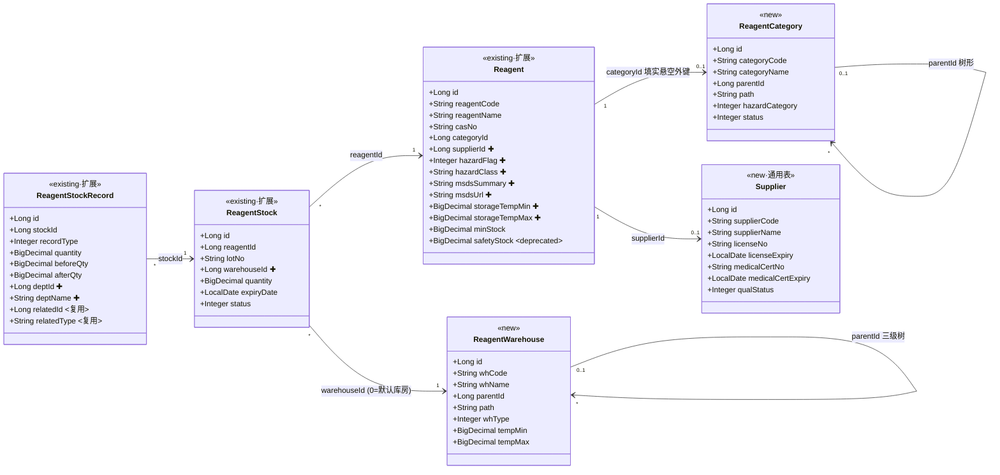
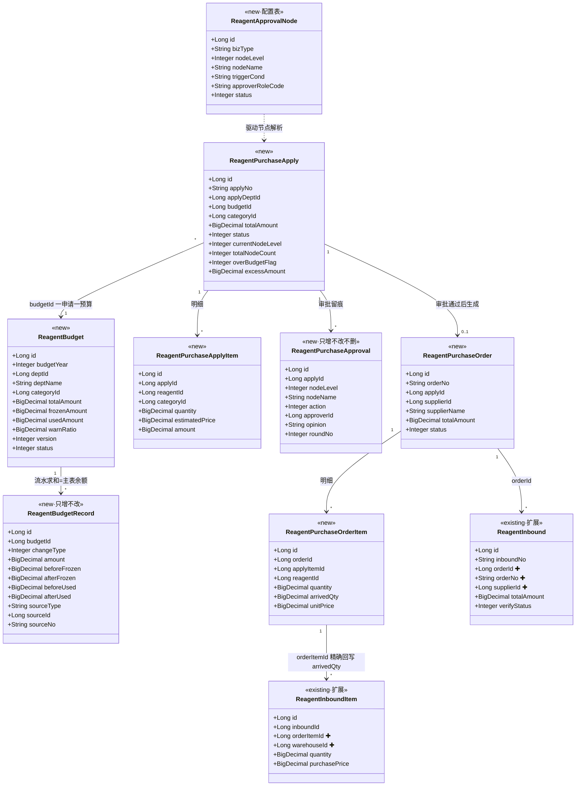
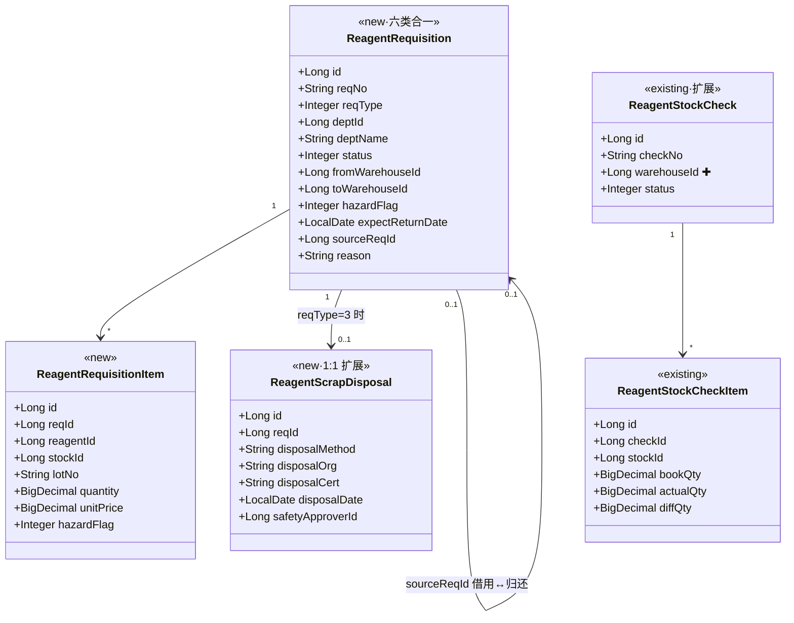
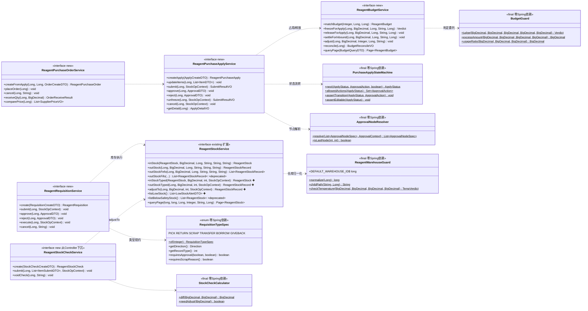
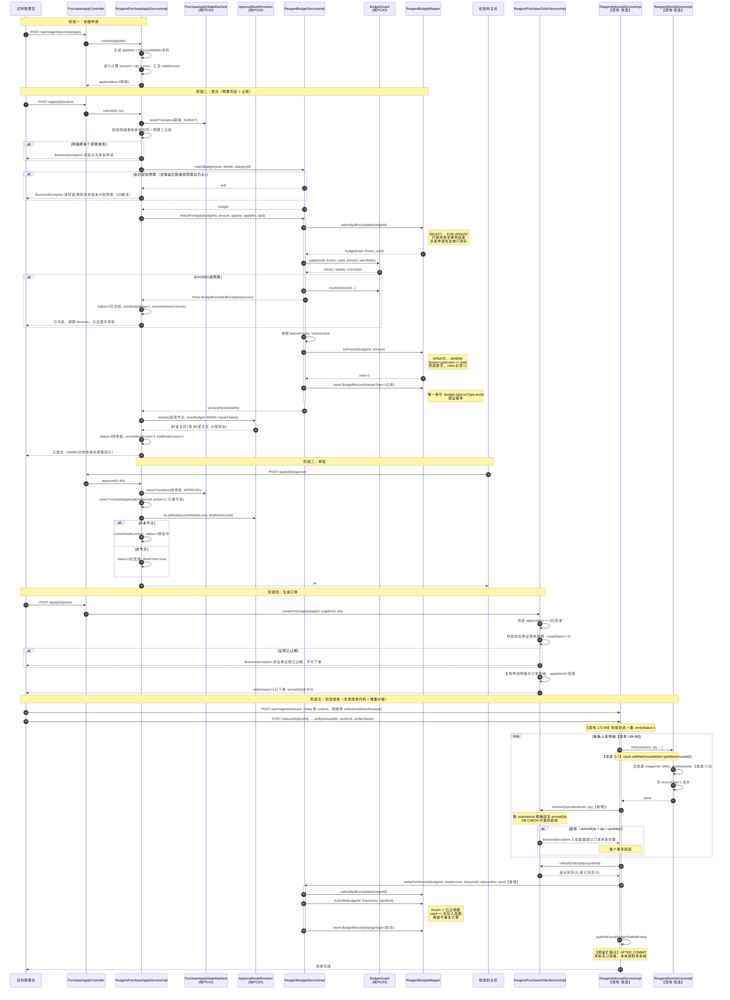
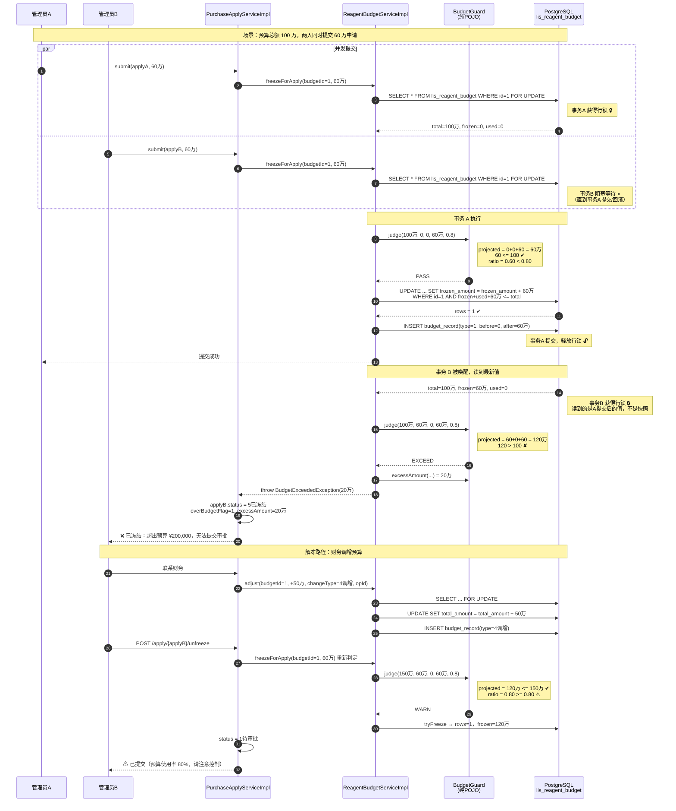
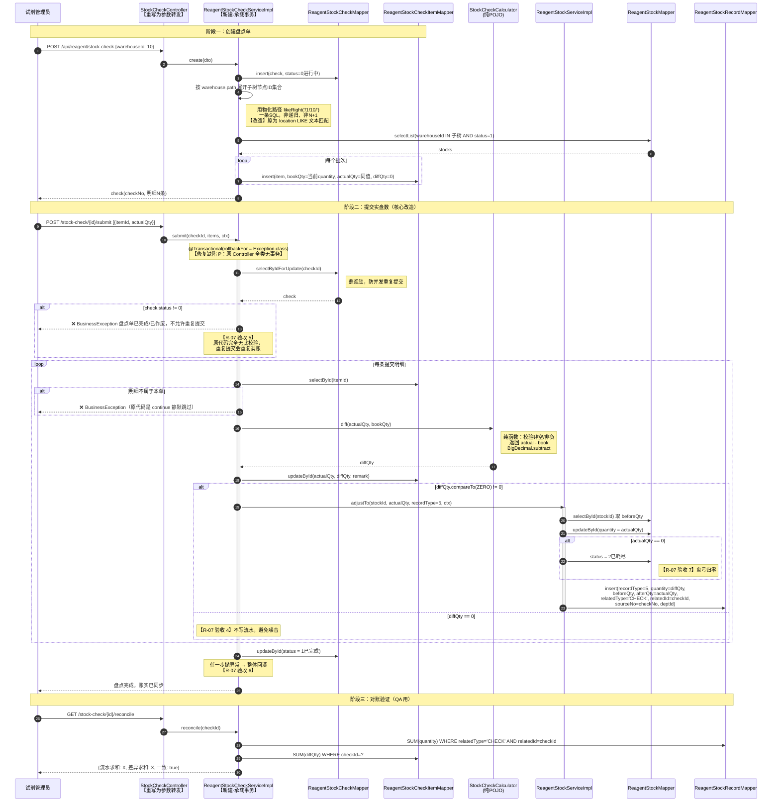
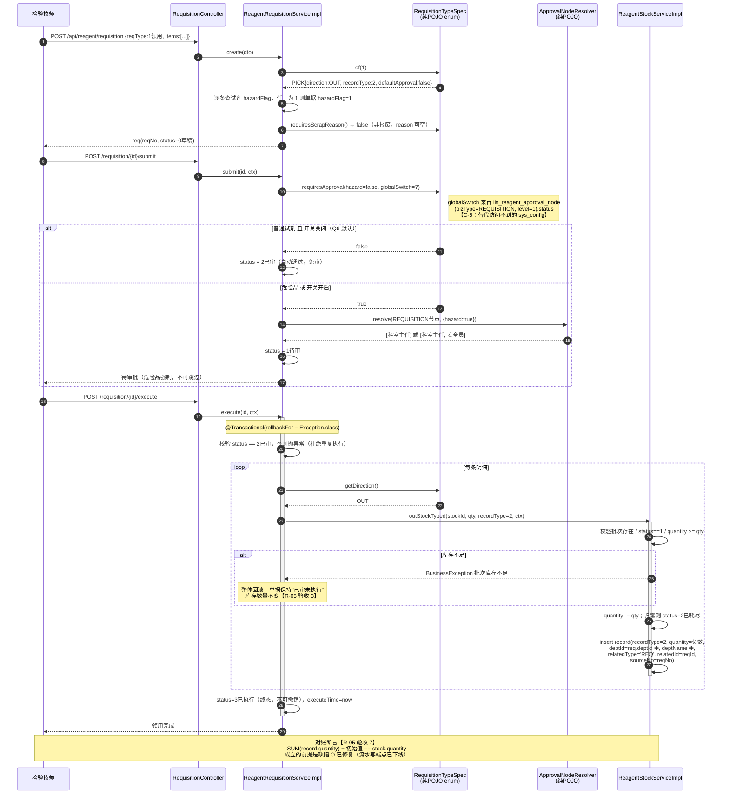
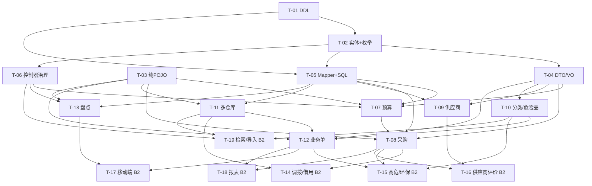

# 试剂管理模块 增量系统设计与任务分解

| 项 | 内容 |
|---|---|
| 文档类型 | 增量系统设计（存量生产项目） |
| 上游输入 | `docs/reagent-enhance-prd.md`（PM 许清楚，v1.0，544 行） |
| 模块 | `lis-system/lis-service/lis-service-reagent` + `lis-frontend/src/views/reagent` |
| 技术栈 | Java 17 + Spring Boot 3.2 + MyBatis-Plus（无 XML）+ PostgreSQL + Redis；前端 Vue3 + TS + Vite + Element Plus |
| 数据库 | `lis_db`（PostgreSQL，现有 66 张表） |
| 本轮范围 | 第一批 = P0 全部（R-01~R-07）+ R-09；第二批 = R-08 / R-10 / R-12 / R-13 / R-14 /（R-11 可选） |
| 撰写人 | Bob（架构师） |
| 版本 | v1.0 |

---

## 目录

- [1. 设计复核（对 PRD 的确认与纠正）](#1-设计复核对-prd-的确认与纠正)
- [2. 实现方案与技术选型](#2-实现方案与技术选型)
- [3. 完整 DDL](#3-完整-ddl)
- [4. 数据结构与接口（类图）](#4-数据结构与接口类图)
- [5. 程序调用流程（时序图）](#5-程序调用流程时序图)
- [6. 任务分解](#6-任务分解)
- [7. 共享知识（跨文件约定）](#7-共享知识跨文件约定)
- [8. 待明确事项](#8-待明确事项)

---

## 1. 设计复核（对 PRD 的确认与纠正）

### 1.0 复核方法

逐个 `Read` 打开并逐行核对了以下文件（非文件名推测、非 grep 摘要）：

- 实体：`Reagent.java`(246行)、`ReagentStock.java`(111行)、`ReagentStockRecord.java`(146行)
- 服务：`ReagentStockServiceImpl.java`(214行)、`ReagentInboundServiceImpl.java`(153行)、`ReagentServiceImpl.java`(36行)、`ReagentDashboardServiceImpl.java`(112行)
- 控制器：`ReagentController.java`(58行)、`ReagentStockController.java`(118行)、`ReagentStockRecordController.java`(61行)、`StockCheckController.java`(149行)、`ScanController.java`(133行)
- 定时任务：`ExpiryAlertJob.java`(38行)
- 建表脚本：`init-schema.sql` L318-461 / L625-690、`reagent-core-tables.sql`(97行)、`add-reagent-stock-check.sql`(38行)
- 前端：`lis-frontend/src/api/reagent/index.ts`(435行)、`lis-frontend/src/router/index.ts` L54-77
- 工程配置：`lis-service-reagent/pom.xml`、`lis-service-reagent/src/main/resources/application.yml`
- 公共设施：`BusinessException.java`、`R.java`、`GlobalExceptionHandler.java`、`QcQueryGuard.java`（纯 POJO 范式参考）、`lis-api/` 全量文件清单
- 跨模块先例：`lis-service-hr/entity/SysUserAccount.java`

### 1.1 结论先行

> **PRD 的现状核实质量很高，A~N 共 14 条结论中 12 条完全属实。但有 2 条与事实相反、4 条存在会导致运行时崩溃或验收无法通过的遗漏。此外我新发现 3 个 PRD 与 PM 均未提及的问题，其中 1 个（缺陷 O）会让 R-03 和 R-05 的核心验收标准永远无法成立。**

| 编号 | 类型 | 影响 | 一句话 |
|---|---|---|---|
| **C-1** | ❌ **纠正** | 省掉一个任务，Q9 作废 | `reagent_code` 唯一索引**早已存在** |
| **C-2** | ⚠️ **纠正（最高危）** | 照 PRD 做会**运行时崩溃** | `lis_reagent_stock` 上有 `(reagent_id, lot_no)` **数据库唯一索引**，PRD 只说改 Java 合批键 |
| **C-3** | 🆕 **新缺陷 O** | R-03/R-05 验收**永远不通过** | 流水表与库存表的 **POST/PUT/DELETE 端点对外裸奔** |
| **C-4** | ⚠️ **遗漏** | 订单 `arrivedQty` **回写无法定位** | 入库明细与订单明细之间**无任何关联字段** |
| **C-5** | ⚠️ **阻塞性架构约束** | PRD/Q6 方案**在代码层不可落地** | reagent 模块**无法访问** `sys_department` / `sys_config` |
| **C-6** | ⚠️ **遗漏** | Q2 裁决**无表可落** | PRD 13 张表清单**漏了审批节点配置表**，实际需 14 张 |
| **C-7** | ⚠️ **遗漏** | 采购入库全部落到默认仓 | `verifyInbound()` → `inStock()` **无仓库传递链路** |
| **C-8** | 🆕 **新缺陷 P** | R-07 验收标准 6 不通过 | `StockCheckController` **全类无 `@Transactional`** |
| **C-9** | ⚠️ **已终裁反转** | 原主张「新表无 `deleted` 列 → 任何 `remove`/`page` 必报错」**不成立** | `logic-delete-field: deleted` 全模块已配（reagent 在 `application.yml` L29-30），但 MP 按实体字段名惰性匹配；reagent 9 实体零声明、全项目 `@TableLogic` 仅 1 处（`Sample.java:119`，配对 `lis_sample.deleted`）。**终裁"全不做"：14 新表不建 `deleted` 列、新实体不声明 `deleted` 字段、不挂 `@TableLogic`，逻辑删除语义统一由 `status` 承担** |
| **C-10** | ⚠️ **精确化** | 风格分裂 | reagent 模块**实体不用 Lombok**，是手写 getter/setter |
| **C-11** | ⚠️ **精确化** | 防重复建模 | `req_id` 属重复建模，已有 `related_id`/`related_type` |
| **C-12** | ⚠️ **精确化** | 缺陷 G 描述不完整 | `status` 是**彻底缺失**而非参数名错位 |

---

### C-1 ❌ 纠正：`reagent_code` 唯一索引早已存在，Q9 是伪命题

**PRD 说**（1.4 节 2.3 行）：「已具备。**注意：建表未加唯一索引**，建议补」
**主理人 Q9 裁决**：「补 `reagent_code` 唯一索引前先跑重复检测脚本，建表脚本把"检测"和"加索引"分两步」

**实际是**：唯一索引在初始建库时就已创建。

**证据**：`lis-system/docs/database/init-schema.sql` **L648**

```sql
CREATE UNIQUE INDEX uk_lis_reagent_code ON lis_reagent (reagent_code);
```

**推论**：
1. 既然唯一索引自建库起就生效，**数据库层面不可能存在重复 `reagent_code`**，重复检测脚本必然返回 0 行；
2. 再执行 `CREATE UNIQUE INDEX` 会因索引重名失败（除非加 `IF NOT EXISTS`），属于给生产库执行脚本平白增加失败风险；
3. **Q9 整个问题作废**，DDL 中不再包含 `reagent_code` 相关的检测与加索引步骤。

**处置**：本设计 DDL **不包含**任何 `reagent_code` 索引操作。R-01 的任务清单相应缩减。

---

### C-2 ⚠️ 纠正（本次复核最高价值）：缺陷 K 是**数据库唯一约束**，不只是 Java 合批键

**PRD 说**（缺陷 K + 5.2/5.3 节）：「`inStock()` 合批键是 `(reagentId, lotNo)`，不含存放位置……R-09 时改为 `(reagentId, lotNo, warehouseId)`」，改造清单里 `lis_reagent_stock` 只写了「追加 `warehouse_id`」。

**实际是**：数据库上有一条**唯一索引**在强制这个合批键。

**证据**：`init-schema.sql` **L666**

```sql
CREATE UNIQUE INDEX uk_lis_reagent_stock_lot ON lis_reagent_stock (reagent_id, lot_no);
```

**如果按 PRD 原样实现，会发生什么**：

工程师加完 `warehouse_id` 字段、把 `ReagentStockServiceImpl.inStock()` L57-59 的 wrapper 改成三元组后，代码逻辑上会认为"A 冰箱的 LOT123"和"B 冰箱的 LOT123"是两条不同记录，于是走 `this.save(stock)` 新增分支（L72）——
**此时数据库唯一索引 `uk_lis_reagent_stock_lot` 会直接抛出**：

```
ERROR: duplicate key value violates unique constraint "uk_lis_reagent_stock_lot"
```

多仓库入库功能**上线即崩**，且这个错误只在"同一批号入到第二个仓库"时才触发，测试若只覆盖单仓库场景会完全漏掉。

**第二层陷阱（PostgreSQL 特有）**：
即使工程师意识到要重建索引，直接写成

```sql
CREATE UNIQUE INDEX uk_... ON lis_reagent_stock (reagent_id, lot_no, warehouse_id);
```

也是**错的**。PostgreSQL 唯一索引中 `NULL` 之间互不相等，存量库存记录的 `warehouse_id` 全是 `NULL`，这条索引对存量数据**完全不起约束作用** —— 同一试剂同一批号可以插入无限条 `warehouse_id IS NULL` 的重复记录，账实必然错乱，而且**不会报错**（比崩溃更危险）。

**正确处置（写入 DDL 与 T04 任务）**：

1. `warehouse_id BIGINT NOT NULL DEFAULT 0`，用**哨兵值 0 代替 NULL**；
2. 显式插入一条 `id = 0` 的「默认库房（待归集）」主数据，让 `warehouse_id = 0` 可 JOIN 出可读名称；
3. `DROP INDEX IF EXISTS uk_lis_reagent_stock_lot;` 后重建三列唯一索引；
4. Java 侧在 `inStock()` **入口做归一化**：`Long wh = stock.getWarehouseId() == null ? 0L : stock.getWarehouseId();`，**绝不让 null 进入 LambdaQueryWrapper**。

---

### C-3 🆕 新缺陷 O（PRD 与 PM 均未提及）：库存流水与库存表的写端点对外裸奔，两条核心验收标准永远无法成立

**证据 1** — `ReagentStockRecordController.java` **L37-60**：

```java
/** 新增出入库记录 */
@PostMapping
public R<ReagentStockRecord> create(@RequestBody ReagentStockRecord record) { ... recordMapper.insert(record); }

/** 修改出入库记录 */
@PutMapping("/{id}")
public R<ReagentStockRecord> update(@PathVariable Long id, @RequestBody ReagentStockRecord record) { ... recordMapper.updateById(record); }

/** 删除出入库记录 */
@DeleteMapping("/{id}")
public R<Void> delete(@PathVariable Long id) { recordMapper.deleteById(id); }
```

**证据 2** — `ReagentStockController.java` **L36-65**：同样暴露 `POST /` `PUT /{id}` `DELETE /{id}`，其中 `update()` L54-57 直接 `stockService.updateById(stock)`，**可以任意修改 `quantity` 而不产生任何流水**。

**为什么这是 P0**：

PRD 给 R-03 和 R-05 定的核心验收标准分别是——

- R-03 验收 5：「每一次占用/释放/实扣在预算流水表落一条……**流水求和恒等于预算主表的占用/实扣值（可写对账断言）**」
- R-05 验收 7：「对任一批次，其**所有流水的 `quantity` 求和 + 初始值 = 当前 `quantity`**（可写对账断言）」

只要 `DELETE /api/reagent/records/{id}` 和 `PUT /api/reagent/stock/{id}` 这两个端点存在，**任何人一次 HTTP 调用就能让上述两条恒等式失效**，且系统无法察觉。这不是"理论风险"——前端 `api/reagent/index.ts` L141-151 已经导出了 `saveRecord()` / `deleteRecord()` 两个函数，说明页面上就有这些按钮。

**处置（纳入 B1-T01，与 R-01 同批）**：

| 端点 | 处置 | 理由 |
|---|---|---|
| `POST /api/reagent/records` | **删除** | 流水只能由 `ReagentStockService` 内部产生 |
| `PUT /api/reagent/records/{id}` | **删除** | 审计账本只增不改 |
| `DELETE /api/reagent/records/{id}` | **删除** | 审计账本不可删 |
| `PUT /api/reagent/stock/{id}` | **收窄** | 只允许改 `location` / `warehouseId` / `barcode`，**禁止改 `quantity` / `status`**；改仓库需走调拨单（第二批） |
| `DELETE /api/reagent/stock/{id}` | **收窄** | 仅允许删除 `quantity = 0` 的记录，否则抛 `BusinessException` |
| `POST /api/reagent/stock` | **收窄** | 强制走 `inStock()`，不再裸 `save()` |

前端 `api/reagent/index.ts` 对应删除 `saveRecord` / `deleteRecord`，并清理调用它们的页面按钮。

---

### C-4 ⚠️ 遗漏：入库明细 ↔ 订单明细无关联字段，`arrivedQty` 回写无法定位

**PRD 说**（5.1 节表 7 + R-02 验收 6）：「`arrivedQty`(已到货累计)，由**现有** `verifyInbound()` 回写」；5.2 节只在 `lis_reagent_inbound`（**主表**）加 `order_id`。

**实际问题**：`ReagentInboundItem` 与 `ReagentPurchaseOrderItem` 之间**只有 `reagent_id` 可以对上**（证据：`reagent-core-tables.sql` L38-52 入库明细全字段）。而**同一张订单里同一个试剂完全可以有多行明细**（不同批号、不同单价分批采购是常态）。届时 `verifyInbound()` 回写时面对"订单里试剂 A 有 2 行、入库单里试剂 A 有 3 行"的场景，**无法确定该把到货量累加到哪一行**，只能瞎猜或按顺序硬分配，必然出错。

R-02 验收标准 7「入库数量大于订单未到货量时系统拦截」同样依赖这个对应关系，否则"未到货量"算不出来。

**处置**：`lis_reagent_inbound_item` **追加 `order_item_id BIGINT`**（可空，兼容非订单来源的入库）。创建入库单时若关联了订单，前端逐行选择对应的订单明细行。`verifyInbound()` 改造时按 `order_item_id` 精确回写。

---

### C-5 ⚠️ 阻塞性架构约束：reagent 模块访问不到 `sys_department` 和 `sys_config`

**PRD 说**（5. 建模原则 1）：「**不新建科室表** —— 复用 `sys_department`」
**主理人 Q6 裁决**：「是否对普通试剂开启审批做成 **`sys_config` 开关**」

**实际约束（三条证据链）**：

1. `lis-service-reagent/pom.xml` 的依赖只有：`spring-boot-starter-web`、`nacos-discovery`、`data-redis`、**`lis-common`**、**`lis-api`**、`lombok`。**不依赖 `lis-service-system`**。
2. `SysDepartment` / `SysConfig` 实体只存在于 `lis-service-system`：
   - `lis-service-system/src/main/java/com/lis/system/entity/SysDepartment.java` L15 `@TableName("sys_department")`
   - `lis-service-system/src/main/java/com/lis/system/entity/SysConfig.java` L14 `@TableName("sys_config")`
3. `lis-api/feign/` 下**只有 3 个 Feign 客户端**：`BaseFeignClient`、`ReportFeignClient`、`SampleFeignClient`。**没有 system 模块的 Feign**。

所以「复用 `sys_department`」和「做成 `sys_config` 开关」在**代码层面都不能直接落地**，工程师照做会卡住。

**先例**：`lis-service-hr/entity/SysUserAccount.java` L15 用 `@TableName("sys_user")` 做**同库直连的只读投影实体**，注释明确写着「与 system 模块的 SysUser 同表但彼此**解耦**」。所有服务共用 `jdbc:postgresql://localhost:5432/lis_db`（已核对 reagent 的 `application.yml` L7）。

**处置（三条，避免重蹈 `Instrument` 重复建模的覆辙）**：

| 场景 | 方案 | 理由 |
|---|---|---|
| **科室（读）** | **不建实体、不建 Mapper**。所有单据表存 `dept_id` + **`dept_name` 冗余快照**；科室下拉列表由**前端直接调 system 模块的科室接口**填充，reagent 后端只接收并存储 id + name。 | ① 零跨模块建模；② 冗余单据快照是财务单据的标准做法（科室改名不应改写历史单据）；③ 现有 `ReagentStockRecord.operatorId/operatorName` 就是同一模式，风格一致 |
| **科室（校验）** | 不做外键校验。`dept_id` 由前端从 system 接口选出，视为可信 | 跨服务同步校验会引入 Feign 依赖与级联故障，收益不匹配 |
| **审批开关（Q6）** | **不用 `sys_config`**，改用 reagent 自有的 `lis_reagent_approval_node` 配置表（见 C-6）承载。开关等价于"该 bizType 下是否存在启用状态的节点定义" | ① Q2 本就要求节点定义入配置表，一张表解决两个问题；② 零跨模块依赖；③ 语义更强（不仅能开关，还能配是谁审） |

> **对主理人 Q6 的精确化，不是推翻**：「危险品强制审批、普通试剂可配置」的**业务语义 100% 保留**，只是开关的存放位置从 `sys_config` 换成 reagent 域内的配置表，因为前者物理上访问不到。

---

### C-6 ⚠️ 遗漏：Q2 裁决要求"节点定义写配置表"，但 PRD 的 13 张表清单里没有这张表

**主理人裁决 Q2**：「审批链固定两级 + 条件分支……**节点定义写配置表不硬编码**，本轮不做配置界面」

**PRD 5.1 节列了 13 张新增表**，逐条核对：分类、供应商、采购申请、申请明细、审批流水、采购订单、订单明细、预算、预算流水、统一业务单、业务单明细、报废处置、仓库 —— **没有审批节点定义表**。`lis_reagent_purchase_approval` 是**审批流水**（记录"谁在什么时候批了"），不是**节点定义**（"这个流程应该有哪几级、什么条件下触发"）。

**处置**：新增第 14 张表 `lis_reagent_approval_node`。**新增表总数从 13 张修正为 14 张。**

---

### C-7 ⚠️ 遗漏：`verifyInbound()` → `inStock()` 没有仓库传递链路，R-09 上线后采购入库会全部落到默认仓

**证据**：`ReagentInboundServiceImpl.verifyInbound()` **L89-98**

```java
for (ReagentInboundItem item : items) {
    ReagentStock stock = new ReagentStock();
    stock.setReagentId(item.getReagentId());
    stock.setLotNo(item.getLotNo());
    stock.setBarcode(item.getBarcode());
    stock.setExpiryDate(item.getExpiryDate());
    stock.setLocation(item.getLocation());     // ← 只有自由文本 location，没有 warehouseId
    stockService.inStock(stock, item.getQuantity(), ...);
}
```

`ReagentInboundItem` 只有 `location VARCHAR(100)`（`reagent-core-tables.sql` L49），没有仓库外键。R-09 落地后，**所有走采购验收入库的试剂 `warehouse_id` 都会是 0（默认仓）**，多仓库功能对最主要的入库入口完全失效。

`ScanController.scanIn()` **L51-59** 有完全相同的问题。

**处置**：`lis_reagent_inbound_item` 追加 `warehouse_id BIGINT`；`verifyInbound()` L95 后补 `stock.setWarehouseId(item.getWarehouseId())`；`ScanController.scanIn()` L55 后补同样一行，请求体增加 `warehouseId`。**PRD 5.3 的"需重写方法清单"应从 5 个增加到 7 个**（补 `verifyInbound()` 与 `ScanController.scanIn()`）。

---

### C-8 🆕 新缺陷 P：`StockCheckController` 全类无 `@Transactional`，且不校验重复提交

**证据**：`StockCheckController.java` 通读 149 行，**无任何 `@Transactional` 注解**（import 列表 L1-23 也无 `org.springframework.transaction`）。业务逻辑全部写在 Controller 里，直接注入 3 个 Mapper（L34-36）操作。

- `submitItems()` **L139-146**：`for` 循环逐条 `itemMapper.updateById(item)`，然后 `checkMapper.updateById(check)`。**每条 SQL 各自独立提交**，中途异常会留下"部分明细已改、盘点单状态未改"的脏数据。
- `submitItems()` **L119-128**：**完全没有校验 `check.status`**。同一张盘点单可以无限次提交，R-07 改造成"提交时调账"后，**重复提交 = 重复调账**，一次盘点能把库存改成任意值。
- `create()` **L93-97**：按 `location LIKE warehouse` 自由文本匹配生成明细，R-09 后应改为按 `warehouse_id` 树形节点匹配。

**为什么这是 P0**：直接对应 PRD R-07 的两条验收标准——
- 验收 5：「已完成的盘点单不可再次提交（重复提交返回业务异常，**不产生重复调账**）」
- 验收 6：「整个提交过程在**单个事务**内，任一明细失败则全部回滚」

**处置**：R-07 不能只是"在 `submitItems` 里加调账代码"，必须**新建 `ReagentStockCheckService` / `ReagentStockCheckServiceImpl`，把业务逻辑整体下沉**，Controller 退化为参数转发。这一点 PRD 5.3 提了「业务逻辑下沉到 Service」，但没说明是因为无事务；工作量应按"新建 Service + 重写 Controller"评估，而非"改几行"。

---

### C-9 🆕 已终裁反转：`logic-delete-field: deleted` 全局已配，但 reagent 模块实体零声明、`@TableLogic` 全项目仅 1 处（`lis_sample`），原「新表必报错」主张不成立

**证据**：`lis-service-reagent/src/main/resources/application.yml` L26-31

```yaml
mybatis-plus:
  global-config:
    db-config:
      logic-delete-field: deleted
      logic-delete-value: 1
      logic-not-delete-value: 0
```

而 reagent 模块 9 个实体**没有任何一个**声明 `deleted` 字段（已 grep 确认零命中），因此 MyBatis-Plus 的全局配置对它们**不生效**——这段配置目前对现有试剂表是**惰性的、无害的**。全库唯一先例是 `lis_sample.deleted SMALLINT DEFAULT 0`（`init-schema.sql` L113）。

**风险（唯一真实雷点）**：MyBatis-Plus 的 `logic-delete-field: deleted` 是**按实体字段名惰性匹配**才生效的——`TableInfoHelper` 解析实体时若未发现同名的 `deleted` 字段，就不会标记为逻辑删除，全局配置完全不注入任何 SQL。因此"新表无 `deleted` 列 → 查询必报错"的担忧**不成立**（系统长期正常运行即是反证）。真正的风险只在一种情形：**某个新实体出于习惯声明了 `private Integer deleted;` 字段，而 DDL 里没有这一列**，此时 MP 会注入 `AND deleted = 0`，运行期直接抛 `column "deleted" does not exist`。

**处置（终裁"全不做"分支）**：14 张新表**一律不建 `deleted` 列**，新实体**禁止声明 `deleted` 字段、禁止挂 `@TableLogic`**，三者一致缺席；存量 9 张试剂表同样不动。逻辑删除语义统一由 `status` 表达（`lis_reagent_category`/`lis_supplier`/`lis_reagent_warehouse` 已有 `status SMALLINT DEFAULT 1` 表达"停用/启用"，比"已删除"语义更准；业务单据走各自状态机，作废走状态位）。**决策留痕**：若当初采纳"给 9 张存量表加列 + `@TableLogic`"，会把已上线的 `deleteById` 从物理删除**静默改成 UPDATE**，那才是真正生产事故——故终裁取"全不做"。

---

### C-10 ⚠️ 精确化：reagent 模块的实体是**手写 getter/setter 的纯 POJO，不用 Lombok**

主理人给的技术栈里写了 Lombok。**实际情况更精确**：

| 层 | 是否用 Lombok | 证据 |
|---|---|---|
| **Entity** | ❌ **完全不用**，手写全部 getter/setter | `Reagent.java` L14 类声明上只有 `@TableName`，L54-244 是 190 行手写 getter/setter；`ReagentStock.java`、`ReagentStockRecord.java` 同样 |
| Service / ServiceImpl | ✅ 用 | `ReagentStockServiceImpl.java` L25-27 `@Slf4j @Service @RequiredArgsConstructor` |
| Controller | ✅ 用 | `ReagentController.java` L16 `@RequiredArgsConstructor` |
| lis-common 公共类 | ✅ 用 | `R.java` L9 `@Data`、`BusinessException.java` L7 `@Getter` |

**处置**：写入共享知识。新增的 14 个实体**一律手写 getter/setter**，与存量保持一致；Service / Controller 继续用 `@Slf4j` + `@RequiredArgsConstructor`。DTO / VO 可以用 `@Data`（与 `lis-api` 下的 DTO 风格一致）。

---

### C-11 ⚠️ 精确化：`req_id` 属于重复建模，`lis_reagent_stock_record` 已有 `related_id` + `related_type`

**PRD 说**（5.2 节）：`lis_reagent_stock_record` 追加 `dept_id`、**`req_id`**。

**实际**：`init-schema.sql` **L682-683** 该表已有

```sql
related_id      BIGINT,          -- 关联业务 ID (结果/质控)
related_type    VARCHAR(20),     -- RESULT / QC
```

对应实体 `ReagentStockRecord.java` L29-30。这组字段的语义就是**通用的"关联业务单"多态外键**，再加一个 `req_id` 属于典型的第二套关联字段——**违反 PRD 自己在第 5 章立的第 4 条硬约束**（"不新建第二套供应商字段"背后的原则）。

**处置**：
- **不加 `req_id`**，复用 `related_id` + `related_type`，新增枚举值 `'REQ'`（业务单）、`'CHECK'`（盘点单）、`'INBOUND'`（入库单）；
- 追加联合索引 `idx_..._related ON (related_type, related_id)` 保证"查某张业务单的所有流水"性能；
- `lis_reagent_stock_record` **只追加 `dept_id` 一个字段**。

---

### C-12 ⚠️ 精确化：缺陷 G 中 `status` 是**彻底缺失**，不是参数名错位

PRD 说前端传 `reagentName`/`reagentCode`/`status`，后端只接 `keyword`/`instrumentId`/`testItemId`，「参数名对不上被静默丢弃」。前两个确实是错位（`reagentName`/`reagentCode` → `keyword`），但 **`status` 在后端整条链路上根本不存在**：

- `ReagentController.page()` **L22-26**：形参 `current, size, keyword, instrumentId, testItemId` —— 无 `status`
- `ReagentServiceImpl.queryPage()` **L15-29**：签名 `(long, long, String, Long, Long)`，wrapper 里只处理 keyword / instrumentId / testItemId —— **无 `status` 条件**

**处置**：R-01 修复时，`status` 不是"改个参数名"，而是要**同时改 Controller 形参、Service 接口签名、ServiceImpl 实现**三处。`ReagentService.java` 接口方法签名会变更，属于破坏性改动，需检查是否有其他调用方（已确认仅 `ReagentController` 一处调用）。

---

### 1.2 确认属实的 PRD 结论（无需改动）

| PRD 结论 | 复核 | 证据行号 |
|---|---|---|
| A：`verifyInbound()` L72-101 已完整实现验收→写库存→记流水 | ✅ 完全属实 | `ReagentInboundServiceImpl.java` L72-101，`rejectInbound()` L105-121，`createInbound()` 汇总金额 L43-56 |
| B：`casNo` 早已存在 | ✅ 属实 | `Reagent.java` L23；`init-schema.sql` L638 `cas_no VARCHAR(50)` |
| C：扫码三端点已实现 | ✅ 属实 | `ScanController.java` `scanIn()` L37、`scanOut()` L73（含 FEFO 降级 L105）、`query()` L117 |
| D：盘点只记差异不调账 | ✅ 属实（且更严重，见 C-8） | `StockCheckController.submitItems()` L118-148 无库存回写无流水 |
| E：recordType 3/4/5/6/7 是空壳 | ✅ 属实 | 全模块仅 `inStock()` L79 `setRecordType(1)`、`doOutStock()` L150 `setRecordType(2)` |
| F：Dashboard 仅 5 个标量 | ✅ 属实 | `ReagentDashboardServiceImpl.getOverview()` L36-73，且 L45-57 库存总值计算是 N+1 |
| G：前后端搜索参数错位 | ✅ 属实（`status` 需精确化，见 C-12） | 前端 L71-81 vs 后端 L22-26 |
| H：字段名大面积错位 | ✅ 属实 | 前端 L13-15 `price`/`storageCondition`/`expiryDays`、L24 `batchNo`、L29 `warningValue` vs `Reagent.java` L38/L24/L44、`ReagentStock.java` L21（`warningValue` 后端确实不存在） |
| I：`listBelowSafetyStock()` 伪造实体 + N+1 | ✅ 属实 | `ReagentStockServiceImpl.java` L181 循环内 `this.list()`，L190 `alert.setLocation("安全库存: " + ...)` |
| J：`outStockFifo` 实为 FEFO | ✅ 属实，同意"只改名不改逻辑" | L106 `.orderByAsc(ReagentStock::getExpiryDate)` |
| K：合批键不含位置 | ✅ 属实，**但严重度被低估**（见 C-2） | L57-59 |
| L：无通用审批流基础设施 | ✅ 属实 | 全项目 grep `class .*Approval` 零命中 |
| M：3 个阈值字段语义打架 | ✅ 属实 | `Reagent.java` L28 `safetyStock` / L46 `minStock` / L48 `maxStock`；仅 L178/L186 读 `safetyStock` |
| N：`categoryId`/`manufacturerId` 悬空外键 | ✅ 属实 | `Reagent.java` L30/L32；全项目无对应字典表 |

**另确认 PM 的 4 条 grep 结论**：全项目无 `Supplier`/`Budget`/`Purchase`/`Warehouse`/`Requisition`/`Approval` 相关实体类，`docs/database/*.sql` 中无 `lis_supplier`/`_budget`/`_purchase`/`_warehouse`/`_requisition` 建表语句。**从零建设的判断成立。**

---

## 2. 实现方案与技术选型

### 2.0 总体原则

| 原则 | 具体表现 |
|---|---|
| **零新增框架** | 不引入工作流引擎（Flowable/Activiti）、不引入规则引擎（Drools/Aviator/SpEL）、不引入分布式锁框架。全部用 Spring Boot 3.2 + MyBatis-Plus + PostgreSQL 既有能力实现 |
| **核心算法纯 POJO 化** | 审批状态机、预算判定、单据类型规约、盘点差异计算全部做成**零 Spring 依赖的 final 类 / enum**，放在 `com.lis.reagent.support` 包下，与 `QcQueryGuard`/`StatsQueryGuard` 同范式，可脱离容器直接单测 |
| **一致性靠数据库** | 并发安全用 PostgreSQL 行级锁 + 唯一约束，**不用 Redis 做业务扣减**。Redis 只用于预警去重与报表缓存 |
| **最小变更** | 现有 5 个 ServiceImpl 只改必须改的方法，不做无关重构；现有方法签名尽量不变，必须变时保留 `@Deprecated` 委托 |

---

### 2.1 审批流：轻量状态机，不做工作流引擎

**判断**：项目只有 2 条审批链（采购审批、危险品单据审批），节点数固定在 2~3 级，无会签、无并行网关、无动态表单。引入工作流引擎的成本（学习曲线 + 表结构侵入 + 运维复杂度）远超收益。

**方案：配置表驱动的线性状态机（三件套）**

```
lis_reagent_approval_node   ← 节点定义（配置表，Q2 要求，PRD 漏掉的第 14 张表）
  ├─ biz_type      PURCHASE / REQUISITION
  ├─ node_level    1, 2, 3 ...（线性顺序）
  ├─ node_name     科室主任 / 分管院长 / 安全员
  ├─ trigger_cond  ALWAYS | OVER_BUDGET | HAZARD   ← 枚举，不是表达式
  ├─ approver_role_code   审批人角色编码
  └─ status        0停用 1启用

单据表.status + 单据表.current_node_level   ← 运行时状态
lis_reagent_purchase_approval               ← 审批流水（只增不改不删）
```

**关键设计：`trigger_cond` 用枚举，绝不引入表达式引擎。**
条件分支只有 3 种，用 `enum ApprovalTriggerCond { ALWAYS, OVER_BUDGET, HAZARD }` 表达。节点解析在纯 POJO 里完成：

```java
// com.lis.reagent.support.ApprovalNodeResolver —— 零 Spring 依赖
public static List<ApprovalNodeSpec> resolve(List<ApprovalNodeSpec> allNodes, ApprovalContext ctx) {
    // ctx: { overBudget: boolean, hazard: boolean }
    // 过滤出满足条件的节点，按 nodeLevel 升序返回，并重新编号为连续 1..n
}
```

**状态机**（`com.lis.reagent.support.PurchaseApplyStateMachine`，零 Spring 依赖）：

```
0 草稿 ──submit──▶ [预算判定] ──超预算──▶ 5 已冻结
                        │                    │
                        └──通过/预警──▶ 1 待审批    └──预算调增──▶ unfreeze ──▶ 回到 [预算判定]
                                          │
                    ┌──approve(非末节点)──┤
                    │                     ├──approve(末节点)──▶ 3 已批准 ──▶ 生成订单
                    ▼                     │
                 2 审批中 ──approve(末)───┘
                    │
                    └──reject──▶ 4 已驳回 ──resubmit(明细可改)──▶ 回到 [预算判定]，node_level 归 0

任意非终态 ──cancel──▶ 6 已作废（释放占用）
```

暴露三个纯函数，便于单测：

```java
public static ApplyStatus next(ApplyStatus current, ApprovalAction action, boolean isLastNode);
public static Set<ApprovalAction> allowedActions(ApplyStatus current);
public static void assertTransition(ApplyStatus from, ApprovalAction action); // 非法流转抛 BusinessException
```

**满足 R-02 验收的关键点**：
- 验收 2「提交后申请人无法再修改明细」→ `assertEditable(status)`，仅 `0草稿` / `4已驳回` 可编辑，其余抛 `BusinessException("单据当前状态不允许修改明细")`
- 验收 3「审批历史不可删改」→ `lis_reagent_purchase_approval` **只提供 insert，Service 层不写 update/delete 方法，Controller 不暴露写端点**（吸取缺陷 O 教训）
- 验收 4「重新提交从第一节点开始」→ `reject` 时 `current_node_level = 0`，`resubmit` 时重新 `resolve` 节点列表（因为金额可能变了，超预算节点可能新增或消失）

---

### 2.2 预算并发安全：本设计最关键的一节

#### 2.2.1 风险描述

预算判定的本质是 `frozen + used + M <= total` 的**读-判-写**序列。两个试剂管理员同时提交 60 万的申请，预算总额 100 万：

```
T1: SELECT → frozen=0, used=0 → 判定 0+0+60 <= 100 ✔ 通过
T2: SELECT → frozen=0, used=0 → 判定 0+0+60 <= 100 ✔ 通过    ← 读到了同样的旧值
T1: UPDATE frozen = 0 + 60 = 60
T2: UPDATE frozen = 0 + 60 = 60                              ← 丢失更新，或
                                                               UPDATE frozen = 60 + 60 = 120 > 100  ← 超卖
```

结果：**预算被超支 20 万，而系统认为一切正常**。这直接摧毁目标 G1 的核心指标「超预算申请 100% 被拦截，无一例绕过」。

#### 2.2.2 方案选型与取舍

| 方案 | 是否采用 | 理由 |
|---|---|---|
| A. 纯 `@Version` 乐观锁 | ❌ | 冲突时抛 `OptimisticLockingFailureException`，**无法区分"并发冲突（应重试）"和"超预算（应拒绝）"**，语义混淆；高频冲突退化成重试风暴 |
| B. Redis 分布式锁 | ❌ | 锁与数据在两个系统，锁超时/Redis 抖动会产生一致性缺口；且本场景是**单库单表**，用不着分布式锁；PRD 的并发量（科室级采购申请，日均个位数）完全不需要 |
| C. 单条原子 CAS UPDATE | 🟡 部分采用 | 无锁窗口、性能最好，但**拿不到变更前的快照**，而 R-03 验收 5 要求流水表记录 `beforeFrozen/afterFrozen` 精确值。若为拿快照再查一次，窗口又回来了 |
| **D. `SELECT ... FOR UPDATE` 悲观行锁 + 纯 POJO 判定 + 同事务写流水** | ✅ **主方案** | 行锁在事务内持有，判定与写入之间**零窗口**；能拿到精确的 before 快照；判定逻辑可抽成纯 POJO 单测 |
| **E. 带条件的 CAS UPDATE 作为兜底断言** | ✅ **配合 D** | 在 D 的 UPDATE 上附加 `AND frozen_amount + used_amount + ? <= total_amount`，受影响行数必须为 1，否则说明有逻辑漏洞，立即抛异常。**防御性双保险** |

#### 2.2.3 最终方案（D + E）

**第一步：在 Mapper 上定义带行锁的查询**（MyBatis-Plus 无 XML，用注解）

```java
public interface ReagentBudgetMapper extends BaseMapper<ReagentBudget> {

    /**
     * 悲观锁加载预算行。必须在事务内调用。
     * FOR UPDATE 会阻塞其他事务对同一行的 FOR UPDATE / UPDATE，直到本事务提交或回滚。
     */
    @Select("SELECT * FROM lis_reagent_budget WHERE id = #{id} FOR UPDATE")
    ReagentBudget selectByIdForUpdate(@Param("id") Long id);

    /**
     * 按三元组定位并加锁。用于"提交申请时按 年度+科室+类别 找预算"。
     * category_id 为 NULL 表示不限类别的通用预算。
     */
    @Select("SELECT * FROM lis_reagent_budget " +
            "WHERE budget_year = #{year} AND dept_id = #{deptId} " +
            "  AND (category_id = #{categoryId} OR (#{categoryId} IS NULL AND category_id IS NULL)) " +
            "FOR UPDATE")
    ReagentBudget selectForUpdate(@Param("year") Integer year,
                                  @Param("deptId") Long deptId,
                                  @Param("categoryId") Long categoryId);

    /**
     * 原子占用：条件更新，超预算时受影响行数为 0。
     * 这是方案 E 的兜底断言 —— 即使 FOR UPDATE 之后的判定逻辑有 bug，这条 SQL 也不会让预算超支。
     */
    @Update("UPDATE lis_reagent_budget SET frozen_amount = frozen_amount + #{amount}, " +
            "       version = version + 1, update_time = CURRENT_TIMESTAMP " +
            " WHERE id = #{id} AND status = 1 " +
            "   AND frozen_amount + used_amount + #{amount} <= total_amount")
    int tryFreeze(@Param("id") Long id, @Param("amount") BigDecimal amount);

    /** 原子释放：带下限保护，防止 frozen 变负数 */
    @Update("UPDATE lis_reagent_budget SET frozen_amount = frozen_amount - #{amount}, " +
            "       version = version + 1, update_time = CURRENT_TIMESTAMP " +
            " WHERE id = #{id} AND frozen_amount >= #{amount}")
    int tryRelease(@Param("id") Long id, @Param("amount") BigDecimal amount);

    /** 原子实扣：占用转实扣，两个字段同时变动，带双重下限保护 */
    @Update("UPDATE lis_reagent_budget SET frozen_amount = frozen_amount - #{freezeAmount}, " +
            "       used_amount = used_amount + #{usedAmount}, " +
            "       version = version + 1, update_time = CURRENT_TIMESTAMP " +
            " WHERE id = #{id} AND frozen_amount >= #{freezeAmount}")
    int trySettle(@Param("id") Long id,
                  @Param("freezeAmount") BigDecimal freezeAmount,
                  @Param("usedAmount") BigDecimal usedAmount);
}
```

> **注意**：这些 `@Select`/`@Update` 全部使用 `#{}` 参数绑定，**没有任何字符串拼接**，符合项目在 qc 模块清理 `String.format("...IN (%s)")` 后立下的规矩。

**第二步：判定逻辑做成纯 POJO**（可脱离容器单测，这是本项目已验证的模式）

```java
// com.lis.reagent.support.BudgetGuard —— 零 Spring 依赖的 final 工具类
public final class BudgetGuard {

    private BudgetGuard() {}

    /** 判定结果三态 */
    public enum Verdict { PASS, WARN, EXCEED }

    /**
     * 纯函数判定。所有金额比较一律 BigDecimal.compareTo，禁止 double / equals。
     *
     * @param total     预算总额
     * @param frozen    已占用
     * @param used      已实扣
     * @param amount    本次拟占用金额
     * @param warnRatio 预警阈值（如 0.80）
     */
    public static Verdict judge(BigDecimal total, BigDecimal frozen, BigDecimal used,
                                BigDecimal amount, BigDecimal warnRatio) {
        BigDecimal projected = nz(frozen).add(nz(used)).add(nz(amount));
        if (projected.compareTo(nz(total)) > 0) {
            return Verdict.EXCEED;
        }
        if (nz(total).compareTo(BigDecimal.ZERO) == 0) {
            return Verdict.EXCEED;
        }
        BigDecimal ratio = projected.divide(total, 4, RoundingMode.HALF_UP);
        return ratio.compareTo(nz(warnRatio)) >= 0 ? Verdict.WARN : Verdict.PASS;
    }

    /** 超额金额 = 预计占用 - 总额（供页面明示，R-03 验收 7） */
    public static BigDecimal excessAmount(BigDecimal total, BigDecimal frozen,
                                          BigDecimal used, BigDecimal amount) { ... }

    private static BigDecimal nz(BigDecimal v) { return v == null ? BigDecimal.ZERO : v; }
}
```

**第三步：Service 编排**（事务边界 = 一个业务动作）

```java
@Transactional(rollbackFor = Exception.class)
public BudgetGuard.Verdict freezeForApply(Long budgetId, BigDecimal amount,
                                          Long applyId, String applyNo, Long operatorId) {
    // 1. 悲观锁加载（此后到事务结束，其他事务无法读写这一行）
    ReagentBudget b = budgetMapper.selectByIdForUpdate(budgetId);
    if (b == null) throw new BusinessException("预算不存在");

    // 2. 纯 POJO 判定
    BudgetGuard.Verdict verdict = BudgetGuard.judge(
            b.getTotalAmount(), b.getFrozenAmount(), b.getUsedAmount(), amount, b.getWarnRatio());
    if (verdict == BudgetGuard.Verdict.EXCEED) {
        BigDecimal excess = BudgetGuard.excessAmount(...);
        throw new BudgetExceededException(budgetId, excess);   // 由调用方转为"已冻结"状态
    }

    // 3. 快照 before（此时行锁在手，值一定是最新的）
    BigDecimal beforeFrozen = b.getFrozenAmount();
    BigDecimal beforeUsed   = b.getUsedAmount();

    // 4. 原子 CAS 更新（兜底断言）
    int rows = budgetMapper.tryFreeze(budgetId, amount);
    if (rows != 1) {
        // 走到这里说明 BudgetGuard 判定与 SQL 条件不一致 —— 代码 bug，绝不能静默放过
        throw new BusinessException("预算占用失败(并发或超额)，budgetId=" + budgetId);
    }

    // 5. 同事务写流水
    writeRecord(budgetId, ChangeType.FREEZE, amount,
                beforeFrozen, beforeFrozen.add(amount),
                beforeUsed,   beforeUsed,
                SourceType.APPLY, applyId, applyNo, operatorId);

    return verdict;   // PASS 或 WARN
}
```

#### 2.2.4 死锁防范：一张申请只允许对应一条预算

**PRD 未考虑的问题**：`ReagentPurchaseApply.budgetId` 是**单个字段**，隐含"一申请一预算"。但申请明细里的试剂可能属于**不同分类**，而预算的三元组是 `(年度, 科室, 类别)` —— 一张跨类别的申请理论上要锁多条预算行。多行加锁若顺序不一致会产生 ABBA 死锁。

**裁决（写入设计，工程师照此实现）**：

1. **一张采购申请只对应一条预算记录**。提交时校验：申请明细所有试剂的 `categoryId` 必须**收敛到同一个预算三元组**。
2. 匹配顺序：先按 `(year, deptId, 明细试剂的 categoryId)` 精确匹配；全部明细命中**同一条**预算 → 通过；命中多条 → 抛 `BusinessException("本次申请涉及多个预算类别，请拆分为多张申请")`。
3. 若精确匹配不到，降级按 `(year, deptId, NULL)` 匹配"不限类别"的通用预算。
4. 仍匹配不到 → **按主理人 Q3 裁决阻断**：`BusinessException("该科室/类别 " + year + " 年度未分配预算，请联系财务")`。
5. 由此，**全流程只会对单行加锁，从根本上杜绝死锁**，无需设计加锁顺序。

#### 2.2.5 幂等：防止重复占用 / 重复实扣

`verifyInbound()` 可能被前端重复点击。虽然 L77-79 有 `verifyStatus != 0` 的状态检查，但那是在同一事务外的读。

**处置**：`lis_reagent_budget_record` 上加**唯一索引**

```sql
CREATE UNIQUE INDEX uk_lis_reagent_budget_record_src
    ON lis_reagent_budget_record (budget_id, change_type, source_type, source_id);
```

同一张单据对同一预算的同一种变动只能发生一次。重复提交会撞唯一约束 → 整个事务回滚 → 天然幂等。这比在代码里写 `if (已存在) return;` 更可靠，因为它在数据库层生效，绕不过去。

#### 2.2.6 对账断言（R-03 验收 5 的落地方式）

提供只读校验接口 `GET /api/reagent/budget/{id}/reconcile`：

```sql
SELECT
  b.frozen_amount,
  b.used_amount,
  COALESCE(SUM(CASE WHEN r.change_type = 1 THEN r.amount
                    WHEN r.change_type = 2 THEN -r.amount
                    WHEN r.change_type = 3 THEN -r.amount ELSE 0 END), 0) AS calc_frozen,
  COALESCE(SUM(CASE WHEN r.change_type = 3 THEN r.amount ELSE 0 END), 0)  AS calc_used
FROM lis_reagent_budget b
LEFT JOIN lis_reagent_budget_record r ON r.budget_id = b.id
WHERE b.id = #{id}
GROUP BY b.id, b.frozen_amount, b.used_amount
```

QA 可直接调用此接口验收；同时把它做成 `ReagentBudgetReconcileJob` 每日巡检，不一致时告警。

#### 2.2.7 Redis 的使用边界（明确划线，防止过度设计）

| 用途 | 是否使用 Redis |
|---|---|
| 预算余额缓存 | ❌ **禁止**。余额是强一致数据，缓存必然产生脏读，收益为零风险巨大 |
| 预算扣减分布式锁 | ❌ **禁止**。单库单表用 DB 行锁即可 |
| 预警消息去重（同一预算同一天只推一次） | ✅ `reagent:budget:warn:{budgetId}:{yyyyMMdd}`，TTL 24h |
| 近效期预警去重 | ✅ `reagent:expiry:alert:{stockId}:{yyyyMMdd}`，TTL 24h |
| 报表结果缓存（第二批 R-13） | ✅ `reagent:report:{type}:{paramHash}`，TTL 5min |

---

### 2.3 统一业务单 `ReagentRequisition`：一套表支撑 6 类单据

#### 2.3.1 状态机是共用的，差异全部下沉到类型规约

**反模式（禁止）**：在 `ReagentRequisitionServiceImpl.execute()` 里写 `switch (reqType) { case 1: ... case 2: ... }` 六个分支。这会导致每加一种类型就要改一次核心方法，且六段代码各自演化后互相打架。

**采用**：把 6 类单据的差异抽成**一个零 Spring 依赖的枚举规约**，执行器只按规约分派。

```java
// com.lis.reagent.support.RequisitionTypeSpec —— 零 Spring 依赖的 enum
public enum RequisitionTypeSpec {

    //          code 方向         流水类型  数量符号  需仓库对    默认审批   批次必填
    PICK    (1, Direction.OUT,    2,       -1,      false,     false,    true),   // 领用
    RETURN  (2, Direction.IN,     4,       +1,      false,     false,    true),   // 退库
    SCRAP   (3, Direction.OUT,    3,       -1,      false,     true,     true),   // 报废
    TRANSFER(4, Direction.MOVE,   7,        0,      true,      true,     true),   // 调拨(第二批)
    BORROW  (5, Direction.OUT,    8,       -1,      false,     true,     true),   // 借用(第二批)
    GIVEBACK(6, Direction.IN,     9,       +1,      false,     false,    true);   // 归还(第二批)

    public enum Direction { IN, OUT, MOVE }

    public static RequisitionTypeSpec of(Integer reqType) { ... 未知类型抛 BusinessException }

    public boolean requiresApproval(boolean hazard, boolean globalSwitch) {
        return this.defaultApproval || hazard || globalSwitch;   // 危险品强制审批（Q6）
    }
    public boolean requiresScrapReason()      { return this == SCRAP; }
    public boolean requiresExpectReturnDate() { return this == BORROW; }
    public boolean requiresSourceReq()        { return this == GIVEBACK; }
}
```

执行器只有三条路径，与类型数量解耦：

```java
// ReagentRequisitionServiceImpl
private void executeItem(RequisitionTypeSpec spec, ReagentRequisitionItem item, ReagentRequisition req) {
    switch (spec.getDirection()) {          // 只有 3 个分支，且永远不会增加
        case OUT  -> stockService.outStockTyped(item.getStockId(), item.getQuantity(),
                                                spec.getRecordType(), ctx(req));
        case IN   -> stockService.inStockTyped(buildStock(item, req.getToWarehouseId()),
                                                item.getQuantity(), spec.getRecordType(), ctx(req));
        case MOVE -> {                       // 调拨：一单两动作，同事务
            stockService.outStockTyped(item.getStockId(), item.getQuantity(),
                                       spec.getRecordType(), ctx(req));
            stockService.inStockTyped(buildStock(item, req.getToWarehouseId()),
                                      item.getQuantity(), spec.getRecordType(), ctx(req));
        }
    }
}
```

#### 2.3.2 现有库存服务的最小扩展

`ReagentStockService` 现有 `inStock()` / `outStock()` **硬编码了 `recordType=1` / `recordType=2`**（L79 / L150）。R-05 需要写 3/4/5，第二批需要 7/8/9。

**最小变更方案**：新增两个带 `recordType` 与业务上下文的重载，**旧方法保留并委托新方法**，调用方（`verifyInbound()`、`ScanController`）零改动。

```java
public interface ReagentStockService extends IService<ReagentStock> {

    // ===== 旧签名保留，内部委托，现有调用方无需改动 =====
    ReagentStock inStock(ReagentStock stock, BigDecimal qty, Long opId, String opName, String sourceNo, String remark);
    ReagentStockRecord outStock(Long stockId, BigDecimal qty, Long opId, String opName, String sourceNo, String remark);

    /** @deprecated 名为 FIFO 实为 FEFO（近效期优先），请改用 {@link #outStockFefo}。逻辑不变，仅更名。 */
    @Deprecated(since = "1.1")
    List<ReagentStockRecord> outStockFifo(Long reagentId, BigDecimal qty, Long opId, String opName, String sourceNo, String remark);
    List<ReagentStockRecord> outStockFefo(Long reagentId, BigDecimal qty, Long opId, String opName, String sourceNo, String remark);

    // ===== 新增：带流水类型与业务上下文 =====
    ReagentStock       inStockTyped (ReagentStock stock, BigDecimal qty, int recordType, StockOpContext ctx);
    ReagentStockRecord outStockTyped(Long stockId,       BigDecimal qty, int recordType, StockOpContext ctx);
    /** 盘点调账专用：直接把数量校准到 actualQty，写 recordType=5 流水，差异为 0 时不写 */
    ReagentStockRecord adjustTo(Long stockId, BigDecimal actualQty, int recordType, StockOpContext ctx);

    /** 重写：单条聚合 SQL，返回专用 DTO，消除伪造实体与 N+1（缺陷 I） */
    List<LowStockAlertDTO> listLowStock();
    /** @deprecated 返回伪造实体，请改用 {@link #listLowStock()} */
    @Deprecated(since = "1.1")
    List<ReagentStock> listBelowSafetyStock();
}
```

`StockOpContext` 是一个简单的载体（`operatorId`/`operatorName`/`deptId`/`deptName`/`sourceNo`/`relatedType`/`relatedId`/`remark`），避免方法参数膨胀到 8 个。

#### 2.3.3 状态流转不打架的保证

6 类单据共用一套状态：`0草稿 1待审 2已审 3已执行 4已驳回 5已作废`。

```
0草稿 ──submit──▶ [spec.requiresApproval()?]
                        │是 ──▶ 1待审 ──approve──▶ 2已审 ──execute──▶ 3已执行
                        │              └──reject──▶ 4已驳回 ──▶ 可改后回 0草稿
                        └否 ──▶ 2已审（自动）──execute──▶ 3已执行
任意非 3已执行 ──cancel──▶ 5已作废
3已执行 ──▶ 终态，不可作废（要冲销请开反向单据）
```

**关键约束**：
- `execute()` 只接受 `2已审`，其余状态抛异常 → 杜绝重复执行（对应 R-05 验收 3「库存不足时执行失败并回滚，单据保持已审未执行」）
- **执行动作与库存变更在同一个 `@Transactional` 内**，库存不足抛 `BusinessException` → 整体回滚，单据状态不变
- **`3已执行` 是终态不可撤销**。这是刻意的：库存已经动了，"撤销"在物理世界不存在，只能开一张反向单据（领用错了就退库）。这样流水永远只增不改，对账断言恒成立。

---

### 2.4 多仓库合批键改造与存量兼容（缺陷 K 完整方案）

> 见 C-2 的问题分析。这里给完整落地方案。

#### 2.4.1 DDL 四步（顺序不可颠倒，全部幂等）

```sql
-- 步骤 1：先建仓库主数据表 + 插入 id=0 的默认库房哨兵
-- 步骤 2：给库存表加列，NOT NULL DEFAULT 0（不是 NULL！）
ALTER TABLE lis_reagent_stock ADD COLUMN IF NOT EXISTS warehouse_id BIGINT NOT NULL DEFAULT 0;

-- 步骤 3：存量数据归一（幂等，可重复执行）
UPDATE lis_reagent_stock SET warehouse_id = 0 WHERE warehouse_id IS NULL;

-- 步骤 4：换索引 —— 先删旧的，再建新的（顺序不可反，否则中间态会有唯一冲突）
DROP INDEX IF EXISTS uk_lis_reagent_stock_lot;
CREATE UNIQUE INDEX IF NOT EXISTS uk_lis_reagent_stock_lot_wh
    ON lis_reagent_stock (reagent_id, lot_no, warehouse_id);
```

**为什么用哨兵值 0 而不是 NULL**：PostgreSQL 唯一索引中 `NULL <> NULL`，若 `warehouse_id` 允许 NULL，则唯一索引对所有存量记录**完全失效**，可以插入任意多条重复行且不报错（比崩溃更危险，因为发现不了）。用 `NOT NULL DEFAULT 0` 后，存量记录全部归到「默认库房（待归集）」，唯一约束继续生效。

#### 2.4.2 Java 侧改造（`ReagentStockServiceImpl.inStock()` L52-92）

```java
/** 仓库 ID 归一化：null → 0（默认库房）。绝不让 null 进入 LambdaQueryWrapper。 */
private static long normalizeWarehouse(Long warehouseId) {
    return warehouseId == null ? ReagentWarehouseConst.DEFAULT_WAREHOUSE_ID : warehouseId;
}

// inStock() L56-59 改为：
long wh = normalizeWarehouse(stock.getWarehouseId());
stock.setWarehouseId(wh);                      // 回写，保证新增分支落库时也是 0 而非 null
ReagentStock existing = this.getOne(new LambdaQueryWrapper<ReagentStock>()
        .eq(ReagentStock::getReagentId, stock.getReagentId())
        .eq(ReagentStock::getLotNo,     stock.getLotNo())
        .eq(ReagentStock::getWarehouseId, wh));     // ← 新增第三个条件
```

#### 2.4.3 仓库传递链路补全（C-7）

| 位置 | 现状 | 改造 |
|---|---|---|
| `ReagentInboundItem` | 只有 `location` 文本 | 加 `warehouseId` 字段 + 表加 `warehouse_id` 列 |
| `ReagentInboundServiceImpl.verifyInbound()` L90-96 | 只 `setLocation()` | L95 后补 `stock.setWarehouseId(item.getWarehouseId())` |
| `ScanController.scanIn()` L51-59 | 只 `setLocation()` | L55 后补 `stock.setWarehouseId(...)`，请求体加 `warehouseId` |
| `StockCheckController.create()` L93-97 | `location LIKE warehouse` 文本匹配 | 改为按 `warehouse_id IN (子树节点)` 精确匹配 |
| `ReagentStockService.queryPage()` L35-48 | 只有 `location` 模糊 | 增加 `warehouseId` 参数（含子树展开） |

#### 2.4.4 仓库树的子树查询（避免递归 N+1）

仓库是三级树（库房→冰箱→层架）。"查 A 库房下所有库存"需要展开子树。

**方案**：仓库表加 `path VARCHAR(255)` 物化路径字段（如 `/1/5/23/`），保存时由 Service 计算。子树查询用 `LIKE '/1/%'` 一条 SQL 搞定，**不用递归 CTE、不用循环查询**。树深度固定为 3，路径长度可控。

**必须注意**：`LIKE` 的模式串由 `path` 拼接而来，是**从数据库读出的受控值**，非用户输入，不构成注入面；且用 MyBatis-Plus 的 `.likeRight(ReagentWarehouse::getPath, parentPath)` 是参数绑定，不是字符串拼接。

#### 2.4.5 回归用例（必须写，否则缺陷 K 会复发）

在 `ReagentStockServiceImplTest` 中补充（该测试类已存在，使用 JUnit5 + Mockito，无需 Spring 容器）：

| 用例 | 输入 | 期望 |
|---|---|---|
| 同试剂同批号不同仓库 | 先入 (r=1, lot=L1, wh=10) 100，再入 (r=1, lot=L1, wh=20) 50 | 产生 **2 条** stock 记录，各自 100 / 50。**当前代码会合并成 1 条 150，这是缺陷 K 的回归断言** |
| 同试剂同批号同仓库 | 先入 (r=1, lot=L1, wh=10) 100，再入 (r=1, lot=L1, wh=10) 50 | 合并为 1 条，quantity=150 |
| warehouseId 为 null | 入 (r=1, lot=L1, wh=null) | 落库 `warehouse_id = 0`，且 wrapper 条件是 `= 0` 不是 `IS NULL` |
| 存量兼容 | 已有 wh=0 的记录，再入 wh=null 同批号 | 合并到 wh=0 那条 |

---

### 2.5 盘点调账闭环（R-07 + 缺陷 P）

**现状**（`StockCheckController.java` L118-148）：Controller 里直接操作 3 个 Mapper，无事务，不调账，不防重复提交。

**改造**：新建 `ReagentStockCheckService` / `ReagentStockCheckServiceImpl`，Controller 退化为参数转发（约 30 行）。

```java
@Transactional(rollbackFor = Exception.class)
public void submit(Long checkId, List<StockCheckItemSubmitDTO> items, StockOpContext ctx) {
    // 1. 悲观锁加载盘点单，防重复提交（R-07 验收 5）
    ReagentStockCheck check = checkMapper.selectByIdForUpdate(checkId);
    if (check == null) throw new BusinessException("盘点单不存在: " + checkId);
    if (check.getStatus() != 0) {
        throw new BusinessException("盘点单已" + (check.getStatus() == 1 ? "完成" : "作废") + "，不允许重复提交");
    }
    if (items == null || items.isEmpty()) throw new BusinessException("盘点明细不能为空");

    for (StockCheckItemSubmitDTO dto : items) {
        ReagentStockCheckItem item = itemMapper.selectById(dto.getItemId());
        if (item == null || !checkId.equals(item.getCheckId())) {
            throw new BusinessException("盘点明细不属于本单: itemId=" + dto.getItemId());  // 原代码是 continue，静默跳过
        }
        // 2. 差异计算走纯 POJO，可单测
        BigDecimal diff = StockCheckCalculator.diff(dto.getActualQty(), item.getBookQty());
        item.setActualQty(dto.getActualQty());
        item.setDiffQty(diff);
        item.setRemark(dto.getRemark());
        itemMapper.updateById(item);

        // 3. 差异为 0 不写流水（R-07 验收 4，避免流水表噪音）
        if (diff.compareTo(BigDecimal.ZERO) != 0) {
            stockService.adjustTo(item.getStockId(), dto.getActualQty(), RecordType.CHECK,
                                  ctx.withSource(check.getCheckNo(), "CHECK", checkId));
        }
    }
    check.setStatus(1);
    checkMapper.updateById(check);
}
```

`adjustTo()` 内部负责：写 `recordType=5` 流水（`quantity` = 差异值，盘盈为正盘亏为负，`beforeQty`/`afterQty` 精确）、回写 `lis_reagent_stock.quantity = actualQty`、数量归零时 `status = 2 已耗尽`（R-07 验收 7）。

**纯 POJO 差异计算**（`com.lis.reagent.support.StockCheckCalculator`）：

```java
public static BigDecimal diff(BigDecimal actual, BigDecimal book) {
    if (actual == null) throw new BusinessException("实盘数量不能为空");
    if (actual.compareTo(BigDecimal.ZERO) < 0) throw new BusinessException("实盘数量不能为负数");
    return actual.subtract(book == null ? BigDecimal.ZERO : book);
}
```

---

### 2.6 存量缺陷修复方案（R-01 + 缺陷 G/H/I/J/M/O/P）

#### 2.6.1 前后端契约统一（缺陷 G/H）

**取舍：改后端还是改前端？**

| 字段 | 前端 | 后端 | 决定 | 理由 |
|---|---|---|---|---|
| `reagentName`/`reagentCode` | 两个独立参数 | 合并成 `keyword` | **改后端**：新增 `reagentName`/`reagentCode` 独立参数，`keyword` 保留 | 用户要"分别按名称/编码精确筛"，合并成 keyword 是能力降级；`keyword` 保留兼容其他调用方 |
| `status` | 传了 | **完全没有** | **改后端**：Controller + Service 接口 + Impl 三处新增 | 见 C-12 |
| `price` | `price` | `pricePurchase` | **改前端** | 后端字段名语义更准（采购价 vs 销售价并存），改后端会破坏已有数据契约 |
| `storageCondition` | | `storageCond` | **改前端** | 同上 |
| `expiryDays` | | `openedExpiryDays` | **改前端** | 语义不同：前端以为是"有效期天数"，后端是"开瓶后效期天数"。改前端字段名 + **改前端列标题为"开瓶效期(天)"** |
| `batchNo` | | `lotNo` | **改前端** | 后端 `lotNo` 与全库一致（`lis_result.reagent_lot_no` 等） |
| `warningValue` | 有 | **不存在** | **改前端删除** + 用 `Reagent.minStock` 替代展示 | 库存预警阈值本就在试剂字典上（Q4 裁决以 `minStock` 为准），不该在库存批次上 |
| 记录页 `recordType: string` | 字符串 | `Integer` | **改前端**为 `number` + 前端做码值映射 | 后端存整型是对的 |
| 记录页 `beginTime`/`endTime` | 有 | **不接** | **改后端**新增 | 时间范围筛选是刚需 |
| 记录页 `reagentName` | 传名称 | 只接 `reagentId` | **改后端**新增 `reagentName` 模糊参数 | 用户不知道 id |

**原则**：**语义正确的一方不动，语义错误或能力缺失的一方改**。不为了省事一律改前端。

#### 2.6.2 三阈值字段统一（缺陷 M / Q4）

按主理人 Q4 裁决执行：

```sql
-- 数据迁移（幂等）：safetyStock → minStock，只填空值，不覆盖已有
UPDATE lis_reagent SET min_stock = safety_stock
 WHERE min_stock IS NULL AND safety_stock IS NOT NULL;
```

- 代码全部改读 `minStock`（`ReagentStockServiceImpl` L178/L186、`ReagentDashboardServiceImpl` L91）
- `Reagent.safetyStock` 字段**保留**，加 `@Deprecated` 注释「已废弃，请用 minStock。保留仅为兼容存量数据与旧页面展示」
- 新建/编辑试剂时**不再写入** `safetyStock`
- `maxStock` 本轮不用，第二批 R-13 库存结构分析使用

#### 2.6.3 `listBelowSafetyStock()` 重写（缺陷 I）

现状（L174-195）：循环内 `this.list()` 是 N+1；L190 把安全库存拼成字符串塞进 `location` 字段返回伪造实体。

**重写为**：新建 `LowStockAlertDTO`（`reagentId`/`reagentCode`/`reagentName`/`unit`/`totalQty`/`minStock`/`gap`/`hazardFlag`），Mapper 上一条聚合 SQL：

```java
@Select("SELECT r.id AS reagent_id, r.reagent_code, r.reagent_name, r.unit, " +
        "       COALESCE(s.total_qty, 0) AS total_qty, r.min_stock, " +
        "       r.min_stock - COALESCE(s.total_qty, 0) AS gap, r.hazard_flag " +
        "  FROM lis_reagent r " +
        "  LEFT JOIN (SELECT reagent_id, SUM(quantity) AS total_qty " +
        "               FROM lis_reagent_stock WHERE status = 1 GROUP BY reagent_id) s " +
        "    ON s.reagent_id = r.id " +
        " WHERE r.status = 1 AND r.min_stock IS NOT NULL " +
        "   AND COALESCE(s.total_qty, 0) < r.min_stock " +
        " ORDER BY gap DESC")
List<LowStockAlertDTO> selectLowStock();
```

一条 SQL 替代 N+1；旧方法 `@Deprecated` 保留委托（`ReagentDashboardServiceImpl` L64/L82 与 `ExpiryAlertJob` L35 三处调用方逐步迁移）。

#### 2.6.4 `outStockFifo` 更名（缺陷 J）

严格按 PRD/主理人要求：**只改名不改逻辑**。

```java
@Override
public List<ReagentStockRecord> outStockFefo(Long reagentId, ...) {
    // 原 L96-120 的逻辑原封不动搬过来，一行不改
    // 补充 Javadoc：说明按 expiryDate 升序 = FEFO（近效期优先），对试剂是正确行为，请勿"修正"为真 FIFO
}

/** @deprecated 名不副实（实为 FEFO）。逻辑与 {@link #outStockFefo} 完全一致，保留仅为兼容。 */
@Deprecated(since = "1.1")
@Override
public List<ReagentStockRecord> outStockFifo(Long reagentId, ...) {
    return outStockFefo(reagentId, ...);
}
```

`ReagentStockController.outStockFifo()` L80-88 与 `ScanController.scanOut()` L105 两处调用方改调新名。REST 路径 `/out/fifo` **保留并新增 `/out/fefo`**，旧路径标注废弃（前端可能有硬编码）。

---

### 2.7 预留扩展点：预算实扣领域事件（PRD R-15 要求，P2 对接用）

按 PRD 建议「把实扣动作与外部同步解耦」。用 **Spring 内置的 `ApplicationEventPublisher`**，不引入 MQ（RabbitMQ 虽在技术栈里，但为一个暂无订阅者的事件引入 MQ 属过度设计）。

```java
// 事件对象（不可变）
public record BudgetSettledEvent(Long budgetId, Long inboundId, String inboundNo,
                                 BigDecimal amount, Long deptId, Integer budgetYear,
                                 LocalDateTime occurredAt) {}

// 发布点：ReagentBudgetServiceImpl.settle() 事务提交后
publisher.publishEvent(new BudgetSettledEvent(...));
```

未来接财务系统时，只需新增一个 `@TransactionalEventListener(phase = AFTER_COMMIT)` 的订阅者，**主流程一行不改**。本轮**不写任何订阅者**，只留发布点。

---

## 3. 完整 DDL

> **落盘位置**：`lis-system/docs/database/add-reagent-enhance.sql`
> **执行前提**：`init-schema.sql`、`reagent-core-tables.sql`、`add-reagent-stock-check.sql` 已执行。
> **幂等性**：全脚本可重复执行。所有建表用 `CREATE TABLE IF NOT EXISTS`，所有加列用 `ADD COLUMN IF NOT EXISTS`，所有索引用 `CREATE ... IF NOT EXISTS`，所有数据迁移带 `WHERE` 幂等条件。
> **⚠️ 绝不修改 `init-schema.sql`**（裸 `CREATE TABLE`，在已有库重跑会失败）。

```sql
-- =============================================================================
-- 试剂管理增量开发 - 数据库变更脚本
-- 对应设计文档: docs/reagent-enhance-design.md
-- 覆盖范围: 第一批(R-01~R-07, R-09) + 第二批(R-08, R-10~R-14) 的全部表结构
--          表结构一次到位，第二批不再改表
--
-- 【执行说明】
--   1. 本脚本幂等，可重复执行
--   2. 依赖 init-schema.sql / reagent-core-tables.sql / add-reagent-stock-check.sql 已执行
--   3. 第 12 节的索引重建是【破坏性变更】，执行前请备份 lis_reagent_stock
--
-- 【已核实无需处理的事项】
--   × lis_reagent.reagent_code 唯一索引 —— init-schema.sql L648 已存在
--     (uk_lis_reagent_code)，无需重复检测、无需补建。原 Q9 作废。
-- =============================================================================


-- =============================================================================
-- 一、基础主数据（3 张）
-- =============================================================================

-- 1. 试剂分类字典（树形，填实 lis_reagent.category_id 悬空外键）
CREATE TABLE IF NOT EXISTS lis_reagent_category (
    id               BIGSERIAL PRIMARY KEY,
    category_code    VARCHAR(32)  NOT NULL,              -- 分类编码
    category_name    VARCHAR(100) NOT NULL,              -- 分类名称
    parent_id        BIGINT       NOT NULL DEFAULT 0,    -- 父分类ID，0=根
    path             VARCHAR(255),                       -- 物化路径 /1/5/，用于子树查询
    level_no         SMALLINT     DEFAULT 1,             -- 层级 1/2/3
    hazard_category  SMALLINT     DEFAULT 0,             -- 0普通 1危险品类（该类下试剂默认危险品）
    sort_order       INT          DEFAULT 0,
    status           SMALLINT     DEFAULT 1,             -- 0停用 1启用
    remark           TEXT,
    create_time      TIMESTAMP    DEFAULT CURRENT_TIMESTAMP,
    update_time      TIMESTAMP    DEFAULT CURRENT_TIMESTAMP
);
COMMENT ON TABLE lis_reagent_category IS '试剂分类字典（树形）';
CREATE UNIQUE INDEX IF NOT EXISTS uk_lis_reagent_category_code   ON lis_reagent_category (category_code);
CREATE INDEX        IF NOT EXISTS idx_lis_reagent_category_parent ON lis_reagent_category (parent_id);
CREATE INDEX        IF NOT EXISTS idx_lis_reagent_category_path   ON lis_reagent_category (path);


-- 2. 供应商主数据（通用表，不带 reagent 前缀，仪器模块未来可复用 —— 主理人 Q1 裁决）
CREATE TABLE IF NOT EXISTS lis_supplier (
    id                   BIGSERIAL PRIMARY KEY,
    supplier_code        VARCHAR(32)  NOT NULL,          -- 供应商编码
    supplier_name        VARCHAR(200) NOT NULL,          -- 供应商名称
    short_name           VARCHAR(100),                   -- 简称
    credit_code          VARCHAR(64),                    -- 统一社会信用代码
    contact_person       VARCHAR(50),                    -- 联系人
    phone                VARCHAR(30),
    email                VARCHAR(100),
    address              VARCHAR(255),
    license_no           VARCHAR(64),                    -- 营业执照号
    license_expiry       DATE,                           -- 营业执照到期日
    medical_cert_no      VARCHAR(64),                    -- 医疗器械经营许可证号
    medical_cert_expiry  DATE,                           -- 医疗器械经营许可证到期日
    qual_status          SMALLINT DEFAULT 0,             -- 资质状态 0待完善 1有效 2已过期（由 Job 每日刷新）
    score                DECIMAL(5,2),                   -- 综合评分（第二批 R-11 使用）
    source_type          SMALLINT DEFAULT 1,             -- 1手工录入 2存量字符串迁移生成（草稿）
    status               SMALLINT DEFAULT 1,             -- 0停用 1启用
    remark               TEXT,
    create_time          TIMESTAMP DEFAULT CURRENT_TIMESTAMP,
    update_time          TIMESTAMP DEFAULT CURRENT_TIMESTAMP
);
COMMENT ON TABLE lis_supplier IS '供应商主数据（通用，非试剂专属）';
CREATE UNIQUE INDEX IF NOT EXISTS uk_lis_supplier_code   ON lis_supplier (supplier_code);
CREATE INDEX        IF NOT EXISTS idx_lis_supplier_name  ON lis_supplier (supplier_name);
CREATE INDEX        IF NOT EXISTS idx_lis_supplier_qual  ON lis_supplier (qual_status, status);
CREATE INDEX        IF NOT EXISTS idx_lis_supplier_expiry ON lis_supplier (license_expiry, medical_cert_expiry);


-- 3. 仓库/冰箱/层架主数据（三级树，带温度区间）
CREATE TABLE IF NOT EXISTS lis_reagent_warehouse (
    id            BIGSERIAL PRIMARY KEY,
    wh_code       VARCHAR(32)  NOT NULL,                 -- 仓库编码
    wh_name       VARCHAR(100) NOT NULL,                 -- 仓库名称
    parent_id     BIGINT       NOT NULL DEFAULT 0,       -- 父节点，0=根
    path          VARCHAR(255),                          -- 物化路径 /1/5/23/，子树查询用 likeRight
    wh_type       SMALLINT     DEFAULT 1,                -- 1库房 2冰箱 3层架
    dept_id       BIGINT,                                -- 归属科室（快照，指向 sys_department.id，不建外键）
    dept_name     VARCHAR(100),                          -- 科室名称冗余快照
    temp_min      DECIMAL(6,2),                          -- 温度区间下限(℃)
    temp_max      DECIMAL(6,2),                          -- 温度区间上限(℃)
    location_desc VARCHAR(255),                          -- 位置描述
    sort_order    INT      DEFAULT 0,
    status        SMALLINT DEFAULT 1,                    -- 0停用 1启用
    remark        TEXT,
    create_time   TIMESTAMP DEFAULT CURRENT_TIMESTAMP,
    update_time   TIMESTAMP DEFAULT CURRENT_TIMESTAMP
);
COMMENT ON TABLE lis_reagent_warehouse IS '试剂仓库/冰箱/层架主数据（三级树）';
CREATE UNIQUE INDEX IF NOT EXISTS uk_lis_reagent_warehouse_code   ON lis_reagent_warehouse (wh_code);
CREATE INDEX        IF NOT EXISTS idx_lis_reagent_warehouse_parent ON lis_reagent_warehouse (parent_id);
CREATE INDEX        IF NOT EXISTS idx_lis_reagent_warehouse_path   ON lis_reagent_warehouse (path);

-- 3.1 【关键】插入 id=0 的默认库房哨兵。
--     存量 lis_reagent_stock 无仓库归属，统一落到 warehouse_id=0；
--     用哨兵值而非 NULL，是因为 PostgreSQL 唯一索引中 NULL<>NULL 会让第 12 节的
--     三列唯一约束对存量数据完全失效（详见设计文档 C-2）。
INSERT INTO lis_reagent_warehouse (id, wh_code, wh_name, parent_id, path, wh_type, sort_order, status, remark)
SELECT 0, 'WH_DEFAULT', '默认库房（待归集）', 0, '/0/', 1, 9999, 1,
       '系统内置。存量库存与未指定仓库的入库默认归入此节点，请逐步归集到实际仓库。'
WHERE NOT EXISTS (SELECT 1 FROM lis_reagent_warehouse WHERE id = 0);


-- =============================================================================
-- 二、预算域（2 张）
-- =============================================================================

-- 4. 预算主表
CREATE TABLE IF NOT EXISTS lis_reagent_budget (
    id            BIGSERIAL PRIMARY KEY,
    budget_no     VARCHAR(32),                           -- 预算编号（可选，展示用）
    budget_year   INT          NOT NULL,                 -- 预算年度
    dept_id       BIGINT       NOT NULL,                 -- 科室ID（指向 sys_department.id，不建外键，跨模块解耦）
    dept_name     VARCHAR(100),                          -- 科室名称冗余快照
    category_id   BIGINT,                                -- 试剂类别ID，NULL=不限类别（通用预算）
    category_name VARCHAR(100),                          -- 类别名称冗余快照
    total_amount  DECIMAL(14,2) NOT NULL DEFAULT 0,      -- 预算总额
    frozen_amount DECIMAL(14,2) NOT NULL DEFAULT 0,      -- 已占用（申请提交时 +，驳回/作废时 -，实扣时 -）
    used_amount   DECIMAL(14,2) NOT NULL DEFAULT 0,      -- 已实扣（入库验收通过时 +）
    warn_ratio    DECIMAL(5,4)  NOT NULL DEFAULT 0.8000, -- 预警阈值，默认 80%
    version       INT           NOT NULL DEFAULT 0,      -- 乐观锁版本号（配合 FOR UPDATE 做双保险）
    status        SMALLINT      DEFAULT 1,               -- 0停用 1启用
    remark        TEXT,
    create_time   TIMESTAMP DEFAULT CURRENT_TIMESTAMP,
    update_time   TIMESTAMP DEFAULT CURRENT_TIMESTAMP,
    -- 金额恒不为负的数据库级保护
    CONSTRAINT ck_lis_reagent_budget_amount CHECK (
        total_amount >= 0 AND frozen_amount >= 0 AND used_amount >= 0
    )
);
COMMENT ON TABLE lis_reagent_budget IS '试剂预算主表（年度+科室+类别 三维）';

-- 唯一约束：(budgetYear, deptId, categoryId)。
-- category_id 可为 NULL 表示"不限类别"，而 PostgreSQL 唯一索引中 NULL<>NULL，
-- 会导致可以插入多条 category_id IS NULL 的重复记录 —— 故用 COALESCE 表达式索引。
CREATE UNIQUE INDEX IF NOT EXISTS uk_lis_reagent_budget_dim
    ON lis_reagent_budget (budget_year, dept_id, COALESCE(category_id, -1));
CREATE INDEX IF NOT EXISTS idx_lis_reagent_budget_dept ON lis_reagent_budget (dept_id, budget_year);


-- 5. 预算变动流水（只增不改不删，支撑对账断言）
CREATE TABLE IF NOT EXISTS lis_reagent_budget_record (
    id            BIGSERIAL PRIMARY KEY,
    budget_id     BIGINT        NOT NULL,
    change_type   SMALLINT      NOT NULL,                -- 1占用 2释放 3实扣 4调增 5调减
    amount        DECIMAL(14,2) NOT NULL,                -- 变动金额（恒为正，方向由 change_type 决定）
    before_frozen DECIMAL(14,2),
    after_frozen  DECIMAL(14,2),
    before_used   DECIMAL(14,2),
    after_used    DECIMAL(14,2),
    source_type   VARCHAR(20),                           -- APPLY / ORDER / INBOUND / MANUAL
    source_id     BIGINT,                                -- 来源单据ID
    source_no     VARCHAR(32),                           -- 来源单号
    operator_id   BIGINT,
    operator_name VARCHAR(50),
    remark        TEXT,
    create_time   TIMESTAMP DEFAULT CURRENT_TIMESTAMP
);
COMMENT ON TABLE lis_reagent_budget_record IS '试剂预算变动流水（只增不改不删）';
CREATE INDEX IF NOT EXISTS idx_lis_reagent_budget_record_budget ON lis_reagent_budget_record (budget_id, create_time);
CREATE INDEX IF NOT EXISTS idx_lis_reagent_budget_record_source ON lis_reagent_budget_record (source_type, source_id);

-- 【幂等保护】同一单据对同一预算的同一种变动只能发生一次。
-- 重复提交（如重复点击验收）会撞唯一约束导致事务回滚，天然幂等，无需在代码里判重。
CREATE UNIQUE INDEX IF NOT EXISTS uk_lis_reagent_budget_record_src
    ON lis_reagent_budget_record (budget_id, change_type, source_type, source_id);


-- =============================================================================
-- 三、采购域（5 张）
-- =============================================================================

-- 6. 审批节点定义（配置表 —— 主理人 Q2「节点定义写配置表不硬编码」）
--    注：PRD 5.1 的 13 张表清单遗漏了本表，实际新增表为 14 张（详见设计文档 C-6）
CREATE TABLE IF NOT EXISTS lis_reagent_approval_node (
    id                BIGSERIAL PRIMARY KEY,
    biz_type          VARCHAR(30) NOT NULL,              -- PURCHASE 采购申请 / REQUISITION 出入库业务单
    node_level        SMALLINT    NOT NULL,              -- 节点顺序 1,2,3...
    node_name         VARCHAR(50) NOT NULL,              -- 节点名称
    trigger_cond      VARCHAR(20) NOT NULL DEFAULT 'ALWAYS', -- ALWAYS 恒触发 / OVER_BUDGET 超预算触发 / HAZARD 危险品触发
    approver_role_code VARCHAR(50),                      -- 审批人角色编码（指向 sys_role.role_code）
    approver_dept_scope SMALLINT DEFAULT 1,              -- 1本科室 2全院
    status            SMALLINT DEFAULT 1,                -- 0停用 1启用（同时充当「是否需要审批」的开关，替代 sys_config）
    remark            TEXT,
    create_time       TIMESTAMP DEFAULT CURRENT_TIMESTAMP,
    update_time       TIMESTAMP DEFAULT CURRENT_TIMESTAMP
);
COMMENT ON TABLE lis_reagent_approval_node IS '试剂审批节点定义（配置表，本轮不做配置界面）';
CREATE UNIQUE INDEX IF NOT EXISTS uk_lis_reagent_approval_node
    ON lis_reagent_approval_node (biz_type, node_level, trigger_cond);

-- 6.1 初始化节点定义（幂等）
INSERT INTO lis_reagent_approval_node (biz_type, node_level, node_name, trigger_cond, approver_role_code, status, remark)
SELECT v.biz_type, v.node_level, v.node_name, v.trigger_cond, v.role_code, v.status, v.remark
FROM (VALUES
    ('PURCHASE',    1, '科室主任审批', 'ALWAYS',      'DEPT_DIRECTOR', 1::smallint, '采购申请第一级，恒触发'),
    ('PURCHASE',    2, '分管院长审批', 'OVER_BUDGET', 'VICE_PRESIDENT',1::smallint, '仅当预算使用率达到预警阈值时追加'),
    ('REQUISITION', 1, '科室主任审批', 'ALWAYS',      'DEPT_DIRECTOR', 0::smallint, '普通试剂领用默认免审(status=0)，科室可自行启用 —— 主理人 Q6'),
    ('REQUISITION', 2, '安全员审批',   'HAZARD',      'SAFETY_OFFICER',1::smallint, '危险品强制审批，不可跳过 —— 第二批 R-10')
) AS v(biz_type, node_level, node_name, trigger_cond, role_code, status, remark)
WHERE NOT EXISTS (
    SELECT 1 FROM lis_reagent_approval_node n
     WHERE n.biz_type = v.biz_type AND n.node_level = v.node_level AND n.trigger_cond = v.trigger_cond
);


-- 7. 采购申请单
CREATE TABLE IF NOT EXISTS lis_reagent_purchase_apply (
    id                 BIGSERIAL PRIMARY KEY,
    apply_no           VARCHAR(32)  NOT NULL,            -- 申请单号 PA + yyyyMMdd + 4位序列
    apply_dept_id      BIGINT       NOT NULL,            -- 申请科室（sys_department.id 快照）
    apply_dept_name    VARCHAR(100),
    apply_user_id      BIGINT,
    apply_user_name    VARCHAR(50),
    budget_id          BIGINT,                           -- 命中的预算ID（一申请一预算，见设计文档 2.2.4）
    budget_year        INT,
    category_id        BIGINT,                           -- 本申请收敛到的试剂类别
    total_amount       DECIMAL(14,2) NOT NULL DEFAULT 0, -- 明细汇总金额
    status             SMALLINT DEFAULT 0,               -- 0草稿 1待审批 2审批中 3已批准 4已驳回 5已冻结 6已作废
    current_node_level SMALLINT DEFAULT 0,               -- 当前审批到第几级，0=未进入审批
    total_node_count   SMALLINT DEFAULT 0,               -- 本次解析出的审批节点总数
    over_budget_flag   SMALLINT DEFAULT 0,               -- 0正常 1超预算（冻结原因）
    excess_amount      DECIMAL(14,2),                    -- 超额金额（供页面明示，R-03 验收 7）
    urgent_flag        SMALLINT DEFAULT 0,               -- 0普通 1紧急
    expect_date        DATE,                             -- 期望到货日期
    submit_time        TIMESTAMP,
    finish_time        TIMESTAMP,
    remark             TEXT,
    create_time        TIMESTAMP DEFAULT CURRENT_TIMESTAMP,
    update_time        TIMESTAMP DEFAULT CURRENT_TIMESTAMP
);
COMMENT ON TABLE lis_reagent_purchase_apply IS '试剂采购申请单';
CREATE UNIQUE INDEX IF NOT EXISTS uk_lis_reagent_purchase_apply_no  ON lis_reagent_purchase_apply (apply_no);
CREATE INDEX IF NOT EXISTS idx_lis_reagent_purchase_apply_dept      ON lis_reagent_purchase_apply (apply_dept_id, status);
CREATE INDEX IF NOT EXISTS idx_lis_reagent_purchase_apply_budget    ON lis_reagent_purchase_apply (budget_id);
CREATE INDEX IF NOT EXISTS idx_lis_reagent_purchase_apply_time      ON lis_reagent_purchase_apply (create_time);


-- 8. 采购申请明细
CREATE TABLE IF NOT EXISTS lis_reagent_purchase_apply_item (
    id              BIGSERIAL PRIMARY KEY,
    apply_id        BIGINT        NOT NULL,
    reagent_id      BIGINT        NOT NULL,
    reagent_code    VARCHAR(32),                         -- 冗余快照
    reagent_name    VARCHAR(100),                        -- 冗余快照
    specification   VARCHAR(50),
    category_id     BIGINT,                              -- 冗余，用于预算类别收敛校验
    quantity        DECIMAL(12,2) NOT NULL,
    unit            VARCHAR(20),
    estimated_price DECIMAL(12,2),                       -- 预估单价
    amount          DECIMAL(14,2),                       -- 行金额 = quantity * estimated_price
    remark          TEXT,
    create_time     TIMESTAMP DEFAULT CURRENT_TIMESTAMP,
    CONSTRAINT ck_lis_reagent_purchase_apply_item_qty CHECK (quantity > 0)
);
COMMENT ON TABLE lis_reagent_purchase_apply_item IS '试剂采购申请明细';
CREATE INDEX IF NOT EXISTS idx_lis_reagent_purchase_apply_item_apply   ON lis_reagent_purchase_apply_item (apply_id);
CREATE INDEX IF NOT EXISTS idx_lis_reagent_purchase_apply_item_reagent ON lis_reagent_purchase_apply_item (reagent_id);


-- 9. 采购审批流水（只增不改不删）
CREATE TABLE IF NOT EXISTS lis_reagent_purchase_approval (
    id            BIGSERIAL PRIMARY KEY,
    apply_id      BIGINT      NOT NULL,
    apply_no      VARCHAR(32),
    node_level    SMALLINT    NOT NULL,
    node_name     VARCHAR(50),
    action        SMALLINT    NOT NULL,                  -- 1通过 2驳回
    approver_id   BIGINT,
    approver_name VARCHAR(50),
    opinion       TEXT,                                  -- 审批意见
    approve_time  TIMESTAMP   DEFAULT CURRENT_TIMESTAMP,
    round_no      SMALLINT    DEFAULT 1,                 -- 第几轮（驳回后重新提交，轮次+1）
    create_time   TIMESTAMP   DEFAULT CURRENT_TIMESTAMP
);
COMMENT ON TABLE lis_reagent_purchase_approval IS '试剂采购审批流水（只增不改不删，Service 层不提供 update/delete）';
CREATE INDEX IF NOT EXISTS idx_lis_reagent_purchase_approval_apply ON lis_reagent_purchase_approval (apply_id, round_no, node_level);


-- 10. 采购订单
CREATE TABLE IF NOT EXISTS lis_reagent_purchase_order (
    id            BIGSERIAL PRIMARY KEY,
    order_no      VARCHAR(32)  NOT NULL,                 -- 订单号 PO + yyyyMMdd + 4位序列
    apply_id      BIGINT,                                -- 来源申请单
    apply_no      VARCHAR(32),
    supplier_id   BIGINT       NOT NULL,                 -- 供应商主数据ID
    supplier_name VARCHAR(200),                          -- 冗余快照（供应商改名不影响历史订单）
    dept_id       BIGINT,
    dept_name     VARCHAR(100),
    total_amount  DECIMAL(14,2) NOT NULL DEFAULT 0,
    expect_date   DATE,                                  -- 期望到货日
    order_date    DATE,                                  -- 下单日
    status        SMALLINT DEFAULT 0,                    -- 0待下单 1已下单 2部分到货 3已到货 4已取消
    operator_id   BIGINT,
    operator_name VARCHAR(50),
    remark        TEXT,
    create_time   TIMESTAMP DEFAULT CURRENT_TIMESTAMP,
    update_time   TIMESTAMP DEFAULT CURRENT_TIMESTAMP
);
COMMENT ON TABLE lis_reagent_purchase_order IS '试剂采购订单';
CREATE UNIQUE INDEX IF NOT EXISTS uk_lis_reagent_purchase_order_no ON lis_reagent_purchase_order (order_no);
CREATE INDEX IF NOT EXISTS idx_lis_reagent_purchase_order_apply    ON lis_reagent_purchase_order (apply_id);
CREATE INDEX IF NOT EXISTS idx_lis_reagent_purchase_order_supplier ON lis_reagent_purchase_order (supplier_id);
CREATE INDEX IF NOT EXISTS idx_lis_reagent_purchase_order_status   ON lis_reagent_purchase_order (status);


-- 11. 采购订单明细
CREATE TABLE IF NOT EXISTS lis_reagent_purchase_order_item (
    id             BIGSERIAL PRIMARY KEY,
    order_id       BIGINT        NOT NULL,
    apply_item_id  BIGINT,                               -- 来源申请明细
    reagent_id     BIGINT        NOT NULL,
    reagent_code   VARCHAR(32),
    reagent_name   VARCHAR(100),
    specification  VARCHAR(50),
    quantity       DECIMAL(12,2) NOT NULL,               -- 订购数量
    arrived_qty    DECIMAL(12,2) NOT NULL DEFAULT 0,     -- 已到货累计（由 verifyInbound() 回写）
    unit           VARCHAR(20),
    unit_price     DECIMAL(12,2),
    amount         DECIMAL(14,2),
    remark         TEXT,
    create_time    TIMESTAMP DEFAULT CURRENT_TIMESTAMP,
    -- 数据库级防超收（R-02 验收 7 的兜底）
    CONSTRAINT ck_lis_reagent_purchase_order_item_arrived CHECK (arrived_qty >= 0 AND arrived_qty <= quantity)
);
COMMENT ON TABLE lis_reagent_purchase_order_item IS '试剂采购订单明细';
CREATE INDEX IF NOT EXISTS idx_lis_reagent_purchase_order_item_order   ON lis_reagent_purchase_order_item (order_id);
CREATE INDEX IF NOT EXISTS idx_lis_reagent_purchase_order_item_reagent ON lis_reagent_purchase_order_item (reagent_id);


-- =============================================================================
-- 四、统一出入库业务单（3 张）
-- =============================================================================

-- 12. 统一出入库业务单（领用/退库/报废/调拨/借用/归还 六类合一）
CREATE TABLE IF NOT EXISTS lis_reagent_requisition (
    id                 BIGSERIAL PRIMARY KEY,
    req_no             VARCHAR(32) NOT NULL,             -- 单号 RQ + yyyyMMdd + 4位序列
    req_type           SMALLINT    NOT NULL,             -- 1领用 2退库 3报废 4调拨 5借用 6归还
    dept_id            BIGINT,                           -- 归属科室（sys_department.id 快照）
    dept_name          VARCHAR(100),
    apply_user_id      BIGINT,
    apply_user_name    VARCHAR(50),
    status             SMALLINT DEFAULT 0,               -- 0草稿 1待审 2已审 3已执行 4已驳回 5已作废
    approver_id        BIGINT,
    approver_name      VARCHAR(50),
    approve_time       TIMESTAMP,
    approve_opinion    TEXT,
    executor_id        BIGINT,
    executor_name      VARCHAR(50),
    execute_time       TIMESTAMP,
    from_warehouse_id  BIGINT,                           -- 源仓库（出库类/调拨源）
    to_warehouse_id    BIGINT,                           -- 目标仓库（入库类/调拨目标）
    hazard_flag        SMALLINT DEFAULT 0,               -- 明细中是否含危险品（决定是否追加安全员节点）
    expect_return_date DATE,                             -- 预计归还日（req_type=5 借用）
    source_req_id      BIGINT,                           -- 归还单指向被归还的借用单（req_type=6）
    reason             TEXT,                             -- 报废原因（req_type=3 必填，R-05 验收 5）
    total_amount       DECIMAL(14,2),                    -- 单据金额（成本归集用）
    remark             TEXT,
    create_time        TIMESTAMP DEFAULT CURRENT_TIMESTAMP,
    update_time        TIMESTAMP DEFAULT CURRENT_TIMESTAMP
);
COMMENT ON TABLE lis_reagent_requisition IS '试剂统一出入库业务单（领用/退库/报废/调拨/借用/归还）';
CREATE UNIQUE INDEX IF NOT EXISTS uk_lis_reagent_requisition_no ON lis_reagent_requisition (req_no);
CREATE INDEX IF NOT EXISTS idx_lis_reagent_requisition_type_status ON lis_reagent_requisition (req_type, status);
CREATE INDEX IF NOT EXISTS idx_lis_reagent_requisition_dept        ON lis_reagent_requisition (dept_id, create_time);
CREATE INDEX IF NOT EXISTS idx_lis_reagent_requisition_source      ON lis_reagent_requisition (source_req_id);


-- 13. 业务单明细
CREATE TABLE IF NOT EXISTS lis_reagent_requisition_item (
    id           BIGSERIAL PRIMARY KEY,
    req_id       BIGINT        NOT NULL,
    reagent_id   BIGINT        NOT NULL,
    reagent_code VARCHAR(32),
    reagent_name VARCHAR(100),
    stock_id     BIGINT,                                 -- 指定批次（出库类必填）
    lot_no       VARCHAR(32),
    expiry_date  DATE,
    quantity     DECIMAL(12,2) NOT NULL,                 -- 恒为正数，方向由 req_type 决定
    unit         VARCHAR(20),
    unit_price   DECIMAL(12,2),                          -- 成本单价快照
    amount       DECIMAL(14,2),
    hazard_flag  SMALLINT DEFAULT 0,
    remark       TEXT,
    create_time  TIMESTAMP DEFAULT CURRENT_TIMESTAMP,
    CONSTRAINT ck_lis_reagent_requisition_item_qty CHECK (quantity > 0)
);
COMMENT ON TABLE lis_reagent_requisition_item IS '试剂出入库业务单明细';
CREATE INDEX IF NOT EXISTS idx_lis_reagent_requisition_item_req     ON lis_reagent_requisition_item (req_id);
CREATE INDEX IF NOT EXISTS idx_lis_reagent_requisition_item_reagent ON lis_reagent_requisition_item (reagent_id);
CREATE INDEX IF NOT EXISTS idx_lis_reagent_requisition_item_stock   ON lis_reagent_requisition_item (stock_id);


-- 14. 报废环保处置扩展（与报废单 1:1，不做独立流程）—— 第二批 R-10 使用，本批建表
CREATE TABLE IF NOT EXISTS lis_reagent_scrap_disposal (
    id                  BIGSERIAL PRIMARY KEY,
    req_id              BIGINT NOT NULL,                 -- 关联报废单（req_type=3），1:1
    disposal_method     VARCHAR(50),                     -- 处置方式：焚烧/中和/委托回收/填埋
    disposal_org        VARCHAR(200),                    -- 处置单位
    disposal_cert       VARCHAR(100),                    -- 处置凭证号
    disposal_date       DATE,                            -- 处置日期
    hazard_flag         SMALLINT DEFAULT 0,
    hazard_class        VARCHAR(50),
    safety_approver_id  BIGINT,                          -- 安全员
    safety_approver_name VARCHAR(50),
    safety_approve_time TIMESTAMP,
    remark              TEXT,
    create_time         TIMESTAMP DEFAULT CURRENT_TIMESTAMP,
    update_time         TIMESTAMP DEFAULT CURRENT_TIMESTAMP
);
COMMENT ON TABLE lis_reagent_scrap_disposal IS '试剂报废环保处置扩展（与报废单 1:1）';
CREATE UNIQUE INDEX IF NOT EXISTS uk_lis_reagent_scrap_disposal_req ON lis_reagent_scrap_disposal (req_id);

-- 14.1 （已撤销）原 C-9/Q12 拟给 14 张新表补 deleted SMALLINT 列；终裁"全不做"已撤销：
--       14 张新表不建 deleted 列、新实体不声明 deleted 字段、不挂 @TableLogic，
--       逻辑删除语义统一由 status 承担（详见 §2 风险表 C-9 / §7.4 共享知识）。


-- =============================================================================
-- 五、现有表改造（只加不删）
-- =============================================================================

-- 15. lis_reagent 扩展（7 个字段）
--     注：category_id 已由 reagent-core-tables.sql L8 添加，此处不重复
ALTER TABLE lis_reagent ADD COLUMN IF NOT EXISTS supplier_id      BIGINT;         -- 供应商主数据ID（旧 supplier 字符串保留冗余）
ALTER TABLE lis_reagent ADD COLUMN IF NOT EXISTS hazard_flag      SMALLINT DEFAULT 0;  -- 0普通 1危险品
ALTER TABLE lis_reagent ADD COLUMN IF NOT EXISTS hazard_class     VARCHAR(50);    -- 危险等级：易燃/易爆/剧毒/腐蚀/放射性
ALTER TABLE lis_reagent ADD COLUMN IF NOT EXISTS msds_summary     TEXT;           -- MSDS 要点文本（Q7：不做文件上传）
ALTER TABLE lis_reagent ADD COLUMN IF NOT EXISTS msds_url         VARCHAR(500);   -- MSDS 外部链接
ALTER TABLE lis_reagent ADD COLUMN IF NOT EXISTS storage_temp_min DECIMAL(6,2);   -- 储存温度下限(℃)，与 storage_cond 文本并存
ALTER TABLE lis_reagent ADD COLUMN IF NOT EXISTS storage_temp_max DECIMAL(6,2);   -- 储存温度上限(℃)

CREATE INDEX IF NOT EXISTS idx_lis_reagent_category ON lis_reagent (category_id);
CREATE INDEX IF NOT EXISTS idx_lis_reagent_hazard   ON lis_reagent (hazard_flag);
CREATE INDEX IF NOT EXISTS idx_lis_reagent_supplier ON lis_reagent (supplier_id);
CREATE INDEX IF NOT EXISTS idx_lis_reagent_status   ON lis_reagent (status);      -- 缺陷 G 的 status 筛选

-- 15.1 三阈值字段统一（主理人 Q4：以 min_stock 为准）
--      幂等：只填空值，不覆盖已有 min_stock
UPDATE lis_reagent SET min_stock = safety_stock
 WHERE min_stock IS NULL AND safety_stock IS NOT NULL;
COMMENT ON COLUMN lis_reagent.safety_stock IS '【已废弃】请用 min_stock。保留仅为兼容存量数据，新代码不再写入';


-- 16. lis_reagent_stock 加仓库字段
ALTER TABLE lis_reagent_stock ADD COLUMN IF NOT EXISTS warehouse_id BIGINT NOT NULL DEFAULT 0;
COMMENT ON COLUMN lis_reagent_stock.warehouse_id IS '仓库ID，0=默认库房（待归集）。用哨兵值而非 NULL，见第 17 节说明';

-- 16.1 存量归一（幂等）
UPDATE lis_reagent_stock SET warehouse_id = 0 WHERE warehouse_id IS NULL;


-- 17. 【⚠️ 破坏性变更 —— 执行前请备份 lis_reagent_stock】重建合批唯一索引（修复缺陷 K）
--
--  背景：init-schema.sql L666 已存在
--        CREATE UNIQUE INDEX uk_lis_reagent_stock_lot ON lis_reagent_stock (reagent_id, lot_no);
--  该索引在数据库层强制"同试剂同批号只能有一条库存记录"。
--  引入多仓库后，A 冰箱与 B 冰箱的同批号试剂必须是两条独立记录，
--  若不重建索引，第二次入库会抛 duplicate key 直接崩溃（详见设计文档 C-2）。
--
--  顺序不可颠倒：必须先 DROP 旧索引，再 CREATE 新索引。
DROP INDEX IF EXISTS uk_lis_reagent_stock_lot;
CREATE UNIQUE INDEX IF NOT EXISTS uk_lis_reagent_stock_lot_wh
    ON lis_reagent_stock (reagent_id, lot_no, warehouse_id);
CREATE INDEX IF NOT EXISTS idx_lis_reagent_stock_warehouse ON lis_reagent_stock (warehouse_id, status);


-- 18. lis_reagent_inbound 关联订单与供应商
ALTER TABLE lis_reagent_inbound ADD COLUMN IF NOT EXISTS order_id      BIGINT;
ALTER TABLE lis_reagent_inbound ADD COLUMN IF NOT EXISTS order_no      VARCHAR(32);
ALTER TABLE lis_reagent_inbound ADD COLUMN IF NOT EXISTS supplier_id   BIGINT;   -- 旧 supplier 字符串保留冗余
CREATE INDEX IF NOT EXISTS idx_lis_reagent_inbound_order    ON lis_reagent_inbound (order_id);
CREATE INDEX IF NOT EXISTS idx_lis_reagent_inbound_supplier ON lis_reagent_inbound (supplier_id);


-- 19. lis_reagent_inbound_item 关联订单明细与仓库
--     【PRD 遗漏项，详见设计文档 C-4 / C-7】
--     · order_item_id：不加此字段，同一订单内同一试剂多行时 arrivedQty 无法精确回写
--     · warehouse_id ：不加此字段，采购验收入库会全部落到默认仓，R-09 对主入口失效
ALTER TABLE lis_reagent_inbound_item ADD COLUMN IF NOT EXISTS order_item_id BIGINT;
ALTER TABLE lis_reagent_inbound_item ADD COLUMN IF NOT EXISTS warehouse_id  BIGINT;
CREATE INDEX IF NOT EXISTS idx_lis_reagent_inbound_item_order_item ON lis_reagent_inbound_item (order_item_id);


-- 20. lis_reagent_stock_record 补科室归属
--     【注意】不新增 req_id。该表 init-schema.sql L682-683 已有 related_id / related_type
--     通用多态外键，复用即可（related_type 扩展枚举 REQ / CHECK / INBOUND），
--     再加 req_id 属于重复建模，违反 PRD 第 5 章第 4 条硬约束（详见设计文档 C-11）
ALTER TABLE lis_reagent_stock_record ADD COLUMN IF NOT EXISTS dept_id   BIGINT;
ALTER TABLE lis_reagent_stock_record ADD COLUMN IF NOT EXISTS dept_name VARCHAR(100);
CREATE INDEX IF NOT EXISTS idx_lis_reagent_stock_record_dept    ON lis_reagent_stock_record (dept_id, create_time);
CREATE INDEX IF NOT EXISTS idx_lis_reagent_stock_record_related ON lis_reagent_stock_record (related_type, related_id);
CREATE INDEX IF NOT EXISTS idx_lis_reagent_stock_record_type    ON lis_reagent_stock_record (record_type, create_time);
COMMENT ON COLUMN lis_reagent_stock_record.record_type IS
    '1入库 2出库(领用) 3报损/报废 4退库 5盘点调账 6消耗 7调拨 8借用 9归还';
COMMENT ON COLUMN lis_reagent_stock_record.related_type IS
    'RESULT 检验结果 / QC 质控 / REQ 出入库业务单 / CHECK 盘点单 / INBOUND 入库单';


-- 21. lis_reagent_stock_check 按仓库主数据盘点
ALTER TABLE lis_reagent_stock_check ADD COLUMN IF NOT EXISTS warehouse_id BIGINT;
CREATE INDEX IF NOT EXISTS idx_lis_reagent_stock_check_wh ON lis_reagent_stock_check (warehouse_id);


-- =============================================================================
-- 六、存量数据迁移（幂等）
-- =============================================================================

-- 22. 供应商字符串 → 主数据草稿（R-04 验收 7）
--     从 lis_reagent.supplier 与 lis_reagent_inbound.supplier 中提取去重的非空字符串，
--     生成 source_type=2 / qual_status=0（待完善）的草稿记录，供管理员补录证照。
INSERT INTO lis_supplier (supplier_code, supplier_name, qual_status, source_type, status, remark)
SELECT 'SUP_MIG_' || LPAD(CAST(ROW_NUMBER() OVER (ORDER BY s.name) AS VARCHAR), 4, '0'),
       s.name, 0, 2, 1, '由存量 supplier 字符串自动迁移生成，请补录证照信息'
FROM (
    SELECT DISTINCT TRIM(supplier) AS name FROM lis_reagent
     WHERE supplier IS NOT NULL AND TRIM(supplier) <> ''
    UNION
    SELECT DISTINCT TRIM(supplier) AS name FROM lis_reagent_inbound
     WHERE supplier IS NOT NULL AND TRIM(supplier) <> ''
) s
WHERE NOT EXISTS (SELECT 1 FROM lis_supplier x WHERE x.supplier_name = s.name);

-- 22.1 回填 lis_reagent.supplier_id（按名称精确匹配，幂等）
UPDATE lis_reagent r SET supplier_id = sp.id
  FROM lis_supplier sp
 WHERE r.supplier_id IS NULL
   AND r.supplier IS NOT NULL AND TRIM(r.supplier) = sp.supplier_name;

-- 22.2 回填 lis_reagent_inbound.supplier_id
UPDATE lis_reagent_inbound i SET supplier_id = sp.id
  FROM lis_supplier sp
 WHERE i.supplier_id IS NULL
   AND i.supplier IS NOT NULL AND TRIM(i.supplier) = sp.supplier_name;


-- 23. 试剂分类字典种子数据（幂等）
INSERT INTO lis_reagent_category (category_code, category_name, parent_id, path, level_no, hazard_category, sort_order, status)
SELECT v.code, v.name, v.pid, v.path, v.lv, v.hz, v.sort, 1
FROM (VALUES
    ('CAT_CHEM',   '化学试剂',   0::bigint, '/CAT_CHEM/',   1::smallint, 0::smallint, 10),
    ('CAT_BIO',    '生物试剂',   0::bigint, '/CAT_BIO/',    1::smallint, 0::smallint, 20),
    ('CAT_HAZARD', '危险品',     0::bigint, '/CAT_HAZARD/', 1::smallint, 1::smallint, 30),
    ('CAT_CONSUM', '耗材',       0::bigint, '/CAT_CONSUM/', 1::smallint, 0::smallint, 40),
    ('CAT_QC',     '质控品/校准品', 0::bigint, '/CAT_QC/',  1::smallint, 0::smallint, 50)
) AS v(code, name, pid, path, lv, hz, sort)
WHERE NOT EXISTS (SELECT 1 FROM lis_reagent_category c WHERE c.category_code = v.code);


-- =============================================================================
-- 七、执行后自检（QA 可直接跑，全部应返回 0 行 / 期望值）
-- =============================================================================

-- 自检 1：库存唯一索引已切换为三列（应返回 uk_lis_reagent_stock_lot_wh 一行，且无 uk_lis_reagent_stock_lot）
-- SELECT indexname FROM pg_indexes WHERE tablename = 'lis_reagent_stock' AND indexname LIKE 'uk_%';

-- 自检 2：无 warehouse_id 为 NULL 的库存记录（应返回 0）
-- SELECT COUNT(*) FROM lis_reagent_stock WHERE warehouse_id IS NULL;

-- 自检 3：默认库房哨兵存在（应返回 1）
-- SELECT COUNT(*) FROM lis_reagent_warehouse WHERE id = 0;

-- 自检 4：审批节点已初始化（应返回 4）
-- SELECT COUNT(*) FROM lis_reagent_approval_node;

-- 自检 5：min_stock 已从 safety_stock 迁移（应返回 0）
-- SELECT COUNT(*) FROM lis_reagent WHERE min_stock IS NULL AND safety_stock IS NOT NULL;

-- 自检 6：新增表数量（应返回 14）
-- SELECT COUNT(*) FROM information_schema.tables WHERE table_name IN (
--   'lis_reagent_category','lis_supplier','lis_reagent_warehouse',
--   'lis_reagent_budget','lis_reagent_budget_record','lis_reagent_approval_node',
--   'lis_reagent_purchase_apply','lis_reagent_purchase_apply_item','lis_reagent_purchase_approval',
--   'lis_reagent_purchase_order','lis_reagent_purchase_order_item',
--   'lis_reagent_requisition','lis_reagent_requisition_item','lis_reagent_scrap_disposal');

-- =============================================================================

-- =============================================================================
-- 脚本结束。新增表 14 张，改造现有表 7 处，重建索引 1 处，数据迁移 3 项。
-- =============================================================================
```

---

## 4. 数据结构与接口（类图）

### 4.1 实体关系总图



### 4.2 采购与预算域



### 4.3 统一业务单域



### 4.4 服务接口与纯 POJO 支撑类



> **纯 POJO 支撑类共 6 个**，全部放在 `com.lis.reagent.support` 包，零 Spring 依赖，可用 JUnit5 静态调用直接单测（无需 Mockito、无需容器），与 `QcQueryGuard` / `StatsQueryGuard` / `ClsiSusceptibilityInterpreter` 同范式。

---

## 5. 程序调用流程（时序图）

### 5.1 采购申请 → 审批 → 订单 → 验收 → 预算实扣（主干全链路）



### 5.2 超预算冻结判定与解冻（并发安全细节）



### 5.3 盘点调账闭环（R-07 + 缺陷 P）



### 5.4 领用单执行（统一业务单，类型规约驱动）



---

## 6. 任务分解

### 6.0 分批原则与说明

- **第一批（B1）** = P0 全部（R-01~R-07）+ R-09（多仓库，因其修复缺陷 K 这一核心逻辑，晚做返工面大得多）+ 本次复核新发现的缺陷 O/P
- **第二批（B2）** = 剩余 P1：R-08 / R-10 / R-11 / R-12 / R-13 / R-14（R-09 已在 B1 先行）。B2 不阻塞 P0 闭环，可独立排期、独立灰度。
- **关键约束**：B1 内部按「基础设施（T-01~T-06）→ 业务域（T-07~T-13）」顺序；任务间依赖已在下文物化。**C-9 已终裁反转：原「新表无 `deleted` 列必报错」主张不成立；14 新表不设 `deleted`、新实体禁止声明 `deleted` 字段、不挂 `@TableLogic`（三者一致缺席），逻辑删除语义由 `status` 承担（详见 §2 风险表 C-9 / §7.4）。**

---

## 6.1 任务总览（两批）

| 批次 | 任务号 | 名称 | 覆盖需求 | 一句话 |
|---|---|---|---|---|
| B1 | T-01 | 数据库增量 DDL | 基础设施 | 14 新表 + 7 改造 + 3 迁移 + 自检（C-9 终裁"全不做"，不建 `deleted` 列） |
| B1 | T-02 | 实体层 + 枚举 | 基础设施 | 15 新实体 + 9 实体扩展 + 枚举包 |
| B1 | T-03 | 纯 POJO 支撑类 | 基础设施 | `support` 包 6 类 + 单测，零 Spring 依赖 |
| B1 | T-04 | DTO / VO 契约 | 基础设施 | 入参 / 出参 / `StockOpContext` |
| B1 | T-05 | Mapper 层 + 自定义 SQL | 基础设施 | 悲观锁 / 子树查询 / 比价 / 对账 |
| B1 | T-06 | 存量控制器治理 | R-01 + 缺陷 O/P + C-12 | 修 G/H/O/P，前端字段对齐 |
| B1 | T-07 | 预算域 | R-03 | 占用 / 实扣 / 冻结 / 对账 / 扩展点 |
| B1 | T-08 | 采购申请 + 审批 + 订单 | R-02 | 闭环前段 + 配置表审批链 |
| B1 | T-09 | 供应商主数据 | R-04 | 资质校验 + 比价 + 存量迁移 |
| B1 | T-10 | 分类字典 + 危险品 + MSDS | R-06 | 填实悬空外键 + 合规底线 |
| B1 | T-11 | 多仓库 / 冰箱分级 + 缺陷 K | R-09 | 三级树 + 合批键哨兵 + 唯一索引重建 |
| B1 | T-12 | 统一业务单（领用/退库/报废） | R-05 | 类型规约驱动 + 科室归属 |
| B1 | T-13 | 盘点调账闭环 | R-07 + 缺陷 P | 逻辑下沉 Service + 调账 |
| B2 | T-14 | 调拨 / 借用 / 归还 | R-08 | 扩展单据类型 + 成对流水 |
| B2 | T-15 | 高危审批 + 环保处置 | R-10 | 安全员节点 + 处置四要素 |
| B2 | T-16 | 供应商评价体系 | R-11 | 评分聚合 + 人工补充 |
| B2 | T-17 | 移动端 Web + 扫码 + 离线 | R-12 | 扫码作业 + 本地暂存草稿 |
| B2 | T-18 | 报表增强 + 导出 | R-13 | 3 类报表 + Excel 导出 |
| B2 | T-19 | 智能检索增强 + 批量导入导出 | R-14 | 组合筛选 + Excel 往返 |

> **总计**：后端新增约 **90** 个 Java 类（实体 16 + 枚举 10 + support 6 + DTO 12 + VO 6 + Mapper 14 新 + Service 9 接口 + Impl 9 + Controller 7 新 + 测试 6），修改约 **25** 个存量文件（实体扩展 9 + Mapper 扩展 7 + Controller 改造 6 + Service 接口扩展 1 + ServiceImpl 改造 2）；前端新增/改造约 **20** 个页面与 api；DDL 脚本 1 个。精确清单见各任务「文件清单」与 §6.5。

---

## 6.2 第一批（B1）任务明细

### T-01 · 数据库增量 DDL（基础设施，必须最先落地）

- **描述**：产出可独立执行的增量脚本 `lis-system/docs/database/add-reagent-enhance.sql`，覆盖本章第 3 章全部 DDL：14 张新表 + 7 处现有表 `ALTER ADD` + 4 项存量迁移 + 唯一/CHECK 约束 + 自检查询。
- **依赖**：无。
- **文件清单**：
  - 新增：`lis-system/docs/database/add-reagent-enhance.sql`
- **关键要点（与第 3 章一致）**：
  - 新建 14 张表**不设 `deleted` 列**（**C-9 终裁"全不做"**：逻辑删除语义由 `status` 承担，详见 §7.4；14 新表与现有 9 张表均不建该列、不挂 `@TableLogic`）。
  - `lis_reagent_budget` 唯一约束 `(budget_year, dept_id, category_id)`；`frozen_amount/used_amount` 默认 0；`version` 乐观锁列。
  - `lis_reagent_budget_record` 含 `before_frozen/after_frozen/before_used/after_used` 支撑对账断言。
  - `lis_reagent_stock` **DROP 旧唯一索引 `uk_lis_reagent_stock_lot(reagent_id, lot_no)` → CREATE 新三列唯一索引 `(reagent_id, lot_no, warehouse_id)`**（C-2 / 缺陷 K 核心）。
  - `lis_reagent_stock.warehouse_id BIGINT NOT NULL DEFAULT 0`（哨兵值 0 = 默认库房，规避 PostgreSQL `NULL<>NULL` 导致唯一索引失效）。
  - `lis_reagent_stock_record` 追加 `dept_id / dept_name`；复用已有 `related_id / related_type`（C-11，不新增 `req_id`）。
  - `lis_reagent_inbound` 追加 `order_id / order_no / supplier_id`；`lis_reagent_inbound_item` 追加 `order_item_id / warehouse_id`。
  - `lis_reagent` 追加 `supplier_id / hazard_flag / hazard_class / msds_summary / msds_url / storage_temp_min / storage_temp_max`；旧 `supplier / storage_cond` 保留。
  - CHECK 约束：`lis_reagent_inbound_item.arrived_qty <= quantity`（防超收）；`lis_reagent_budget.frozen_amount + used_amount <= total_amount`（预算兜底断言）。
  - 迁移（3 项）：①`lis_reagent.safety_stock` → `min_stock` 值复制（Q4 裁决）；②存量 `supplier`/`inbound.supplier` 非空串 → 生成 `lis_supplier` 草稿（R-04 验收 7）；③`reagent_code` 重复检测（C-1 已确认索引存在，仅做存量重复兜底）。
- **验收标准**：①脚本在 `lis_db` 副本上以非超级用户执行零报错；②`\d` 确认三列唯一索引已重建、预算三元组唯一索引存在；③CHECK 约束存在；④`SELECT count(*) FROM lis_reagent WHERE reagent_code IN (重复组)` 返回 0。

### T-02 · 实体层 + 枚举（基础设施）

- **描述**：新建 15 个实体（14 业务 + 2 跨模块只读投影，实际 16）+ 扩展 9 个存量实体 + 建立 `enums` 包。
- **依赖**：T-01（字段名/类型与 DDL 严格一致）。
- **文件清单（新增）**：
  - `entity/ReagentCategory.java`、`entity/Supplier.java`、`entity/ReagentBudget.java`、`entity/ReagentBudgetRecord.java`、`entity/ReagentPurchaseApply.java`、`entity/ReagentPurchaseApplyItem.java`、`entity/ReagentPurchaseApproval.java`、`entity/ReagentApprovalNode.java`、`entity/ReagentPurchaseOrder.java`、`entity/ReagentPurchaseOrderItem.java`、`entity/ReagentRequisition.java`、`entity/ReagentRequisitionItem.java`、`entity/ReagentScrapDisposal.java`、`entity/ReagentWarehouse.java`
  - `entity/SysDepartmentProjection.java`、`entity/SysConfigProjection.java`（C-5 跨模块只读，`@TableName("sys_department")` / `@TableName("sys_config")`，只映射需要的列，无任何写操作）
  - `enums/ApplyStatus.java`、`enums/ApprovalAction.java`、`enums/ChangeType.java`、`enums/SourceType.java`、`enums/ReqType.java`、`enums/RecordType.java`、`enums/WhType.java`、`enums/BizType.java`、`enums/QualStatus.java`、`enums/Direction.java`
- **文件清单（扩展，遵循 C-10 手写 getter/setter，不用 Lombok）**：
  - `entity/Reagent.java`（追加 `supplierId/hazardFlag/hazardClass/msdsSummary/msdsUrl/storageTempMin/storageTempMax`；`safetyStock` 标记 `@Deprecated` 保留）
  - `entity/ReagentStock.java`（`warehouseId`）、`entity/ReagentStockRecord.java`（`deptId/deptName`）、`entity/ReagentInbound.java`（`orderId/orderNo/supplierId`）、`entity/ReagentInboundItem.java`（`orderItemId/warehouseId`）、`entity/ReagentStockCheck.java`（`warehouseId`）、`entity/ReagentStockCheckItem.java`（无新增字段，沿用现有）、`entity/ReagentOpening.java`（无新增字段）、`entity/ReagentConsumption.java`（无新增字段）
- **关键约定**：所有实体手写 getter/setter（**C-10**，与存量 `Reagent.java` 一致，不用 Lombok `@Data`）；`@TableName` 与 DDL 表名一致；金额/数量一律 `BigDecimal`；**新建 14 个实体禁止声明名为 `deleted` 的字段、禁止挂 `@TableLogic`（C-9 终裁"全不做"）：全局 `application.yml` 已配 `logic-delete-field: deleted`，实体一旦声明该字段而表中无对应列，MP 会在 SQL 注入 `AND deleted = 0`、运行期抛 `column "deleted" does not exist`——这是本方案唯一真实雷点；逻辑删除语义一律用 `status` 表达。现有 9 个扩展实体同样不加 `deleted`。**
- **验收标准**：①`mvn -q -pl lis-service-reagent compile`（仅编译，不跑测试）通过；②`SysDepartmentProjection` 不带任何 `@Insert/@Update` 注解；③枚举 `ApplyStatus` 覆盖草稿/待审/审批中/已批准/已驳回/已冻结/已作废。

### T-03 · 纯 POJO 支撑类（零 Spring 依赖，可单测）

- **描述**：落地第 2/4 章定义的 6 个纯 POJO 支撑类，全部放 `com.lis.reagent.support`，与 `QcQueryGuard`/`StatsQueryGuard` 同范式，**import 中不得出现 `org.springframework.*`**。
- **依赖**：无（先于业务任务，供 T-07~T-13 调用）。
- **文件清单（新增）**：
  - `support/BudgetGuard.java`（`judge / excessAmount / usageRatio`，全部 `static`）
  - `support/PurchaseApplyStateMachine.java`（`next / allowedActions / assertTransition / assertEditable`，`static`）
  - `support/ApprovalNodeResolver.java`（`resolve / isLastNode`，`static`）
  - `support/RequisitionTypeSpec.java`（`enum PICK/RETURN/SCRAP/TRANSFER/BORROW/GIVEBACK`，`of / getDirection / getRecordType / requiresApproval / requiresScrapReason`）
  - `support/StockCheckCalculator.java`（`diff / needAdjust`，`static`）
  - `support/ReagentWarehouseGuard.java`（`normalize / DEFAULT_WAREHOUSE_ID / childPath / checkTemperature`，`static`）
  - `support/BudgetGuardTest.java`、`support/PurchaseApplyStateMachineTest.java`、`support/ApprovalNodeResolverTest.java`、`support/RequisitionTypeSpecTest.java`、`support/StockCheckCalculatorTest.java`、`support/ReagentWarehouseGuardTest.java`（JUnit5，无 Mockito）
- **关键约定**：输入参数用 `BigDecimal`，比较一律 `compareTo(ZERO)`；`ReagentWarehouseGuard.normalize(null)=0`；`checkTemperature` 返回 `TempVerdict{ok, msg}`。
- **验收标准**：①六个测试类全绿；②`grep -rl "org.springframework" src/main/java/com/lis/reagent/support` 无命中；③`BudgetGuard.judge(100,0,0,90,10)` 返回冻结，`judge(100,0,0,95,10)` 返回预警但放行。

### T-04 · DTO / VO 契约（基础设施）

- **描述**：建立出入参契约，供各 Service 接口使用，避免 Controller 直接吃 `Map`。
- **依赖**：T-02（引用实体与枚举）。
- **文件清单（新增）**：
  - `dto/StockOpContext.java`（operatorId/operatorName/deptId/deptName/ip，贯穿所有写操作审计）
  - `dto/ApplyCreateDTO.java`（含 `List<ApplyItemDTO>` 内部类）、`dto/ApprovalDTO.java`、`dto/BudgetQueryDTO.java`、`dto/StockCheckCreateDTO.java`、`dto/ItemSubmitDTO.java`、`dto/RequisitionCreateDTO.java`、`dto/OrderCreateDTO.java`、`dto/SupplierCreateDTO.java`、`dto/CategoryCreateDTO.java`、`dto/WarehouseCreateDTO.java`
  - `vo/SubmitResultVO.java`、`vo/ApplyDetailVO.java`、`vo/SupplierPriceVO.java`、`vo/BudgetReconcileVO.java`、`vo/LowStockAlertDTO.java`、`vo/PriceCompareVO.java`
- **验收标准**：①编译通过；②`StockOpContext` 为不可变 holder（构造器或全参 setter），不含业务逻辑。

### T-05 · Mapper 层 + 自定义 SQL（基础设施）

- **描述**：新建 14 个 Mapper + 扩展 7 个存量 Mapper；自定义 SQL **只用 `@Select`/`@Update` 注解 + `#{}` 参数绑定，禁止字符串拼接**，无 XML。
- **依赖**：T-01、T-02。
- **文件清单（新增 Mapper）**：`mapper/ReagentCategoryMapper.java`、`SupplierMapper.java`、`ReagentBudgetMapper.java`、`ReagentBudgetRecordMapper.java`、`ReagentPurchaseApplyMapper.java`、`ReagentPurchaseApplyItemMapper.java`、`ReagentPurchaseApprovalMapper.java`、`ReagentApprovalNodeMapper.java`、`ReagentPurchaseOrderMapper.java`、`ReagentPurchaseOrderItemMapper.java`、`ReagentRequisitionMapper.java`、`ReagentRequisitionItemMapper.java`、`ReagentScrapDisposalMapper.java`、`ReagentWarehouseMapper.java`
- **文件清单（扩展 Mapper，加自定义方法）**：
  - `ReagentBudgetMapper`：`@Select("SELECT ... FROM lis_reagent_budget WHERE budget_year=#{y} AND dept_id=#{d} AND (category_id=#{c} OR category_id IS NULL) FOR UPDATE")`（悲观行锁）
  - `SupplierMapper`：`licenseExpiryWithinDays()`（证照临期筛选）、`comparePriceByReagent()`（比价聚合）
  - `ReagentWarehouseMapper`：`selectChildrenByPath()`（物化路径子树，`WHERE path LIKE #{path}||'%'`）+ 树形组装
  - `ReagentInboundItemMapper`：`@Update("UPDATE ... SET arrived_qty = arrived_qty + #{qty} WHERE id=#{id} AND arrived_qty + #{qty} <= quantity")`（`arrivedQty` 精确回写 + 防超收兜底）
  - `ReagentInboundMapper`：`selectByOrderId()`；`ReagentStockCheckItemMapper`：`sumDiffByCheck()`（对账）；`ReagentStockRecordMapper`：`sumQtyByRelated()`
- **关键约定**：所有动态条件用 `LambdaQueryWrapper`/`MP` 构造，不用 `+` 拼接；`FOR UPDATE` 仅出现在预算占用/实扣同一事务内。
- **验收标准**：①编译通过；②`grep -rn "SELECT\|UPDATE" mapper/ | grep '\+"'` 无字符串拼接命中；③`ReagentBudgetMapper` 的锁查询含 `FOR UPDATE`。

### T-06 · 存量控制器治理（R-01 + 缺陷 O/P + C-12，地基任务）

- **描述**：修复已上线失效功能与裸奔写端点，是后续所有前端联调的地基。
- **依赖**：T-02（实体字段）、T-05（Mapper 能力）。
- **文件清单（修改）**：
  - `controller/ReagentController.java`：`page()` **L22** 形参改为 `reagentName/reagentCode/status/categoryId/hazardFlag`（修复缺陷 G + C-12 `status` 彻底缺失），转发到 `ReagentServiceImpl.queryPage(...)` 扩展签名
  - `controller/ReagentStockController.java`：**删除** L69 `inStock()` 裸写端点、L81/L110/L116 裸 `outStockFifo/listBelowSafetyStock/lockExpiredStock` 对外端点（缺陷 O）；保留 `page`/只读查询；库存写一律经业务单/入库单
  - `controller/ReagentStockRecordController.java`：**删除** L37-60 暴露的 `POST/PUT/DELETE`（缺陷 O）；仅留 `page`/`GET` 查询
  - `controller/StockCheckController.java`：类上加 `@Transactional(rollbackFor = Exception.class)`（缺陷 P），`submitItems()` **L118-148** 改为：①校验重复提交（按 `checkId` + 状态）②调用新增 `ReagentStockCheckService.submit(...)` 下沉调账逻辑
  - 前端：`src/api/reagent/index.ts`（①修正 `reagentName/reagentCode` 参数与 `pricePurchase/storageCond/lotNo` 字段名，缺陷 H；②**删除** `saveStock`(**L112**)/`deleteStock`(**L120**)/`saveRecord`(**L141**)/`deleteRecord`(**L149**) 四个调用裸端点的函数——端点已下线，否则前端 404）、`src/views/reagent/list/index.vue`（搜索框接 `reagentName/status`、价格/储存条件列）、`src/views/reagent/stock/index.vue`（批号列，**移除"新增/编辑库存""删除库存"按钮**）、`src/views/reagent/record/index.vue`（按 `reagentId/recordType(Integer)/timeRange`，**移除"新增/编辑记录""删除记录"按钮**）。**连带成本约 0.5 人日（Q11），勿漏导致前端 404。**
- **关键约定**：**不在 Controller 直接写库存/流水**（O 缺陷根因）；`recordType` 用 `Integer` 与前端对齐。
- **验收标准**：①PRD R-01 验收 1~6 全部通过（搜索生效、列有值）；②`grep -n "@PostMapping\|@PutMapping\|@DeleteMapping" controller/ReagentStockController.java controller/ReagentStockRecordController.java` 仅剩非写库存端点；③对 `POST/PUT/DELETE /reagent/stock`、`/reagent/records` 返回 404/405（缺陷 O 已闭环，R-05 验收 8/9）；④`src/api/reagent/index.ts` 中 `saveStock/deleteStock/saveRecord/deleteRecord` 四个函数已删除、对应页面按钮已移除；⑤`StockCheckController.submitItems` 在已完成单据上重复提交返回业务异常。

### T-07 · 预算域（R-03）

- **描述**：预算主表 + 流水 + 占用/实扣/冻结判定，并发安全核心。
- **依赖**：T-02、T-03（BudgetGuard）、T-04、T-05（FOR UPDATE）、T-06。
- **文件清单（新增）**：
  - `service/ReagentBudgetService.java`（`matchBudget / freezeForApply / releaseForApply / settleForInbound / adjust / reconcile / queryPage`）
  - `service/impl/ReagentBudgetServiceImpl.java`、`controller/ReagentBudgetController.java`、`vo/BudgetReconcileVO.java`
  - `support` 已在 T-03 就绪
- **关键方法·行号（实现要点）**：
  - `freezeForApply()`：`@Transactional` 内先 `SELECT ... FOR UPDATE` 锁预算行 → `BudgetGuard.judge(total, frozen, used, M, warnRatio)` → 命中超预算则 `status=已冻结`+`excessAmount`；否则 `frozen += M` 并写 `ReagentBudgetRecord(changeType=1)`（含 before/after）
  - 同事务内 `tryFreeze` 用带条件 `UPDATE ... SET frozen=... WHERE id=#{id} AND frozen+used+#{m} <= total`（CAS 兜底，防止行锁失效时超卖）
  - `settleForInbound()`：验收通过时 `used += 实付`，`frozen -= 对应占用`，写 `changeType=3/2`；**实扣成功后发布领域事件（预留 R-15 扩展点，见 §2.7）**
  - `reconcile()`：返回 `SUM(流水) == 主表(frozen,used)` 的对账断言结果
- **验收标准**：PRD R-03 验收 1~8；重点：①并发 10 线程各提交 10 万，最终 `frozen+used <= total` 恒成立（§2.2 并发用例）；②驳回后占用自动释放；③对账断言 `reconcile()` 返回一致。


### T-08 · 采购申请 + 审批 + 订单（R-02）

- **描述**：新建采购申请单/明细/审批流水/订单/订单明细 + 配置表驱动审批链，对接现有 `ReagentInboundServiceImpl.verifyInbound()`。
- **依赖**：T-02、T-03（PurchaseApplyStateMachine/ApprovalNodeResolver）、T-04、T-05、T-07（freezeForApply/releaseForApply）。
- **文件清单（新增）**：
  - `service/ReagentPurchaseApplyService.java`、`service/impl/ReagentPurchaseApplyServiceImpl.java`
  - `service/ReagentPurchaseOrderService.java`、`service/impl/ReagentPurchaseOrderServiceImpl.java`
  - `service/ReagentApprovalNodeService.java`、`service/impl/ReagentApprovalNodeServiceImpl.java`（启动种子：将 `lis_reagent_approval_node` 初始节点写入，参考 Q2 裁决：科室主任→分管院长（超预算时））
  - `controller/ReagentPurchaseApplyController.java`、`controller/ReagentPurchaseOrderController.java`
- **关键方法·行号（实现要点）**：
  - `ReagentPurchaseApplyServiceImpl.createApply()`：汇总 `totalAmount`、`generateApplyNo()`、状态=草稿；`updateItems()` 仅草稿态可改（`PurchaseApplyStateMachine.assertEditable`）
  - `submit()`：先 `ReagentBudgetService.freezeForApply(...)`（超预算则单据进冻结态，无法审批）；否则状态=待审，`currentNodeLevel=1`
  - `approve()`：写 `ReagentPurchaseApproval`（只增不改）；`PurchaseApplyStateMachine.next(...)` 推进；末节点通过后调 `ReagentPurchaseOrderService.createFromApply()`（回填 `applyId`）
  - `reject()`：状态=已驳回 + `releaseForApply()` 释放占用；重新提交从第一节点重走
  - `收到验收`：`ReagentInboundServiceImpl.verifyInbound()` **L72-101** 复用；`verifyInbound` 内回写 `orderItem.arrivedQty`（经 T-05 的 `ReagentInboundItemMapper` 条件 UPDATE）；全到齐订单状态=已到货；随后 `settleForInbound()` 实扣
- **验收标准**：PRD R-02 验收 1~7；重点：①草稿态改明细被拒；②驳回释放预算；③订单明细 `arrivedQty` 累加且不允许超收（DB CHECK + 条件 UPDATE 双保险）。

### T-09 · 供应商主数据（R-04）

- **描述**：供应商通用主数据 + 资质有效期校验 + 同试剂跨供应商比价 + 存量迁移。
- **依赖**：T-02、T-04、T-05（`SupplierMapper` 自定义 SQL）。
- **文件清单（新增）**：`service/SupplierService.java`、`service/impl/SupplierServiceImpl.java`、`controller/SupplierController.java`、`vo/SupplierPriceVO.java`、`vo/PriceCompareVO.java`
- **关键方法·行号（实现要点）**：
  - `create()`：`supplierCode` 唯一校验；`licenseExpiry/medicalCertExpiry` 存 `LocalDate`
  - 采购订单下拉：仅返回 `qualStatus=有效 且 两证照均未过期` 的供应商（T-05 `licenseExpiryWithinDays` 反向）
  - `comparePrice(reagentId)`：按均价升序返回各供应商历史成交次数/最近价/最低/最高/均价
  - 迁移：T-01 已生成草稿，本任务提供「草稿→完善」接口
- **验收标准**：PRD R-04 验收 1~7；重点：①证照过期供应商不可选且列表醒目标记；②临期 30 天内可筛；③比价按均价升序。

### T-10 · 分类字典 + 危险品 + MSDS（R-06）

- **描述**：树形分类字典填实 `Reagent.categoryId` 悬空外键；试剂增加危险品标识/等级/MSDS/储存温度上下限。
- **依赖**：T-02、T-04、T-05。
- **文件清单（新增）**：`service/ReagentCategoryService.java`、`service/impl/ReagentCategoryServiceImpl.java`、`controller/ReagentCategoryController.java`
- **关键方法·行号（实现要点）**：
  - 树形用 `path` 物化路径（T-05 `selectChildrenByPath` 同范式），避免递归 CTE/N+1
  - `delete()`：存在子节点或 `categoryId` 被 `lis_reagent` 引用时拒绝（R-06 验收 2）
  - `Reagent.java` 扩展字段已在 T-02 落地；本任务在 `ReagentServiceImpl` 增加 `queryPage` 的 `categoryId/hazardFlag` 过滤与危险品视觉标识 VO
- **验收标准**：PRD R-06 验收 1~8；重点：①悬空外键被填实可反查；②危险品在列表/库存/领用明细均有标识；③储存温度上下限数值化。

### T-11 · 多仓库 / 冰箱分级 + 缺陷 K（R-09）

- **描述**：仓库主数据三级树（库房→冰箱→层架）+ 温度区间；修复 `inStock()` 合批键不含仓库（缺陷 K）；打通 `verifyInbound`/`scanIn` 的仓库传递（C-7）。
- **依赖**：T-01（三列唯一索引 + 哨兵默认 0）、T-02（ReagentStock.warehouseId）、T-03（ReagentWarehouseGuard）、T-05（子树查询）。
- **文件清单（新增）**：`service/ReagentWarehouseService.java`、`service/impl/ReagentWarehouseServiceImpl.java`、`controller/ReagentWarehouseController.java`
- **文件清单（修改）**：
  - `service/ReagentStockService.java` + `impl/ReagentStockServiceImpl.java`：`inStock()` **L52** 签名增加 `Long warehouseId`，合批键改为 `(reagentId, lotNo, warehouseId)`（**L57-59 原 `.eq(getReagentId).eq(getLotNo)` 改为三条件**）；新增 `inStockTyped/outStockTyped/adjustTo`（供 T-12 调用，`@Transactional`）
  - `service/impl/ReagentInboundServiceImpl.java`：`verifyInbound()` **L90-97** 补 `stock.setWarehouseId(item.getWarehouseId())` 并传入 `inStock()`（C-7 修复）
  - `controller/ScanController.java`：`scanIn()` **L51-59** 传入 `warehouseId`（默认 0）
  - `controller/ReagentInboundController.java`：建单时选仓库 + `supplierId`（R-04）
- **关键方法·行号（实现要点）**：
  - `ReagentWarehouseGuard.normalize(warehouseId)`：`null/0 → 0`；`childPath(path, id)`；`checkTemperature(stockTempMin/Max, whTempMin/Max)` 返回越界警告
  - 库存按 `warehouseId` 节点（含子树）筛选汇总
- **验收标准**：PRD R-09 验收；重点：①不同仓库同批号不再错误合并（**回归用例**：同 `reagentId+lotNo` 不同 `warehouseId` 生成两条库存）；②唯一索引已为三列；③试剂储存温度超出目标冰箱区间时告警；④`verifyInbound` 入库落到正确仓库而非默认仓。

### T-12 · 统一业务单（领用 / 退库 / 报废）（R-05）

- **描述**：`ReagentRequisition`（六类合一）+ 明细 + 扩展表；执行时调用 `ReagentStockService.inStockTyped/outStockTyped/adjustTo`，写 `recordType` 并落 `deptId`（复用 `relatedId/relatedType`，C-11）。
- **依赖**：T-02、T-03（RequisitionTypeSpec）、T-04、T-05、T-10（hazard 判定）、T-11（`inStockTyped` 需 `warehouseId`）。
- **文件清单（新增）**：`service/ReagentRequisitionService.java`、`service/impl/ReagentRequisitionServiceImpl.java`、`controller/ReagentRequisitionController.java`、`entity/ReagentScrapDisposal.java`（T-02 已建实体，本任务落逻辑）
- **关键方法·行号（实现要点）**：
  - `create()`：`RequisitionTypeSpec.of(reqType)` → `PICK{direction:OUT,recordType:2}` / `RETURN{direction:IN,recordType:4}` / `SCRAP{direction:OUT,recordType:3,requiresScrapReason:true}`；逐条 `hazardFlag` 任一为 1 则单据 `hazardFlag=1`
  - `submit()`：`requiresApproval(hazard, switch)` 决定免审（普通，Q6 默认）或进审批（危险品/开关开）
  - `execute()`：`@Transactional`；校验 `status==已审`；按 `getDirection()` 分派 `inStockTyped/outStockTyped`；**绝不用 `switch(reqType)`**（类型规约驱动）；归零置 `status=2已耗尽`；流水 `deptId/deptName` 有值、`relatedType='REQ'`
  - 报废 `reason` 为空则拒（R-05 验收 5）
- **验收标准**：PRD R-05 验收 1~7；重点：①库存不足执行整体回滚、单据保持已审；②流水 `deptId` 有值、对账断言 `SUM(quantity)+初始=当前` 成立（缺陷 O 修复后）。

### T-13 · 盘点调账闭环（R-07 + 缺陷 P）

- **描述**：盘点提交逻辑从 Controller 下沉到 Service，生成盘盈/盘亏流水并回写库存，单事务 + 幂等。
- **依赖**：T-02、T-03（StockCheckCalculator）、T-05（对账 sum）、T-06（Controller 已加 `@Transactional` 并去重）、T-12（`adjustTo`）。
- **文件清单（新增）**：`service/ReagentStockCheckService.java`、`service/impl/ReagentStockCheckServiceImpl.java`
- **文件清单（修改）**：`controller/StockCheckController.java`：`submitItems()` **L118-148** 改为委托 `ReagentStockCheckService.submit(checkId, items, ctx)`（去重 + 调账），自身保留 `@Transactional`（T-06）
- **关键方法·行号（实现要点）**：
  - `submit()`：`@Transactional`；校验 `status!=已完成` 否则抛（幂等，R-07 验收 5）；逐条 `StockCheckCalculator.diff(bookQty, actualQty)`；`needAdjust!=0` 时 `adjustTo(stockId, actualQty, recordType=5, ctx)`（经 T-12 `ReagentStockServiceImpl.adjustTo`）；`actualQty==0` 置批次已耗尽
  - 全部失败回滚；完成后 `status=已完成`
- **验收标准**：PRD R-07 验收 1~7；重点：①`diff_qty=0` 不写流水；②`quantity` 更新为 `actual_qty`；③已完成单据重复提交报错；④全量回滚；⑤盘亏归零置已耗尽。

---

## 6.3 任务依赖图（Mermaid）




---

## 6.4 第二批（B2）任务明细

### T-14 · 调拨 / 借用 / 归还（R-08）

- **描述**：扩展 `ReagentRequisition` 单据类型至 `TRANSFER/BORROW/GIVEBACK`（`recordType` 7/8/9），调拨执行源仓减+目标仓增成对流水，借用记预计归还日、逾期可筛，归还回增。
- **依赖**：T-12（统一业务单执行器）、T-11（仓库主数据）。
- **文件清单（新增/修改）**：`support/RequisitionTypeSpec.java`（扩展枚举值 + `getDirection()=MOVE/IN`）、`service/impl/ReagentRequisitionServiceImpl.java`（扩展 `execute` 三分支：`Direction.IN/OUT/MOVE`）、`controller/ReagentRequisitionController.java`（调拨/借用/归还端点）、前端新增 `views/reagent/transfer/index.vue`、`borrow/index.vue`
- **关键方法·行号（实现要点）**：`execute()` 按 `getDirection()` 分派——`MOVE`：源仓 `outStockTyped` + 目标仓 `inStockTyped`（`toWarehouseId`），成对流水数量绝对值相等、方向相反；`BORROW`：`outStockTyped` + 记 `expectReturnDate`；`GIVEBACK`：按 `sourceReqId` 关联，`inStockTyped` 回增
- **验收标准**：PRD R-08 验收；重点：①调拨成对流水数量相等；②借用逾期未还可筛选；③归还后库存回增。

### T-15 · 高危审批 + 环保处置（R-10）

- **描述**：`hazardFlag=1` 的领用/报废单自动追加安全员审批节点（不可跳过）；报废扩展处置四要素（方式/单位/凭证/日期）。
- **依赖**：T-08（审批链）、T-12（报废单）、T-10（hazard 标识）。
- **文件清单（新增/修改）**：`service/impl/ReagentRequisitionServiceImpl.java`（`submit` 中 `ApprovalNodeResolver` 解析出安全员节点）、`entity/ReagentScrapDisposal.java`（逻辑落库，T-02 已建实体）、`controller/ReagentRequisitionController.java`、导出端点（危险品处置台账 Excel）
- **关键方法·行号（实现要点）**：`submit()` 当明细任一 `hazardFlag=1` 时 `requiresApproval=true` 且节点含安全员；`execute()` 前校验 `ReagentScrapDisposal` 四要素非空（R-10 验收）
- **验收标准**：PRD R-10 验收；重点：①危险品强制多级且不可跳过；②普通试剂不触发；③处置四要素缺一不可提交；④可导出处置台账。

### T-16 · 供应商评价体系（R-11）

- **描述**：基于订单准时率、入库拒收率自动统计 + 人工主观评分，综合分排序。
- **依赖**：T-09（供应商主数据）、T-08（订单/入库数据）。
- **文件清单（新增）**：`service/SupplierEvaluateService.java`、`service/impl/SupplierEvaluateServiceImpl.java`、`controller/SupplierEvaluateController.java`、`vo/SupplierScoreVO.java`
- **关键方法·行号（实现要点）**：`computeScore()` 聚合 `lis_reagent_purchase_order` 准时率 + `lis_reagent_inbound` 拒收率 + 人工分；`rank()` 按综合分降序
- **验收标准**：PRD R-11 验收；重点：①系统自动统计准时率/拒收率；②支持人工补充；③可按综合分排序。

### T-17 · 移动端 Web + 扫码 + 离线暂存（R-12）

- **描述**：移动端适配页面（扫码盘点/领用/库存查询），断网数据暂存浏览器本地、恢复后手动幂等提交；复用 `ScanController`。
- **依赖**：T-12（领用/盘点单）、T-13（盘点调账）、`ScanController`（现有三端点）。
- **文件清单（新增）**：`views/reagent/mobile/scan-check.vue`、`views/reagent/mobile/scan-pick.vue`、`views/reagent/mobile/stock-query.vue` + 本地存储工具 `utils/offlineQueue.ts`
- **关键方法·行号（实现要点）**：扫码调 `ScanController.query()`（**L117**）；盘点结果写 `ReagentStockCheckService.submit`；离线队列以 `checkId+itemId` 为幂等键，恢复后一键提交且服务端按 `checkId` 幂等（T-13）
- **验收标准**：PRD R-12 验收；重点：①375px 宽布局正常；②断网提交存本地且明示"N 条待上传"；③恢复后提交不重复（幂等）。

### T-18 · 报表增强 + 导出（R-13）

- **描述**：新增采购统计、领用趋势（按日/周/月时间序列，空档补 0）、库存结构分析三类报表，全部支持 Excel 导出。
- **依赖**：T-08（采购数据）、T-12（领用数据）、T-04（VO）、T-05（聚合查询）、C-5 只读投影 `sys_department`（科室名）。
- **文件清单（新增）**：`service/ReagentReportService.java`、`service/impl/ReagentReportServiceImpl.java`、`controller/ReagentReportController.java` + Excel 导出端点（基于现有 `CostController` 导出范式）
- **关键方法·行号（实现要点）**：`trendByDay/Week/Month()` 时间序列补齐；`purchaseStat(groupBy)` 按供应商/科室/类别；`stockStructure()` 用 `maxStock` 做结构分布（Q4）
- **验收标准**：PRD R-13 验收；重点：①趋势空档补 0；②三类报表 + 现有成本报表均可导出且数据与页一致。

### T-19 · 智能检索增强 + 批量导入导出（R-14）

- **描述**：试剂检索支持分类/危险品/库存量区间/效期区间/存放位置组合筛选；试剂基础信息 Excel 批量导入导出（往返一致）。
- **依赖**：T-06（契约对齐）、T-10（分类）、T-11（仓库/位置）。
- **文件清单（新增/修改）**：`service/impl/ReagentServiceImpl.java`（`queryPage` 扩展多条件）、`controller/ReagentController.java`、`src/api/reagent/index.ts`（扩展查询）、`views/reagent/list/index.vue`（高级筛选）、导入导出端点
- **关键方法·行号（实现要点）**：`queryPage` 用 `LambdaQueryWrapper` 叠加 `between(categoryId/hazardFlag/quantity/expiryDate/warehouseId)`；导入逐行校验失败返回行号+原因且不影响成功行
- **验收标准**：PRD R-14 验收；重点：①5+ 条件任意组合正确；②导入失败行号可定位；③导出可再次导入。

---

## 6.5 新增 / 修改文件总数统计

| 类别 | 新增 | 修改 | 说明 |
|---|---|---|---|
| 实体（entity） | 16（14 业务 + 2 跨模块投影） | 9（Reagent/Stock/StockRecord/Inbound/InboundItem/StockCheck/StockCheckItem/Opening/Consumption） | 手写 getter/setter（C-10） |
| 枚举（enums） | 10 | 0 | ApplyStatus/ApprovalAction/ChangeType/SourceType/ReqType/RecordType/WhType/BizType/QualStatus/Direction |
| 纯 POJO（support） | 6 + 6 测试 | 0 | 零 Spring 依赖 |
| DTO / VO | 12 DTO + 6 VO | 0 | 出入参契约 |
| Mapper | 14 | 7（Budget/Supplier/Warehouse/Inbound/InboundItem/StockCheckItem/StockRecord） | 自定义 SQL 仅注解 |
| Service 接口 / Impl | 9 / 9 | 2 Impl（Stock/Inbound）+ 1 接口（StockService） | — |
| Controller | 7 | 6（Reagent/Stock/StockRecord/StockCheck/Inbound/Scan） | 删除裸写端点（缺陷 O） |
| 前端 | ~14 页面 + 1 api 扩展 | 3 视图（list/stock/record） | R-01 字段对齐 |
| DDL 脚本 | 1 | 0 | `add-reagent-enhance.sql` |
| **合计** | **≈ 110** | **≈ 28** | 后端 ≈ 90 类 + 前端 ≈ 20 + DDL 1 |

> 说明：枚举/DTO/VO/前端为估算区间；Maven 多模块编译以 `lis-service-reagent` 模块为单位，DDL 与代码分两个 PR 合入（先 DDL 后代码）。


---

## 7. 共享知识（跨任务约束，Engineer 必读）

1. **金额 / 数量一律 `BigDecimal`**：所有金额、数量、比例字段用 `BigDecimal`；比较用 `compareTo(BigDecimal.ZERO)`，禁用 `>`/`<`/`equals`（浮点陷阱）。`BudgetGuard`/`StockCheckCalculator` 已封装比较。
2. **SQL 禁止字符串拼接**：动态条件统一用 `LambdaQueryWrapper` 或 `@Select("... #{param} ...")` 参数绑定；自定义 SQL 不得出现 `"SELECT ... " + variable`。审核钩子：CI 中加 `grep` 检查（见 T-05 验收）。
3. **零 Spring 依赖的算法放 `support` 包**：`BudgetGuard`/`PurchaseApplyStateMachine`/`ApprovalNodeResolver`/`RequisitionTypeSpec`/`StockCheckCalculator`/`ReagentWarehouseGuard` 为 `final` 类 + `static` 方法，import 中不得出现 `org.springframework.*`，可用 JUnit5 纯单测。
4. **C-9 终裁"全不做"（全局硬规则）**：新实体**禁止**声明名为 `deleted` 的字段。全局 `application.yml` 配了 `logic-delete-field: deleted`，实体一旦声明该字段而表中无对应列，MyBatis-Plus 会在 SQL 注入 `AND deleted = 0`，运行期直接抛 `column "deleted" does not exist`。这是本方案唯一真实雷点。逻辑删除语义一律用 `status` 表达（主数据表 `status SMALLINT DEFAULT 1` 表达停用/启用，比"已删除"语义更准；业务单据走各自状态机）。全项目 `@TableLogic` 仅 1 处命中（`lis_service_sample/.../entity/Sample.java:119`，配对 `lis_sample.deleted SMALLINT`），reagent 模块 9 实体零声明——证明全局配置对未声明字段的实体完全惰性、无害。
5. **实体手写 getter/setter（C-10）**：reagent 模块实体不用 Lombok，与存量 `Reagent.java` 一致；新增实体同样手写，避免引入 `@Data` 引发 `equals/hashCode` 与 MP 代理冲突。
6. **库存写入口唯一化（缺陷 O 根因）**：库存与流水**只**经 `ReagentStockServiceImpl`（inStock/inStockTyped/outStockTyped/adjustTo）与 `ReagentRequisitionServiceImpl.execute` / `ReagentInboundServiceImpl.verifyInbound` 写入；Controller 不得直接写 `quantity` 或 `ReagentStockRecord`。已删除 `ReagentStockController.inStock` 等裸端点（T-06）。
7. **事务边界**：所有"读预算→改预算→写流水→改库存"的复合写操作必须 `@Transactional(rollbackFor = Exception.class)` 且在同一事务内完成 `SELECT ... FOR UPDATE` 到 `UPDATE`；`StockCheckController` 类级已加（T-06），`ReagentStockServiceImpl`/`ReagentRequisitionServiceImpl` 各方法已有。
8. **并发安全三板斧（预算超卖）**：①同一事务 `SELECT ... FOR UPDATE` 悲观行锁预算行；②`BudgetGuard.judge()` 纯 POJO 判定超预算/预警；③同事务内带条件 `UPDATE ... WHERE frozen+used+#{m} <= total` 做 CAS 兜底；④预算流水唯一索引 + 一申请一预算根治死锁（见 §2.2）。**禁止用 Redis 做预算扣减锁或缓存余额**（Redis 仅用于预警去重/报表缓存，§2.2 末尾）。
9. **跨模块只读（C-5）**：reagent 模块访问不到 `sys_department`/`sys_config`（无 Feign），采用同库直连只读投影 `SysDepartmentProjection`/`SysConfigProjection`（`@TableName` + 仅映射所需列），不引入任何写操作；审批开关从 `lis_reagent_approval_node` 配置表读取（替代 `sys_config`）。
10. **类型码驱动，禁用 `switch(reqType)`**：六类业务单统一 `ReagentRequisition` + `RequisitionTypeSpec` 枚举；`execute()` 按 `getDirection()` 三分支（IN/OUT/MOVE）分派，新增类型只扩枚举不碰 `switch`。
11. **合批键与哨兵（缺陷 K）**：库存合批键 = `(reagentId, lotNo, warehouseId)`；`warehouseId` 默认 `0`（默认库房哨兵），避免 PostgreSQL 唯一索引 `NULL<>NULL` 失效；三列唯一索引须先 DROP 旧再 CREATE 新。**存量库存行（历史数据）无仓库归属，统一以 `warehouse_id = 0` 哨兵行表达，禁止用 `NULL`**——若用 `NULL`，三列唯一索引对所有存量行静默失效，缺陷 K 表面修复实则未修，要等生产出现重复批次才暴露。查询与合批**必须按 `warehouse_id = 0` 取数，不得用 `IS NULL`**，否则会漏掉全部存量行（此点尤其提醒 B2 实现者）。
12. **`relatedId/relatedType` 复用（C-11）**：业务单与库存流水的关联复用 `lis_reagent_stock_record.related_id/related_type`（已有列），**不再新增 `req_id`**；`deptId/deptName` 为新增落库字段。
13. **`reagent_code` 唯一索引（C-1）**：索引已存在，本方案仅做存量重复检测兜底，不再新建索引；若有重复由试剂管理员人工归并。
14. **命名与状态码**：状态码用枚举常量（如 `ApplyStatus.DRAFT=0`），不在代码散落魔法数字；`recordType` 取值 1入/2领用出/3报废/4退库/5盘点/6消耗/7调拨/8借用/9归还（PRD §6.3 对照表）。
15. **最小变更原则**：复用 `verifyInbound()`/`outStockFifo`（仅改名 `outStockFefo` 保留 `@Deprecated` 委托，缺陷 J）、`sys_department`、`Reagent.supplier` 旧字符串保留做冗余展示；不删旧字段、不新建第二套供应商/科室表。

---

## 8. 待明确事项（含推荐默认答案，供主理人裁决）

| # | 事项 | 影响任务 | **推荐默认答案** |
|---|---|---|---|
| U-1 | `reagent_code` 存量是否确有重复？C-1 已确认唯一索引存在，理论上不可能；但 DDL 仍加重复检测 | T-01 | **先跑检测脚本，命中率为 0 则直接加索引**；若有重复，由试剂管理员在页面人工归并后再执行索引段（DDL 已把"检测"与"加索引"分两段，避免生产库脚本直接失败）。 |
| U-2 | C-9 `deleted` 列？ | T-01/T-02 | **已终裁反转（取"全不做"分支）**：14 张新表不建 `deleted` 列、新实体不声明 `deleted` 字段、不挂 `@TableLogic`，三者一致缺席；逻辑删除语义统一由 `status` 承担（`lis_reagent_category`/`lis_supplier`/`lis_reagent_warehouse` 已有 `status SMALLINT DEFAULT 1` 表达停用/启用，语义比"已删除"更准；业务单据走各自状态机）。判定依据：全项目 `@TableLogic` 仅 1 处（`Sample.java:119` 配对 `lis_sample.deleted`），reagent 9 实体零声明、全局配置惰性无害；若当初给 9 张存量表加列+`@TableLogic` 会把已上线 `deleteById` 静默改成 UPDATE，才是真正生产事故。代码为既成事实，文档向代码对齐（工程师已在 `add-reagent-enhance.sql` 头部及附录 A 写明决策与证据链）。 |
| U-3 | `outStockFifo` 改名 `outStockFefo` 后，存量调用方（`ReagentConsumptionServiceImpl` L57/L89、`ScanController` L105）如何迁移？ | T-11/T-12 | **保留旧名 `@Deprecated` 委托到新名**，存量调用方本批不动；B2 清理或保留均可（不影响功能）。 |
| U-4 | 审批链"分管院长"节点的 `approverRoleCode` 取哪个角色体系？ | T-08 | **复用现有 `sys_role`（同库直连只读）**，节点配置表存角色编码字符串；本轮不做配置界面，种子数据由 `ReagentApprovalNodeServiceImpl` 启动写入。 |
| U-5 | 预算"找不到匹配预算"时（新科室/新类别）按 Q3 阻断，但紧急申请通道是否本轮做？ | T-07/T-08 | **本轮不做紧急通道**，严格阻断并提示"请联系财务分配预算"（Q3 默认）；紧急通道放 P1/R-10 之后评估。 |
| U-6 | 报表 Excel 导出用哪套组件？项目是否已有 POI/EasyExcel？ | T-18 | **复用现有 `CostController` 导出范式**（避免引入新依赖）；若现有用 Apache POI 则沿用，若用 EasyExcel 亦沿用，不新增第二套。需 Engineer 在 T-18 开工前确认 `lis-service-reagent` 的 pom 依赖。 |
| U-7 | 移动端 `offlineQueue` 用 `localStorage` 还是 `IndexedDB`？ | T-17 | **`localStorage` + JSON 队列**即可（R-12 为短时弱网暂存，非完整离线，见 R-17 排除理由）；单条记录小，无需 IndexedDB。 |
| U-8 | 供应商评价（R-11）综合分权重？ | T-16 | **准时率 40% + 拒收率 40% + 人工分 20%**（默认），权重常量放 `SupplierEvaluateServiceImpl`，后续可调；不上配置界面。 |
| U-9 | MSDS 本轮是否要做全文检索/附件？ | T-10 | **否**，仅"要点文本 + 外部链接"（Q7 默认），不做文件上传（无对象存储基建）。 |
| U-10 | 盘点单是否必须选仓库（R-09 上线后）？ | T-13/T-11 | **盘点单 `warehouseId` 可空=全盘，非空=按仓盘**；`submit` 调账时按 `stockId` 定位批次，与仓库维度解耦，兼容两种模式。 |

> 以上 U-1~U-10 均给出推荐默认答案，主理人可直接采纳；未采纳项请在评审时回标，架构据此微调对应任务文件清单。

---

*文档结束。设计复核（第 1 章 C-1~C-12）、实现方案（第 2 章）、完整 DDL（第 3 章）、类图（第 4 章）、时序图（第 5 章）、任务分解（第 6 章）、共享知识（第 7 章）、待明确事项（第 8 章）已全部落盘。所有现状结论基于 2026-02 实读代码，证据标注至文件行号。*
- **第二批（