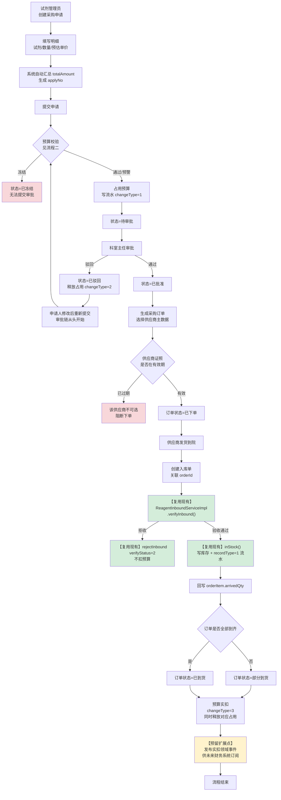
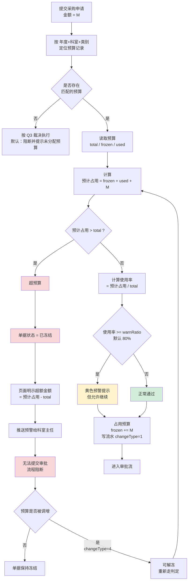
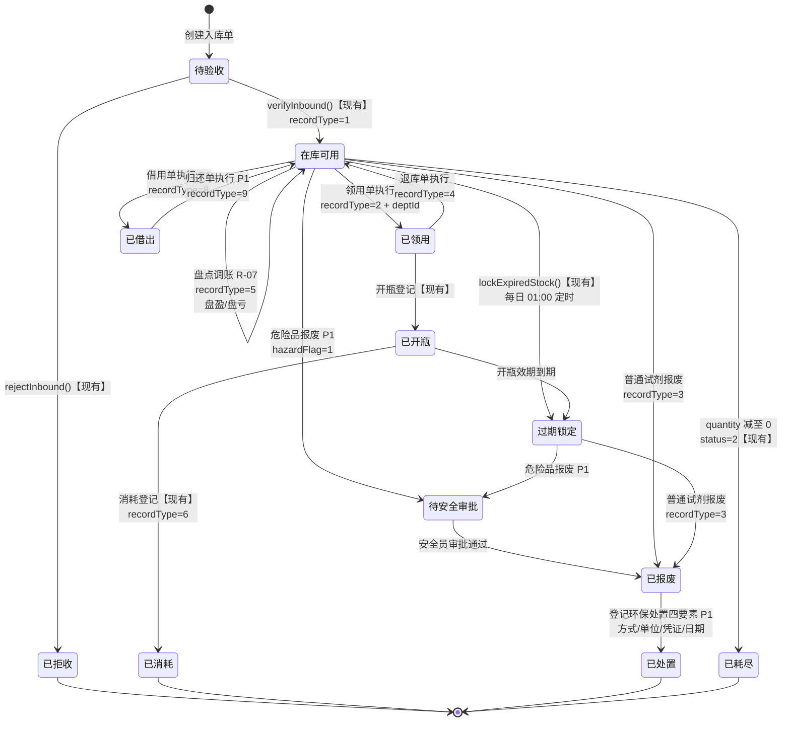

# 试剂管理模块 增量 PRD

| 项 | 内容 |
|---|---|
| 文档类型 | 增量 PRD（存量生产项目，非从零建设） |
| 模块 | `lis-service-reagent` + `lis-frontend/src/views/reagent` |
| 技术栈 | Java 17 + Spring Boot 3.2 + MyBatis-Plus（无 XML）+ PostgreSQL + Redis + RabbitMQ；前端 Vue3 + TS + Vite + Element Plus |
| 数据库 | `lis_db`（PostgreSQL，现有 66 张表） |
| 撰写人 | Alice（产品经理） |
| 版本 | **v1.2**（v1.1 据架构师设计复核 C-1~C-12 修订；v1.2 据 Q12 终裁反向对齐已落盘 DDL，见第 9 章） |

---

## 0. 阅读指引（给主理人 / 架构师）

本文第 1 章是**实读代码后的现状核实**，与主理人的初步摸底存在 **4 处实质性出入**，请优先阅读。
第 4 章需求池已做**优先级裁剪**：用户提的 16 个子功能点中，P0 只保留 7 条，P1 六条，P2 五条并说明不做的理由。

> **v1.1 变更提示**：架构师设计复核纠正了本文两处事实错误（`reagent_code` 唯一索引、缺陷 K 根因），并新发现缺陷 O/P/Q。**其中缺陷 O 会直接导致 R-05、R-07 的核心验收标准不成立，已升为 R-05 前置项。**新增待裁决问题 Q11、Q12，作废 Q9。完整勘误见**第 9 章**。

---

## 1. 现状核实表（最重要）

### 1.1 核实方法

逐个打开了以下文件（非文件名推测）：

- 实体：`Reagent.java`、`ReagentStock`（经 `init-schema.sql` 建表语句核对）、`ReagentStockRecord.java`、`ReagentInbound/Item`
- 服务：`ReagentServiceImpl.java`、`ReagentStockServiceImpl.java`、`ReagentInboundServiceImpl.java`、`ReagentDashboardServiceImpl.java`
- 控制器：`ReagentController`、`ReagentStockController`、`ReagentStockRecordController`、`ScanController`、`StockCheckController`、`CostController`
- Mapper：`ReagentCostMapper.java`（含内联 SQL）
- 定时任务：`ExpiryAlertJob.java`
- 建表脚本：`init-schema.sql`、`reagent-core-tables.sql`、`add-reagent-lot-trace.sql`、`add-reagent-stock-check.sql`
- 前端：`lis-frontend/src/api/reagent/index.ts`（全文 435 行）
- 全项目 Grep：`Purchase|Budget|Supplier|Procurement|Scrap|Transfer|Borrow|Warehouse`（`*.java`）与建表语句正则

### 1.2 我核实的实际情况 vs 主理人初判

> **结论先行：主理人的 4 条初判中，2 条需要修正、2 条需要精确化。另外我发现了 3 个主理人未提及的存量缺陷，其中 1 个是 P0 级功能失效。**

| # | 主理人初判 | 核实结果 | 证据 |
|---|---|---|---|
| A | 需求1 采购与预算「疑似完全缺失」 | **⚠️ 需修正为「后半段已具备」**。采购闭环的**后段（到货验收→入库→流水）已完整实现且质量可用**，缺的只有**前段（申请/审批/订单）**。金额字段也已存在。预算/供应商确实为零。 | `ReagentInboundServiceImpl.verifyInbound()` L72-101 完整实现验收→写库存；`ReagentInbound.totalAmount`、`ReagentInboundItem.purchasePrice/amount`（`reagent-core-tables.sql` L25/L46/L47）；`createInbound()` L43-56 已自动汇总金额。全项目 Grep 无任何 `Budget`/`Supplier` 实体或表。 |
| B | 需求2「疑似缺 CAS号」 | **❌ 初判错误**。CAS 号早已存在于实体和表。 | `Reagent.java` L23 `private String casNo;`；`init-schema.sql` `lis_reagent.cas_no VARCHAR(50)  -- CAS 号` |
| C | 需求2「疑似缺二维码」 | **❌ 初判部分错误**。条码字段与整套扫码接口已实现（扫码入库/出库/查询三个端点，出库还带 FEFO 降级）。真正缺的是**二维码生成与标签打印**，不是扫码识别。 | `init-schema.sql` `lis_reagent_stock.barcode VARCHAR(64) -- 二维码/条码`；`ScanController.scanIn()` L37、`scanOut()` L73、`query()` L117 |
| D | 需求3「有盘点」 | **⚠️ 需精确化为「盘点只记差异、不调账」**，等于盘点业务不闭环。`submitItems` 内不写任何库存流水、不回写 `lis_reagent_stock.quantity`。 | `StockCheckController.submitItems()` L118-119；对该文件 Grep `recordType\|StockRecord\|adjust` **零命中** |
| E | 需求3「疑似缺退库/调拨/报废」 | **⚠️ 需精确化为「有定义、无实现」**。类型码在注释里已定义齐全，但代码里只有 1/2 两种被真正写入过。 | `ReagentStockRecord.java` L21 注释 `1入库 2出库 3报损 4退库 5盘点`；`reagent-core-tables.sql` L97 注释扩展 `6消耗 7调拨`；但全模块仅 `ReagentStockServiceImpl.inStock()` L79 `setRecordType(1)` 与 `doOutStock()` L150 `setRecordType(2)` 两处赋值 |
| F | 需求4「有 Dashboard，缺自定义报表」 | **✅ 初判正确**，补充量化：Dashboard 仅 5 个标量数字，无任何时间序列/趋势接口；成本仅 2 个查询；全模块无导出能力。 | `ReagentDashboardServiceImpl.getOverview()` L36-73 返回 `totalReagents/totalStockValue/nearExpiryCount/lowStockCount/openedExpiryCount`；`ReagentCostMapper` 仅 `summaryByReagent`/`summaryByInstrument`/`detail` |

### 1.3 主理人未提及、我新发现的存量缺陷

| # | 缺陷 | 严重度 | 证据 |
|---|---|---|---|
| **G** | **试剂字典页搜索完全失效**。前端传 `reagentName`/`reagentCode`/`status`，后端只接 `keyword`/`instrumentId`/`testItemId`，参数名对不上被 Spring 静默丢弃，后端永远返回全量分页——**用户在页面上搜什么都出全部数据**。 | **P0 缺陷** | 前端 `api/reagent/index.ts` L71-81 `query.reagentName = reagentName`；后端 `ReagentController.page()` L22-26 形参仅 `keyword, instrumentId, testItemId` |
| **H** | **前端字段名与后端实体大面积错位**，相关列渲染为空。前端 `price`/`storageCondition`/`expiryDays`/`batchNo`/`warningValue` ↔ 后端 `pricePurchase`/`storageCond`/`openedExpiryDays`/`lotNo`/（`warningValue` 后端根本不存在）。出入库记录页同样错位（前端传 `reagentName`/`recordType:string`/`beginTime`/`endTime`，后端只接 `reagentId`/`recordType:Integer`）。 | **P0 缺陷** | 前端 L5-17（Reagent）、L20-31（ReagentStock）、L61-66（Query）；后端 `Reagent.java` L37-50、`ReagentStockRecordController.page()` L25-28 |
| **I** | `listBelowSafetyStock()` 返回**伪造实体**——把安全库存值拼成字符串塞进 `location` 字段当展示用；且循环内逐个试剂发查询，是 N+1。该方法被 Dashboard 和定时任务各调一次。 | 中（改造时必须重写） | `ReagentStockServiceImpl.java` L180-183 循环内 `this.list(...)`；L190 `alert.setLocation("安全库存: " + r.getSafetyStock())` |
| **J** | `outStockFifo` **名不副实**：按 `expiryDate` 升序，实为 FEFO（近效期优先）。对试剂而言 FEFO 才是正确行为，**建议改名不改逻辑**，避免后人误以为是 bug 去"修正"成真 FIFO。 | 低（但需备注） | `ReagentStockServiceImpl.java` L106 `.orderByAsc(ReagentStock::getExpiryDate)` |
| **K** | 【**已由架构师 C-2 修正根因，严重度上调**】原判断为「`inStock()` 合批键 `(reagentId, lotNo)` 不含存放位置」的 Java 层问题。**实际根因在数据库层**：`init-schema.sql` L666 `CREATE UNIQUE INDEX uk_lis_reagent_stock_lot ON lis_reagent_stock (reagent_id, lot_no)` —— 唯一索引本身不含仓库。多仓库上线后，同一批号入到两个冰箱会**直接触发唯一约束冲突、insert 失败报错**，不是"悄悄合并"而是"当场崩溃"。 **修复必须是 DROP 旧索引 → CREATE 三列唯一索引 `(reagent_id, lot_no, warehouse_id)`，只改 Java 层无效。** | **极高**（阻塞 R-09，且属生产事故级） | `init-schema.sql` **L666**（DB 层根因）；`ReagentStockServiceImpl.inStock()` L57-59（Java 层同步症状） |
| **O** | 【**架构师新发现，我已核实**】`ReagentStockController` 与 `ReagentStockRecordController` 存在**裸奔的写端点**：前者 `create()` L37-50 / `update()` L53-58 / `delete()` L61-65 可直接增改删 `lis_reagent_stock.quantity` **而不写任何流水**；后者 `create()` L38-45 / `update()` L48-53 / `delete()` L56-60 可直接增改删流水记录**而不动库存**。 **这直接摧毁我在 R-05 与 R-07 里写的核心验收标准「流水求和 + 初始值 = 当前 quantity」——只要这 6 个端点还在，该断言永远可被绕过。** | **P0**（否则 R-05/R-07 验收标准不成立） | `ReagentStockController.java` L37-65；`ReagentStockRecordController.java` L38-60 |
| **P** | 【**架构师新发现，我已核实**】`StockCheckController` **全类无任何 `@Transactional`**（对该文件 Grep `Transactional` 零命中），且 `submitItems()` 不防重复提交。R-07 要把盘点改造成"回写库存 + 生成调账流水"的多写操作，**无事务保障 = 中途失败会留下账实撕裂的脏数据**。 | **高**（R-07 前置） | `StockCheckController.java` 全文 Grep `Transactional` 零命中 |
| **Q** | 【**架构师 C-9 提示，经三方交叉印证后终裁**】全部 12 个模块的 `application.yml` 均配置了 `logic-delete-field: deleted`（reagent 模块在 L29-30）。架构师称"**所有表都无 `deleted` 列 → 任何 remove/page 必报错**"——**此主张不成立**：`lis_sample` **有**该列（`init-schema.sql` L113 `deleted SMALLINT DEFAULT 0`），与 `Sample.java:119` 的 `@TableLogic` 严格配对；主理人独立 grep 确认全项目 `@TableLogic` 仅此 1 处命中。 **`logic-delete-field` 按实体字段名匹配才生效，实体不声明则惰性无害**——现有 reagent 实体均无 `deleted` 字段，配置完全不触发，故当前零故障。 **终裁 Q12 = 全不做分支**：14 张新表一律不加 `deleted` 列，新实体一律禁止声明 `deleted` 字段，逻辑删除由各自 `status` 承担（见 §5.2、Q12）。**唯一真实雷点**：若未来开发在新实体上声明 `deleted` 字段而表里无列，MyBatis-Plus 会在每条 SQL 注入 `AND deleted = 0`，运行期报 `column "deleted" does not exist`。此约束已写入 Q12 硬约束。 | 低（终裁后仅剩"勿在新实体加 deleted 字段"一条纪律） | 12 个模块 `application.yml`（reagent L29-30）；`init-schema.sql` **L113**（`lis_sample.deleted SMALLINT`，与 `Sample.java:119` `@TableLogic` 配对）；主理人 grep：全项目 `@TableLogic` 仅 1 处命中 |
| **L** | **无通用审批流基础设施**。全项目仅 `lis-service-report` 域有 `AutoAuditEngine`（报告自动审核规则引擎，与单据审批无关）。采购审批、高危试剂审批需自建轻量审批链。 | 中（影响 R-02 工作量评估） | Grep `*Approv*\|*Workflow*\|*Flow*` 仅命中 report 域与 `SysAuditLog`（操作日志，非审批） |
| **M** | `Reagent` 有 **3 个语义重叠的库存阈值字段**：`safetyStock`（init-schema）、`minStock`、`maxStock`（reagent-core-tables 后补）。目前**只有 `safetyStock` 被代码读取**，`minStock`/`maxStock` 从未被任何代码使用。 | 中（需裁决，见 Q4） | `Reagent.java` L28/L46/L48；仅 `ReagentStockServiceImpl.listBelowSafetyStock()` L178/L186 读 `safetyStock` |
| **N** | `Reagent.categoryId`、`manufacturerId` 是**悬空外键**——字段存在，但库中无对应字典表。 | 中 | `Reagent.java` L30/L32；Grep 无 `lis_reagent_category` / 厂商表建表语句 |

### 1.4 逐子功能核实明细表

图例：`✅已有` / `🟡部分有` / `❌无`；处置：`复用` / `改造` / `新建`

#### 需求 1：试剂采购与预算管理

| 子功能 | 现状 | 证据（文件 : 类.方法 / 表.字段） | 缺口描述 | 处置 |
|---|---|---|---|---|
| 1.1 采购申请 | ❌ 无 | 全项目 Grep `Purchase\|Apply` 无采购申请实体/表 | 无申请单、无明细、无申请人/科室归属 | **新建** |
| 1.2 采购审批 | ❌ 无 | Grep `*Approv*` 仅命中 report 域 `AutoAuditEngine`（缺陷 L） | 无审批链、无审批留痕、无多级节点 | **新建** |
| 1.3 采购订单生成 | ❌ 无 | 无 order 相关表/实体 | 无订单、无到货数量跟踪 | **新建** |
| 1.4 入库验收 | ✅ 已有 | `ReagentInboundServiceImpl.verifyInbound()` L72-101 / `rejectInbound()` L105-121；表 `lis_reagent_inbound.verify_status/verifier_id/verify_time` | 功能完整可用。**仅缺与订单的关联**（无 `order_id` 字段） | **复用+加字段** |
| 1.5 采购金额自动同步财务 | ❌ 无 | `ReagentInbound.totalAmount` 已算出（`createInbound()` L43-56）但无任何下游消费方 | 金额算完即止，无预算扣减、无外部推送 | **新建（内部闭环）** |
| 1.6 多维度预算分配 | ❌ 无 | 无 budget 表；`sys_department` 表已存在（`init-schema.sql` L440）可直接做科室维度 | 无预算主表、无年度/科室/项目维度 | **新建** |
| 1.7 预算进度实时显示 | ❌ 无 | Dashboard 无任何预算字段 | 无占用/实扣分离，无进度计算 | **新建** |
| 1.8 超预算预警与冻结 | ❌ 无 | — | 无阈值判定、无流程冻结机制 | **新建** |
| 1.9 供应商资质审核 | ❌ 无（仅字符串） | `Reagent.supplier` **VARCHAR(100) 自由文本**（`reagent-core-tables.sql` L18）；`lis_reagent_inbound.supplier` 同为 VARCHAR | 供应商是裸字符串，无主数据、无证照、无有效期校验 | **新建+改造** |
| 1.10 历史采购记录 / 价格比对 | 🟡 数据有、能力无 | `lis_reagent_inbound_item.purchase_price` 逐笔已存 | 数据在库里但**无任何按供应商聚合/比价的查询** | **改造（加查询）** |
| 1.11 供应商评价体系 | ❌ 无 | — | 无评分模型 | **新建** |

#### 需求 2：试剂信息管理

| 子功能 | 现状 | 证据 | 缺口描述 | 处置 |
|---|---|---|---|---|
| 2.1 试剂分类 | 🟡 字段有、字典无 | `Reagent.categoryId` L30 存在，但**无 `lis_reagent_category` 表**（缺陷 N） | 悬空外键，无法按化学/生物/危险品分类 | **新建字典** |
| 2.2 危险品标识 | ❌ 无 | `Reagent.java` 全 25 个字段无 hazard/危险相关；Grep `hazard` 零命中 | 无危险品标记、无危险等级 | **新建字段** |
| 2.3 唯一试剂身份编码 | ✅ 已有（**完整**） | `lis_reagent.reagent_code VARCHAR(32) NOT NULL`；`ReagentServiceImpl.getByCode()` L32-35；**唯一索引已存在：`init-schema.sql` L648 `uk_lis_reagent_code`** | **无缺口**（原稿误判"未加唯一索引"，已按架构师 C-1 更正） | **复用** |
| 2.4 条码/二维码识别 | ✅ 已有 | `lis_reagent_stock.barcode VARCHAR(64)`；`ScanController` 三端点 L37/L73/L117 | 扫码识别已完整（**纠正主理人初判 C**） | **复用** |
| 2.5 二维码生成与标签打印 | ❌ 无 | 无任何 QR 生成/打印代码 | 只能读码不能出码 | **新建（P2）** |
| 2.6 CAS 号 | ✅ 已有 | `Reagent.java` L23 `casNo`；`lis_reagent.cas_no VARCHAR(50)`（**纠正主理人初判 B**） | 无缺口 | **复用** |
| 2.7 规格 / 储存条件 | ✅ 已有 | `Reagent.specification` L21、`Reagent.storageCond` L24 | 储存条件是自由文本，**无温度上下限数值**，无法做冰箱温度校验 | **复用+加字段** |
| 2.8 MSDS 安全数据表 | ❌ 无 | Grep `msds` 零命中 | 无 MSDS 存储、无关联 | **新建字段** |
| 2.9 批量导入导出 | ❌ 无 | `ReagentController` 仅 CRUD 5 个端点（L21-57），无 import/export | 无 Excel 导入导出 | **新建** |
| 2.10 智能检索（多条件组合） | 🟡 弱且**当前失效** | `ReagentServiceImpl.queryPage()` L15-29 支持 `keyword`(code/name 模糊) + `instrumentId` + `testItemId`；**但前端参数名对不上，实际搜索失效（缺陷 G）** | 无库存量/效期/存放位置/分类条件；且现有能力被前后端错位废掉 | **改造** |

#### 需求 3：试剂全生命周期管理

| 子功能 | 现状 | 证据 | 缺口描述 | 处置 |
|---|---|---|---|---|
| 3.1 入库追踪 | ✅ 已有 | `ReagentStockServiceImpl.inStock()` L52-92，写 `recordType=1` 流水含 before/after 数量 | 完整 | **复用** |
| 3.2 领用（出库）追踪 | 🟡 有出库无单据 | `outStock()` L124-137、`outStockFifo()` L96-120，写 `recordType=2` | 有库存动作，**但无领用单、无科室归属、无申请审批**（`ReagentStockRecord` 无 deptId 字段） | **改造+新建** |
| 3.3 退库 | ❌ 有定义无实现 | `ReagentStockRecord.java` L21 注释含 `4退库`，但无代码写入 4（缺陷 E） | 类型码是空壳 | **新建** |
| 3.4 调拨 | ❌ 有定义无实现 | `reagent-core-tables.sql` L97 注释含 `7调拨`，无代码写入 | 类型码是空壳 | **新建** |
| 3.5 借用 / 归还 | ❌ 无 | 类型码里连定义都没有 | 完全缺失 | **新建** |
| 3.6 报废 | ❌ 有定义无实现 | 注释含 `3报损`，无代码写入 | 类型码是空壳 | **新建** |
| 3.7 责任人与部门关联 | 🟡 有人无部门 | `ReagentStockRecord.operatorId/operatorName` 已有 L26-27；**全模块无任何 deptId 字段** | 无法按科室归集领用与成本 | **改造** |
| 3.8 近效期自动预警 | ✅ 已有 | `ReagentStockServiceImpl.listNearExpiry()` L164-171；`ExpiryAlertJob.executeDaily()` L26-37 每日 01:00 cron；`lockExpiredStock()` L199-213 自动锁定 | 逻辑完整。**但预警只 `log.info` 打印，不落库、不推送**（`ExpiryAlertJob` L33 仅打印计数） | **改造** |
| 3.9 高危试剂额外审批 | ❌ 无 | 无危险品标识（2.2），也无审批链（缺陷 L） | 双重缺失 | **新建** |
| 3.10 报废电子登记 + 环保处置 | ❌ 无 | — | 无处置方式/处置单位/处置凭证 | **新建** |
| 3.11 实时库存显示 | ✅ 已有 | `ReagentStockController.page()` L26-34；`lis_reagent_stock.quantity` 实时增减 | 完整 | **复用** |
| 3.12 最低库存阈值提醒 | 🟡 能跑但实现劣质 | `listBelowSafetyStock()` L174-195 | 返回伪造实体 + N+1（缺陷 I）；且 3 个阈值字段语义打架（缺陷 M） | **改造** |
| 3.13 多仓库 / 冰箱分级 | ❌ 无 | `lis_reagent_stock.location VARCHAR(100)` **自由文本**；`lis_reagent_stock_check.warehouse VARCHAR(100)` 也是自由文本，两者无关联、无主数据 | 无仓库主表、无层级、无温度属性。**且合批键不含位置（缺陷 K）为前置阻塞** | **新建+改造** |
| 3.14 盘点 | 🟡 **有单据不调账** | `StockCheckController` 6 端点（L39/L57/L63/L74/L118）；`lis_reagent_stock_check_item.book_qty/actual_qty/diff_qty` | `submitItems` 不写流水不回写库存（**纠正主理人初判 D**），盘完账实照样不符 | **改造** |
| 3.15 批次追溯 | ✅ 已有 | `add-reagent-lot-trace.sql` 给 `lis_result` 加 `reagent_lot_id`/`reagent_lot_no` + 2 个索引；`ReagentTraceController` | 试剂批号→检测结果反查已通 | **复用** |

#### 需求 4：试剂统计与移动化应用

| 子功能 | 现状 | 证据 | 缺口描述 | 处置 |
|---|---|---|---|---|
| 4.1 扫码能力（API 层） | ✅ 已有 | `ScanController.scanIn/scanOut/query` L37/L73/L117 | API 完备，含条码未命中降级 FEFO | **复用** |
| 4.2 移动端页面 | ❌ 无 | `views/reagent/` 下 8 个页面均为 PC 布局，无移动端路由/适配 | 扫码 API 没有移动端载体 | **新建** |
| 4.3 扫码盘点 | ❌ 无 | 盘点走 `StockCheckController` 手工录入，与 `ScanController` **无任何调用关系** | 两套能力未打通 | **新建** |
| 4.4 移动端领用申请 | ❌ 无 | 无领用单（见 3.2） | 依赖 R-05 | **新建** |
| 4.5 离线模式 | ❌ 无 | 无 IndexedDB/Service Worker/本地队列 | 完全缺失 | **新建（降级方案）** |
| 4.6 成本核算报表 | ✅ 已有 | `ReagentCostMapper.summaryByReagent/summaryByInstrument/detail`；`CostController` L28/L43 | 已有试剂维度与仪器维度 | **复用** |
| 4.7 库存分析报表 | 🟡 仅标量 | `ReagentDashboardServiceImpl.getOverview()` L36-73 五个数字 | 无结构分布、无周转率 | **改造** |
| 4.8 采购统计报表 | ❌ 无 | 无采购数据源（依赖 R-02） | — | **新建** |
| 4.9 领用趋势（时间序列） | ❌ 无 | 所有现有查询均为**时间段内单点聚合**，无按日/月分组 | 无趋势数据接口 | **新建** |
| 4.10 可视化图表 | 🟡 待确认 | 后端返回 `List<Map>` 结构对图表友好；前端 `dashboard/index.vue` 需确认图表库 | 缺趋势类图表数据源 | **改造** |
| 4.11 自定义报表字段 | ❌ 无 | — | 需报表设计器 | **新建（P2）** |
| 4.12 报表导出 | ❌ 无 | 全模块无 Excel/PDF 导出端点 | 完全缺失 | **新建** |

### 1.5 现状总结（一句话）

> **试剂模块的"库存执行层"（入库/出库/批次/扫码/效期/追溯）质量良好、可直接复用；"业务单据层"（采购、领用、调拨、报废、盘点调账）几乎全部缺失或只有空壳类型码；"管理层"（预算、供应商、多仓库、报表）从零开始。此外存在 2 个已上线但功能失效的前后端契约缺陷（G/H），必须先修。**

---

## 2. 产品目标

| # | 目标 | 业务价值 | 衡量指标 |
|---|---|---|---|
| G1 | **打通"钱"的闭环** | 让试剂支出从申请到入库全程有据可查、有预算可控，杜绝"先花后报、超支才知道" | 采购申请到入库全流程 100% 线上留痕；超预算申请 100% 被拦截，无一例绕过 |
| G2 | **打通"物"的闭环** | 让每一支试剂从进门到销毁的每一次流转都有单据、有责任人、有科室归属 | 库存流水覆盖 6 种业务动作（入/领/退/拨/废/盘）；账实相符率 ≥ 99%（由盘点调账保证） |
| G3 | **补齐合规底线** | 危险品与报废处置满足实验室安全与环保监管要求 | 危险品试剂 100% 有分类标识与 MSDS；报废 100% 有处置记录与审批 |
| G4 | **修复存量失效功能** | 现有页面上"看得见但用不了"的搜索与字段展示恢复可用 | 缺陷 G/H 涉及的搜索条件与展示字段 100% 生效 |
| G5 | **让数据说话** | 管理者能看到趋势而非只有当前快照，支持采购决策与成本管控 | 提供采购/领用/库存 3 类趋势报表，支持导出 |

---

## 3. 用户故事

### 检验科主任（决策与审批）
- 作为检验科主任，我希望在审批采购申请时能直接看到本科室当前预算余额和本次申请占比，以便判断是否批准，而不用另外去问财务。
- 作为检验科主任，我希望超预算的申请被系统自动冻结并给我预警，以便避免事后超支追责。
- 作为检验科主任，我希望看到本科室试剂领用趋势和成本排名，以便发现异常消耗并优化采购计划。

### 试剂管理员（日常执行主力）
- 作为试剂管理员，我希望录入采购申请后系统自动流转到主任审批、批准后自动生成订单，以便不用线下追着领导签字。
- 作为试剂管理员，我希望供应商是从主数据里选而不是手打，并能看到该供应商证照是否在有效期内，以便避免采购到无资质渠道的试剂。
- 作为试剂管理员，我希望盘点提交后系统自动生成盈亏调整流水并更新库存，以便盘点结果真正生效而不是白盘一场。
- 作为试剂管理员，我希望能按存放位置、效期区间、库存量组合筛选试剂，以便快速定位近效期需优先使用的批次。
- 作为试剂管理员，我希望用 Excel 批量导入几百种试剂基础信息，以便系统初始化时不用一条条敲。

### 检验技师（一线使用者）
- 作为检验技师，我希望用手机扫试剂条码就能提交领用申请，以便不用回工位开电脑。
- 作为检验技师，我希望在冰箱旁边扫码盘点时，即使没有 WiFi 也能先把数据存下来、回到有网时再提交，以便不中断盘点作业。
- 作为检验技师，我希望领用高危试剂时系统提示需要额外审批并展示 MSDS 要点，以便我知道该怎么防护。
- 作为检验技师，我希望多余的试剂能走退库流程还回库房，以便不占用我们组的账面消耗。

### 采购员
- 作为采购员，我希望看到同一试剂在不同供应商的历史成交价对比，以便谈判时有依据。
- 作为采购员，我希望到货验收时能直接关联采购订单核对数量，以便发现少发漏发。

### 财务 / 成本管理岗
- 作为财务，我希望预算按年度+科室+试剂类别三个维度分配并实时显示占用与实扣，以便随时掌握执行进度。
- 作为财务，我希望采购金额在入库验收时自动实扣预算，以便账目与实物同步，不需要月末对账。
- 作为财务，我希望能导出采购统计与成本核算报表，以便并入医院整体成本分析。

---

## 4. 需求池

### 4.1 优先级判定标准

- **P0（本轮必做，7 条）** = 业务闭环必需 **且** 现有代码无法绕过。去掉任何一条，"钱"或"物"的闭环就断。
- **P1（本轮尽量做，6 条）** = 提升管理精度与体验，但缺失时业务仍可运转（可用变通手段）。
- **P2（本轮明确不做，5 条）** = 投入产出比低、依赖外部条件不具备、或属于下一阶段能力。

> **裁剪立场**：用户一口气提了 16 个子功能点。我把 **11 条**放进 P0+P1，**5 条**明确排除。核心判断是——**先让"采购→预算→入库"和"入库→领用→报废"两条主干闭环真正跑通并可验收，好过 16 条全做成半成品。** 半成品的库存系统比没有系统更危险，因为它会让人误以为账是准的。

---

### 4.2 P0 —— 本轮必做

---

#### **R-01｜修复前后端契约错位（存量缺陷）**

| 项 | 内容 |
|---|---|
| 描述 | 修复缺陷 G / H：统一试剂字典、库存、出入库记录三个列表页的查询参数名与展示字段名，使前端已有的搜索框和表格列真正生效 |
| 优先级 | **P0** |
| 依赖 | 无（应最先做，否则后续新功能会沿用同一套错位契约继续踩坑） |
| 理由 | 这不是新需求，是**已上线功能处于失效状态**。用户在试剂列表输入任何关键字都返回全量数据，`价格`/`储存条件`/`批号`等列渲染为空。成本极低（1 人日内），收益立竿见影，且是后续所有前端联调的地基 |
| 验收标准 | 1. 试剂列表输入试剂名称片段，返回结果条数 < 全量条数，且每条结果的 `reagentName` 均包含该片段 2. 试剂列表输入试剂编码、选择状态，三个条件可任意组合生效 3. 试剂列表的"价格""储存条件"列有值展示（对应后端 `pricePurchase`/`storageCond`） 4. 库存列表"批号"列有值展示（对应后端 `lotNo`） 5. 出入库记录页按试剂、按记录类型、按时间范围筛选均生效 6. 前端 `ReagentStock.warningValue` 等后端不存在的字段被移除或明确对应到真实字段 |

---

#### **R-02｜采购申请 → 审批 → 订单 → 到货验收 闭环**

| 项 | 内容 |
|---|---|
| 描述 | 新建采购申请单（含明细）、轻量多级审批链（申请人→科室主任→（超预算时）分管院长）、审批通过后生成采购订单、订单关联到现有入库单完成验收核对 |
| 优先级 | **P0** |
| 依赖 | R-03（预算校验在审批节点触发）、R-04（订单须选供应商主数据）；**复用** `ReagentInboundServiceImpl.verifyInbound()` |
| 理由 | 用户需求 1.1 的核心。当前"后段验收"已可用（核实结论 A），只需补前段并与之对接，是性价比最高的一段 |
| 验收标准 | 1. 可创建含 ≥2 条明细的采购申请，系统自动汇总 `totalAmount` 并生成唯一 `applyNo` 2. 提交后单据状态变为"待审批"，且**申请人无法再修改明细**（尝试修改返回业务异常） 3. 每个审批动作（通过/驳回）在审批记录表落一条，含审批人、时间、意见，**审批历史不可删改** 4. 驳回后单据回到"已驳回"，申请人可修改并重新提交，重新提交后审批链**从第一节点重新开始** 5. 审批通过后可一键生成采购订单，订单自动带出申请明细，且 `applyId` 正确回填 6. 创建入库单时可选择关联采购订单；验收通过后订单明细 `arrivedQty` 累加，全部到齐时订单状态自动变为"已到货" 7. 入库数量大于订单未到货量时，系统拦截并提示（不允许超收） |

---

#### **R-03｜预算分配、实时占用与超预算冻结**

| 项 | 内容 |
|---|---|
| 描述 | 按「年度 + 科室 + 试剂类别」三维度维护预算额度；采购申请提交时**占用**预算，入库验收时**实扣**并释放占用；超预算时预警并冻结流程 |
| 优先级 | **P0** |
| 依赖 | R-02（占用/实扣触发点）、R-06（类别维度来自分类字典）；科室维度**复用现有 `sys_department` 表，不新建** |
| 理由 | 用户需求 1.2 核心，且是目标 G1 的判定闸门。**关于"与财务系统对接"：本项目无真实财务系统可对接，本轮定义为内部预算模块闭环 + 预留同步接口（见 R-16/P2），我认可主理人的判断。**理由是：外部对接的接口契约完全由对方系统决定，在对方系统不存在时设计的对接协议 100% 会返工，属于确定性浪费 |
| 验收标准 | 1. 可为「2026年 + 检验科 + 生化试剂」创建预算 100 万，重复创建同一三元组时系统拒绝 2. 提交一张 10 万的采购申请后，该预算"已占用"变为 10 万，"可用余额"变为 90 万，"已实扣"仍为 0 3. 该申请被驳回或作废后，占用**自动释放**，可用余额回到 100 万 4. 该申请对应订单入库验收通过后，"已实扣"变为实际入库金额，"已占用"相应减少，两者不重复计算 5. 每一次占用/释放/实扣在预算流水表落一条，含变动前后值与来源单号，**流水求和恒等于预算主表的占用/实扣值**（可写对账断言） 6. 预算使用率 ≥ 80%（阈值可配）时，提交申请返回预警提示但**允许继续** 7. 申请金额导致占用 + 实扣 > 预算总额时，单据进入"已冻结"状态，**无法提交审批**，页面明示超额金额 8. 冻结的单据在预算调增后可解冻继续流转 |

---

#### **R-04｜供应商主数据与资质管控**

| 项 | 内容 |
|---|---|
| 描述 | 新建供应商主数据（含营业执照、医疗器械经营许可证及各自有效期）；采购订单与入库单从主数据选择供应商；提供同一试剂跨供应商历史成交价对比 |
| 优先级 | **P0** |
| 依赖 | 无（但 R-02 依赖它） |
| 理由 | 用户需求 1.3。当前供应商是**自由文本**（核实结论 1.9），同一家公司会出现"XX生物""XX生物科技""XX生物科技有限公司"三条数据，导致比价、统计全部不可信。**无法通过任何变通手段绕过**——只要采购单要选供应商，主数据就必须先有。 **范围裁剪：本条只做主数据 + 资质有效期校验 + 历史价对比，"评价体系"移入 P1（R-11）**，因为评价模型需要业务方先定义评分维度，现在拍脑袋定的模型上线即废 |
| 验收标准 | 1. 可维护供应商，`supplierCode` 唯一，重复录入被拒 2. 录入营业执照号 + 到期日、医疗器械经营许可证号 + 到期日 3. 任一证照已过期时，该供应商在采购订单的下拉列表中**不可选**，并在供应商列表以醒目状态标记 4. 证照 30 天内到期的供应商，在供应商列表可被筛选出来 5. 采购订单、入库单均记录 `supplierId`；**现有 `supplier` 字符串字段保留做冗余展示，不删除**（避免破坏存量数据与页面） 6. 提供「某试剂的供应商比价」查询：输入 `reagentId`，返回各供应商的历史采购次数、最近成交价、最低价、最高价、均价，按均价升序 7. 存量数据迁移：现有 `lis_reagent.supplier` / `lis_reagent_inbound.supplier` 中的非空字符串自动生成供应商主数据草稿记录（状态=待完善） |

---

#### **R-05｜领用 / 退库 / 报废 单据化与库存流水类型落地**

| 项 | 内容 |
|---|---|
| 描述 | 新建统一的试剂出入库业务单据（领用/退库/报废），带科室归属与责任人；执行时调用现有库存服务并写入对应 `recordType`（3报损 / 4退库 / 2出库-领用），让已定义的类型码真正落地 |
| 优先级 | **P0** |
| 依赖 | 复用 `ReagentStockService.outStock()` / `inStock()`；报废需 R-06 的危险品标识判断是否走额外审批（P1 部分）；**前置：必须先下线缺陷 O 的 6 个裸奔写端点，否则本条第 7 项验收标准不成立** |
| 理由 | 用户需求 3.1 的主干。当前只有裸的"出库"动作，**没有单据、没有科室、没有申请人**（核实结论 3.2/3.7），意味着：无法回答"这批试剂被谁领走了""生化组这个月领了多少钱的试剂"。这是"物"的闭环（G2）和科室成本归集（G5）的共同前提。 **范围裁剪：本条只做领用/退库/报废三种，调拨与借用归还移入 P1（R-08）**——因为调拨涉及双仓库，强依赖 R-09 多仓库主数据；借用是低频场景 |
| 验收标准 | 1. 可创建领用单（含多条明细，指定试剂+批次+数量），提交后状态"待审" 2. 审核通过并执行后：`lis_reagent_stock.quantity` 相应减少；`lis_reagent_stock_record` 新增记录，`recordType=2`，`sourceNo` = 领用单号，且**新增的 `deptId` 字段有值** 3. 库存不足时执行失败并回滚，单据保持"已审"未执行状态，库存数量不变 4. 退库单执行后：库存增加，流水 `recordType=4`，数量为正数 5. 报废单执行后：库存减少，流水 `recordType=3`，数量为负数，且**必须填写报废原因**（为空则拒绝提交） 6. 单据可按科室、按类型、按时间范围查询 7. 对任一批次，其所有流水的 `quantity` 求和 + 初始值 = 当前 `quantity`（可写对账断言） 8. **`ReagentStockController` 与 `ReagentStockRecordController` 的 POST/PUT/DELETE 共 6 个端点已删除**，对其发起请求返回 404/405；前端 `saveStock`/`deleteStock`/`saveRecord`/`deleteRecord` 四个函数及对应页面按钮已同步移除 9. **库存与流水的唯一写入通道是 `ReagentStockService` 的 `inStock`/`outStock`**（可用架构测试或代码评审确认无旁路写入） |

---

#### **R-06｜试剂分类字典 + 危险品标识 + MSDS**

| 项 | 内容 |
|---|---|
| 描述 | 新建试剂分类字典表（支持树形，如 化学试剂/生物试剂/危险品/耗材），填实 `Reagent.categoryId` 悬空外键；在 `lis_reagent` 增加危险品标识、危险等级、MSDS 内容/链接、储存温度上下限字段 |
| 优先级 | **P0** |
| 依赖 | 无（R-03 的类别预算维度依赖它） |
| 理由 | 用户需求 2.1 + 2.2 部分。三重必要性：①`categoryId` 已是悬空外键（缺陷 N），是数据完整性问题；②预算的"项目维度"需要类别做分组键；③**危险品标识与 MSDS 是实验室安全合规的硬要求**，不是"nice to have"。 **范围裁剪：MSDS 本轮存"文本要点 + 外部链接"，不做文件上传服务**——项目当前无对象存储/文件服务基础设施，为 MSDS 单独引入文件服务是过度投入 |
| 验收标准 | 1. 可维护树形分类，支持至少两级（父类"危险品"→子类"易燃液体"） 2. 分类下存在试剂时，禁止删除该分类 3. 试剂编辑页可选择分类，`categoryId` 正确保存并可反查 4. 试剂可标记 `hazardFlag`（是否危险品）与 `hazardClass`（危险等级） 5. 试剂可录入 MSDS 要点文本与外部链接，试剂详情页可查看 6. 试剂可录入储存温度上下限（数值），与现有 `storageCond` 文本字段并存 7. 危险品试剂在试剂列表、库存列表、领用单明细中均有醒目视觉标识 8. 可按"是否危险品""分类"筛选试剂 |

---

#### **R-07｜盘点调账闭环**

| 项 | 内容 |
|---|---|
| 描述 | 改造盘点提交逻辑：提交实盘数后，对有差异的明细自动生成盘盈/盘亏库存流水（`recordType=5`）并回写 `lis_reagent_stock.quantity`，使账实一致 |
| 优先级 | **P0** |
| 依赖 | 纯改造现有 `StockCheckController.submitItems`。**前置：该类全无 `@Transactional`（缺陷 P），改造时必须把业务逻辑下沉到 Service 并加事务，否则第 6 项验收标准无法满足** |
| 理由 | 当前盘点**只记差异不调账**（核实结论 D），盘完之后账面数量原封不动——盘点这个功能目前在业务上等于零价值，甚至有害（管理者以为盘过了、账是准的）。改造量小，是"物"的闭环（G2）中账实相符率指标的唯一保障手段 |
| 验收标准 | 1. 提交实盘数量后，`diff_qty` 正确计算为 `actual_qty - book_qty` 2. 对每条 `diff_qty != 0` 的明细，生成一条 `recordType=5` 的流水，`quantity` = 差异值（盘盈为正、盘亏为负），`before_qty`/`after_qty` 正确 3. `lis_reagent_stock.quantity` 被更新为 `actual_qty` 4. `diff_qty = 0` 的明细**不生成**流水（避免流水表噪音） 5. 盘点单状态变为"已完成"，**已完成的盘点单不可再次提交**（重复提交返回业务异常，不产生重复调账） 6. 整个提交过程在单个事务内，任一明细失败则全部回滚 7. 盘亏导致数量归零时，批次状态正确置为"已耗尽" |

---

### 4.3 P1 —— 本轮尽量做

| 编号 | 名称 | 描述 | 依赖 | 验收标准（要点） |
|---|---|---|---|---|
| **R-08** | 调拨 / 借用 / 归还 | 扩展 R-05 单据类型，新增调拨（跨仓库移库）、借用、归还；扩展 `recordType` 至 `7调拨 8借用 9归还` | R-05、**R-09（调拨强依赖仓库主数据）** | 调拨执行后源仓库减、目标仓库增，生成成对流水且数量绝对值相等；借用单记录预计归还日期，逾期未还可筛选；归还后库存回增 |
| **R-09** | 多仓库 / 冰箱分级管理 | 新建仓库主数据（支持 库房→冰箱→层架 三级树），带温度区间属性；`lis_reagent_stock` 增加 `warehouseId`；**同步修复缺陷 K（DB 索引 + Java 合批键两处）** | 无（但阻塞 R-08） | 可维护三级仓库树；库存可按仓库节点筛选并汇总；**① DB 层：旧唯一索引 `uk_lis_reagent_stock_lot`(2列) 已 DROP，新三列唯一索引 `(reagent_id, lot_no, warehouse_id)` 已建立；② Java 层：`inStock()` 合批键改为三元组**；**回归用例：同一试剂同一批号分别入库到两个不同冰箱，两条库存记录均创建成功且互不干扰（此用例在修复前必然失败）**；试剂储存温度超出目标冰箱温度区间时给出警告 |
| **R-10** | 高危试剂额外审批 + 报废环保处置 | 危险品试剂的领用/报废单自动追加一级安全员审批；报废单扩展处置方式、处置单位、处置凭证号、处置日期 | R-05、R-06 | `hazardFlag=1` 的试剂进入单据明细时，审批链自动多一级且不可跳过；普通试剂不触发；报废危险品时处置四要素为必填，缺一不可提交；可导出危险品处置台账 |
| **R-11** | 供应商评价体系 | 基于到货及时率、验收合格率、价格竞争力等维度对供应商打分 | R-04、R-02 | 系统自动统计各供应商的订单准时率与入库拒收率；支持人工补充主观评分；供应商列表可按综合分排序 |
| **R-12** | 移动端 Web + 扫码作业 + 离线暂存 | 移动端适配的 Web 页面（扫码盘点 / 扫码领用 / 库存查询），断网时数据暂存本地、恢复后手动提交 | R-05、R-07；复用 `ScanController` | 移动端页面在 375px 宽下布局正常；扫码可调起摄像头并识别条码；扫码盘点结果可写入盘点单；**断网时提交的数据存入浏览器本地存储且页面明示"N 条待上传"，恢复网络后可一键提交且不重复提交（幂等）** |
| **R-13** | 报表增强 + 导出 | 新增采购统计、领用趋势（按日/周/月时间序列）、库存结构分析三类报表；全部支持 Excel 导出 | R-02、R-05 | 领用趋势可按日/月粒度返回时间序列数据，空档期补 0；采购统计可按供应商/科室/试剂类别分组；三类报表 + 现有成本报表均可导出 Excel 且数据与页面一致 |
| **R-14** | 智能检索增强 + 批量导入导出 | 试剂检索支持分类、危险品、库存量区间、效期区间、存放位置组合筛选；试剂基础信息支持 Excel 批量导入导出 | R-01、R-06、R-09 | 5 个以上条件可任意组合且结果正确；导入模板可下载；导入时逐行校验，失败行返回行号与原因且不影响成功行；导出结果可再次导入（往返一致） |

---

### 4.4 P2 —— 本轮明确不做

| 编号 | 名称 | 不做的理由 | 后续建议 |
|---|---|---|---|
| **R-15** | 与外部财务系统真实对接 | **本项目无真实财务系统可对接。**接口契约（协议、字段、鉴权、对账规则）完全由对方系统决定，在对方不存在时设计的对接方案返工率接近 100%，属于确定性浪费 | 本轮在预算实扣处**预留一个内部事件/扩展点**（如实扣成功后发布领域事件），未来接入时只需增加一个订阅者，不改动主流程。**建议架构师在 R-03 实现时把实扣动作与外部同步解耦** |
| **R-16** | 原生 PDA / 手机 APP | 现有前端是 Vue3 Web，无移动原生技术栈、无 App 发布渠道、无设备管理能力。为本轮需求引入一整套原生开发链路，投入远超收益 | 用 R-12 的移动端 Web 满足 90% 场景。若未来确有 PDA 硬件（如霍尼韦尔/斑马扫码枪），这类设备普遍支持"扫码即键盘输入"，R-12 的 Web 页面**可直接兼容**，无需原生开发 |
| **R-17** | 真·离线模式（完整离线数据库 + 双向同步） | 完整离线需要本地数据库、冲突检测与合并策略、同步状态机，复杂度接近再做一个系统。而试剂盘点/领用的离线场景是**短时弱网**（冰箱间、库房角落），不是长期断网 | R-12 的"本地暂存草稿 + 恢复后手动提交"已覆盖真实痛点。若未来确需完整离线，应作为独立专项立项 |
| **R-18** | 自定义报表字段 / 拖拽式报表设计器 | 报表设计器是一个独立产品级能力（字段元数据、权限、渲染引擎、性能治理）。用户真实诉求大概率是"现有报表不够用"，而非"要自己搭报表" | 先用 R-13 交付 4 类固定报表 + Excel 导出。**Excel 导出后用户可自行透视，已能覆盖绝大部分"自定义"诉求。**观察 2-3 个月，收集真实的报表需求清单后再评估 |
| **R-19** | 二维码生成与标签打印 | 扫码**识别**能力已完整存在（核实结论 C），当前痛点是"能不能扫"而非"能不能印"。且标签打印强依赖具体标签打印机型号与耗材规格，未确认硬件前无法设计 | 待确认实验室实际使用的标签打印机型号后单独评估。优先级低于所有 P0/P1 |

---

## 5. 数据模型草案

> **建模原则（本项目踩过 `Instrument` 实体在两个模块重复定义的坑，以下为规避措施）**
>
> 1. **不新建科室表** —— 复用 `sys_department`（`init-schema.sql` L440），预算/领用/申请的 `deptId` 全部指向它
> 2. **不新建操作人表** —— 复用 `sys_user`
> 3. **不新建"试剂分类"字段** —— `Reagent.categoryId` 已存在，只补字典表填实它
> 4. **不新建第二套供应商字段** —— `Reagent.supplier` / `ReagentInbound.supplier`（String）**保留做冗余展示**，只**追加** `supplierId`，不删旧字段（避免破坏存量数据和现有页面）
> 5. **报废不单独建流程** —— 复用统一出入库单据（`reqType=3`），仅用 1:1 扩展表存环保处置信息
> 6. **MSDS 不单独建表** —— 作为试剂静态属性直接加在 `lis_reagent` 上
> 7. **仓库不复用 `lis_reagent_stock_check.warehouse`（自由文本）** —— 建主数据表，旧文本字段保留

### 5.1 新增实体清单（14 个）

| # | 实体 / 建议表名 | 用途 | 核心字段 | 与现有表的关系 |
|---|---|---|---|---|
| 1 | `ReagentCategory` `lis_reagent_category` | 试剂分类字典（树形） | `categoryCode`(唯一)、`categoryName`、`parentId`、`hazardCategory`(是否危险品类)、`sortOrder`、`status` | **填实** `lis_reagent.category_id` 悬空外键 |
| 2 | `Supplier` `lis_supplier` | 供应商主数据 | `supplierCode`(唯一)、`supplierName`、`creditCode`、`contactPerson`、`phone`、`address`、`licenseNo`、`licenseExpiry`、`medicalCertNo`、`medicalCertExpiry`、`qualStatus`、`status` | `lis_reagent` / `lis_reagent_inbound` **追加** `supplier_id`；旧 `supplier` 字符串保留。**表名不带 reagent 前缀**，便于未来仪器模块复用（见 Q1） |
| 3 | `ReagentPurchaseApply` `lis_reagent_purchase_apply` | 采购申请单 | `applyNo`(唯一)、`applyDeptId`、`applyUserId/Name`、`budgetId`、`totalAmount`、`status`(0草稿1待审2审批中3已批准4已驳回5已冻结6已作废)、`urgentFlag`、`remark` | `applyDeptId`→`sys_department`；`budgetId`→`lis_reagent_budget` |
| 4 | `ReagentPurchaseApplyItem` `lis_reagent_purchase_apply_item` | 采购申请明细 | `applyId`、`reagentId`、`quantity`、`unit`、`estimatedPrice`、`amount`、`remark` | `reagentId`→`lis_reagent` |
| 5 | `ReagentPurchaseApproval` `lis_reagent_purchase_approval` | 审批流水（留痕，仅追加） | `applyId`、`nodeLevel`、`nodeName`、`approverId/Name`、`action`(1通过2驳回)、`opinion`、`approveTime` | `applyId`→申请单。**只增不改不删** |
| 6 | `ReagentPurchaseOrder` `lis_reagent_purchase_order` | 采购订单 | `orderNo`(唯一)、`applyId`、`supplierId/Name`、`totalAmount`、`expectDate`、`status`(0待下单1已下单2部分到货3已到货4已取消) | `applyId`→申请单；`supplierId`→`lis_supplier` |
| 7 | `ReagentPurchaseOrderItem` `lis_reagent_purchase_order_item` | 采购订单明细 | `orderId`、`reagentId`、`quantity`、`unitPrice`、`amount`、`arrivedQty`(已到货累计) | `arrivedQty` 由**现有** `verifyInbound()` 回写 |
| 8 | `ReagentBudget` `lis_reagent_budget` | 预算主表 | `budgetYear`、`deptId`、`categoryId`(可空=不限类别)、`totalAmount`、`frozenAmount`(占用)、`usedAmount`(实扣)、`warnRatio`、`status` **唯一约束：`(budgetYear, deptId, categoryId)`** | `deptId`→`sys_department`；`categoryId`→`lis_reagent_category` |
| 9 | `ReagentBudgetRecord` `lis_reagent_budget_record` | 预算变动流水 | `budgetId`、`changeType`(1占用2释放3实扣4调增5调减)、`amount`、`beforeFrozen/afterFrozen`、`beforeUsed/afterUsed`、`sourceType`(APPLY/ORDER/INBOUND)、`sourceId`、`sourceNo`、`operatorId`、`remark` | 支撑对账断言：**流水求和 = 主表余额** |
| 10 | `ReagentRequisition` `lis_reagent_requisition` | **统一出入库业务单**（领用/退库/报废/调拨/借用/归还） | `reqNo`(唯一)、`reqType`(1领用2退库3报废4调拨5借用6归还)、`deptId`、`applyUserId/Name`、`status`(0待审1已审2已执行3驳回)、`approverId/Name`、`approveTime`、`executeTime`、`fromWarehouseId`、`toWarehouseId`、`expectReturnDate`(借用用)、`remark` | **执行时调用现有** `ReagentStockService.inStock/outStock`，不另写库存逻辑 |
| 11 | `ReagentRequisitionItem` `lis_reagent_requisition_item` | 出入库业务单明细 | `reqId`、`reagentId`、`stockId`、`lotNo`、`quantity`、`unit`、`remark` | `stockId`→`lis_reagent_stock` |
| 12 | `ReagentScrapDisposal` `lis_reagent_scrap_disposal` | 报废环保处置扩展（与报废单 **1:1**） | `reqId`、`disposalMethod`、`disposalOrg`、`disposalCert`、`disposalDate`、`hazardFlag`、`safetyApproverId/Name` | **不做独立单据流程**，只作为 `ReagentRequisition(reqType=3)` 的扩展表 |
| 13 | `ReagentWarehouse` `lis_reagent_warehouse` | 仓库/冰箱/层架主数据（树形） | `whCode`(唯一)、`whName`、`parentId`、`whType`(1库房2冰箱3层架)、`deptId`、`tempMin`、`tempMax`、`sortOrder`、`status` | `lis_reagent_stock` **追加** `warehouse_id`；旧 `location` 字符串保留冗余 |
| 14 | `ReagentApprovalNode` `lis_reagent_approval_node` | 审批节点**定义配置表**（实现 Q2「审批节点写配置表而非硬编码」） | `bizType`(PURCHASE/REQUISITION)、`nodeLevel`、`nodeName`、`approverRole`(科室主任/分管院长/安全员)、`triggerRule`(ALWAYS/OVER_BUDGET/HAZARD)、`status`(0=生效/1=停用)、`sortOrder` | **定义**审批链模板；与实体 5 `ReagentPurchaseApproval`（**执行留痕**）互补：前者是"该走哪些节点"，后者是"每个节点实际谁、何时、通过/驳回"。种子数据：PURCHASE（科室主任 ALWAYS + 分管院长 OVER_BUDGET）；REQUISITION（科室主任 ALWAYS 但 `status=0` 即免审，见 Q6 + 安全员 HAZARD，见 R-10） |

### 5.2 现有表的改造清单（只加不删）

| 表 | 追加字段 | 说明 |
|---|---|---|
| `lis_reagent` | `supplier_id`、`hazard_flag`、`hazard_class`、`msds_summary`、`msds_url`、`storage_temp_min`、`storage_temp_max` | 旧 `supplier`/`storage_cond` 保留 |
| ~~`lis_reagent`（索引）~~ | ~~`reagent_code` 补唯一索引~~ | **【撤销】** `uk_lis_reagent_code` 已存在于 `init-schema.sql` L648，无需处置 |
| `lis_reagent_stock` | `warehouse_id` | 旧 `location` 保留 |
| **`lis_reagent_stock`（索引）** | **DROP `uk_lis_reagent_stock_lot`（`init-schema.sql` L666，两列）→ CREATE 三列唯一索引 `(reagent_id, lot_no, warehouse_id)`** | **缺陷 K 的真正修复点，属 R-09 的第一步。**不做这步，多仓库上线即唯一约束冲突崩溃 |
| 本轮新建的 14 张表 | **不设 `deleted` 列** | **反向对齐已落盘 DDL（`add-reagent-enhance.sql`）**：14 张新表一律不加 `deleted` 列，新实体一律禁止声明 `deleted` 字段，逻辑删除语义由各自已有的 `status` 字段承担（主数据 `status` 0停用/1启用，业务单据用各自状态机）。理由：①主数据被 `supplier_id`/`category_id`/`warehouse_id` 引用，应"停用"而非"物理删除"避免悬空引用；②单据靠状态机流转，不作废即不删；③避免存量 9 张表无 `deleted`、新表有的"半逻辑删半物理删"分裂。**存量 9 张试剂表同样不动**。详见 Q12 终裁 |
| `lis_reagent_inbound` | `order_id`、`supplier_id` | 打通订单→验收 |
| `lis_reagent_stock_record` | `dept_id`、`req_id` | 补齐科室归属（核实 3.7），关联业务单 |
| `lis_reagent_stock_record`（枚举） | `record_type` 扩展至 `8借用 9归还` | 现注释已到 7调拨 |

### 5.3 需要重写的现有方法（提示架构师）

| 方法 | 问题 | 处置 |
|---|---|---|
| `ReagentStockServiceImpl.listBelowSafetyStock()` | 返回伪造实体 + N+1（缺陷 I） | 重写为独立 DTO + 单条聚合 SQL |
| `ReagentStockServiceImpl.inStock()` | 合批键缺仓库（缺陷 K，Java 层症状） | R-09 时改为 `(reagentId, lotNo, warehouseId)`。**但必须先做 DB 层索引重建（见 5.2），只改 Java 无效** |
| `ReagentStockController` 的 `create/update/delete` L37-65 | 裸奔写库存，不产流水（缺陷 O） | **删除这 3 个端点**，并同步删前端 `saveStock`/`deleteStock` |
| `ReagentStockRecordController` 的 `create/update/delete` L38-60 | 裸奔写流水，不动库存（缺陷 O） | **删除这 3 个端点**，并同步删前端 `saveRecord`/`deleteRecord` |
| `ReagentStockServiceImpl.outStockFifo()` | 名为 FIFO 实为 FEFO（缺陷 J） | **只改名不改逻辑**（FEFO 对试剂是正确的），改为 `outStockFefo` 并保留旧方法名 `@Deprecated` 委托 |
| `StockCheckController.submitItems()` | 不调账（缺陷 D） | R-07 改造，业务逻辑下沉到 Service |
| `ExpiryAlertJob.executeDaily()` | 预警只打日志不落库不推送 | 改为落预警记录 / 发 MQ（项目已有 RabbitMQ） |

---

## 6. 关键业务流程

### 6.1 流程一：采购申请 → 审批 → 订单 → 到货验收 → 入库 → 预算扣减

> 绿色 = 复用现有代码，黄色 = 预留扩展点（P2 对接），红色 = 阻断分支

---

### 6.2 流程二：超预算预警与冻结判定

---

### 6.3 流程三：试剂全生命周期状态流转

**状态与库存流水类型对照表**

| 业务动作 | `record_type` | 数量符号 | 现状 | 归属需求 |
|---|---|---|---|---|
| 入库验收 | 1 | + | ✅ 已实现 | 复用 |
| 领用出库 | 2 | − | 🟡 有动作无单据 | R-05 |
| 报废 | 3 | − | ❌ 空壳码 | R-05 |
| 退库 | 4 | + | ❌ 空壳码 | R-05 |
| 盘点调账 | 5 | ± | ❌ 空壳码 | R-07 |
| 消耗 | 6 | − | 🟡 有消耗单，流水待确认 | R-05 顺带对齐 |
| 调拨 | 7 | ± 成对 | ❌ 空壳码 | R-08 (P1) |
| 借用 | 8 | − | ❌ 未定义 | R-08 (P1) |
| 归还 | 9 | + | ❌ 未定义 | R-08 (P1) |

---

## 7. 待确认问题（每条附推荐默认答案，可直接裁决）

| # | 问题 | 背景 | **推荐默认答案** |
|---|---|---|---|
| **Q1** | 供应商表建成通用 `lis_supplier` 还是试剂专属 `lis_reagent_supplier`？ | 仪器模块（`lis-service-instrument-mgmt`）未来大概率也需要供应商。本项目踩过 `Instrument` 实体跨模块重复定义的坑 | **建 通用 `lis_supplier`**，实体暂放 `lis-service-reagent`。表名不带 reagent 前缀，未来仪器模块可直接复用同一张表，避免二次重复建模。若架构师认为跨模块访问有障碍，可将实体下沉到 `lis-service-base` |
| **Q2** | 采购审批链设计成"固定两级"还是"可配置多级"？ | 项目无通用审批流基础设施（缺陷 L），可配置审批流工作量约为固定链的 3 倍 | **固定两级 + 一个条件分支**：①科室主任 →（超预算时）②分管院长。危险品另加安全员节点（R-10）。**审批节点定义写在配置表而非硬编码**（对应新建的 `lis_reagent_approval_node` 表，见 §5.1 第 14 项），为未来可配置留出改造空间，但本轮不做配置界面 |
| **Q3** | 采购申请找不到匹配预算时（如新科室、新类别未分配预算）如何处理？ | 影响 R-03 的边界行为 | **阻断并提示"该科室/类别本年度未分配预算，请联系财务"**。理由：静默放行等于预算管控形同虚设，与目标 G1 矛盾。若确需应急，通过"紧急申请"标记走额外审批（可放 P1） |
| **Q4** | `Reagent` 的 `safetyStock` / `minStock` / `maxStock` 三个重叠字段如何统一？（缺陷 M） | 目前只有 `safetyStock` 被代码读取，另两个字段从未使用 | **以 `minStock` 为准，`safetyStock` 标记废弃**。理由：`minStock`/`maxStock` 语义成对且清晰，符合库存管理惯例。**做数据迁移把 `safetyStock` 值复制到 `minStock`**，代码改读 `minStock`，`safetyStock` 保留字段但不再写入（避免破坏存量数据）。`maxStock` 用于 R-13 的库存结构分析 |
| **Q5** | 预算的"实扣"时点定在**入库验收通过**还是**订单下单**？ | 影响 R-03 与 R-02 的耦合点 | **入库验收通过时实扣**（下单时只是占用）。理由：①与实物到账同步，符合权责发生制直觉；②订单可能取消或部分到货，下单即扣会导致频繁冲销；③**验收方法 `verifyInbound()` 已存在且是天然的单点切入位置**，改造成本最低 |
| **Q6** | 领用单是否需要审批？ | 影响 R-05 工作量与技师日常效率 | **普通试剂领用默认免审、直接执行**（技师日常高频操作，加审批会被绕过成"事后补单"）；**危险品试剂领用强制审批**（R-10）。是否对普通试剂开启审批做成 `sys_config` 开关，由科室自行决定 |
| **Q7** | MSDS 本轮是否需要文件上传（PDF）？ | 项目当前无对象存储/文件服务基础设施 | **本轮只做"要点文本 + 外部链接"，不做文件上传**。理由：为 MSDS 单独引入文件服务是过度投入；多数试剂厂商提供 MSDS 在线链接，够用。若确需附件，建议与全系统的附件能力一起立项 |
| **Q8** | R-01（修复存量缺陷）由本轮团队做，还是拆成独立缺陷单？ | 它不是新需求，是存量 bug | **纳入本轮、排最前面做**。理由：①后续所有新页面都会复用同一套前后端契约约定，先统一可避免同类问题扩散；②工作量小（约 1 人日）；③是目标 G4 的唯一交付物 |
| ~~**Q9**~~ | ~~`lis_reagent.reagent_code` 补唯一索引前是否需先清理重复数据？~~ | **【已作废——本问题基于我的错误事实判断】** 架构师 C-1 指出并经我核实：`init-schema.sql` **L648 `CREATE UNIQUE INDEX uk_lis_reagent_code ON lis_reagent (reagent_code)`** 早已存在。我之前"缺唯一索引"的结论是错的（错因见文末勘误说明） | **无需任何处置。**唯一索引已在，DB 层已保证编码唯一，存量不可能有重复。R-06 中"补唯一索引"一项**撤销**。前端/后端只需在新增试剂时捕获唯一约束冲突并转为友好提示即可 |
| **Q10** | P1 六条中若时间不够，优先保哪几条？ | 提前约定，避免临期拍脑袋 | **优先级排序：R-09（多仓库，因为它阻塞 R-08 且修复缺陷 K）> R-10（危险品与环保，合规要求）> R-13（报表，管理层可见度高）> R-12（移动端）> R-14（检索与导入）> R-11（供应商评价）。**建议 R-11 可直接下沉 P2 |
| **Q11** | 缺陷 O 的 6 个裸奔写端点，是**直接删除**还是**保留但加权限**？ | 架构师建议"下线"。但这些端点已上线，可能有前端页面或外部脚本在调用 | **直接删除 `ReagentStockController` 的 POST/PUT/DELETE 与 `ReagentStockRecordController` 的 POST/PUT/DELETE 共 6 个端点。**理由：①库存与流水必须**只能**经 `ReagentStockService` 的 `inStock/outStock` 变更，这是"流水求和=库存"断言成立的唯一前提；②"加权限"挡不住断言被破坏，只是让破坏者变少；③经查前端 `api/reagent/index.ts` 确有 `saveStock`/`deleteStock`/`saveRecord`/`deleteRecord` 四个函数在调用，**须同步删除前端函数及对应页面按钮**（这是删除方案唯一的额外成本，约 0.5 人日）。 若主理人认为存量数据修正场景必须保留，**建议改为提供一个显式的"库存调整单"（`reqType=7 调整`）走 R-05 单据通道**，而非留裸端点 |
| **Q12** | C-9 的 `deleted` 列：类型用 `SMALLINT` 还是 `BIGINT`？范围是"仅新表"还是"新旧表全加"？ | 架构师设计文档提出"每张表（新+旧）加 `deleted BIGINT NOT NULL DEFAULT 0` 并在实体加 `@TableLogic`"；我此前建议"仅新表用 `SMALLINT`"（v1.1 旧稿，已撤销） | **终裁：取「全不做」分支（主理人裁决，工程师已落地）。** 工程师的 `lis-system/docs/database/add-reagent-enhance.sql`（14 张表齐全）已落盘，文件头部注释与末尾「附录 A」明确写明：①**14 张新表一律不加 `deleted` 列**；②**新实体禁止声明 `deleted` 字段**；③逻辑删除语义一律由各自已有的 `status` 字段承担（主数据 `status` 0停用/1启用，业务单据用各自状态机）。故本方案 = **新表不建 `deleted` 列、新实体不声明 `deleted` 字段、不加 `@TableLogic`——三者一致缺席；存量表与存量实体一律不动**。三方（主理人实读 DDL + 我 + 工程师落地）结论一致，理由：主数据被 `supplier_id`/`category_id`/`warehouse_id` 引用，应"停用"而非物理删除避免悬空引用；单据靠状态机流转；避免存量 9 张表无 `deleted` 而新表有的半分裂。 **⚠️ 硬约束（本方案唯一真实雷点，必须让后续开发看见）：新实体禁止声明名为 `deleted` 的字段。** 因 `application.yml` 全局配了 `logic-delete-field: deleted`，一旦实体声明 `deleted` 而表里无该列，MyBatis-Plus 会在每条 SQL 注入 `AND deleted = 0`，运行期直接报 `column "deleted" does not exist`。逻辑删除配置按实体字段名匹配才生效、不声明则惰性无害——这正是「全不做」可行的基础；只要未来的开发者不在新实体上画蛇添足加 `deleted` 字段，零风险 |

---

## 8. 本轮范围一览（速查）

| 优先级 | 编号 | 名称 | 一句话 |
|---|---|---|---|
| **P0** | R-01 | 修复前后端契约错位 | 让已上线但失效的搜索与字段展示恢复可用 |
| **P0** | R-02 | 采购申请→审批→订单→验收闭环 | 补前段，对接现有 `verifyInbound()` |
| **P0** | R-03 | 预算分配 / 占用 / 实扣 / 超预算冻结 | 内部闭环，外部对接预留扩展点 |
| **P0** | R-04 | 供应商主数据 + 资质管控 + 比价 | 把自由文本变成主数据 |
| **P0** | R-05 | 领用 / 退库 / 报废 单据化 | 让空壳 `recordType` 真正落地，补科室归属 |
| **P0** | R-06 | 分类字典 + 危险品标识 + MSDS | 填实悬空外键，补合规底线 |
| **P0** | R-07 | 盘点调账闭环 | 让盘点结果真正生效 |
| P1 | R-08 | 调拨 / 借用 / 归还 | 依赖 R-09 |
| P1 | R-09 | 多仓库 / 冰箱分级 | 同时修复合批键缺陷 K |
| P1 | R-10 | 高危审批 + 环保处置 | 合规要求 |
| P1 | R-11 | 供应商评价体系 | 可下沉 P2 |
| P1 | R-12 | 移动端 Web + 扫码 + 离线暂存 | 替代原生 APP |
| P1 | R-13 | 报表增强 + 导出 | 替代自定义报表 |
| P1 | R-14 | 检索增强 + 批量导入导出 | — |
| ~~P2~~ | ~~R-15~~ | ~~外部财务系统对接~~ | 无对接对象，预留扩展点 |
| ~~P2~~ | ~~R-16~~ | ~~原生 PDA / APP~~ | 用移动端 Web 替代 |
| ~~P2~~ | ~~R-17~~ | ~~完整离线模式~~ | 用本地暂存草稿替代 |
| ~~P2~~ | ~~R-18~~ | ~~自定义报表设计器~~ | 用固定报表 + Excel 导出替代 |
| ~~P2~~ | ~~R-19~~ | ~~二维码生成与标签打印~~ | 扫码识别已有，待确认打印机型号 |

**新增表 14 张，改造现有表 6 处，重写现有方法 5 个。**

---

---

## 9. 勘误与修订记录（v1.0 → v1.1）

架构师在设计复核（`docs/reagent-enhance-design.md` 第 1 章 C-1~C-12）中指出了本 PRD 的事实性错误。**以下每一条我都重新实读代码独立核实过**，确认后修订。

### 9.1 我的两处事实错误（已更正）

| # | 我的原结论 | 事实 | 影响 |
|---|---|---|---|
| 1 | `lis_reagent.reagent_code` **缺唯一索引**，需先查重再补 → 派生出 Q9 | **唯一索引早已存在**：`init-schema.sql` **L648** `CREATE UNIQUE INDEX uk_lis_reagent_code` | Q9 整条作废；R-06"补唯一索引"撤销 |
| 2 | 缺陷 K 是 **Java 层合批键**问题，症状是"不同仓库同批号被错误合并" | 根因在 **DB 层唯一索引** `uk_lis_reagent_stock_lot(reagent_id, lot_no)`（**L666**）。症状不是"悄悄合并"而是**唯一约束冲突、insert 当场失败** | 严重度 高→**极高**；修复方案从"改 Java"变为"**DROP+CREATE 索引** + 改 Java"，只做后者无效 |

**错因（方法论教训，值得记录）**：我用 `awk '/CREATE TABLE.*lis_reagent/,/^\);/'` 提取建表语句，该正则**在 `);` 处终止**，因此完全没有读到紧随其后的 `CREATE INDEX` 语句块。**"读了建表语句"不等于"读了表结构"——索引、约束、注释都在 DDL 块之外。**后续核实 DB 相关结论时应直接搜索索引名或通读文件段落，而非依赖范围正则。

### 9.2 架构师新发现、经我核实确认的缺陷（已补入 1.3 节）

| # | 缺陷 | 我的核实 | 对本 PRD 的影响 |
|---|---|---|---|
| **O** | 6 个裸奔的写库存/写流水端点 | ✅ 确认（`ReagentStockController` L37-65、`ReagentStockRecordController` L38-60） | **直接摧毁我自己写的 R-05 第7项、R-07 的核心验收标准。**已升为 R-05 前置项，新增第8、9项验收标准，并派生 Q11 |
| **P** | `StockCheckController` 全类无 `@Transactional` | ✅ 确认（Grep `Transactional` 零命中） | 已列为 R-07 前置项 |
| **Q**(C-9) | 全局配 `logic-delete-field: deleted` | ✅ 确认配置存在（12 模块，reagent 在 L29-30）；三方（主理人/我/工程师）交叉印证结论一致 | 已补入 1.3 节并派生 Q12；**终裁 Q12 = 全不做分支，见 §9.3 与 §9.6** |

### 9.3 我对架构师结论的一处反向修正（已三方交叉印证、终裁归档）

**架构师称"所有表都无 `deleted` 列 → 任何 remove/page 必报错"——此主张不成立。**

经我核实：`lis_sample` **有**该列（`init-schema.sql` **L113** `deleted SMALLINT DEFAULT 0`），是全库唯一先例，且与 `lis-service-sample/.../entity/Sample.java:119` 的 `@TableLogic` 严格配对；主理人随后独立 grep 验证三条证据，与我与工程师结论**三方交叉印证一致**：
- 证据1：`logic-delete-field: deleted` 确实在所有模块 `application.yml` 都配了（reagent 在 L29-30）。
- 证据2：全项目 `@TableLogic` **仅 1 处命中**——`Sample.java:119`，其余所有模块所有实体零命中。
- 证据3：`init-schema.sql:113` 的 `deleted` 与 `lis_sample`/`Sample.java` 严格配对。

**结论：MyBatis-Plus 的 `logic-delete-field` 按实体字段名匹配才生效，实体不声明该字段时配置完全惰性无害。系统能正常运行本身就是反证。** 我当初对架构师 C-9 的反向修正方向正确——若按架构师原方案给 9 张存量表加列并挂 `@TableLogic`，会把已上线的 `deleteById` 从物理删除静默改为 UPDATE，那才是真正的生产事故。

**终裁（Q12）= 取「全不做」分支**：14 张新表一律不加 `deleted` 列、新实体一律禁止声明 `deleted` 字段、不加 `@TableLogic`，三者一致缺席；存量表与存量实体同样不动；逻辑删除语义由各自已有的 `status` 承担。唯一真实雷点（已写入 Q12 硬约束）：新实体一旦声明 `deleted` 字段而表里无列，MyBatis-Plus 会在每条 SQL 注入 `AND deleted = 0`，运行期报 `column "deleted" does not exist`——故后续开发禁止在新实体加该字段即可零风险。详见 **Q12** 与 **§9.6**。

### 9.4 修订清单

- 1.3 节：缺陷 K 根因与严重度更正；新增缺陷 O、P、Q
- 1.4 节：子功能 2.3 由"缺唯一索引"更正为"无缺口"
- 4.2 节：R-05 增加前置依赖与第 8、9 项验收标准；R-07 增加事务前置
- 4.3 节：R-09 验收标准细化为 DB + Java 两层，增加回归用例
- 5.2 节：撤销"补 `reagent_code` 唯一索引"；新增库存表索引重建；新增 `deleted` 列
- 5.3 节：新增缺陷 O 的两个待删除端点；`inStock()` 补 DB 层前置说明
- 第 7 章：Q9 作废；新增 Q11（裸奔端点处置）、Q12（`deleted` 列类型与范围）

### 9.5 v1.1 与架构师设计文档的对齐收尾（14 张表 reconciled）

架构师在 `docs/reagent-enhance-design.md` 终稿中落实了 **14 张新建表**：除本 PRD §5.1 原列的 13 个实体外，设计文档第 1 章同步新增了第 14 张表 `lis_reagent_approval_node`（L1162），即 Q2「审批节点写配置表」的落地表。该表不是新需求，而是把我在 Q2 里写的"固定两级 + 条件分支、节点定义写配置表而非硬编码"从建议变成 DDL。本轮据此把 §5.1 实体清单、§5.2 `deleted` 列范围、§8 速查计数、Q12 范围、§9.3 范围全部由"13"更正为"14"，并补充 Q2 与 §5.1 第 14 项的互引。设计文档与 PRD v1.1 现已完全对齐。

---

### 9.6 Q12 终裁：PRD 反向对齐已落盘 DDL（deleted 取「全不做」分支）

主理人裁决采纳工程师在 `lis-system/docs/database/add-reagent-enhance.sql`（约 630 行，14 张表齐全）落盘的「全不做」分支，PRD 据此向代码反向对齐（本次仅改文档，不动代码）：

- **§5.2**：原"14 张新表加 `deleted SMALLINT DEFAULT 0`"改为"14 张新表**均不设 `deleted` 列**"，写明理由（主数据用 `status` 0停用/1启用、业务单据用各自状态机、避免存量无 `deleted`/新表有的半分裂）。
- **Q12**：结论由"仅新表用 SMALLINT"更新为"**全不做**：新表不建列、新实体不声明字段、不加 `@TableLogic`，三者一致缺席；存量表与实体一律不动"，并写入硬约束——**新实体禁止声明名为 `deleted` 的字段**，否则 `application.yml` 全局 `logic-delete-field: deleted` 会让 MyBatis-Plus 在每条 SQL 注入 `AND deleted = 0`，运行期报 `column "deleted" does not exist`。
- **§1.3 缺陷 Q / §9.2 / §9.3**：统一为"架构师 C-9 原主张不成立、三方交叉印证一致"的终裁口径，删除 SMALLINT 对齐旧表述。

**C-9 争议三方结论（归档）**：主理人独立 grep 验证三条证据——① 全局 `logic-delete-field: deleted` 确在所有模块 `application.yml` 配了（reagent L29-30）；② 全项目 `@TableLogic` **仅 `Sample.java:119` 1 处命中**；③ `init-schema.sql:113` 的 `deleted` 与 `lis_sample`/`Sample.java` 严格配对。与我此前对架构师的反向修正及工程师落盘结果三方一致。`logic-delete-field` 按实体字段名匹配才生效、不声明则惰性无害，系统正常运行即反证。若当初按架构师方案给 9 张存量表加列并挂 `@TableLogic`，会把已上线的 `deleteById` 从物理删除静默改为 UPDATE，那才是真正的生产事故。**当初对 C-9 的反向修正记一功。**

---

*文档结束。v1.2 反向对齐于工程师已落盘的 `add-reagent-enhance.sql` 之后，Q12 终裁为「全不做」分支；其余结论（14 张表、R-09 索引 DROP+CREATE、缺陷 O 前端连带）维持 v1.1 与架构设计文档的对齐。所有结论均经独立实读核实，证据标注到文件行号。*
