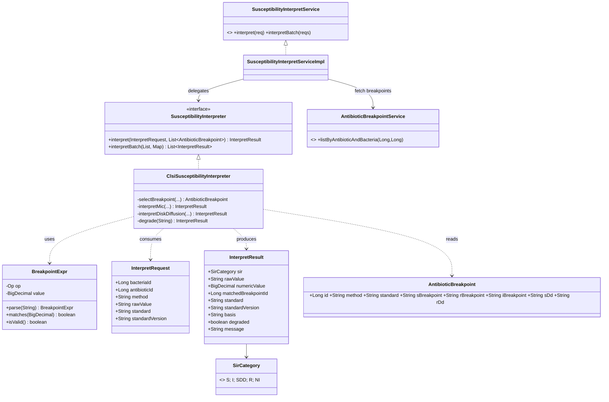
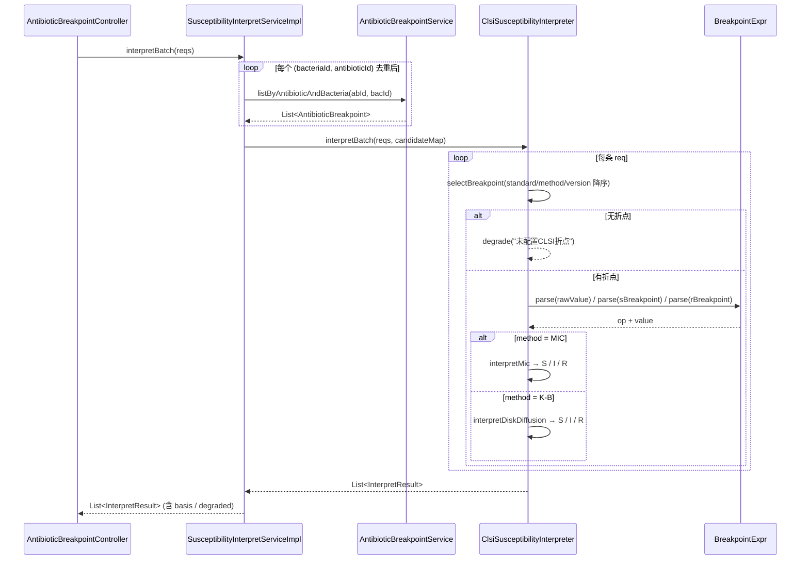
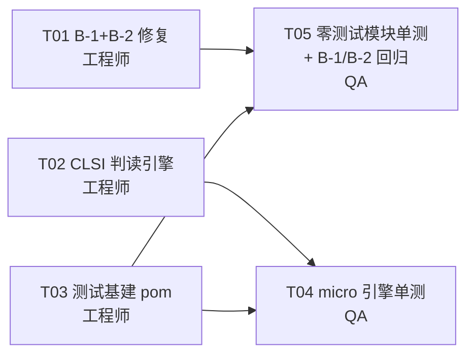

# LIS 增量设计与任务分解（B-1 / B-2 / CLSI 判读引擎 / 单测补齐）

> 架构师：高见远　范围：仅后端 `lis-system/lis-service/`　不改前端　不新增中间件

## 1. 实现取向（Implementation Approach）

三处改动性质不同，采取不同策略：

- **B-1（ESBL 逻辑）**：纯表达式缺陷。根因是 `SensitivityLookup` 只提供单关键词查询，调用方被迫写长链 `||`/`&&`，踩到优先级坑。修法不止于加括号——给 `SensitivityLookup` 增加 **varargs 聚合方法** `isAnyResistant(String...)` / `isAnySusceptible(String...)`，把布尔语义提取为**具名局部变量**，从结构上杜绝复发。
- **B-2（三个空实现）**：缺落库载体。经核查 `init-schema.sql` + `add-technician-batch-fields.sql`，**不存在**补打记录表与签到表，`TechnicianMapper` 也无对应方法。故需新增 2 张表 + 2 组 Mapper 方法（沿用 `TechnicianMapper` 注解式 SQL 风格，不引入 XML）。
- **CLSI 判读引擎**：核心增量。关键设计是**算法与 Spring/DB 解耦**——纯算法类 `ClsiSusceptibilityInterpreter` 不依赖任何容器，Service 层只负责取折点并委托。这样单测无需 Spring 上下文，也满足"沙箱无 Maven、只能静态自检"的约束。
- **不新增判读结果表**（一期）：`lis_antibiotic_sensitivity` 已有 `mic_value` / `result` / `breakpoint` 三列，足以承载判读产物；判读依据（basis）随 DTO 返回不落库。避免跨模块双写不一致。二期若需审计追溯再加 `lis_interpretation_record`。

## 2. 改动清单（File List）

| # | 类型 | 全路径（相对 `lis-system/lis-service/`） | 职责 |
|---|------|------|------|
| 1 | 修改 | `lis-service-report/.../report/service/impl/MicroExpertRuleServiceImpl.java` | 修复 ESBL；`SensitivityLookup` 增 varargs 聚合方法 |
| 2 | 修改 | `lis-service-report/.../report/service/impl/TechnicianServiceImpl.java` | 补全 3 个方法落库 + `@Transactional` |
| 3 | 修改 | `lis-service-report/.../report/mapper/TechnicianMapper.java` | 增 `insertBarcodePrintLog` / `insertSignin` / `closeOpenSignin` |
| 4 | 新增 | `lis-service-report/.../report/entity/BarcodePrintLog.java` | 条码补打记录实体（`lis_barcode_print_log`） |
| 5 | 新增 | `lis-service-report/.../report/entity/StationSignin.java` | 工作站签到记录实体（`lis_station_signin`） |
| 6 | 新增 | `lis-system/docs/database/add-technician-signin-print.sql` | 上述 2 表建表脚本 |
| 7 | 新增 | `lis-service-micro/.../micro/interpret/SirCategory.java` | 枚举 S/I/SDD/R/NI |
| 8 | 新增 | `lis-service-micro/.../micro/interpret/BreakpointExpr.java` | 折点表达式解析值对象（`≤2`/`>=8`/`2`） |
| 9 | 新增 | `lis-service-micro/.../micro/interpret/dto/InterpretRequest.java` | 判读入参 |
| 10 | 新增 | `lis-service-micro/.../micro/interpret/dto/InterpretResult.java` | 判读出参（含依据/降级标记） |
| 11 | 新增 | `lis-service-micro/.../micro/interpret/SusceptibilityInterpreter.java` | 判读器接口 |
| 12 | 新增 | `lis-service-micro/.../micro/interpret/impl/ClsiSusceptibilityInterpreter.java` | **纯算法实现，无 Spring 依赖** |
| 13 | 新增 | `lis-service-micro/.../micro/service/SusceptibilityInterpretService.java` (+`impl/`) | 接入点：取折点 + 委托 + 批量 |
| 14 | 修改 | `lis-service-micro/.../micro/controller/AntibioticBreakpointController.java` | 加 1 个 `POST /interpret` 端点 |
| 15 | 修改 | `lis-service-{sample,reagent,hr,micro}/pom.xml` | 补 test 依赖 + surefire |
| 16 | 新增 | 各模块 `src/test/java/...`（见 §6） | 单元测试 |

## 3. B-1 修复方案（ESBL）

**现状**（第 66-69 行）：`&&` 优先级高于 `||`，实际等价于
`(三代头孢R && 亚胺培南S) || 美罗培南S || Imipenem S || Meropenem S` → **任一碳青霉烯敏感即误报**。

**修正判定式**（表型定义：对第三代头孢菌素和/或氨曲南耐药，且未表现碳青霉烯耐药，同时对碳青霉烯类或β-内酰胺酶抑制剂复方敏感）：

```java
// SensitivityLookup 新增（消除长链布尔）
boolean isAnyResistant(String... kws);
boolean isAnySusceptible(String... kws);

// ESBL 分支
boolean ceph3OrAztreonamR = lookup.isAnyResistant(
        "头孢曲松", "头孢他啶", "头孢噻肟", "氨曲南",
        "Ceftriaxone", "Ceftazidime", "Cefotaxime", "Aztreonam");

boolean carbapenemR = lookup.isAnyResistant(
        "亚胺培南", "美罗培南", "厄他培南",
        "Imipenem", "Meropenem", "Ertapenem");

boolean carbapenemS = lookup.isAnySusceptible(
        "亚胺培南", "美罗培南", "厄他培南",
        "Imipenem", "Meropenem", "Ertapenem");

boolean inhibitorComboS = lookup.isAnySusceptible(
        "头孢哌酮舒巴坦", "哌拉西林他唑巴坦", "阿莫西林克拉维酸",
        "Cefoperazone-Sulbactam", "Piperacillin-Tazobactam", "Amoxicillin-Clavulanate");

if (ceph3OrAztreonamR && !carbapenemR && (carbapenemS || inhibitorComboS)) {
    alerts.add(buildAlert(reportId, organism, "ESBL",
            "疑似产超广谱β-内酰胺酶(ESBL)：第三代头孢菌素/氨曲南耐药，碳青霉烯类或酶抑制剂复方敏感"));
}
```

要点：① 三个条件全部 `&&` 串联，**无混合优先级**；② `!carbapenemR` 保证与 CRE 分支互斥（碳青霉烯耐药时 ESBL 表型被掩盖，应报 CRE 而非 ESBL）；③ 补齐氨曲南与酶抑制剂复方，贴合 CLSI 表型定义。

## 4. B-2 修复方案（三个空实现）

### 4.1 新增表（`add-technician-signin-print.sql`）

```sql
CREATE TABLE IF NOT EXISTS lis_barcode_print_log (
    id BIGSERIAL PRIMARY KEY,
    sample_id BIGINT NOT NULL,
    sample_barcode VARCHAR(64),
    print_type VARCHAR(20) DEFAULT 'REPRINT',  -- FIRST/REPRINT
    copies SMALLINT DEFAULT 1,
    printer_name VARCHAR(64),
    reason VARCHAR(200),
    operator_id BIGINT, operator_name VARCHAR(64),
    print_time TIMESTAMP DEFAULT CURRENT_TIMESTAMP
);
CREATE INDEX IF NOT EXISTS idx_bpl_sample ON lis_barcode_print_log(sample_id);

CREATE TABLE IF NOT EXISTS lis_station_signin (
    id BIGSERIAL PRIMARY KEY,
    signin_type VARCHAR(20) NOT NULL,   -- INSTRUMENT / AUTO_AUDIT
    instrument_id BIGINT,
    operator_id BIGINT, operator_name VARCHAR(64),
    action VARCHAR(10) DEFAULT 'signin',-- signin / signout
    signin_time TIMESTAMP, signout_time TIMESTAMP,
    status SMALLINT DEFAULT 1,          -- 1在岗 0已签退
    remark VARCHAR(200)
);
CREATE INDEX IF NOT EXISTS idx_signin_type_status ON lis_station_signin(signin_type, status);
```

### 4.2 三方法落库规格

| 方法 | 落库动作 | Mapper 方法 | 返回 |
|------|---------|------------|------|
| `batchReprintBarcode` | 逐 sampleId：`selectSampleDetail` 校验存在→取 `sample_barcode`→插 `lis_barcode_print_log`（`print_type=REPRINT`，`copies`/`reason`/`operator` 取自 params） | `insertBarcodePrintLog(sampleId, barcode, copies, printerName, reason, operatorId, operatorName, now)` | `BatchOpResult.of(ids.size(), 实际成功数, 失败明细)` |
| `instrumentSignin` | `action=signin`：先 `closeOpenSignin('INSTRUMENT', instrumentId, now)` 关闭该仪器旧在岗记录（保证单一在岗），再插新记录 `status=1`；`action=signout`：仅 `closeOpenSignin` | `insertSignin(...)` / `closeOpenSignin(type, instrumentId, now)` | `of(1, affected)`；`instrumentId` 为空抛 `BusinessException` |
| `autoAuditSignin` | 同上，`signin_type='AUTO_AUDIT'`、`instrument_id=null`，按 `operator_id` 维度去重 | 复用同两个方法 | `of(1, affected)` |

三者均加 `@Transactional(rollbackFor = Exception.class)`，**返回值改为真实影响行数**（当前恒返回 1/1 会掩盖失败）。

## 5. CLSI 判读引擎设计

### 5.1 实体决策
- **复用** `AntibioticBreakpoint`（`s_breakpoint`/`i_breakpoint`/`r_breakpoint`/`s_dd`/`r_dd`/`standard`/`standard_version`/`method`），**零 schema 变更**。
- **不新增** `ResistanceResult` / `InterpretationRecord` 表（理由见 §1）。判读结果写回既有 `lis_antibiotic_sensitivity.result` + `.breakpoint`。

### 5.2 接口签名

```java
public interface SusceptibilityInterpreter {
    /** 纯函数：给定原始值 + 候选折点集合 → 判读结果，绝不抛业务异常 */
    InterpretResult interpret(InterpretRequest req, List<AntibioticBreakpoint> candidates);
    List<InterpretResult> interpretBatch(List<InterpretRequest> reqs,
                                         Map<String, List<AntibioticBreakpoint>> candidateMap);
}

// InterpretRequest: bacteriaId, antibioticId, method("MIC"/"K-B"),
//                   rawValue(String，如 "≤0.5"/"4"/"18"), standard(默认"CLSI"), standardVersion(可空)
// InterpretResult : sir(SirCategory), rawValue, numericValue(BigDecimal),
//                   matchedBreakpointId, standard, standardVersion,
//                   basis(String 依据文本), degraded(boolean), message(String)
```

### 5.3 判定算法要点

1. **解析原始值**：`BreakpointExpr.parseValue("≤0.5")` → `(op=LE, value=0.5)`；支持 `≤ ≥ < > =` 与半角 `<= >=`；`>64` 等含前缀值保留 op 供边界仲裁。非数值 → 降级。
2. **选折点**：`candidates` 先按 `status=1` 过滤 → `standard` 匹配（默认 CLSI）→ `method` 匹配 → 按 `standardVersion` **字典序降序取最新一条**（如 M100-2023 > M100-2021）。多条同版本取 id 最小，保证判读**确定性可复现**。
3. **MIC 法**（值越小越敏感）：
   - `value ≤ S阈值` → **S**
   - `value ≥ R阈值` → **R**
   - 落中间：若 `i_breakpoint` 有配置且命中 → **I**；未配置但 S/R 阈值均存在 → **I**（推定中介）
   - 边界仲裁：`op=LE` 且 `value` 恰等 S 阈值 → S；`op=GE/GT` 且 `value` 恰等 R 阈值 → R
4. **K-B 法**（抑菌圈直径，**方向相反**）：`value ≥ s_dd` → S；`value ≤ r_dd` → R；否则 I。**这是最易写反的点，必须有专门用例。**
5. **降级处理（关键）**——任一情形返回 `SirCategory.NI` + `degraded=true` + 明确 `basis`，**不抛异常、不阻断报告流程**：
   - 无匹配折点 → `basis="未配置CLSI折点(bacteriaId=X, antibioticId=Y, method=Z)"`
   - 折点字符串解析失败 → `basis="折点表达式非法: '≤abc'"`
   - `rawValue` 非数值（如 "NG"/"未检测"）→ `basis="原始值非数值"`
   - `s/r` 阈值缺失 → `basis="折点不完整"`
   - **降级时若入参已带人工 `result`，Service 层保留人工值不覆盖**（人工优先）。

### 5.4 接入点

在 micro 模块新增 `SusceptibilityInterpretService`（Spring bean，依赖 `AntibioticBreakpointService`）：

```java
InterpretResult interpret(InterpretRequest req);                 // 单条
List<InterpretResult> interpretBatch(List<InterpretRequest> reqs);// 批量，按(菌,药)预取折点，避免 N+1
```

`AntibioticBreakpointController` 仅加 `POST /micro/breakpoint/interpret`（单条+批量共用），**不动其他 Controller**。report 模块药敏录入侧后续通过该端点接入（跨微服务，本期不改 report 药敏流程）。

### 5.5 类图



### 5.6 调用时序



## 6. 单元测试计划（JUnit5 + Mockito，不加载 Spring）

| 模块 | 测试类（`src/test/java/...`） | 覆盖要点 | 用例数 |
|------|------|---------|-------|
| micro | `micro/interpret/BreakpointExprTest` | `≤2`/`>=8`/`<0.5`/`4`/全角半角/非法串 | ~8 |
| micro | `micro/interpret/ClsiSusceptibilityInterpreterTest` | **MIC S/I/R 三分支 + 边界等值 + K-B 反向 + 版本择新 + 5 类降级** | ~16 |
| micro | `micro/service/SusceptibilityInterpretServiceImplTest` | mock `AntibioticBreakpointService`，验批量去重取折点（无 N+1）、人工值不被覆盖 | ~5 |
| sample | `sample/service/impl/SampleServiceImplTest` | 状态机：采集/送检/签收正向，及 `cancelDeliver`/`cancelSignOff` 逆向的前置状态校验与非法态抛错 | ~10 |
| sample | `sample/service/impl/SampleServiceTubeGroupTest` | `calculateTubeGroups`：mock `JdbcTemplate.queryForList`，验同管同标本类型合并、未绑管独立成组、空结果、跨申请合并 | ~6 |
| sample | `sample/service/impl/BarcodeServiceImplTest` | 双通道规则生成（纯数字/年月日+序号/字母+数字）、`validateBarcode` 唯一性、规则停用回退 | ~8 |
| reagent | `reagent/service/impl/ReagentStockServiceImplTest` | `outStockFifo`（按入库时间先进先出、跨批次拆分、库存不足抛错、过期批次跳过）、`listBelowSafetyStock`、`lockExpiredStock` | ~12 |
| hr | `hr/service/impl/StaffAuthorizationServiceImplTest` | `hasAuthorization`：有效期内/已过期/未生效/status=0/scope 匹配与不匹配/scope 为空 | ~7 |
| hr | `hr/service/impl/StaffCertificateServiceImplTest` | 证书到期扫描窗口边界（今日到期/临界 N 天/已过期） | ~5 |
| report | `report/service/impl/MicroExpertRuleServiceImplTest` | **B-1 回归**：碳青霉烯敏感但三代头孢敏感→不报 ESBL；三代头孢耐药+美罗培南敏感→报；CRE 场景不报 ESBL；MRSA/VRE/CRAB/MDR 既有分支不回归 | ~10 |
| report | `report/service/impl/TechnicianServiceSigninTest` | **B-2 回归**：verify Mapper 被调用且次数正确、失败计数、`instrumentId` 为空抛错、signout 只关不插 | ~8 |

**测试关键约束（工程师/QA 必读）**：MyBatis-Plus `ServiceImpl` 的 `list()/count()/save()` 依赖 `TableInfo` 静态注册，直接 `@InjectMocks` 易触发 `NullPointerException`。**统一采用 `spy(new XxxServiceImpl())` + `doReturn(...).when(spy).list(any())` 桩化父类方法**，避开 MyBatis-Plus 静态初始化；仅当被测方法直接调用自注入的 Mapper/Service 字段时才用 `@Mock` + `@InjectMocks`。`ClsiSusceptibilityInterpreter` 为纯 POJO，直接 `new` 即可，无需任何 mock。

## 7. 依赖包

| 模块 | 动作 |
|------|------|
| `lis-service-report` | **复用**已有 `junit-jupiter:5.10.2` + `mockito-core:5.11.0` + `mockito-junit-jupiter:5.11.0` + `surefire:3.2.5`，**勿重复添加** |
| `lis-service-sample` / `reagent` / `hr` / `micro` | **新增**上述 4 项，版本与 `lis-service-qc/pom.xml` **逐字一致**（避免版本漂移） |
| 其他 | **无需**任何新的运行时依赖。判读引擎仅用 JDK（`BigDecimal`/`regex`），不引入规则引擎/表达式库 |

## 8. 共享约定（Shared Knowledge）

- 包路径：micro 判读引擎统一 `com.lis.micro.interpret`（算法）与 `com.lis.micro.service`（接入），勿混放。
- 数值一律 `BigDecimal`，`compareTo` 比较，**禁止** `double`/`equals`。
- 判读器**只返回不抛出**；业务异常仅在 Service 层参数校验时抛 `com.lis.common.core.exception.BusinessException`。
- 新表 SQL 一律 `IF NOT EXISTS`，放 `lis-system/docs/database/`，命名 `add-*.sql`，执行序在 `init-schema.sql` 之后。
- 新 Mapper 方法沿用 `TechnicianMapper` 的注解式 SQL（`@Insert`/`@Update`），**不建 XML**。
- 批量方法返回 `BatchOpResult.of(total, success, msgs)`，`success` 必须来自真实影响行数。
- 单测命名 `方法名_场景_预期`（如 `interpretMic_valueEqualsSBreakpoint_returnsS`），中文 `@DisplayName` 可选。

## 9. 任务列表

| ID | 任务 | 归属 | 涉及文件 | 依赖 | 优先级 |
|----|------|------|---------|------|-------|
| **T01** | **修复 B-1 + B-2**：ESBL 判定式重写 + `SensitivityLookup` varargs 化；新增 2 实体 + 建表 SQL；`TechnicianMapper` 增 3 方法；三个空实现补全落库与事务 | 工程师 | 清单 #1~#6 | 无 | P0 |
| **T02** | **CLSI 判读引擎**：`SirCategory`/`BreakpointExpr`/2 个 DTO/接口/`ClsiSusceptibilityInterpreter`/`SusceptibilityInterpretService(+Impl)`/Controller 加 1 端点 | 工程师 | 清单 #7~#14 | 无（与 T01 并行） | P0 |
| **T03** | **测试基建**：4 个 pom 补 test 依赖 + surefire（照抄 qc pom） | 工程师 | 清单 #15 | 无 | P0 |
| **T04** | **micro 引擎单测**：`BreakpointExprTest` / `ClsiSusceptibilityInterpreterTest` / `SusceptibilityInterpretServiceImplTest` | QA | micro `src/test` | T02, T03 | P0 |
| **T05** | **零测试模块单测 + B-1/B-2 回归**：sample 3 类、reagent 1 类、hr 2 类、report 2 类回归 | QA | sample/reagent/hr/report `src/test` | T01, T03 | P1 |



## 10. 待明确事项

1. **B-2 落库表命名**：代码库中确实无补打/签到表（已核 `init-schema.sql`、`add-technician-batch-fields.sql`、`TechnicianMapper` 全量）。本设计**建议新建** `lis_barcode_print_log` 与 `lis_station_signin`。若贵方已有院内既定表名/字段规范，请覆盖本方案。
2. **仪器当前操作人**：`instrumentSignin` 是否需同步回写 `lis_instrument` 的"当前操作人"字段？该字段现不存在，本期**仅写签到表**，如需回写请确认是否可 `ALTER TABLE lis_instrument`。
3. **签到唯一性粒度**：`AUTO_AUDIT` 按 `operator_id` 还是按 `operator_id + 专业组` 去重？当前按 `operator_id`。
4. **ESBL 与 CRE 互斥**：本设计在碳青霉烯耐药时**不报 ESBL**（只报 CRE），符合表型判读惯例。若临床希望两者并报，请告知，改为去掉 `!carbapenemR` 条件。
5. **SDD 类别**：CLSI 部分药物（如头孢吡肟对肠杆菌目）有 SDD（剂量依赖敏感）。`AntibioticBreakpoint` 现无 SDD 字段，枚举已预留 `SirCategory.SDD` 但**本期不产出**。是否需要二期补字段？
6. **判读依据是否需落库审计**：一期不落库（仅 DTO 返回）。若 CNAS/等保要求可追溯，需二期加 `lis_interpretation_record`。
7. **报告侧接入时机**：本期 micro 只提供端点，report 药敏录入流程**未接线**。是否需本期就在 `MicroReportServiceImpl.addSensitivity` 中远程调用？（涉及跨服务 Feign，建议下期）
